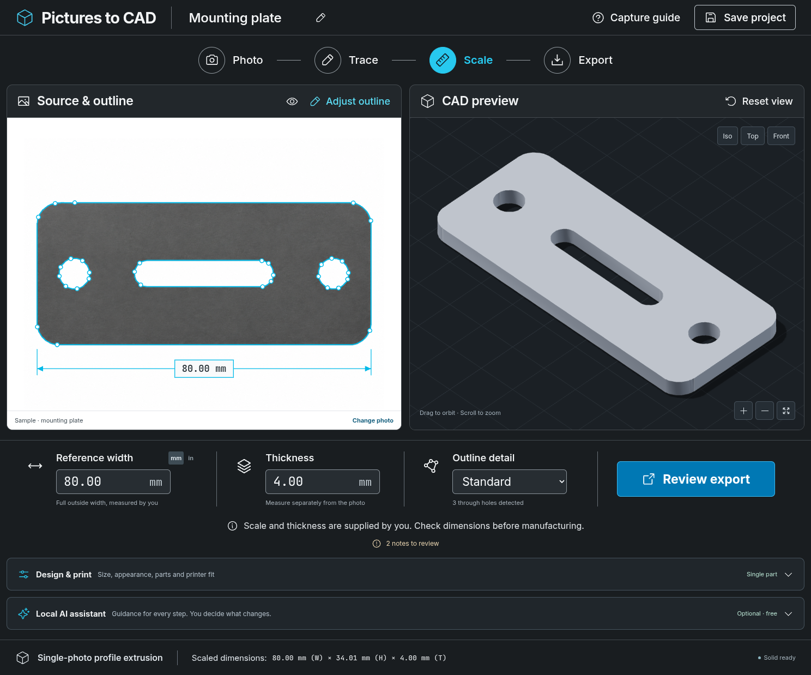

# Pictures to CAD

Turn a photograph of a **flat, constant-thickness part** into a scaled CAD solid. Review the traced outline beside an interactive 3D model, enter a real width and thickness, then export for your next tool.

The workbench is designed for plates, gaskets, spacers, and templates. It traces what is visible in the photograph; it does not recover hidden geometry or infer physical dimensions.

This repository contains two related tools:

| Component | Use it for | Entry point |
| --- | --- | --- |
| Photo-to-CAD workbench | Trace, measure, review, and export a flat part | `make start` after setup |
| Reference library | Read the handbook, compare workflows, and use standalone calculators | [Open the library](reference-library/index.html) or [read its guide](reference-library/README.md) |



Browser-rendered workbench with the demonstration part. The source photo is generated sample imagery; the displayed solid is constructed from its traced outline.

## Start the app

Use **Python 3.12** (setup finds `python3.12` even when `python3` is another version, or set `PICAD_PYTHON`), Node.js 22.12 or later (24 recommended), npm, and GNU Make. Setup uses [uv](https://docs.astral.sh/uv/) if available, or installs a pinned local copy. From this repository:

```bash
make setup
make start
```

Setup prepares the workbench and reference-library dependencies in separate local environments and builds the workbench interface. Startup runs the API and built interface together. No account, paid API, GPU, or third-party AI credential is required. Setup does not download Ollama models, browsers, OpenSCAD, or system fonts.

For workbench-only setup, use `make setup-app`. The existing `./scripts/setup.sh` and `./scripts/start.sh` commands remain supported and apply only to the workbench.

The server listens on the local machine at port **8000**. In a managed cloud environment, use the environment's supported browser or forwarding mechanism. A server running on a remote machine is not your device's localhost.

For development with frontend hot reload:

```bash
make dev
```

See [development and setup](docs/development.md) for prerequisites, commands, and troubleshooting.

## Optional local AI guidance

Open **Local AI assistant** for help with capture, tracing, design changes, print planning, and export choices. Choose an installed Ollama model, ask a question, and review its answer. Suggestions show their proposed settings before an explicit **Apply**, with undo available. You still enter measured dimensions and decide when to build and export.

The assistant uses your question, measurements, trace and design settings, warnings, and built-part dimensions; it does not receive the photograph, outline, or mesh. It runs on the same machine as the CAD backend, with no paid API or cloud-model fallback. The regular CAD workflow works without it.

For the included Linux x86_64 setup:

```bash
./scripts/ollama.sh install
./scripts/ollama.sh serve
```

Keep that terminal running. In another terminal, download the initial small model:

```bash
./scripts/ollama.sh pull qwen3:1.7b
```

Refresh the assistant's connection after the download. This is a provisional CPU-friendly starting model, not a measured quality winner. See [local AI setup and controls](docs/ollama.md) and the [model comparison plan](docs/ollama-models.md). The recorded cloud setup has a verified Ollama runtime, but model downloads and live comparisons are pending network access.

## Try the complete workflow

1. **Start with the sample.** The supplied demonstration image is traced and converted by the same pipeline as an uploaded photograph.
2. **Choose a photo.** Upload a PNG, JPEG, or WebP containing one flat part against a contrasting background.
3. **Review the outline.** Check the boundary and every through-hole. Adjust the tracing controls if the selection is wrong.
4. **Set the dimensions.** Enter the measured width of the entire part along the image's horizontal axis, then enter its measured thickness separately.
5. **Choose design and print settings.** Keep the measured size or set explicit XY and thickness scales, preview a color and material, choose a printer or custom volume, and decide whether to keep one piece or generate straight-cut parts.
6. **Inspect and export.** Rotate the model, compare it with the photograph, rebuild after edits, review each piece's geometric bed fit, and choose a format.

The sample's dimensions are demonstration inputs, not measurements recovered from the photograph. Measure your own part before using its output.

Design scales preserve those source measurements: an 80 mm reference width at 125% requests a 100 mm design, while the entered reference remains 80 mm. Thickness scale is separate. Geometry-detail approximation may alter the resulting outline, so check the built dimensions. Color and material affect the approximate preview and saved plan; they do not simulate strength or select a filament spool.

Printer fit compares actual part bounds with the chosen usable volume, including a possible 90° XY rotation. It does not generate toolpaths or account for supports, adhesion, machine clearances, or material behavior. Review exported parts in your slicer. See [print planning](docs/print-planning.md).

The bundled searchable [printer catalog](docs/printer-catalog.md) covers 429 model groups across 70 manufacturer/profile families, with nozzle-specific source profiles and links. It works offline. Hardware capabilities absent from those sources are shown as unknown; custom printer dimensions remain available.

## What you can export

| Format | Use it for | What it preserves |
| --- | --- | --- |
| STEP | Opening solids in CAD software | Solid geometry in assembled positions; not the original feature history |
| STL | Slicing or mesh workflows | Triangle surfaces in assembled positions; millimeter coordinates, no color |
| DXF | A flat profile for a CAD or CAM workflow | The planar boundary and holes |
| Parts ZIP | Importing generated pieces separately | A STEP and STL per piece, plus a manifest |
| Project JSON | Restoring the workbench settings | Version 2 outline, measured inputs, design and print plan; version 1 imports remain supported |

See [export formats and dimensional checks](docs/exports.md) before transferring a part to fabrication software.

## Honest limits

- A single image supplies a 2D outline. Thickness is entered by the user; recesses, sloped walls, threads, and hidden features are not reconstructed.
- One reference width sets uniform scale. It does not correct perspective, lens distortion, or an out-of-plane part.
- Tracing approximates pixel boundaries. Smooth-looking geometry is not evidence of manufacturing accuracy.
- Relative detail can simplify the CAD outline; it does not recover missing image detail or establish a minimum printable wall thickness.
- Split exports use straight cuts without joinery, kerf, or assembly tolerances. Combined STEP/STL exports show the assembled geometry, not separated parts arranged on a print bed.
- The browser sends images to the app's backend. On a cloud host, that means uploading to that host; processing is not browser-only.
- This release is a single-user workbench, not a hosted account or collaboration service.

## Documentation

- [Capture and calibration guide](docs/capture-guide.md)
- [Export formats](docs/exports.md)
- [Print planning, materials, and split parts](docs/print-planning.md)
- [Printer catalog, provenance, and updates](docs/printer-catalog.md)
- [Development and setup](docs/development.md)
- [Optional local AI: setup and controls](docs/ollama.md)
- [Local model choices and comparison](docs/ollama-models.md)
- [Architecture and API](docs/architecture.md)
- [Data handling and security boundaries](docs/privacy-security.md)
- [Troubleshooting](docs/troubleshooting.md)
- [Research and design decisions](docs/research.md)
- [Scope and roadmap](docs/roadmap.md)
- [Validation results](docs/validation.md)
- [Visual QA report](design-qa.md)

## Reference library

Revision 6 adds independent measurement worksheets, clearer source search, and portable photo backup/restore, with 88 annotated sources.

[`reference-library/`](reference-library/README.md) is the companion reference for work beyond one flat part. Open `reference-library/index.html` in a browser; it works offline. It covers:

- **Handbook:** 23 chapters on capture, scale and calibration, reconstruction workflows, CAD drawings, print design, and validation
- **Source catalog:** 88 annotated sources, each labeled with its depth of review
- **Toolkit:** 14 calculators and a route finder, with the same arithmetic available as `python3 -m cadkit` from the `reference-library/` directory
- **Photos:** an offline reference-photo workspace. Add photos in batches, label viewpoints, keep notes, and estimate a flat dimension from a known length. Protect unsaved edits, back up originals and notes to a folder, restore a reference set, and export image-derived measurements. Photos stay in that browser's local storage and are separate from the workbench's uploads.
- **Worksheets and examples:** project worksheets and an OpenSCAD example pipeline
- **Mesh check for workbench exports:** `python3 -m cadkit meshcheck model.stl --expect-mm 80` independently checks an exported STL for closure, manifoldness, and orientation, and reports its genus (through-holes) for comparison with the workbench's hole count. See [export checks](docs/exports.md#check-an-stl-independently).

The root `make build-library` and `make test-library` commands operate on this component. Its own Makefile and [CI workflow](.github/workflows/reference-library.yml) remain available. See [its README](reference-library/README.md) and [verification record](reference-library/VERIFICATION.md).

## Checks

From the repository root:

```bash
make test
make lint
```

`make test` runs the workbench's Python tests, frontend type check/build, and browser scenarios, followed by the reference library's Python/Node tests and its three browser checks (the page, Photos workspace, and portable backup/restore) over loopback HTTP. `make lint` runs the workbench Python and frontend/browser-source lint/format checks. Use `make test-app` or `make test-library` to work on one component; `make` lists the available commands.

Browser checks use an installed Chromium or Google Chrome; if neither is available, run `npx playwright install chromium`. OpenSCAD-dependent library tests may skip when OpenSCAD is absent; `make setup` does not install it. See [development prerequisites](docs/development.md) for browser, PDF/font, and OpenSCAD requirements. The [validation report](docs/validation.md) distinguishes recorded successful runs from checks that have not yet run. A successful synthetic fixture does not establish dimensional accuracy for an arbitrary real-world photograph.

Separate GitHub Actions workflows validate the [workbench](.github/workflows/ci.yml) and [reference library](.github/workflows/reference-library.yml). Recorded results apply to their stated commits; see the validation report for execution evidence.

## License

[MIT](LICENSE). Dependencies retain their own licenses. Bundled printer-profile data has its own [source attribution and license record](data/PRINTER_SOURCES.md). The demonstration photograph is generated example content, not a certified reference object.
