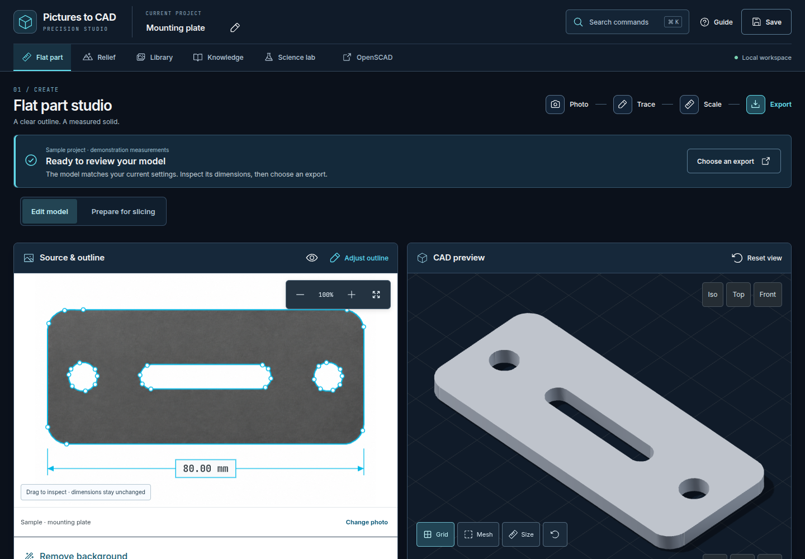

# Pictures to CAD

A local studio for turning a measured photograph of a flat part into editable CAD, preparing a print plan, and understanding the assumptions behind the result.

Trace a plate, gasket, spacer or template. Set scale from a real measurement, enter thickness, inspect the solid, and export to CAD or a slicer. Separate studios create reliefs and lithophanes, organize source photos, and explain the measurement workflow with interactive scientific scenarios.

[Get started](docs/getting-started.md) · [Workflows](docs/workflows.md) · [Documentation](docs/README.md) · [Troubleshooting](docs/troubleshooting.md)



## Start locally

Requirements: **Python 3.12**, **Node.js 22.12+**, npm and GNU Make. Setup finds `python3.12`, or accepts `PICAD_PYTHON` pointing to a Python 3.12 interpreter.

```bash
make setup
make start
```

Keep the terminal open and visit [Pictures to CAD](http://127.0.0.1:8000). The default server binds to your computer's loopback address. `make setup-app` installs only the workbench; `make dev` starts frontend hot reload. See [setup details](docs/development.md) for platform requirements and commands.

The basic workflow needs no account, GPU, paid API or AI credential. Setup installs application dependencies; it does not install a native slicer or OpenSCAD, download optional AI weights, or send a model to a printer.

## A workspace for each step

| Workspace               | What works here                                                                                                                                        | What to check yourself                                                                     |
| ----------------------- | ------------------------------------------------------------------------------------------------------------------------------------------------------ | ------------------------------------------------------------------------------------------ |
| **Flat part**           | Trace a planar outline and through holes; calibrate from measured width, known features or a suitable reference sheet; build constant-thickness solids | Independent dimensions, important radii and the source photograph                          |
| **Quick edit**          | Set target width and thickness, keep XY proportions, use size presets, undo/redo design settings                                                       | Whether the intended size still meets your fit requirement                                 |
| **Prepare for slicing** | Select printer bounds; split into straight-cut parts; plan layers, walls, infill, supports and adhesion; inspect each piece over a bed envelope        | Native printer/material settings, orientation, supports and sliced layers                  |
| **Project library**    | Save and reopen editable flat-part snapshots, find them by name or tag, and record print status and attempts                                         | Keep portable recipe downloads and your source photos separately                           |
| **Relief**              | Convert photos, depth maps or elevation maps into reliefs, lithophanes and supported spherical forms                                                   | Surface interpretation, wall thickness, actual material transmission and print orientation |
| **Photo library**       | Index photos, rank sharpness, identify copies and inspect source images; optional local vision features add similarity/grouping                        | Whether suggested images show the same actual part                                         |
| **Knowledge**           | Search task guides, follow concrete steps and keep local reading notes                                                                                 | Which assumptions apply to your part                                                       |
| **Science lab**         | Explore scale sensitivity, ideal layer counts and measured-clearance scenarios with editable values                                                    | Real measurement uncertainty, slicer behavior and physical fit                             |
| **OpenSCAD**            | Open the companion handbook, calculators and parametric examples                                                                                       | External edits and native rendering separately from the workbench recipe                   |

Use **Search commands** or **Ctrl/Cmd+K** to find a workspace or supported action. Escape closes the launcher. Visited studios keep their current edits while navigating in the same page; save a project before reloading or closing the browser.

## First successful model

1. Open **Flat part**. The included mounting plate is a demonstration with an 80 mm reference width and 4 mm thickness.
2. Inspect the outline and through holes beside the generated solid. Use **Quick edit** to choose a target size without replacing the reference measurements.
3. Update the model after an edit. A stale preview cannot authorize downloads for the new settings.
4. Open **Prepare for slicing**, choose a process starting point, and review printer dimensions under **Printer & split settings**.
5. Build the updated plan, then **Review slicer handoff**. Save the editable project and download a package for your chosen slicer.

For your own part, start with a front-on photograph and real measurements. The [getting-started guide](docs/getting-started.md) explains each decision; the [capture guide](docs/capture-guide.md) helps avoid scale and perspective errors.

## Export and continue

| Destination                                                          | Output                                                                              |
| -------------------------------------------------------------------- | ----------------------------------------------------------------------------------- |
| CAD editor                                                           | STEP solid, or generated OpenSCAD source                                            |
| 3D slicer                                                            | Millimeter 3MF or STL; separate files for split parts                               |
| Bambu Studio, PrusaSlicer, QIDI Studio, OrcaSlicer or UltiMaker Cura | Targeted ZIP with geometry, recipe, process plan, instructions and SHA-256 manifest |
| Cutter or vector editor                                              | DXF or SVG planar profile                                                           |
| Paper template                                                       | PDF with actual-size rulers to verify after printing                                |
| This workbench                                                       | JSON recipe containing the source outline and editable settings                     |

Slicer packages contain **geometry and planning notes**, not native process presets or G-code. Enter and review the planned settings in your slicer, inspect its layer preview, and save its native project there. The optional local launcher is off by default and requires an explicit action. See [slicer integration](docs/slicers.md) and [export contracts](docs/exports.md).

Optional **Remove background** uses the reviewed outline to create a separate transparent PNG in the browser, preserving through holes and the working photo's colors. It does not retrace the part or change CAD geometry.

## Measurement and evidence

A photograph supplies visible shape. A known length supplies scale. Entered thickness supplies the extrusion depth. The app does not recover hidden surfaces, arbitrary 3D geometry, real tolerances or material strength from one image.

The bed display is an inspection of a mesh over a rectangular envelope. Its view controls do not rotate the exported model. A checked geometric fit does not include supports, adhesion structures, excluded bed zones, toolpaths or physical printing. The Science lab explores explicit numerical assumptions; it does not certify accuracy or compensate the current CAD model automatically.

The [science guide](docs/science.md), [engineering model](docs/engineering-model.md) and [research index](docs/research-index.md) keep application methods, experimental Python APIs and historical studies distinct. Recorded test counts and case studies remain bound to their own revisions and inputs.

## Design from common shapes

Open **Shape designer** to combine rectangles, rounded rectangles, circles, slots, triangles and hexagons, add through cutouts, and watch the CAD preview update automatically. Save the editable design or export STEP/STL/DXF. See the [shape designer guide](docs/shape-designer.md).

## Creative tools

**Image inspection** adds browser-local histograms, contrast/exposure readings,
selected regions and A/B comparison, with unchanged-original handoff to CAD.
See the [image inspection guide](docs/image-inspection.md).

Open **Creative tools** to explore design directions, refine an idea, or plan the making with an installed local Ollama chat model. Save generated notes with the submitted brief and use the searchable toolkit to open a making workspace. See [creative tools and extension guide](docs/creative-tools.md).

## Local data and optional models

Flat-part and relief uploads are processed by the running CAD backend. Temporary model jobs expire; downloaded files remain yours to keep. The photo library has separate persistent storage and original-file rules. Browser notes and saved scenarios belong to the browser profile and origin; export them for a portable copy. Read [privacy and security](docs/privacy-security.md) before using sensitive source material.

Optional local capabilities are documented separately: [Ollama text guidance](docs/ollama.md), [AI depth](docs/relief.md#ai-depth-from-an-ordinary-photo), and [DINOv3 photo features](docs/photo-library.md#optional-vision-model). They require their own installed services or model files and are not prerequisites for measured flat-part CAD.

## Develop and verify

```bash
npm run typecheck
npm run test:unit
.venv/bin/python -m pytest -q
npm run build
npm run test:e2e
```

Browser tests need an installed supported browser; `PLAYWRIGHT_CHROMIUM_EXECUTABLE` selects one. `make lint`, `make smoke`, and `make slicers` provide formatting, running-service and read-only slicer checks. `make test` also checks the separate companion reference library. See [development](docs/development.md), [architecture](docs/architecture.md) and [contributing](docs/contributing.md).

Local tests, rendered-browser checks, native slicer import, slicing and physical print acceptance are separate results. See the [validation overview](docs/validation.md) for recorded evidence and scope.

## License

See [LICENSE](LICENSE). The reference library documents the licenses and sources of its cited material; external slicers and optional models retain their own licenses.
