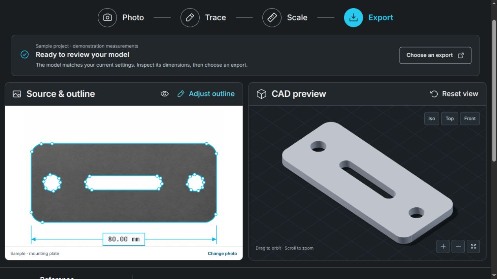

# Design QA records

This page connects the workbench's recorded design reviews. It is not a claim that
older screenshots, test totals or runtime observations validate the current
checkout. No browser, geometry or accessibility tests were rerun for this
documentation refresh.

The [current documentation review](docs/validation/documentation-codecell-result.md)
also links a [separate local recovery prototype](docs/finite-acquisition-recovery.md).
Its focused tests and synthetic study do not change the reviewed interface below
or add acquisition-fitting controls to the workbench.

## Latest recorded workbench review — November 11, 2026

The [guided workbench review](docs/validation/guided-workbench.md) records the
source/CAD experience, implemented recovery changes, accepted screenshots and
local regression results. Its scope is input and digital-model readiness,
separate from manufacturing acceptance.

| Step | Recorded result | Health in the reviewed flow |
| --- | --- | --- |
| 1. Open the sample | Demonstration measurements are labeled; the Next step guide, active workflow stage and footer share actual readiness. | Good in recorded desktop/phone views |
| 2. Edit a measured dimension | Previous geometry stays marked outdated; Update preview rebuilds without opening Export and preserves the keyboard correction path. | Good in recorded cases |
| 3. Collapse invalid design settings | The cause stays visible and Fix design settings opens the existing panel. | Recovery fixed in recorded cases |
| 4. Save an invalid recipe from Export | Export closes; the independent height check opens and focuses the failed measurement or missing decision input. Common downloads remain visible and specialist formats are expandable. | Recovery fixed in recorded cases |

The same review includes [phone evidence](docs/images/guided-workbench-mobile.png),
blocked-setting and save-correction captures, arithmetic checks and explicit
AI-response fixtures. See the separate [engineering-check audit](docs/validation/engineering-audit.md)
for source-height decision behavior, and [validation records](docs/validation.md)
for revision/run boundaries. Native screen-reader behavior, complete WCAG
conformance, real-photo accuracy and physical print acceptance remain outside
these records. Use the [documentation index](docs/README.md) for current usage.

## Historical option 2 comparison — November 8, 2026

The original workbench was compared with the selected option 2 reference in
paired full-view and native-density control captures. The subsequent design,
printing and local-assistant follow-up retained that composition. The following
observations and test counts describe those earlier reviews only; they are
preserved as design history, not current proof.

### Historical evidence and comparison conditions

- Source visual truth: [selected design](docs/images/design-reference.png), the second displayed concept selected by the user; 1487 × 1058 pixels.
- The earlier implementation review recorded a 1488 × 1238 document at a 1488 × 1058 CSS viewport and device scale factor 1. The [desktop documentation image](docs/images/workbench.png) was later refreshed and does not preserve that earlier capture's dimensions or state; use the paired historical comparisons below for the original visual comparison.
- Historical state: supplied sample successfully traced and built; 80 mm reference width, 4 mm thickness, standard outline detail, Scale workflow, no dialog open. The implemented guide now marks a current model at Export rather than always highlighting Scale.
- [Paired full-view comparison](docs/images/design-comparison.png): both source and implementation displayed at half size in the same browser capture. The source's one-pixel narrower native width is retained and is not treated as a visual defect.
- [Paired control comparison](docs/images/design-comparison-controls.png): source and implementation dimension controls and footer at native pixel density, cropped through browser layout without modifying either original image.
- The earlier mobile review recorded a 390 × 844 CSS viewport, device scale factor 1 and a 390 × 1615 full document, without horizontal overflow. The [mobile documentation image](docs/images/workbench-mobile.png) was later refreshed; the latest recorded guide evidence is linked above.
- Chromium rendered the actual source image, contour canvas, and CAD mesh. The test waits for the model's real `onAfterRender` readiness marker before capturing. The 3D scene is not a screenshot placeholder.

### Historical fidelity surfaces

| Surface | Assessment |
| --- | --- |
| Fonts and typography | Locally bundled Inter Variable and JetBrains Mono Variable reproduce the reference's product/technical hierarchy. Desktop brand, project, panel headings, numerical fields, and footer were enlarged after the first comparison. Mobile helper text was increased to 11 px to remain readable. No external font request is required. |
| Spacing and layout rhythm | Equal source/model panels, header, four-stage workflow, horizontal dimension controls, and bottom summary follow the selected composition. The original footer fit in 1058 px. At that follow-up, collapsed Design & print and Local AI panels, plus review notes, extended the document to 1238 px. Vertical scrolling is intentional; main dimensions and export controls retain their position. Mobile panels stack and all core controls remain reachable. |
| Colors and tokens | Charcoal surfaces, cyan outline and active stage, restrained dividers, and the blue primary action are retained. The primary action intentionally uses darker blue `#0078b4`, giving approximately 4.83:1 contrast with white text. Flat product surfaces replace decorative raster gradients. |
| Image quality and asset fidelity | A generated source photograph is traced through the real backend. The original release used a generated brushed-metal texture for cosmetic shading. The follow-up viewer used the selected solid color and an approximate filament finish on the actual CAD mesh. The floor and grid were darkened; lighting, framing, and camera angle were refined. Phosphor icons supply the standard UI iconography. |
| Copy and content | The main workflow and action hierarchy match the reference. “Reference width” explicitly describes the supported calibration. “Scaled dimensions” avoids presenting user-supplied scale as an independent measurement. Sample labeling, upload handling, stale results, and export units provide essential product context. |

### Comparison history

1. **Initial rendered review — blocked.** [Initial capture](docs/images/workbench-initial.png), 1488 × 1096 for a 1488 × 1058 viewport. P2: footer below the intended frame, undersized desktop typography, low-contrast primary action, overly pale/flat model material, and a lighter-than-reference floor. The source canvas also showed an unnecessary background boundary.
2. **First refinement.** [Material/layout capture](docs/images/workbench-material-refinement.png). Enlarged typography, darker compliant primary blue, white source background, removal of redundant STL guidance from the main workbench, and reduced panel height corrected the layout and contrast issues. A generated metal texture, revised lighting, and darker floor corrected the material appearance. Remaining P2: the model occupied too little of the CAD viewport.
3. **Original final desktop comparison — passed.** Both paired comparisons above record that release. Revised isometric orientation and fit margins increased model prominence without changing its vertices, and grid opacity was reduced. The main documentation screenshot has since been refreshed; the paired comparisons preserve this historical review.
4. **Mobile refinement — passed.** Helper text that was too small was increased to 11 px. The affected keyboard/accessibility/mobile browser test passed again; the review recorded the revised layout before later documentation-image refreshes.

### Historical functional and accessibility evidence

The original six browser scenarios, rerun successfully within that release's 15-scenario suite, cover sample conversion and real downloads, edited dimensions and stale exports, exact mm/in conversion, saved-project recovery, own-photo calibration, malformed upload recovery, keyboard dialog focus and Escape, mobile overflow, missing export recovery, and temporary-export cleanup. The sample scenario checks browser console errors and page exceptions; none occurred. The rendered workbench had zero violations in the selected axe-core WCAG A/AA checks. This is not a claim of complete accessibility conformance or a substitute for assistive-technology user testing.

The environment's `sites-preview` relay was unavailable. Browser verification used actual Chromium against the running app and development proxy, with screenshots and interaction tests; no hosted preview or deployment is claimed.

### Historical design, print and local-assistant follow-up

The recorded run for those earlier design, print, and assistant changes passed 142 Python tests, production typecheck/build, and 15 browser scenarios. Additional scenarios cover reviewed multi-setting suggestions, explicit rejection, Undo after building, stale responses, saved recipes, printer search, actual parts ZIP geometry, and mobile accessibility. The viewer keeps a stable canvas across model changes; both a multipart-build regression and genuine context-loss recovery were tested and corrected before this passing run.

Actual rendered evidence, without AI-response fixtures:

- [Design and print controls](docs/images/design-print.png), 1464 × 1241, and [mobile controls](docs/images/design-print-mobile.png), 366 × 1997, at a 390 px viewport.
- [Separated actual pieces](docs/images/separated-pieces.png), 723 × 572. The original 80 mm / 4 mm source measurements remain intact; 150% XY and 125% thickness produce a 120 × 51.02 × 5 mm assembly. Two real pieces are shown with display-only separation and Ocean/PETG appearance.
- [Printer profile facts](docs/images/printer-profile.png) show the selected Prusa MK4S nozzle profile, declared limits, unknown hardware details, and source attribution.
- [Local assistant](docs/images/local-assistant.png) and [mobile assistant](docs/images/local-assistant-mobile.png) show the actual running Ollama server's empty model list. They do not present fabricated model answers or imply inference was tested.

The capture run recorded no page exceptions and no horizontal overflow. The design panel uses two desktop columns and a single mobile column, with optional profile facts collapsed by default. Material appearance is illustrative; the separated view is for inspection and does not define a slicer plate arrangement. Main color, measurements, control labels, and print-fit limitations remain visible and consistent.

**Open Questions / accepted differences**

- The reference depicts a demonstration height of 30 mm; the real traced sample produces 34.05 mm at an 80 mm width. The interface reports the calculated geometry instead of copying a mock measurement.
- In that review, the ordinary photo-derived outline was polygonal. Later reference-sheet tracing added fitted lines, arcs and circles, while ordinary and split outlines remain polygon-based. See [reference-sheet tracing](docs/reference-sheet.md) and [export formats](docs/exports.md) for the implemented distinctions.
- Named, keyboard-accessible view buttons replace the illustrative orientation cube. Outline dots show sampled geometry; direct vertex editing is outside this release.
- Helpful sample labeling, explicit units, and capture guidance add modest content beyond the static concept.

**Implementation Checklist**

- [x] Resolve and inspect the selected visual target.
- [x] Use real source imagery, traced geometry, and a functioning CAD viewer.
- [x] Compare the same desktop state and density.
- [x] Fix all P0/P1/P2 issues identified within that review's scope and recapture.
- [x] Verify core interactions, console errors, keyboard behavior, and mobile layout.
- [x] Preserve useful limitations in product copy and documentation.

**Follow-up Polish**

At that time, analytic curve fitting and a more elaborate orientation cube were proposed as P3 follow-ups. Reference-sheet curve fitting has since been implemented; a decorative orientation cube remains outside that historical review. Named, keyboard-accessible view controls remain the supported interaction.

Historical result: passed for the reviewed release and its stated checks. Use the latest recorded reviews above and rerun the relevant checks before making a claim about a different revision.
