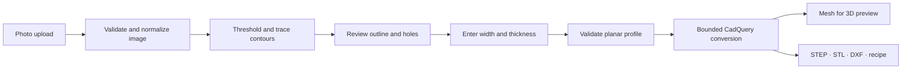

# Architecture and API

Pictures to CAD separates image interpretation from geometric construction. The photo supplies a planar profile. The user supplies scale and thickness. CadQuery constructs a solid, and that solid supplies both the displayed mesh and the export artifacts.

## Components

| Component | Responsibility |
| --- | --- |
| React and TypeScript | Workflow state, measured inputs, revision tracking, recovery, and export controls |
| Three.js / React Three Fiber | Interactive inspection of the actual generated mesh |
| FastAPI | Input validation, request handling, artifact delivery, and static frontend serving |
| Pillow | Image decoding and orientation normalization |
| OpenCV | Thresholding, contours, hierarchy, and outline approximation |
| Shapely | Planar-profile validity checks before invoking the solid kernel |
| CadQuery / OpenCascade | Solid construction, topology checks, tessellation, and CAD exports |

The application does not call an external AI service. An uploaded photograph still reaches the Python backend, which may run on the user's machine or on a cloud host.

## Geometry conventions

Traced points use image pixel coordinates, with the image's vertical coordinate increasing downward. Conversion translates and scales the profile into a centered XY model plane, then extrudes along Z. The dimensional scale is the entered width divided by the traced profile's horizontal span.

All geometry is stored internally in millimeters. The entered thickness is independent of image scale. Changing display units must convert the entered values rather than reinterpret the same number in another unit.

The pipeline preserves supported through-hole boundaries. It cannot infer whether a dark patch represents a hole, a marking, or surface relief; the user must review the trace.

## API overview

Use the running server's `/docs` page for the exact generated request schemas and validation constraints.

### `GET /api/health`

Returns API health information. A successful health response establishes service availability, not that a conversion, export, or browser interaction has passed.

### `POST /api/trace`

A multipart request includes:

| Field | Meaning |
| --- | --- |
| `file` | PNG, JPEG, or WebP upload |
| `threshold` | Intensity cutoff, or `-1` for automatic selection |
| `inverted` | Switch from the default dark-foreground interpretation |
| `detail` | `coarse`, `standard`, or `fine` contour approximation |

The response contains a normalized display image, its dimensions, the traced outer boundary and holes, the bounding box, the chosen threshold, and any relevant warnings.

The normalized image and trace share the same coordinate system. This avoids using uncorrected EXIF orientation for one while displaying the other differently.

### `POST /api/build`

A JSON request contains the reviewed `profile`, `width_mm`, `thickness_mm`, project `name`, and a client `revision` identifier.

The response contains a build identifier, matching revision, dimensions, volume, hole count, mesh vertices and triangles, download links, and warnings. The client must only present a build as current if its revision matches the settings still shown in the interface.

The profile is validated at the API boundary even when it originated in this app's trace endpoint. A client-supplied polygon is not trusted merely because it has the expected JSON shape.

### Export downloads

`GET /api/download/{job_id}/{kind}` returns an artifact for `kind` equal to `step`, `stl`, `dxf`, or `project`. Successful builds provide those links explicitly. Do not construct arbitrary filesystem paths from project names or user-provided extensions.

`DELETE /api/models/{job_id}` removes the generated model directory. It is an API capability; it is not a promise that the interface exposes a model-management screen. Deleting server artifacts does not delete copies already downloaded.

`DELETE /api/models` clears all completed temporary models and reports the number removed. It rejects the request with 409 while a CAD build is active. This is a global operation in the single-user service, not a per-account deletion request.

### Limits and errors

| Boundary | Current limit |
| --- | --- |
| Encoded upload | 10 MiB |
| Decoded image | 16 million pixels; at least 16 pixels per side |
| Normalized image | Longest side at most 1400 pixels |
| Planar profile | At most 2000 vertices in total and 32 holes |
| Scaled width and height | 0.1–2000 mm each |
| Thickness | 0.1–500 mm |
| Image tracing | One concurrent trace per API process |
| CAD work | One concurrent build per API process; 60-second worker timeout |
| Stored models | At most 20 model directories per process; one-hour expiry |

Do not increase the web server worker count as a substitute for a job queue: the concurrency lock and capacity accounting are per process. The supplied startup runs a single API process.

Errors use a JSON `detail` string. Invalid inputs commonly return 422, oversized requests 413, busy or full-capacity responses 429, deletion conflicting with an active build 409, and CAD timeouts 504. Missing artifacts return 404; an artifact found at access time but already expired returns 410. A background cleanup may already have removed an expired artifact, so expired links may also appear missing.

Project recipes identify `format: "pictures-to-cad"` and `version: 1`, with `name`, `profile`, `width_mm`, and `thickness_mm`. The server's artifact recipe also includes units and provenance text. The source photograph is not embedded.

## Revision and failure behavior

The workbench treats a successful model as a result of a particular set of inputs. Editing those inputs marks the result outdated. A failed or late response must not silently replace the current revision or make an old artifact appear current.

User inputs remain available after recoverable failures. A previous successful model may remain visible for comparison, but export controls must distinguish it from a successful rebuild of the new settings.

The geometry process has bounded execution and concurrency. A timed-out worker is terminated, and failed build directories are removed. See the implementation and [validation results](validation.md) for the exact checks exercised.

## Deployment boundary

The included runtime is a single-user application. It does not implement account authentication, per-user authorization, shared project storage, collaborative editing, a durable job queue, or a billing service. Those capabilities require an explicit design and implementation before a public multi-user deployment.
