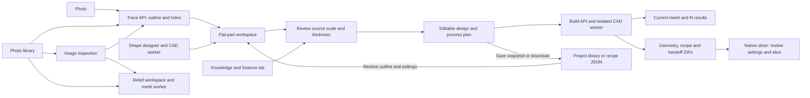

# Architecture

Pictures to CAD separates measurements, editable design settings, generated geometry and downstream printing. Browser controls select a requested model; a bounded backend worker constructs the solid; the viewer and export files come from that successful build.

## Workspaces and data flow

The hash router defaults to Start (`#start`) for empty or unknown routes and exposes Shape designer (`#designer`), Flat part (`#workbench`), Relief (`#relief`), Photo library (`#library`), Image inspection (`#image`), Knowledge (`#knowledge`), Science lab (`#science`) and Creative tools (`#creative`). Explicit `#workbench?open=photo`, `open=projects`, and `open=sample` intents defer until the workspace is active and idle, then are consumed without replacing the current draft merely by navigating. OpenSCAD links to the separately served companion library. Visited studio state is retained in memory during in-page navigation; this is not automatic disk persistence.

Image inspection (`ImageStudio.tsx`, `imageAnalysis.ts`) samples explicitly chosen
files in browser memory, computes bounded region statistics and pixel differences,
and exports a JSON receipt. It has no analysis API or model dependency. Its original
file handoff reuses the photo-library transport into Flat part or Relief. Sampling
does not alter the CAD source or establish its scale; see [the method and limits](image-inspection.md).

## Component map

| Area                       | Main source                                                                | Responsibility                                                                   |
| -------------------------- | -------------------------------------------------------------------------- | -------------------------------------------------------------------------------- |
| Application routing        | `frontend/src/main.tsx`                                                    | Select and retain visited workspaces                                             |
| Flat-part orchestration    | `frontend/src/App.tsx`                                                     | Trace/build requests, measurements, revisions, import/export and recovery        |
| Flat-part snapshots        | `ProjectLibrary.tsx`, `projectLibrary.ts`, `projectRecipe.ts`              | Browser-local recipes and print logs, shared recipe downloads and restore flow   |
| Shape designer             | `ShapeStudio.tsx`, `backend/shapes.py`, `backend/shape_worker.py`          | Common-shape editing, exact solid construction and outline handoff               |
| Design and process editing | `QuickEdit.tsx`, `PrintSettings.tsx`, `PrintPreparation.tsx`, `design.ts`  | Commit validated settings, inspect printer bounds and carry process notes        |
| Settings history           | `designHistory.ts`                                                         | Bounded snapshots of design settings; no export-file ownership                   |
| Geometry visualization     | `ModelViewer.tsx`, `plateInspection.ts`                                    | Camera/mesh inspection and top-down projection; no mutation of exported geometry |
| Photo cutout               | `BackgroundRemoval.tsx`, `background.ts`                                   | Browser-local outline clipping and transparent PNG generation                    |
| Learning tools             | `KnowledgeStudio.tsx`, `ScienceStudio.tsx`, `science.ts`                   | Searchable guidance, local notebooks and explicit numerical scenarios            |
| Local documentation        | `backend/documentation.py`                                                 | Read-only allowlisted Markdown guides, checksums and downloads                   |
| HTTP service               | `backend/app.py`, `backend/models.py`                                      | Bounded request contracts, job lifecycle, controlled downloads and local bridges |
| CAD construction           | `backend/worker.py`                                                        | Scale profile, prepare/split, construct CadQuery solids and export artifacts     |
| Fit planning               | `backend/printing.py`, `backend/placement.py`, `backend/curve_envelope.py` | Resolve catalog bounds and test per-piece containment                            |
| Slicer handoff             | `backend/slicer_handoff.py`, `backend/slicers.py`                          | Neutral packages, planning notes, hashes and optional fixed-program launch       |
| Relief and photo library   | `backend/relief.py`, `backend/library.py`, associated workers              | Separate image/mesh and persistent-photo workflows                               |
| Setup status               | `StartStudio.tsx`, `runtimeStatus.ts`, `backend/runtime_status.py` | Task entry and validated, read-only runtime metadata with optional local AI checks |
| Creative tools             | `CreativeStudio.tsx`, `backend/creative.py`, `backend/assistant.py`        | Registered text tools and the shared local Ollama connection                     |

The [detailed API and geometry contracts](api-reference.md) describe request fields, geometry conventions, algorithms and HTTP responses. The [research index](research-index.md) links developer-only numerical APIs and archived experiments; their existence does not imply a browser feature or automatic tracing step.

## Geometry and plan boundaries

Image coordinates use the working photo's pixel frame. The worker translates the source about its center, scales into millimeters and reverses image Y to construct the CAD XY plane. Measured reference width and thickness remain recipe inputs; design percentages determine the requested output size.

Accepted fitted profiles can preserve line/arc/circle geometry. Other profiles become polygon extrusions. Detail reduction is a bounded geometric simplification tied to nozzle size, not recovered photo detail. Splits produce real solids with straight cut faces; combined files preserve assembly coordinates and individual files normalize their own XY origin.

Printer fit resolves the selected profile and checks each flat piece independently. Supported rectangular placement uses a continuous-angle search; fitted outlines use conservative bounds and retain unknown states when an enclosure is inconclusive. A positive result supplies a suggested counterclockwise XY angle. Bed inspection independently projects the preview mesh at the user's selected angle; that view never changes the saved fit result or file orientation.

Process settings are `layer_height_mm`, `wall_count`, `infill_percent`, `supports` and `adhesion`. Backend and frontend validate ranges; layer height cannot exceed the nozzle. Older recipes get defaults. The worker writes the plan into the design recipe and each handoff's hash-verified `process-plan.json`. No native process preset, support geometry, slicing action or G-code is generated.

## Revision and asynchronous work

Every geometry-affecting or saved-plan edit invalidates the current build revision. Successful builds install only when the requested sequence and revision still match. Superseded jobs are released. Downloads verify the model ID and revision after the response arrives, so a file cannot silently belong to an earlier edited state.

Project import validates and builds the replacement before installing it. A failed import preserves the user's current work. Undo/redo restores settings and requires a fresh build rather than assuming an old job still exists. Source-context changes clear design history where required.

Project library keeps unsaved form patches in a bounded tab-local cache tied to snapshot identity. Form saves clear only matching submitted fields, so an older save cannot discard newer edits or the other form. Reload clears these unsaved patches.

Project library stores Flat part recipes and per-snapshot metadata in IndexedDB. Saving compares recipes with the same name and reuses an identical entry. Print attempts append to the selected snapshot and update its status in the same transaction. Opening a snapshot uses the normal recipe restore flow and generates a fresh CAD job. See the [snapshot workflow](workflows.md#save-snapshots-and-record-prints).

Background removal binds its request and object URL to the current trace, aborts obsolete image work and revokes owned URLs. The cutout is independent of CAD geometry. The optional assistant uses validated proposals that require explicit Apply; stale context blocks application.

## Storage and service scope

| Data                                        | Lifetime and location                                               |
| ------------------------------------------- | ------------------------------------------------------------------- |
| Current workspace inputs and design history | Browser memory for the current page                                 |
| Flat-part snapshots and print history       | Browser IndexedDB for the current profile and origin                |
| Flat-part/relief generated job artifacts    | Backend temporary job directory; normally expire after one hour     |
| Downloaded geometry, recipes and ZIPs       | User-selected browser download location                             |
| Retained native handoff copy                | Backend handoff directory, independent of temporary CAD job cleanup |
| Photo library                               | Separate backend library store and configured original paths        |
| Knowledge notes and saved Science scenarios | Browser-profile/origin storage with separate export controls        |

The default server is a local, single-user service with no general multi-user account boundary. Same-origin JSON and loopback gates constrain native program opening and filesystem-sensitive library actions; they do not make the whole service a public authenticated deployment. See [privacy and security](privacy-security.md).

## Setup checks

`GET /api/runtime` runs stdlib-only environment/package/asset checks off the API event loop and sends `Cache-Control: no-store`. The optional Ollama check reads only bounded loopback metadata under a shared 1.5-second budget, with no inference or download. Reports omit paths, endpoint configuration and model names. The browser validates the entire response before presenting readiness and cancels hidden requests. `make doctor` exposes the same report before the API can start, adding development-tool checks and next-step commands.

`backend/build_info.py` freezes a bounded backend source snapshot at process startup. Health, runtime and doctor expose only validated revision, checkout-state and source-fingerprint fields. Vite embeds one frontend input identity and emits a matching bounded manifest; the runtime reads that manifest without Git or source scans on requests. The Start setup details compare the loaded production browser fingerprint with the interface on disk. Missing or malformed optional metadata never changes core readiness, and live development avoids production reload guidance. These are diagnostic snapshots rather than loaded-byte or output-integrity attestations.

## API groups

| Group              | Representative routes                                                     |
| ------------------ | ------------------------------------------------------------------------- |
| Health and catalog | `GET /api/health`, `GET /api/printers`                                    |
| Flat parts         | `POST /api/trace`, `POST /api/build`                                      |
| Shape designer     | `POST /api/designer/build`                                                |
| Generated files    | `GET /api/download/{job_id}/{kind}`, `DELETE /api/models/{job_id}`        |
| Slicer bridge      | `GET /api/slicers`, `POST /api/models/{job_id}/slicer/{program_id}`       |
| Relief             | `POST /api/relief`, `GET /api/relief/depth`, `POST /api/relief/calibrate` |
| Blender bridge     | `GET /api/blender`, `POST /api/models/{job_id}/blender`                   |
| Photo library      | `/api/library` plus documented browse/upload/index/search/detail routes   |
| Optional assistant | `GET /api/assistant/status`, `POST /api/assistant/chat`                   |
| Creative tools     | `GET /api/creative/tools`, `POST /api/creative/run`                       |
| Local guides       | `GET /api/docs`, `GET /api/docs/{slug}`, `GET /api/docs/{slug}/download`  |

Image inspection runs in the browser. The Project library uses the build API when a user reopens a snapshot.

Only fixed download kinds and registered native-program IDs are accepted. Launcher commands use fixed argument arrays with `shell=False`; the browser cannot supply a command or post-processing script. A successful launch response is `launch_requested`, not confirmation of import, slicing or printing.

## Verify a change

Use focused Python tests for schema, geometry, job lifecycle and handoff contracts; pure TypeScript tests for math/history; frontend typecheck and production build; then browser tests for real interaction, download freshness and accessibility. Run native import or physical print checks only as separate explicit activities. See [development](development.md), [validation](validation.md) and [contributing](contributing.md).

## Creative tool extension boundary

The typed `studioCatalog.ts` supplies shared route metadata. `CreativeStudio.tsx` discovers bounded text tools from `backend/creative.py`; both it and the CAD assistant run through the same local-model gate and cancellation-safe inference slot. See the [extension guide](creative-tools.md) and [architecture decision](adr-local-creative-tools.md).

The shape designer uses `backend/shapes.py` for bounded inputs and the isolated `backend/shape_worker.py` for exact constructive solid operations. It recovers the planar boundary and reuses the measured-profile exporter; the UI serializes automatic rebuilds and rejects obsolete results.
