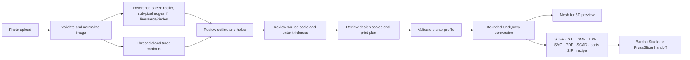

# Architecture and API

Pictures to CAD separates image interpretation from geometric construction. The photo supplies a planar profile. Scale comes from the entered outside width, a measured feature, or a reference sheet; thickness is entered separately. Optional design scales and print-planning settings then define the requested output. CadQuery constructs the resulting solid or split solids, which supply both the displayed mesh and the export artifacts. Use the [documentation index](README.md) for the user-facing guides.

This contract describes the [reviewed main-based source](project-status.md).
The separate source-observation/PSF research APIs are not HTTP capabilities or
Python modules in this checkout.

## Components

| Component | Responsibility |
| --- | --- |
| React and TypeScript | Workflow state, measured inputs, revision tracking, recovery, and export controls |
| Three.js / React Three Fiber | Interactive inspection of the actual generated mesh |
| FastAPI | Input validation, request handling, artifact delivery, static frontend and published companion serving |
| Pillow | Image decoding and orientation normalization |
| pi-heif (libheif, libde265) | HEIC decoding, in a child process (`backend/heic.py`) |
| OpenCV | Thresholding, contours, hierarchy, and outline approximation |
| Shapely | Planar-profile validity checks before invoking the solid kernel |
| CadQuery / OpenCascade | Solid construction, topology checks, tessellation, and CAD exports |
| Optional local Ollama | Text advice and validated trace/design/print-setting proposals for explicit user review |

The application does not call a paid or external inference service. Its optional assistant connects to Ollama through an HTTP loopback address on the backend host. It receives text context, including measured and built dimensions, but not the photograph, outline vertices, or mesh. An uploaded photograph still reaches the Python backend for tracing, which may run on the user's machine or on a cloud host.

## Geometry conventions

Traced points use image pixel coordinates, with the image's vertical coordinate increasing downward. Pixel *i* spans *i* to *i* + 1, so the image spans 0 to its pixel width. Outlines follow the outer edges of boundary pixels: a part covering pixel columns 50–450 spans 50 to 451, and a hole follows the edges of the material around it. Conversion translates and scales the profile into a centered XY model plane, then extrudes along Z. The measured scale is the entered reference width divided by the traced profile's horizontal span. An explicit XY design percentage multiplies that scale; a separate thickness percentage multiplies the entered thickness. Design choices do not overwrite the source measurements.

Source profiles and their image overlays use pixels; built CAD coordinates and physical inputs use millimeters. A reference-sheet profile retains `mm_per_px` for its display frame. The entered thickness is independent of image scale. Changing display units must convert entered physical values rather than reinterpret the same number in another unit.

The pipeline preserves supported through-hole boundaries. It cannot infer whether a dark patch represents a hole, a marking, or surface relief; the user must review the trace.

Reference-sheet radial inversion uses the increasing branch containing the
image center. `backend/sheet.py` rejects observed radii outside that branch and
restricts coefficient trials to invert all measured sheet corners and edge
samples. Its residual measures agreement with that lens model, rather than
physical part accuracy. The [domain and simulation record](validation/radial-inverse.md)
describes the separate synthetic inverse and higher-order mismatch inputs.

Reference-sheet analysis mixes decoded sRGB channels in linear light, rectifies
with Keys sampling into float32, then smooths by Gaussian sigma 0.7 px. The
directional rise-width covariance belongs to this rectified field. Normal-specific
widths drive edge/wall localization. Supported nonparallel fillets now use the
full covariance, transported into their corrected frame; free arcs/circles keep
the scalar `(det S)^¼` correction, and slot ends keep a directional approximation.
Neither numerical rank, model convergence nor positive definiteness converts
these empirical widths into a calibrated camera PSF; [the tracing guide](reference-sheet.md#3-segmentation-and-sub-pixel-edges)
defines the boundaries.

### Circle-consistent final assembly

Final reference-sheet arc assembly retains each accepted fitted circle's centre
and radius. `backend.circular_joins` constructs line/circle roots and compares
ordered cyclic choices using frozen source endpoints, line traversal and signed
arc-sector witnesses. A unique separated minimum is a construction decision;
it does not identify the physical boundary. Numerical guards, provenance and
work limits can leave a join unavailable.

Initial support may use a legacy geometric proxy when canonical construction
cannot yet reach the correction stage; final analytic export must construct
separately. An unavailable final join normally retains the affected traced ring
with a targeted notice, while other accepted rings remain analytic. Invalid
retained geometry produces actionable refusal rather than a missing-sheet
fallback. Final circle checks, whole-profile validity and camera/model adequacy
remain separate. See [curved joins](curved-joins.md) and
[critical export checks](exports.md#verify-critical-arc-geometry).

Geometry detail is a geometric approximation applied to the scaled profile. `original` retains it; `draft`, `balanced`, and `fine` use simplification tolerances of 0.5, 0.25, and 0.1 times the selected nozzle diameter in millimeters, respectively. The simplification preserves topology and checks that every hole remains. The modes can still change small features and must be inspected; they do not recover image information, measure minimum wall thickness, or prove printability. The original trace remains the recipe's source profile.

Split mode makes actual solids with straight XY cuts. The default preview and combined STEP/STL/3MF keep those solids in their assembled positions. A separated inspection view displays the actual per-part meshes with temporary offsets; it does not change exported coordinates or claim a print-bed layout. Per-part exports translate each piece to a local XY origin and record the assembly offset in the bundle manifest. The program does not introduce alignment pins, joints, kerf compensation, or assembly tolerances.

3MF Core packages use millimetres and separate indexed mesh objects for split solids. Each mesh is checked for finite coordinates, nondegenerate triangles, closed oriented edges and positive volume. Slicer handoff ZIPs carry this geometry, STL alternatives, the recipe, printer/material planning notes, instructions and payload hashes. They do not contain native slicing presets or machine instructions.

OpenSCAD source serializes the final prepared profile and effective built thickness. Fitted single-piece circles remain `circle()` calls; other fitted boundaries are sampled as polygons. Polygon and split output use their prepared numeric points and hole paths. Sampling targets and caps are described in [exports](exports.md#openscad-editable-profile-extrusion). Default source values reproduce the assembly. An additional XY scale and a piece selector support downstream edits; those changes do not feed back into the workbench recipe or bed-fit calculation. OpenSCAD is only needed to render the source, not to produce it. The source contains no user-provided code or project-name interpolation and does not claim recovered constraints or feature history.

Printer fit checks the selected Z height and searches continuous XY rotations inside the clear rectangular bed after margins. `backend/placement.py` partitions rotation space at convex-hull support events and solves trigonometric bed-limit crossings. Polygon extrusions supply their actual built footprint. Fitted curves first use their solid's enclosing rectangle, then `backend/curve_envelope.py` constructs an outer polygon from analytic supports in 256 directions. Positive outer-bound placements contain the curved solid; inconclusive XY results remain unknown. Each positive per-piece `bed_fit` includes `rotation_deg` (counterclockwise about model Z), `footprint_mm` (`width`, `depth`), and `basis` (`outline`, `bounding_box` or `curve_envelope`); a curve enclosure also records `enclosure_directions`. The legacy `rotated_90` flag remains available. The worker and handoff manifests preserve these suggestions without transforming exports. This is individual geometric containment, not plate packing, slicing, support generation, material simulation, or G-code generation. Color/material choices are approximate preview and recipe/planning metadata; STL carries no color.

Known catalog printers resolve their bed geometry from the selected nozzle's source profile; the backend does not trust stale client-supplied dimensions for a known match. Missing profiles, several matching profiles that describe different beds, nonrectangular beds, and excluded bed areas produce an unknown-placement result instead of a rectangular-fit guarantee. Custom mode uses the user's rectangular volume. Unsupported hardware facts remain unknown.

`backend.printing.suggest_split_plan` enumerates eleven supported straight-cut grids only after a polygon build exceeds the checked envelope. It validates clipping, connected pieces, area preservation and each piece's placement, then ranks by actual piece count, cut lines, rows and columns. An optional `split_plan` in the build result carries `status` (`suggested` or `no_fit`), `grids_considered`, `grids_failed`, a reason, and, for a suggestion, `columns`, `rows`, `piece_count` and per-piece dimensions, area and bed-fit witnesses. Numerical intersection failures qualify a partial search and do not invalidate the intact build. Fitted single-piece curves are excluded. The frontend displays proposals only for the current model revision; applying one changes only cut settings and requires a fresh build. Unapplied proposals are not serialized as generated parts in recipes or handoffs.

## API overview

Use the running server's `/docs` page for the exact generated request schemas and validation constraints.

### `GET /api/health`

Returns API health information. A successful health response establishes service availability, not that a conversion, export, or browser interaction has passed.

### `GET /api/printers`

Returns the bundled pinned printer catalog with source metadata, grouped
models, nozzle-specific profiles and known/unknown feature facts. The frontend
loads it when the design/print panel needs it. The endpoint reads local data;
it does not refresh upstream profiles or identify the connected printer.
Hardware facts absent from the source stay unknown. See the
[catalog and importer contract](printer-catalog.md) for profile inheritance,
bed shapes, exclusions and provenance.

### `POST /api/trace`

A multipart request includes:

| Field | Meaning |
| --- | --- |
| `file` | PNG, JPEG, WebP, HEIC, or AVIF upload; a multi-picture (MPO) camera JPEG or a HEIC burst uses its primary image |
| `threshold` | Intensity cutoff, or `-1` for automatic selection |
| `inverted` | Switch from the default dark-foreground interpretation |
| `detail` | `coarse`, `standard`, or `fine` contour approximation |
| `reference` | `none` (default), `a4`, `letter`, or `custom` scale reference sheet |
| `sheet_width_mm`, `sheet_height_mm` | Measured sides of a `custom` sheet, 10–2000 mm |
| `thickness_mm` | Optional part thickness for the reference-sheet parallax correction |
| `snap` | Recover design intent on a reference-sheet trace (default `true`) |
| `fallback` | Trace without the sheet, with a warning, if it cannot be found or used |

The response contains a normalized display image, its dimensions, the traced outer boundary and holes, the bounding box, the chosen threshold, and any relevant warnings.

With a reference sheet, the display image is the rectified, perspective- and lens-corrected view of the part. A detected straight-edge direction can set a rigid display/profile rotation even when an affected ring is retained as line geometry. This coordinate alignment is separate from accepting analytic geometry or claiming exact snapping. The profile also carries `primitives`: exact `line`, `arc` (start, mid, end) and `circle` segments for the outer boundary and every hole, in the same display-pixel frame. It also carries `reference`, the evidence for that trace: sheet kind and size, `mm_per_px`, the lens coefficient, edge blur, any thickness correction with camera height and focal-length source, and notes such as the snap list and the sheet-proportions check. The outside width is the outline's span in that frame × `mm_per_px`. See [reference-sheet tracing](reference-sheet.md) and [display alignment](curved-joins.md#display-alignment-is-a-coordinate-choice).

The normalized image and trace share the same coordinate system. This avoids using uncorrected EXIF orientation for one while displaying the other differently.

Before Gaussian reconstruction or design snapping, the [initial-fit support check](validation/fit-support.md)
compares assembled candidates with the complete classified contour, while
retaining only accepted subpixel points for precision fitting. These internal
coverage points and indices are not new API fields. The build API's separate
3 % primitive/polygon area check below validates the supplied profile; it does
not recover agreement with source observations that were already discarded.
With thickness correction, `reference.focal_source` can be `sheet`, `exif`,
`assumed` or `holes`; the last records an accepted hole-roundness inference.

### Directional covariance at nonparallel corners

`edges.edge_covariance` supplies an empirical covariance in rectified measurement
pixels squared. For supported nonparallel fillets, `fitting.corner_level` whitens
that Gaussian and transforms the corner's ray geometry with it. The numerical
fit has bounded convergence checks; it does not certify the physical blur model.
The scalar path remains when no covariance is supplied, while failure of a
supplied-covariance corner fit has no scalar replacement.

`reference.trace_on_sheet` carries the thickness map's per-point scale into the
fit. A uniform scale `k` transforms covariance to `k² S`; mixed support in a
supplied-covariance corner or an unresolved covariance fit marks that boundary
for traced-outline recovery before generic blur correction and radius equalization. If that
corrected source ring is invalid, `_geometric_source_polyline` may instead use
an already supported initial fit, frozen before those modifications and sampled
as lines. It requires one valid positive-area ring, the existing vertex cap and
bidirectional whole-boundary containment within the existing geometric-fit
tolerance `max(0.03 * ppm, 0.15 * sigma)` in rectified pixels. It does not add
outward padding, increase the standard `0.05 mm` polyline-detail tolerance,
run a generic topology-repair operator, delete components or infer a radius.
The invalid source has no accepted polygon topology; tube proximity does not
certify the intended one. Final profile validation still applies, and an absent
or rejected candidate preserves normal profile refusal.

Other supported rings can still be fitted. Reference notes and warnings name
the nearby polygonal recovery and undetermined radius. The covariance is not a
new client-supplied trace option or a camera-calibration status. See the
[corner model and recovery limits](anisotropic-corners.md#when-the-corrected-source-ring-is-invalid),
including the separate free-arc and slot-cap approximations.

### Blur frames for free curves and slot caps

`reference.trace_on_sheet` also passes point-bound thickness scales to
`correct_blur`, `fit_fillets` and `refit_lines`. A uniform support scale `k`
transports scalar spread by `k` and covariance by `k²`, including the existing
free-curve radius series and scalar/directional slot-cap placement. Free arcs
use their own cyclic support spans, circles use the whole ring, and constrained
caps include the neighboring lines' context. The line-refit exclusion margin
uses the maximum scale over that line's support, with a small arithmetic tie
guard at window boundaries.

Mixed free curves, caps and scalar-only nonparallel corners retain the legacy
geometry approximation, marked internally by `blur_frame_mixed`. Mixed scalar
corners carry infinite `r_sd` and no sharp-bound/deletion claim; mixed
supplied-covariance nonparallel corners remain withheld under the existing
recovery policy. An unusable mixed scalar radius retains the initial positive
finite geometric arc with `blur_correction_withheld`, skipping another generic
blur correction; without an eligible initial arc it remains unresolved.
A visible note is added only when marked geometry survives
into the described fitted boundary. This is not an averaged Gaussian frame or
an uncertainty estimate. No new polygon-cleanup policy is introduced. The
[blur-frame guide](blur-frames.md) records the homogeneity equations, support
rules and numerical limitations.

### `POST /api/build`

A JSON request contains the reviewed `profile`, measured `width_mm` and `thickness_mm`, project `name`, a client `revision` identifier, and optional `design` settings. A profile's `primitives` are validated at the API boundary: they must be closed, must match the outline and every hole, and must agree with the traced polygon rings within 3 % symmetric-difference area. Single-piece output then extrudes the exact segments; the response's `geometry` reports `fitted` with line, arc and circle counts, or `polygon`. Design settings include XY/thickness percentages, appearance, material, relative detail, nozzle size, output mode and split grid, and printer/usable-volume choices.

The response contains a build identifier, matching revision, resulting dimensions, volume, hole count, mesh vertices and triangles, effective design settings, part metadata and geometric fit results, download links, and warnings. The client must only present a build as current if its revision matches the settings still shown in the interface. Each part reports its actual dimensions, volume, and fit status.

The profile is validated at the API boundary even when it originated in this app's trace endpoint. A client-supplied polygon is not trusted merely because it has the expected JSON shape.

### Export downloads

`GET /api/download/{job_id}/{kind}` returns an artifact for `kind` equal to `step`, `stl`, `3mf`, `dxf`, `svg`, `pdf`, `scad`, `project`, `parts`, `bambu`, or `prusa`. The `svg` and `pdf` artifacts are the DXF's loops as a millimetre drawing and as a page that prints at 1:1 (`backend/drawing.py`, which writes both without a PDF or SVG library). The parts artifact is a ZIP of separate STEP/STL/3MF files and a manifest. The `bambu` and `prusa` artifacts are tailored handoff ZIPs. Successful builds provide those links explicitly. Do not construct arbitrary filesystem paths from project names or user-provided extensions.

`DELETE /api/models/{job_id}` removes the generated model directory. It is an API capability; it is not a promise that the interface exposes a model-management screen. Deleting server artifacts does not delete copies already downloaded.

`DELETE /api/models` clears all completed temporary models and reports the number removed. It rejects the request with 409 while a CAD build is active. This is a global operation in the single-user service, not a per-account deletion request.

### Optional local slicer opening

`GET /api/slicers` checks fixed executable names or server-configured paths without executing them. It reports target releases, executable availability and whether direct opening is enabled; installed versions remain unchecked.

`POST /api/models/{job_id}/slicer/{program_id}` accepts an empty JSON object for `bambu` or `prusa`. With `PICAD_ENABLE_SLICER_LAUNCH=1`, a loopback caller/host and matching Origin, it retains a copy of the generated 3MF and requests GUI opening using a fixed argument list without a shell. The API accepts neither executable paths nor arbitrary arguments. The response is HTTP 202 with `launch_requested`, not proof of import. A per-process lock and two-second cooldown bound launch attempts; request cancellation keeps the lock until the worker completes.

Copies under `.local/slicer-handoffs/` (or `PICAD_SLICER_HANDOFF_DIR`) outlive temporary model expiry and deletion and remain until manually removed. This workflow does not slice or send anything to a printer. See [slicer setup and limits](slicers.md).

### Optional local assistant

`GET /api/assistant/status` reports whether the local Ollama server responds, the available local models, a provisional recommended model, and setup guidance. Server availability alone does not prove that a model can produce a useful answer.

`POST /api/assistant/chat` accepts `model`, `question`, and a bounded `context` containing trace settings, optional measured dimensions and hole count, presence flags, warnings, design/print choices, and dimensions of available built geometry and parts. It returns `model`, `answer`, a nullable `proposal`, `warnings`, and `elapsed_seconds`.

Proposals may contain supported trace controls and design/print settings, including explicit XY/thickness design percentages. They cannot replace the measured source width or thickness. The server requests structured output and independently validates it; response text does not execute actions. Invalid proposals are discarded with a warning. The browser previews proposals, requires an explicit application, rejects proposals for an outdated project, and offers undo. Geometry-affecting changes invalidate the existing CAD result and require review and a new build before export. Undo before any build from the suggestion keeps the existing model current, because the restored settings are the ones it was built from. Undo after building an AI suggestion restores prior settings and their previously current mesh for comparison, or clears the preview if none existed; exports remain stale until rebuilt because those server artifacts may already have been released.

There is no image, outline, or mesh payload, model-download endpoint, generated-code execution, or cloud fallback. Ollama must already have the selected local model installed. See [local AI setup and controls](ollama.md).

The status endpoint returns HTTP 200 with `running: false` when Ollama is unavailable. Chat failures use 503 for an unavailable service, 409 for an unavailable or unsupported model, 429 for a busy assistant, 504 for a timeout, and 502 for an unusable upstream response. Cloud names and remote-model metadata are rejected; a model is checked again before inference. Generated prose still requires human review.

### Published companion library

`GET /reference-library/index.html` serves the offline handbook and browser workspaces; `#cad` selects OpenSCAD. The app opens this link in a separate tab to preserve its current project and temporary exports. This route mirrors the companion browser-test server's explicit reader-file allowlist, including the bundled synthetic examples and published handbook PDF. Both check real filesystem containment so an allowlisted symlink cannot escape the library. Personal builds under `output/`, scratch reports, dependencies, scripts, and environment files are excluded. The Vite development proxy forwards the same path to the API service.

### Limits and errors

| Boundary | Current limit |
| --- | --- |
| Photo upload | 32 MiB |
| Any other request body | 10 MiB |
| Decoded image | 70 million pixels; at least 16 pixels per side |
| HEIC decoding | A child process per file; 60-second timeout; 4 GiB address space and 60 s of processor time where the platform enforces them |
| Normalized image | Longest side at most 1400 pixels (without a reference sheet) |
| Reference-sheet analysis | Full-resolution photo up to 16 MP, larger photos reduced to that in linear light; rectified at 1.25 × native resolution, 4–12 px/mm, at most 12 MP; display crop at most 1400 pixels |
| Planar profile | At most 2000 vertices in total and 32 holes |
| Scaled width and height | 0.1–2000 mm each |
| Thickness | 0.1–500 mm |
| Image tracing | One concurrent trace per API process |
| CAD work | One concurrent build per API process; 60-second worker timeout |
| Stored models | At most 20 model directories in the job directory (`PICTURES_CAD_JOB_DIR`); one-hour expiry |
| Design percentages | 10–400% XY and thickness; resulting CAD dimensions must remain within the geometry bounds above |
| Split grid and solids | 1–4 rows/columns; at most 8 cells and 8 connected pieces |
| Assistant question/context | 1600-character question; up to 8 warnings of 300 characters each |
| Assistant inference | One concurrent request; 120-second chat timeout plus short model checks; 2 MiB upstream response cap |

Do not increase the web server worker count as a substitute for a job queue: the concurrency locks are per process, while the capacity count covers every model directory on disk, including those of other processes sharing the job directory. The supplied startup runs a single API process.

Errors use a JSON `detail` string. Invalid inputs commonly return 422, oversized requests 413, busy or full-capacity responses 429, deletion conflicting with an active build 409, and CAD timeouts 504. Missing artifacts return 404; an artifact found at access time but already expired returns 410. A background cleanup may already have removed an expired artifact, so expired links may also appear missing.

The interface saves recipes identifying `format: "pictures-to-cad"` and `version: 2` (`version: 3` when the profile carries fitted `primitives` or a sheet `reference`), with `name`, source `profile`, measured `width_mm` and `thickness_mm`, and `design`. **Save project** additionally includes optional browser-held `reference_calibration`, `measured_height_mm` and `height_check` inputs. These notes are not sent in the build request and therefore are absent from the server-generated `project.json` and slicer ZIP recipe. Save the browser recipe separately to retain them. The server's recipe includes units and provenance text. Versions 1, 2 and 3 remain importable; version 1 receives default design settings. Legacy API requests omitting `design` receive version 1 for polygon profiles; fitted/reference profiles use version 3 with resolved design settings. Neither recipe embeds the photograph.

## Revision and failure behavior

`frontend/src/workflow.ts` derives the deterministic next step from busy state,
source availability, width, thickness, design validation and build revision, in
that order. Guide, footer and navigation share that result; an open workflow
dialog overrides the navigation stage. Busy work has no current navigation step.
The guide requires no AI connection. Its preview action builds without opening
Export; the existing main action may build and then open Export.

The workbench treats a successful model as a result of a particular set of inputs. Editing those inputs marks the result outdated. A failed or late response must not silently replace the current revision or make an old artifact appear current.

User inputs remain available after recoverable failures. A previous successful model may remain visible for comparison, but export controls must distinguish it from a successful rebuild of the new settings.

Missing-measurement actions focus the relevant field. Invalid-design recovery
opens and focuses the existing settings panel. Save validation for optional
height notes closes Export, opens the height check and focuses the field needing
correction without invalidating geometry. The guide button remains mounted and
disabled during work so completion can restore meaningful focus. The [guided
audit](validation/guided-workbench.md) records the tested flows.

The geometry process has bounded execution and concurrency. A timed-out worker is terminated, and failed build directories are removed. See the implementation and [validation results](validation.md) for the exact checks exercised.

## Deployment boundary

The included runtime is a single-user application. It does not implement account authentication, per-user authorization, shared project storage, collaborative editing, a durable job queue, or a billing service. Those capabilities require an explicit design and implementation before a public multi-user deployment.
