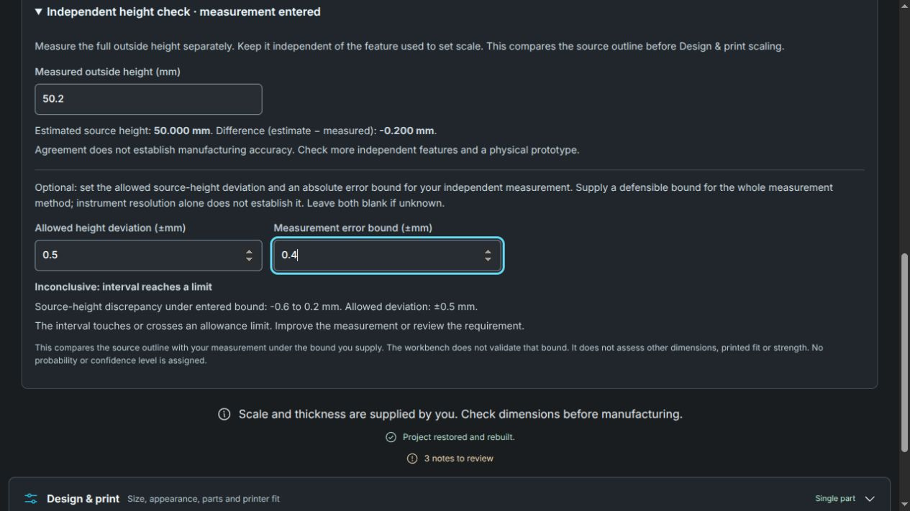

# Engineering model and verification

[Documentation index](README.md) · [Guided workbench review](validation/guided-workbench.md)

The useful engineering concept is a **measurement-assisted 2.5D reverse-engineering
workbench**: reconstruct the boundary of a flat, constant-thickness part, verify
reserved dimensions, then qualify the manufactured prototype for its intended use.
The model is a planar profile extruded through a separately measured thickness.
A single photograph does not identify hidden surfaces, blind holes, internal
features, material properties, loads or process settings.

The guided next step distinguishes missing measurements, invalid design settings,
a model needing a rebuild, and a current model ready for export review. **Solid
ready** means the digital model matches the current settings. The independent
height decision and printer-fit result remain separate checks; neither the guide
nor a successful build establishes physical acceptance. See [print planning](print-planning.md)
and [export checks](exports.md) before moving to manufacturing.

## Define the requirement before tracing

Record the part's function, mating features, required dimensions and allowable
errors before inspecting results. Reserve dimensions that will not set scale:
outside height is supported in the UI; hole diameter, hole spacing and mating
clearance still need independent checks in CAD or on the prototype. Do not tune
an allowance merely to make a result agree. A load-bearing part also needs load
cases, boundary conditions, material/process data and an independent structural
analysis; choosing a preview material supplies none of those inputs.

## Geometry, units and design changes

For working-image outside spans `Bx, By` in pixels, reference endpoint span `s`
in pixels and known feature length `L` in mm, the uniform model is

```
k = L / s                 mm per working-image pixel
W = k Bx                  source width, mm
H = k By                  source height, mm
d = H - M                 discrepancy from independent measured height M, mm
```

Thickness `t` is measured separately. For a planar profile with net area `A` in
working-coordinate units squared, `V = A k² t` in mm³. Fitted circles and arcs
use their analytic geometry, while polygon outlines retain tracing and
simplification error. If XY design scale is `a` and thickness scale is `b`, the
ideal extrusion has `W' = aW`, `H' = aH`, `t' = bt` and `V' = a²bV`, before any
geometry-detail change. Scaling dimensions does not establish a strength law.
Check the generated solid and downstream import after approximation or splitting.

Reference-length drafts retain full numeric precision when switching between
millimeters and inches. The computed width normalizes floating-point contact
with the supported 0.1 mm and 2000 mm limits using
`64 * Number.EPSILON * max(abs(width), abs(limit))`. This is an arithmetic guard
(about 2.84e-11 mm at 2000 mm), not a measurement allowance. Values outside that
narrow guard remain outside the supported range. Endpoint sensitivity scenario
widths are not clipped to these build limits; a collapsed reference span still
withholds the scenario as described in [endpoint placement](reference-sensitivity.md).

The independent height check concerns the **source polygon's bounding spans**,
not a resized design, a local fitted radius, an exported mesh or a printed part.
It remains a global aspect-ratio check even for a fitted profile. Agreement can
miss a shifted hole, local contour error, or a wrong reference measurement.

## Why capture assumptions matter

Consider an ideal orthographic image of a flat part tilted by angle `θ` about
its horizontal axis. If a horizontal reference sets scale, vertical dimensions
are multiplied by `cos θ`. The vertical relative bias is `1 - cos θ`: about
0.38% at 5°, 3.41% at 15°, and 13.40% at 30°. A 50 mm height tilted by 15° reads
about 48.30 mm, a 1.70 mm discrepancy. This is an illustrative camera model,
not a prediction for arbitrary phone photographs.

In an ideal pinhole camera, a top face `t` above the reference plane at camera
distance `D` is magnified relative to that plane by `D/(D-t)`. Before correction,
`t = 4 mm` and `D = 300 mm` give about 1.35% scale bias, or 0.68 mm on a 50 mm
feature. The implemented reference-sheet pipeline estimates plane correction,
one radial lens term and top-face parallax; its assumptions and limits are in
[reference-sheet tracing](reference-sheet.md). These equations explain why a
calibrated capture and independent measured features matter even when a digital
solid is exact.

## Bounded source-height decision

In **Independent height check**, optionally enter:

- an **allowed height deviation** `T > 0`, chosen from the source-reconstruction requirement;
- an absolute **measurement error bound** `B ≥ 0`, justified for the complete independent measurement method.

Both are blank by default. The tool does not estimate either value or equate a
caliper display resolution with a method error bound. An instrument's expanded
uncertainty or stated accuracy is not automatically a guaranteed absolute
bound. If the assumption cannot be defended, leave the decision inputs blank.
The existing endpoint-placement explorer remains a separate hypothetical
scenario; its pixel shift is not substituted for `B`.

Conditional on `actual source height ∈ [M-B, M+B]`, the deterministic source
prediction differs from the actual height by an interval

```
E = [H-M-B, H-M+B] = [d-B, d+B].
```

| Outcome | Rule | Meaning |
| --- | --- | --- |
| Within entered allowance | `abs(d) + B < T` | Every discrepancy in the entered interval is strictly inside the allowance for this dimension. |
| Outside entered allowance | `max(0, abs(d)-B) > T` | Every discrepancy in the entered interval exceeds the allowance. |
| Inconclusive | Otherwise, including boundary contact | The input cannot support either of those conclusions. |
| Undecided | A required input is absent or invalid | No assessment is made. |

A numerical guard of `64 × Number.EPSILON × max(1, H, M, T, B)` keeps floating-point
contact with a limit inconclusive. It is measured in mm internally and does not
represent physical uncertainty. Decisions use unrounded inputs; displayed
values are rounded. If an entered interval extends below zero height, the full
interval is retained conservatively rather than narrowing it without evidence.

For `H = 50`, `M = 50.2`, `T = 0.5` and `B = 0.1 mm`, `E = [-0.3, -0.1] mm` is
within the allowance. With `B = 0.4`, `E = [-0.6, 0.2] mm` is inconclusive.
With `M = 50.9`, `B = 0.1`, `E = [-1.0, -0.8] mm` is outside. A boundary-touching
interval `[-0.5, -0.3] mm` remains inconclusive.

The decision is conditional, dimension-specific and recomputed from the current
source width and outline. It does not quantify uncertainty in the entire
photo reconstruction, assign a confidence level, certify conformance to a
metrology standard, or assess final printed dimensions. A wrong height may
reveal a capture, reference, trace or measurement problem; it does not identify
which one. Investigate or remeasure rather than stretching the profile to fit
the check, which would consume its independence.



Browser example with synthetic dimensions: a ±0.4 mm entered measurement bound
makes a −0.2 mm central discrepancy inconclusive against a ±0.5 mm allowance.

## A practical verification sequence

| Stage | Evidence to retain | What remains to be established |
| --- | --- | --- |
| Capture | Original photo, reference identity, measured length/thickness, capture conditions | Hidden geometry and unmodelled camera effects |
| Source reconstruction | Reviewed outline, reference scale, reserved height and justified decision inputs | Other functional dimensions and local features |
| Digital CAD | Valid solid, dimensions, topology, export/reimport checks tied to the recipe | Physical process behavior |
| Slicer setup | Actual imported units, per-piece placement, layer preview, qualified machine/material settings | Actual dimensions, layer adhesion and fit |
| Prototype inspection | Independent measurements of critical features and mating tests | Repeatability and service performance |
| Functional qualification | Relevant loads, environment, allowable deformation/failure and repeated tests | Any untested use or process change |

The project JSON preserves `measured_height_mm` and optional `height_check`
inputs (`allowance_mm`, `measurement_bound_mm`), not a cached acceptance status.
A unit change converts all three physical values. New photos and older recipes
without these inputs clear them. Invalid imports are rejected before the current
project is replaced. Geometry exports and print-fit status do not acquire an
approval from this check. Save a separate inspection record for physical tests.

## Basis and evidence limits

[JCGM 106:2012, sections 8.2–8.3](https://www.bipm.org/documents/20126/2071204/JCGM_106_2012_E.pdf)
distinguishes tolerance limits, decision rules and guard bands, and explains
why uncertainty matters near a limit. It is background for making assumptions
and the decision rule explicit. The implementation here is a direct bounded-
interval derivation; it does not implement that document's probability models
or claim a consumer/producer risk level. Reviewed November 11, 2026.

Repository tests establish arithmetic, state handling, recipe preservation and
accessible browser behavior on synthetic inputs. They do not establish a
physical error bound. The [measured-photo benchmark](photo-benchmark.md) still
needs real calipered parts and recorded capture conditions. Prioritize that
experiment, held-out functional dimensions and prototype inspection before
expanding reconstruction scope or making an accuracy claim.

The [scientific model review](validation/scientific-model-review.md) records
the original whole-circle extrapolation and camera-model limits.
The [radial-domain repair](validation/radial-inverse.md) removes the renderer's
production-inverse dependency and supplies higher-order mismatch cases;
physical camera assumptions remain. The [directional-spread qualification](validation/directional-spread-qualification.md)
documents missed directional cases and unknown outcomes, with no production
warning or correction. Benchmark statistics remain conditional on comparisons.
Residuals describe the selected
model's agreement with sampled points; they do not alone establish source
coverage, identifiable radius, physical uncertainty or complete benchmark
coverage. The [initial-fit support repair](validation/fit-support.md) addresses
the reproduced extrapolation before Gaussian/design reconstruction; it does not
establish final model adequacy. The optional bounded-height decision above retains its separate,
user-supplied assumptions.

A sharp-corner note reports an estimated radius resolution under the assumed
blur model. It is separate from the user-bounded height decision above. The
[corner-resolution record](validation/sharp-corner-resolution.md) reproduces a
known rounded corner whose model estimate is smaller than its actual radius.
Neither that estimate nor a local radius standard deviation is a physical upper
radius bound. Reserve an independent measurement for fit-critical fillets.
