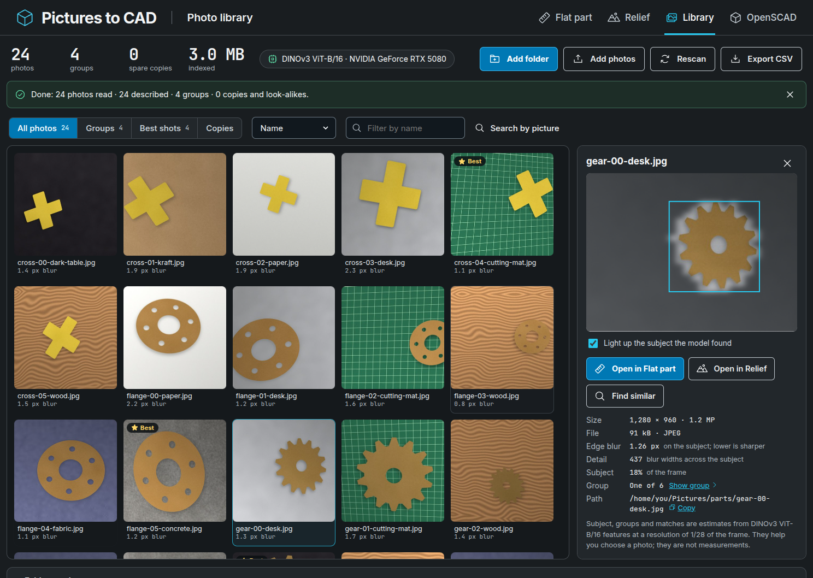

# Photo library

Open **Photo library** in the app header (**Library** on narrow screens), or `/#library`, to prepare a collection of photos
before making CAD or reliefs. Point it at a folder and it reads every picture: size,
sharpness and exact copies, and, with the optional DINOv3 vision model, what each
picture shows and which shots belong together. Then open the best shot of a part
in Flat part, Relief or Image inspection.



The screenshot shows rendered test parts with the vision model installed. Every result
on this page is a suggestion for choosing a photo. Nothing here measures a part.

## Start

1. Choose **Add folder** and pick a folder on this computer, or **Add photos** to send
   files through the browser. You can also drop photos anywhere on the page.
2. The library crunches by itself. A bar shows the stage, the photos per second and the
   time left. **Cancel** stops at a checkpoint. Completed reads and descriptions
   are retained. If regrouping is cancelled, the previous groups stay in place.
3. Choose a photo to see its details, then **Open in Flat part**, **Open in Relief**
   to use the source, **Inspect image** to examine it in the browser, or **Find similar**
   when vision features are available.

**Rescan** looks for new, changed and removed files in the added folders and finishes
any work a cancelled crunch left over. Unchanged photos are not read again.

Folder originals stay where they are and are only read. Removing a folder from the
library forgets its catalogue entries; it never touches the folder. Photos sent through
the browser are stored in the library, because no other copy is reachable, and only
those can be removed one at a time.

## What a crunch does

| Stage | What happens | Needs the vision model |
| --- | --- | --- |
| Scan | Walks the added folders for PNG, JPEG, WebP, HEIC and AVIF files. Hidden folders, linked folders and the library's own storage are skipped. | No |
| Read | Decodes each new picture with the workbench's own decoders and limits (32 MiB, 70 megapixels), measures edge blur and clipping, reads the date and camera, and writes a preview of at most 512 pixels. | No |
| Describe | Runs DINOv3 on each preview: a vector for the whole picture, the region of the subject, and a vector for the subject. | Yes |
| Organize | Finds exact copies (same SHA-256), look-alikes, groups of the same subject, and the best shot of each group. | Copies: no. The rest: yes |

Without the vision model the library still indexes, measures, sorts, filters, exports
and finds exact copies. Groups, look-alikes, similar-photo search and the subject
overlay stay empty, and the header says how to turn them on.

## Views and details

- **All photos** sorts by newest, date taken, name, sharpest edges, most detail or most
  pixels, and filters by file name. The grid draws only the rows on screen, so a large
  library scrolls like a small one.
- **Groups** shows sets of photos of the same subject, largest first. Open one to see
  its photos.
- **Best shots** shows one photo per group: the one with the most detail.
- **Copies** shows exact copies and look-alikes, set by set.
- **Not read** appears when some files could not be decoded, with the reason for each.
- **Search by picture** finds the library photos most like any picture you choose. The
  picture is not added.

A photo's details show:

| Field | Meaning |
| --- | --- |
| Edge blur | Width of the photo's strongest edges, in its own pixels, as the standard deviation of the Gaussian that would blur a step into them. Lower is sharper. Read on the subject when the vision model found one, otherwise on the whole picture. |
| Detail | The subject's longer side in pixels divided by the edge blur: how many blur widths span the part. Without a subject, half the photo's longer side is used. The best shot of a group has the most. |
| Subject | Share of the frame the model's subject region covers. **Light up the subject** dims everything else. The region is drawn on a 28 × 28 grid; it is not an outline. |
| Clipped | Share of the preview's pixels within 5 grey levels of black or white (0–5 or 250–255), shown from 2 %. White paper counts. |
| Group, Copies | The photo's group and copy set, with a link to show them. |

**Export CSV** (and **Export JSON** under *Folders and storage*) writes one row per
photo: name, path, SHA-256, size, date, camera, edge blur, detail, group, copy set and
subject box. Cells that a spreadsheet would run as a formula are written as text.

## Optional vision model

DINOv3 (Siméoni et al., Meta AI, 2025) is a self-supervised Vision Transformer. The
library uses its frozen ViT backbones trained on the LVD-1689M web image set. Nothing
is trained or fine-tuned.

Its code and weights are released under Meta's
[DINOv3 License](https://github.com/facebookresearch/dinov3/blob/main/LICENSE.md),
which is not an open-source licence, and the weights are handed out only after a
[request form](https://ai.meta.com/resources/models-and-libraries/dinov3-downloads/).
This project never downloads, bundles or redistributes them. Setup installs nothing
for the vision model.

With weight files you obtained from Meta:

```bash
make vision-model WEIGHTS=/folder/with/the/pth/files
make start
```

`make vision-model` runs `./scripts/vision-model.sh install`. It builds a separate
Python environment in `.local/vision-env` with PyTorch (several GB) and the DINOv3 code
at commit `6876159a11b4`, checks each weight file against the SHA-256 pinned in
`backend/vision.py`, links the verified ones into `.local/vision-model`, and starts the
model once to confirm it runs. The workbench checks every file again before each load.
`./scripts/vision-model.sh status` shows what is installed; `remove` deletes the
environment and the links, never the files you downloaded.

Four backbones are supported. Other DINOv3 files (ViT-H+, ViT-7B, the satellite and
ConvNeXt models, the adapter heads) are not used.

| Model | File size | Used when |
| --- | --- | --- |
| ViT-B/16 | 343 MB | Graphics card: first choice. Processor: third |
| ViT-L/16 | 1.2 GB | Graphics card: second. Processor: fourth |
| ViT-S+/16 | 115 MB | Processor: second. Graphics card: third |
| ViT-S/16 | 87 MB | Processor: first choice. Graphics card: fourth |

The first installed model in that order is used; `PICAD_VISION_MODEL` forces one.

On the rendered benchmark ViT-B/16 matched parts best and described photos about twice as
fast as ViT-L/16 (1.8–2.3 times on the saved runs); see the [validation record](validation/photo-library.md). Features
from different models cannot be compared, so changing the model describes every photo
again.

The model runs in its own process (`backend/vision_worker.py`), started when photos
are first described and stopped after five idle minutes, which returns the graphics
memory. On a CUDA card it uses 16-bit autocast. ViT-B/16 used about 2.3 GB of graphics
memory here.

| Variable | Effect |
| --- | --- |
| `PICAD_LIBRARY_DIR` | Where the catalogue, previews and uploads are kept. Default `.local/library`. |
| `PICAD_LIBRARY_FOLDERS=0` | Turns off folder browsing and adding; uploads still work. |
| `PICAD_LIBRARY_WORKERS` | Number of reader processes. Default: cores minus two, at most 24. |
| `PICAD_VISION_WEIGHTS` | Folder to read weight files from instead of `.local/vision-model`. |
| `PICAD_VISION_PYTHON` | Python of another environment that has PyTorch and the DINOv3 code. |
| `PICAD_VISION_MODEL` | Force `vitb16`, `vitl16`, `vits16plus` or `vits16`. |
| `PICAD_VISION_DEVICE` | Force `cuda`, `mps` or `cpu`. |
| `PICAD_VISION_IDLE_SECONDS` | Idle time before the model process stops. Default 300. |

## How it works

The methods and their derivations are in the module texts of `backend/library.py` and
`backend/vision_math.py`. In short:

- **Edge blur.** For a step of height H blurred by a Gaussian of width σ, the rise R
  across ±d satisfies R / H = erf(d / (σ√2)). The strongest edge of each tile of a
  24 × 24 grid is found, its profile is sampled along the gradient at full resolution,
  and σ is solved from R and H. It is measured along the colour direction in which the
  picture varies most, so an edge between two equally bright colours still counts. A
  JPEG of 7.6 megapixels or more is decoded at half scale or less and the reading is
  scaled back to the photo's own pixels.
- **Subject.** DINOv3 gives one feature vector per 16 × 16 pixel patch of a 448 × 448
  copy of the preview. On a plain or evenly textured surface those vectors change only
  slowly with position, so the surface is modelled as a plane in feature space, fitted
  robustly so the object does not pull it. Patches closer to the object's own direction
  than to that surface form the subject; the largest connected region is kept.
- **Matching.** A photo's subject vector is the mean of its subject's patch vectors.
  Two photos are compared by the cosine between those vectors. The whole-picture vector
  is the model's class token and is used for look-alikes.
- **Groups.** Photos are linked when each is among the other's 12 nearest and their
  cosine reaches the model's threshold. A group held together only by a chain of links
  is then split by average likeness. Thresholds were chosen on seven rendered parts and
  scored on seven others.
- **Search cost.** The exact nearest-neighbor pass compares blocks of query and candidate
  vectors. With default blocks, the score matrix is at most 2 MiB, while total
  comparisons still grow quadratically. See [bounded search and cancellation](bounded-photo-search.md).

## Limits

- Groups, look-alikes, matches and the subject are estimates from image features. Two
  parts that look alike can share a group: on the rendered benchmark an L-bracket and
  a T-bracket did. Similar features do not show that two parts have the same geometry.
- The subject region is as coarse as 1/28 of the frame and tends to run slightly wide.
  It must not be used as a CAD boundary. The workbench traces the photo itself.
- Edge blur compares shots of the same scene well. Across different scenes it also
  reflects how sharp the scene's own edges are. On large JPEGs blur below about one
  pixel is not resolved, and blur above about five measured pixels reads low. A picture
  with too few clear edges gets no reading.
- On the rendered benchmark with ViT-B/16, the best shot was the truly most detailed
  one in 3 of 7 groups of the held-out parts and 9 of 13 with all fourteen parts, and
  among the top three in 3 of 7 and 12 of 13. Look at the photo before tracing it.
- All quality figures come from rendered drawings of flat parts. No accuracy on
  photographs of real parts has been measured.
- DINOv3 does not measure, recover hidden surfaces or produce a 3D model. The ViT-7B
  depth, segmentation and detection heads need more graphics memory than a 16 GB card
  has and are not connected.
- A library holds at most 250,000 photos. Groups larger than 400 photos are not split.
  Location data in photos is never read. HEIC files give no date or camera.

For a per-image histogram, selected region or aligned A/B comparison, use the separate
browser-local tool. See [Image inspection](image-inspection.md).

## Data and privacy

Everything stays on the computer that runs the backend. The catalogue (a SQLite file),
a 512-pixel JPEG preview of each photo, the measurements and the feature vectors are
kept under `.local/library` until you remove the folder, the photo or clear the
library. Unlike built models, they do not expire. Previews carry no metadata. Back up
that directory together with your original folders if you want to keep the catalogue;
exports hold measurements, not pictures.

Naming a folder on the host is allowed only for the workbench's own page on the same
computer: a loopback client, a same-origin request and a JSON body, the same gate as
opening a slicer. A hosted or remote instance offers uploads only. See
[privacy and security](privacy-security.md#photo-library).

## Check it yourself

```bash
.venv/bin/python -m pytest tests/test_library.py tests/test_vision.py
make vision-benchmark
```

The tests run without PyTorch or weights: a stand-in process (colour statistics in
place of the network) exercises the same protocol and pipeline, and one test runs the
real model when it is installed. `make vision-benchmark` renders parts with known
identity and outline, indexes them with the installed model and scores the result;
add `--calibrate` or `--all` through
`.venv/bin/python scripts/vision_benchmark.py`. Browser scenarios are in
`tests/e2e/library.spec.ts`. They run only against an empty library and remove exactly
what they add.
