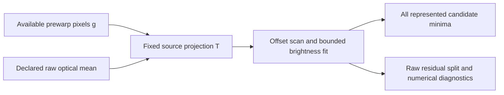

# Fit a declared raw source without inverting weak profile modes

A developer-only fitter estimates a straight plane-edge offset from available
prewarp image samples under a supplied lens-free homography, normal, Gaussian
optical covariance and raw-noise model. It profiles two bounded brightness levels
for each candidate offset. It returns numerical candidates and diagnostics;
production tracing, the UI and geometry remain unchanged. Here “raw” means the
available prewarp linear-light array, not ingestion of camera RAW files.

The [known warp model](warp-observations.md) supplies `A = S G R`. The
[fixed-observation module](profile-observations.md) supplies its retained noise
modes. The [complete experiment and regression record](validation/raw-source-fit.md)
keeps matched controls, adverse outcomes and numerical limits together.

## Fit in the declared source projection

For supplied independent raw standard deviations `D = diag(s)`, factor
`A D = U diag(d) V^T`, retaining the module's declared numerical modes. Define

```text
T = V^T D^-1
z = T g
prediction(e, c, a) = T [(1-p(e)) c + p(e) a]
```

Both observations and predictions use the same `T`. No division by a small
retained `d` is needed. In exact arithmetic this is equivalent to whitening
`A g` by `diag(1/d) U^T`, with the same fixed operator and retained modes. Actual
rectification and filtering also round values. Whitening a rounded profile
can amplify those discrepancies, even when a retained-range check passes.



The selected row space is part of the input. Fitting every available raw pixel
would be a different objective. Changing profile density or support can change
that row space. The fitter does not change support with the candidate offset.
`PixelNoise` stores no pixel coordinates: callers must supply `pixels_xy` in
exactly the order of its sampling-matrix columns. Duplicate, noninteger,
out-of-sensor or mismatched coordinates are refused.

## Put the Gaussian in raw-image coordinates

Let `p0` be a plane anchor, `n` a supplied unit plane normal, and `e` a signed
plane-distance offset. The material half-plane is
`n^T(p-p0) >= e`. For known lens-free homography `H`, its raw line is

```text
ell_raw(e) = H^-T [n_x, n_y, -n^T p0 - e]^T
v(e)^2 = ell_raw_xy(e)^T Sigma_raw ell_raw_xy(e)
p_i(e) = Phi((ell_raw_xy(e)^T q_i + ell_raw_3(e)) / v(e))
q_i = pixels_xy_i + 0.5
```

`Sigma_raw` is supplied positive-definite optical covariance in raw pixels squared.
The offset `e` uses the plane-coordinate length unit determined by `H` (millimetres
in the included study).
This describes the convolution of an ideal straight raw half-plane with a
translation-invariant Gaussian and point-sensor observations. It is not a
Gaussian approximation in the rectified coordinates. The implementation orients
`H` at the anchor and checks a consistent inverse projective chart over the
declared sensor. Multiplying `H` by a nonzero scalar must preserve the model.
An offset interval that makes a raw line degenerate is unsupported.

Radial distortion can curve a line and is outside this primitive. Detector-area
averaging, unknown PSFs, nonlinear tone response, source quantization and
image-derived geometry/noise uncertainty require additional models or evidence.
The original pipeline's prewarp image is already float32 and decoded from saved
intensities; access to it does not recover unrecorded radiance.

## Profile brightness, retain search limits

For every sampled offset, solve the two-variable linear least-squares problem
with both mean levels inside the declared bounds (default `0..255`). Enumerating
free and active box faces handles coupling between coefficients; clipping an
unconstrained solution does not generally solve that problem. Noisy observed
pixels may lie outside the mean-level bounds and are not clipped.

This separation of nonlinear position from linear brightness follows the
[variable-projection method described by O'Leary and Rust](https://www.cs.umd.edu/users/oleary/software/varpro.pdf).
The nonlinear search is a finite grid with bounded local refinement. It retains
represented minima and endpoints, sampled costs and evaluation/work accounting.
Flat, tied, endpoint, rank-deficient, exhausted and numerically unsupported cases
remain explicit. A unique represented minimum is not a global-search certificate,
physical feature identification or a confidence interval.
Here rank deficiency concerns the two brightness-design columns at the chosen
offset. A rank-two design can still have a flat or tied offset search.

A small projected cost can coexist with a large raw-model mismatch. The result
also reports standardized raw residuals split into retained and omitted source
components. These are diagnostics for the supplied model; no physical rejection
threshold is inferred, and omitted components do not silently change the fit.

## Developer API

The functions in [backend/raw_source_fit.py](../backend/raw_source_fit.py) are
Python primitives, with no HTTP endpoint or workbench control:

```python
def plane_edge_probabilities(
    pixels_xy, offset, *, sensor_shape, homography, anchor, normal, psf_covariance
):
    ...

def fit_plane_edge_offset(
    pixels_xy, raw_values, noise, *, sensor_shape, homography, anchor, normal,
    psf_covariance, offset_bounds, level_bounds=(0.0, 255.0), grid_points=65,
    refinement_iterations=40, max_basins=16, max_evaluations=4096,
    work_limit=50_000_000
):
    ...
```

| Input | Contract and units |
| --- | --- |
| `pixels_xy`, `raw_values` | Unique integer `[x,y]` raw pixel indices and finite observed levels, in exactly `noise.matrix` column order; the model evaluates pixel centres at index + 0.5 |
| `noise` | A `PixelNoise.factor` result for the fixed declared operator and supplied positive input deviations, in the same intensity units as `raw_values` |
| `sensor_shape` | `[height,width]` in raw pixels; each dimension is an integer from 1 to 1 billion |
| `homography` | Invertible 3 × 3 plane-to-raw matrix, with a consistent supported projective chart over the sensor and search interval |
| `anchor`, `normal` | Plane anchor in the chosen plane-length unit, and a unit normal; anchors are finite with absolute coordinates at most 1 billion |
| `psf_covariance` | Symmetric positive-definite 2 × 2 covariance in raw pixels squared; no radial distortion or detector-area model is included |
| `offset_bounds` | Two finite, strictly increasing plane-distance endpoints with absolute values at most 1 billion; the sign follows the declared normal |
| `offset` | The probability function's scalar plane-distance offset, finite with absolute value at most 1 billion |
| `level_bounds` | Two finite, strictly increasing bounds on both unknown mean levels, in source intensity units, with absolute endpoint values at most 1 billion; noisy observations are not clipped to them |

The fitter allows at most 512 profile rows and 2,048 source pixels. The underlying
observation/factorization limits also apply. `grid_points` is 3–513,
`refinement_iterations` is 0–64, `max_basins` is 0–32, and `max_evaluations` is
between `grid_points` and 4,096. `work_limit` is 1–100 million accounting units;
the complete grid and residual diagnostics must fit before refinement starts.
Invalid inputs or an insufficient initial budget raise an error. Later
refinement exhaustion returns represented candidates with `work_exhausted`.
These limits bound supported numerical work, not whole-photo runtime.

| Result | Interpretation |
| --- | --- |
| `best`, `candidates` | Numerical minimum and all represented minima/endpoints; each includes offset, two brightness levels, squared projected cost, design rank, kind, bracket and maximum projected residual |
| `grid_offsets`, `grid_costs` | Complete initial scan; unobserved narrower basins remain possible |
| `flat`, `plateau`, `tied`, `endpoint` | Search ambiguity or boundary diagnostics; no physical edge-identity decision |
| `rank_deficient` | The selected brightness design has rank below two; its absence does not establish offset identifiability |
| `work_exhausted`, `numerically_unsupported` | Limits or arithmetic prevent stronger numerical interpretation; inspect the retained candidates |
| `raw_residual_l2`, `raw_residual_maximum` | Norm and maximum of `(observed - predicted) / input_std`; standardized values, not raw intensity errors; can be `None` when unsupported |
| `retained_residual_l2`, `omitted_source_residual_l2` | Standardized raw residual split along and outside the retained source row space; can be `None` when unsupported |
| `comparison_tolerance` | Floating-arithmetic cost comparison guard; not a measurement allowance or statistical threshold |
| `global_search_certified` | Always false for this finite search |

`evaluations`, `work`, `projection_rank` and `raw_pixel_count` retain execution
and model dimensions. `dataclasses.asdict(result)` exposes the result as ordinary
Python containers for JSON serialization. No field automatically accepts or
moves CAD geometry.

## Repeat

```bash
make raw-source-fit-study OUTPUT=.local/raw-source-fit-new.json
.venv/bin/python studies/verification/raw-source-fit-oracle-v1.py --output .local/raw-source-oracle-new.json
.venv/bin/python -m pytest -q tests/test_raw_source_fit.py
```

Run from the repository root after workbench setup. This command executes the
fixed synthetic plan; it does not fit an uploaded workbench photograph. The study
requires a fresh JSON path, a Git checkout and the declared plan in `studies/raw-source-fit-v1.json`.
It records source/input/operator hashes, runtime versions and every planned case.
No CAD server, photograph upload, native application or language model is used.
Use [the validation record](validation/raw-source-fit.md) for the measured limits.
The separate oracle also requires a fresh JSON destination. It checks independent
geometry and bounded brightness solutions; it does not fit a physical photograph.

For direct developer use, [backend/raw_source_fit.py](../backend/raw_source_fit.py)
exports `plane_edge_probabilities` and `fit_plane_edge_offset`. Build the supplied
`PixelNoise` from the exact declared operator, extract unique source values in
its column order, and provide sensor shape, homography, unit normal, anchor,
optical covariance and finite search bounds. `result.best` is a numerical
candidate even when flags are set; inspect all candidates and diagnostics before
interpretation. The result never automatically accepts or moves CAD geometry.

The separate [common-response tool](response-calibration.md) can check externally
supplied exact calibration bands. It does not estimate a response from this fitter's
edge, alter the objective, or justify inverse-transforming samples and reusing the
same noise covariance. Its [controls](validation/response-calibration.md) retain
response/edge ambiguity and incorrect-calibration failures.
