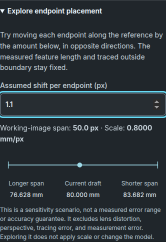

# Explore reference endpoint placement

[Documentation index](README.md) · [Guided workbench review](validation/guided-workbench.md)

Open **Use a known feature → Explore endpoint placement** after entering two valid endpoints and a known length. The readout uses the orientation-adjusted working image, whose longest side is at most 1400 pixels. It shows the draft reference span, millimeters per working-image pixel, and calculated outside widths for an explicit endpoint-shift scenario.

Browser-rendered example with a 1.1-pixel assumed shift per endpoint. The dimensions are synthetic test inputs.

The shift is an assumption you choose, from 0 to 5 working-image pixels per endpoint; the initial value is 1 pixel. Both endpoints move along their connecting line in opposite directions, either shortening or lengthening that span. The known physical feature length and traced outside width in pixels stay fixed. The chart uses source dimensions before any Design & print scaling; the display follows your millimeter/inch choice.

For outline width `B` pixels, reference length `L` mm, endpoint span `s` pixels, and assumed shift `d` pixels per endpoint:

| Scenario | Reference span | Calculated source outside width |
| --- | --- | --- |
| Longer span | `s + 2d` | `B × L / (s + 2d)` |
| Current draft | `s` | `B × L / s` |
| Shorter span | `s − 2d` | `B × L / (s − 2d)` |

For example, `B = 100`, `L = 40`, `s = 50`, and `d = 1` produce 76.923, 80.000, and 83.333 mm. If `s ≤ 2d`, the shorter span can reach zero, so the interface shows no finite range. At zero shift, all three widths coincide and the graphic collapses to one mark.

The explorer appears only for a valid reference draft whose current width is
inside the supported build range. Its scenario widths are not clipped to that
range: a hypothetical shift can therefore show a width that the workbench would
not accept as an applied size. The [reference-width arithmetic guard](engineering-model.md#geometry-units-and-design-changes)
does not turn the scenario into a physical tolerance or an uncertainty estimate.

These are calculated scenarios, not measured errors, confidence intervals, accepted tolerances, or predicted print dimensions. The assumed shift does not cover lens distortion, perspective, tracing/simplification error, reference measurement error, or material/process effects. No statistical distribution is assumed. There is no universal pass/fail reference length. A longer span reduces this particular sensitivity for a fixed per-endpoint shift; it cannot establish physical accuracy.

Exploration does not change endpoints, apply scale, invalidate a current model, or enter the saved recipe. Use **Apply reference scale** to commit the actual endpoint draft. Compare independent physical measurements and a prototype before fabrication.

## Research basis and limits

The equations above are a direct consequence of the workbench's uniform scale model. They are independently checked with fixed numeric browser cases; no paper-derived performance score or threshold is used.

- [Gądek-Moszczak, *The impact of the resolution of the measured object on the assessment of its perimeter* (2019)](https://scispace.com/papers/the-impact-of-the-resolution-of-the-measured-object-on-the-35j4wau7ly): the abstract reviewed through SciSpace describes generated test objects and progressively reduced image resolution. It supports treating image resolution as relevant to measurement; its perimeter study is not a validation of this workbench's width scenario. Full methods and results were not reviewed.
- [OpenCV camera calibration and 3D reconstruction](https://docs.opencv.org/4.12.0/d9/d0c/group__calib3d.html): intrinsic calibration and lens-distortion models are separate from a single uniform length scale. The scenario adds neither capability.

Reviewed November 10, 2026. A measured-photo benchmark with independent ground truth remains future work.
