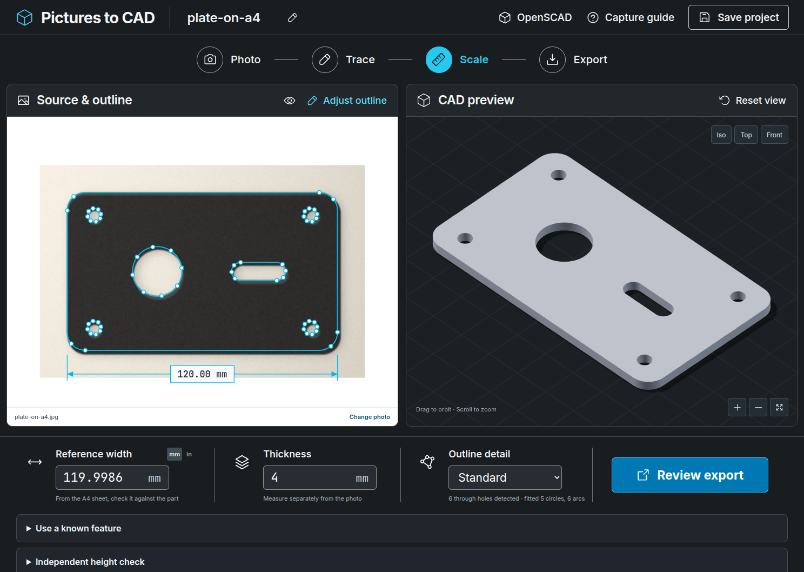

# Reference-sheet tracing: method, mathematics and evidence

Lay the part on a sheet of known size, photograph the whole sheet, and choose that sheet as the **Scale reference**. The photo then supplies more than an outline:

- **Scale** from the sheet's stated size, so no calipered outside width is needed. Your own width measurement becomes an independent check.
- **Perspective and lens correction** from the sheet's four edges.
- **Thickness parallax correction**: the camera's position, recovered from the sheet, together with the thickness you enter, removes the visible side walls of a thick part.
- **Exact geometry**: lines, tangent arcs and circles fitted with residuals, then exported as true cylinders (STEP), `ARC`/`CIRCLE` entities (DXF) and `circle()` calls (OpenSCAD).
- **A check of the sheet you chose**: its proportions, though not its scale, are measured from the photo.



The screenshot shows the browser-test fixture `tests/e2e/fixtures/plate-on-a4.jpg`, a rendered photo, after building with a 4 mm thickness.

This page describes each stage, the mathematics it depends on, and the tests that check that mathematics. The code is in `backend/sheet.py`, `backend/edges.py`, `backend/fitting.py` and `backend/reference.py`. The tests are in `tests/test_fidelity_math.py` (mathematical verification) and `tests/test_sheet_reference.py` (measurement accuracy against rendered photographs).

## Evidence boundary

The accuracy figures here come from **synthetic photographs** with exact ground truth (`tests/synthetic.py`). The renderer models a pinhole camera with radial distortion, uneven light, vignetting, a soft shadow, optical blur, noise, JPEG compression and the walls of a thick part. It also uses the same single-coefficient lens model the estimator fits. Light is mixed and blurred in linear light and saved through the sRGB tone curve, the same curve the tracer decodes. A real camera adds its own tone mapping, which neither side models; §3 gives the cost of a mismatched curve. The sheet is exactly its nominal size and perfectly flat, and the walls are vertical with uniform tone.

Real lenses, paper tolerance, a curled sheet, chamfered or shiny edges will all do worse. These figures show which error sources each stage removes and the floor it reaches. They are not a physical accuracy claim. A measured-photo benchmark with calipered parts and real phones remains necessary; [the photo benchmark](photo-benchmark.md) runs one on your own photos, and no result from real photos is recorded yet.

## Pipeline

```text
photo (full resolution, <= 16 MP)
  -> linear-light copy of the photo (sRGB decoding), used for every sub-pixel measurement
  -> find the sheet: largest convex quadrilateral (bright first, then dark) holding contrasting content
  -> sub-pixel points on each sheet edge (two passes)
  -> radial lens coefficient k1 from edge straightness (plumb-line)
  -> homography H: sheet millimetres -> undistorted photo pixels
  -> sheet-proportions check, and camera pose if a thickness is entered
  -> exact cubic resampling of linear light onto a millimetre grid (analysis), fast resampling (display)
  -> illumination-flattened part/sheet classification, on saved values
  -> sub-pixel boundary at the local mid-level (two passes), edge blur sigma
  -> thick parts: two-step wall model on narrow wall bands, then top-face parallax correction
  -> circles / lines / arcs, design-intent snapping, constrained fillets, blur-curvature correction
  -> rotate to the part's own axes, display crop, Profile (polygons + exact primitives + evidence)
```

Coordinates follow the repository convention: pixel *i* spans [*i*, *i* + 1], so its centre is *i* + 0.5. The rectified image is addressed in millimetres times pixels per millimetre (`ppm`). That is 1.25 × the photo's native resolution at the sheet centre, clamped to 4–12 px/mm and to at most 12 MP.

## 1. Sheet and lens

**Edges.** Each sheet side is sampled from 6 % to 94 % of its length, clear of the corners. Each sample moves along the side normal to the local mid-level crossing (§3). A second pass re-centres on the first crossings. Lens distortion bows a real edge several pixels away from the corner-to-corner chord, which would otherwise put one level window on the transition. With one pass, k₁ was underestimated by 8–16 %; with two, corners are within 0.05 px.

**Lens model.** x_d = x_u (1 + k₁ r_u²), with r normalised by the image half-diagonal and centred on the image. A golden-section search over k₁ ∈ [−0.25, 0.25] minimises the RMS straightness of the four undistorted edges. A correction is kept only if it reduces that RMS by at least 20 %.

**Inverse.** Undistorting solves r_u + k₁ r_u³ = r_d by Newton's method. The forward map is monotonic while 1 + 3 k₁ r_u² > 0, which holds over the whole frame for |k₁| ≤ 0.25. The earlier fixed-point inverse x = x_d / (1 + k₁ r²) contracts slowly at strong distortion. At k₁ = −0.25 it left a 4.6 px error at the image corners; Newton's method leaves ≤ 1.4 × 10⁻¹² px for every allowed k₁ (`test_newton_undistortion_is_the_inverse_of_the_lens_model`). Noise-free distorted edges give back k₁ within 10⁻⁶ (`test_plumb_line_recovers_the_radial_coefficient_from_noise_free_edges`).

**Homography.** Total-least-squares lines through the undistorted edge points are intersected for the four corners, and `cv2.findHomography` maps the sheet's millimetre corners onto them. The longer pair of opposite sides is matched to the sheet's long dimension.

## 2. Resampling without positional quantisation

`cv2.remap` quantises interpolation positions to 1/32 pixel. Measured with an intensity ramp, which cubic interpolation must reproduce exactly, it moved rectified content by up to 0.086 photo px (RMS 0.036). That is the same size as the edge noise being measured. The measurement image is therefore resampled in float64 with the Keys cubic kernel (a = −½), which reproduces polynomials up to degree two. Linear and quadratic photo intensity fields are returned to float32 precision at every mapped position (`test_measurement_resampling_reproduces_quadratic_fields_exactly`). An A4 sheet at 11 px/mm takes 0.9 s. The display image still uses `cv2.remap`, which affects nothing measured. Rectification follows the pixel-centre convention: an analytic feature at plane point *c* lands at *c* · ppm within 0.02 px (`test_rectification_follows_the_pixel_centre_convention`).

## 3. Segmentation and sub-pixel edges

**Classification.** After an initial Otsu split, a robust cubic polynomial surface is fitted to the sheet (pixels at least 4 mm from the part) and a plane to the part. Each pixel is normalised as (sheet − value) / (sheet − part) and classified at 0.5. Gradients, vignetting and soft shadow therefore do not move the threshold. Only the largest region is kept, and a 3 mm sheet margin is excluded.

**Linear light.** A lens and sensor blur the scene in linear light. The camera then saves each value through a tone curve, close to a 2.2 gamma, which bends a blurred edge's profile. The mid-level property below holds only in linear light.

On saved values, the mid-level between linear tones L < H is the linear level lin((enc(L) + enc(H)) / 2). A Gaussian edge reaches that level at σ · Φ⁻¹(s) from the edge, where s is the level's share of the step. For the test plate's saved tones (48 on 236), s = 0.30 and the crossing sits 0.53 σ inside the darker side. In the rendered photos that made holes read about 0.25 mm too large and the outline about 0.3 mm too small. `test_saved_values_bias_the_half_level_as_predicted_and_linear_light_removes_it` checks the prediction and its removal.

The tracer therefore decodes the photo with the sRGB curve (IEC 61966-2-1; `backend/tone.py`) and makes every sub-pixel measurement on linear light: the sheet's edges, the resampling onto the millimetre grid, the part's boundary, the edge blur and the wall model. Finding the sheet and classifying the part still use saved values, the scale their thresholds were set on. Contrast limits are stated on that scale too, because a processed photo's noise is roughly even there. Any fixed mix of linear colour channels keeps an edge's mid-level in place, so the photo's colour primaries do not matter; only its tone curve does.

That freedom also chooses the mix. Luminance is used while it leaves at least 24 saved grey levels across the boundary at its weakest stretch (the 5th percentile along it), twice the 12 a measurement needs. Two colours can differ clearly in the saved photo and still have the same luminance: pure green and a 220 grey are 70 grey levels apart there. The tracer then takes the candidate mix with the best weakest stretch: each channel weighted by its own difference between the two sides' typical colours, an even mix, or one channel alone. It does this for the part against the sheet and for the sheet against the surface under it, and the trace notes a colour mix.

Judging by the weakest stretch matters for a part of two colours. A mix chosen from the main colour alone can make the other colour equal to the sheet; a pale pink plate with a green patch then read 66 mm wide, not 80, and lost a hole. On lossless rendered photos that plate, a green part on the grey sheet and a grey sheet on a green table all trace within 0.01 mm (`test_a_two_colour_part_keeps_the_boundary_of_its_smaller_colour`, `test_parts_and_sheets_that_differ_in_colour_are_measured_on_the_channels_that_differ`).

A camera whose curve differs from sRGB leaves part of the bias. On the overhead rendered photo (ideal light, 2400 × 1800), the largest of the five errors reported under Results was:

| Camera's curve | Largest error (mm) |
| --- | --- |
| sRGB | 0.003 |
| Plain gamma 2.2 | 0.019 |
| Plain gamma 2.4 | 0.027 |
| Plain gamma 2.0 | 0.065 |
| Plain gamma 1.8 | 0.114 |
| Linear (no curve) | 0.318 |

Phone cameras also apply their own tone mapping, which the file does not record. Its cost is not measured here.

**Mid-level crossing.** Each boundary point is moved along its normal to where the profile crosses the mean of its two end medians. Profiles are sampled with exact float64 bilinear interpolation (§2). For a straight edge blurred by any symmetric point-spread function, the crossing of the continuous profile is the edge itself, whatever the blur width.

Sampling a pixel-integrated image adds a phase-dependent error ("pixel locking"):

- zero for a box blur, because the interpolated profile is exact;
- at most 0.03 px for Gaussian or triangular blur;
- zero-mean over the sub-pixel phase, so it averages out along any edge that is not aligned with the pixel grid.

This is checked at 16 phases by `test_half_level_crossing_on_symmetric_blur_is_unbiased_on_average`. Cubic profile interpolation did not reduce it. An area (moment) estimator removes it on noise-free data, but with realistic sensor noise its per-point spread was larger (0.052 against 0.043 px), so the crossing is kept.

**Two passes.** Pass 1 starts from boundary-pixel centres, about half a pixel inside one side, so its level windows are asymmetric. That grew holes by about 0.09 px at σ = 2 px. Pass 2 re-centres every point, with windows beyond 3.5 σ on both sides.

**Edge blur.** σ is the 25–75 % rise distance divided by 1.349 (the Gaussian value), taken as the median over the outer boundary.

**Shadows (not corrected).** A soft shadow makes the paper brighter away from an edge, with slope b per pixel. The blurred profile at the edge is (a + b₀)/2 + b σ/√(2π) for part light a and paper light b₀ at the edge. The level taken from the profile's ends, whose medians lie at 85 % of the half-window H, is (a + b₀ + 0.85 b H)/2. The crossing therefore moves out of the part by b (0.425 H − σ/√(2π)) divided by the edge's slope, about 2.7 σ² b / (b₀ − a) for H = 3.5 σ (`test_a_sloped_plateau_shifts_the_half_level_by_the_predicted_amount`).

In the tilted rendered photo the error grows with the shadow's depth, and almost all of that photo's error is its shadow:

| Light the shadow removes | Ø6 | Ø22 | Slot | Outer |
| --- | --- | --- | --- | --- |
| None | 0.001 | 0.004 | 0.008 | 0.004 |
| 25 % (the test photos) | 0.012 | 0.026 | 0.027 | 0.025 |
| 47 % (25 % darker in the saved photo) | 0.024 | 0.054 | 0.066 | 0.055 |

`test_without_a_shadow_the_tilted_trace_is_several_times_tighter` and `test_a_deep_shadow_biases_edges_by_a_bounded_amount` hold these figures. Fitting each plateau's slope, instead of taking its end median, would remove the effect; that is not implemented.

## 4. Blur–curvature correction

A blurred curved edge's half-level contour moves toward its centre of curvature, for either polarity. Let X be the blurred position of a point at distance ρ from a disc's centre. Write the half-level condition P(|X| ≤ R) = ½ with tangential offset v ~ N(0, 1), and expand √(R² − σ² v²) in ε = σ/R. Using E v² = 1, E v⁴ = 3 and E v⁶ = 15 gives

> half-level radius = R − σ²/(2R) − (5/24) σ⁴/R³ + O(σ⁶/R⁵),

and inverting the series gives the correction used for every freely fitted arc and circle:

> R = r + σ²/(2r) − σ⁴/(24 r³) + O(σ⁶/r⁵).

`test_blur_curvature_series_and_its_inversion` evaluates the blurred disc by Gauss–Legendre quadrature, with x = R sin θ removing the square-root endpoint singularity. The integrator is first checked against the closed form at the centre, 1 − exp(−R²/2σ²), to 10⁻¹². The test then finds:

- the third-order coefficient converging to −5/24 (−0.20855 at R = 30σ);
- the residual after the second-order term falling as R⁻³ (slope −3.02);
- the inverted correction leaving an error of about 0.03 σ⁶/R⁵, which is 10–1000 times smaller than the first-order correction (for example 1.7 × 10⁻⁴ σ at R = 3σ).

Slot end caps take their radius from the spacing of their straight sides, which blur does not bias, and are not corrected.

**A fillet needs the blur in its fit, not a correction after it.** A fillet's centre is tied to its radius (§7): c(r) = c₀ + r v. Blur draws the traced arc toward its centre by s = σ²/(2R) and leaves the centre and both edges where they are. A fit of r alone cannot follow those points by shrinking, because shrinking r also moves the centre toward the corner. For a right-angle corner the mismatch along the arc, at angle θ from the bisector, is s + e (1 − √2 cos θ) for a radius error e. Least squares over the quarter turn gives e = +3.0 s: the fillet reads three shrinks too large, where a free circle reads one too small. The free-circle correction then added a fourth.

Fillets are therefore fitted to a circle of radius r − s(r) about c(r), with s(r) the series above, and are not corrected afterwards. Within about 2.5 σ of where the arc meets an edge the traced curve is neither arc nor line; those points are left out of the fit.

- On exact geometry (`test_a_fillet_fitted_with_the_blur_in_its_model_keeps_its_true_radius`), ignoring the blur leaves fillets 3.7 to 4.0 s large, and the fit with it is within 0.3 s.
- On rendered, blurred plates (`test_blurred_fillets_keep_their_radius_when_snapped`), R8, R4 and R2.5 corners read within 0.007 mm at blurs of 0.34 and 0.46 mm. Before, they read 0.027, 0.053 and 0.16 mm large.
- On the rendered photos of the test plate, the R8 corners' mean error fell from +0.029 to +0.005 mm, with every other dimension unchanged ([photo benchmark](photo-benchmark.md)).

**The exact blurred corner.** The shrink s(r) is the disc's, and a fillet is a disc only in the middle of a long arc. Near its ends, and over the whole of a short arc, the blurred edge is neither arc nor line. At a 150° corner a fillet's arc spans only 30°, and on exact outlines the fit above read radii up to 19 s large, with nothing flagging them. Fillets are therefore refined against the exact blurred corner, `fitting.corner_level`. It treats the corner as an arc of radius r about c, from angle a₁ through a sweep β < π, plus the two tangent lines running away from it. The corner is star-shaped from c. A ray at angle α leaves it at:

- R(α) = r across the arc;
- R(α) = r / cos(α − aᵢ) beyond each tangent point, for a quarter turn;
- nowhere (R = ∞) in the opening between the lines.

With q = c − p, b = q·e(α) and h² = |q|² − b², the radial integral of the Gaussian has a closed form. That leaves one smooth integral over the angle:

> u(p) = ∫ { [e^(−|q|²/2σ²) − e^(−((R+b)² + h²)/2σ²)] / 2π − b/(σ√2π) · e^(−h²/2σ²) · [Q(b/σ) − Q((R+b)/σ)] } dα,

with Q the upper normal tail. The integral runs over the directions within 9 σ of p (all directions when p is that close to c), by composite Gauss–Legendre broken at the arc's ends. It is 160 pieces when rays from c graze the edges and 40 otherwise. Q uses a Chebyshev erfc with fractional error below 1.2 × 10⁻⁷ (`test_erfc_matches_the_standard_library_within_its_stated_accuracy`). The traced edge is u = ½ whichever side the material is on, because the two blurred indicators sum to one.

The model is checked against a separate computation that shares no code with it. For a convex shape each vertical line meets the shape in one interval [bot(x), top(x)], so u(p) = ∫ φ(x − pₓ)[Φ((top − p_y)/σ) − Φ((bot − p_y)/σ)] dx. Around every corner of two filleted pentagons (corners of 60°, 90°, 120° and 150°; r from one to twelve σ), the two agree to 10⁻⁶ at the points the fit uses. A sharp right angle gives exactly Φ(x/σ)Φ(y/σ) (`test_blurred_corner_matches_closed_forms_and_an_independent_integral`).

Each fillet's radius is then found by Gauss–Newton. The fit uses the arc's points and the edges' points out to 5 σ beyond the tangent points. Each point's residual is (u − ½)/|∇u|, its distance from the model's edge to first order. The fit's own derivatives carry four uncertainties into the radius's standard deviation r_sd:

- the residual noise;
- that noise's correlation along the edge, measured on the neighbouring straight edges as 1 + 2Σρₖ (Geyer's initial positive sequence);
- a 5 % uncertainty in the measured blur;
- a 0.03 px systematic error in each edge's position.

A wide corner magnifies the last of these most. On a rendered octagon the tracer places axis-aligned and diagonal edges about 0.03 px apart, and its 135° fillets then read 0.07 mm small.

**Sharp corners.** Blur rounds a sharp corner too, and the same model at r = 0 describes it. A fitted fillet is kept only if its outline differs somewhere from the sharp corner's by twice the edge uncertainty. Otherwise the corner is traced as sharp. The trace then gives the radius at which a fillet would first show (found by bisection), as a bound on any fillet there. Before, a sharp 120 × 70 mm plate at a 0.32 mm blur was fitted with fillets of R0.4 to R0.6 mm. Now it is sharp, with any fillet bounded under R0.23 mm (`test_sharp_corners_are_traced_sharp`).

**What the photo cannot resolve.** At the corner's midpoint a radius error moves the outline only (1/sin(θ/2) − 1) times as far: 1.0 at 60°, 0.41 at 90°, 0.15 at 120°, 0.035 at 150°. A radius whose r_sd exceeds 10 % of it is named in the trace's notes and warnings, with the outline's own uncertainty. The note says "or more", because once r_sd is a large share of r the fit is no longer linear and the spread is larger still.

Evidence:

- **Exact recovery** (`test_fillets_keep_their_radius_at_every_corner_angle_and_size`). On exact blurred outlines of filleted pentagons, with r from 2 to 50 σ, every fillet's outline is within 0.001 px. Every radius up to 120° is within 0.005 px + 0.1 %. The one exception is a 150° fillet of 2 σ, which moves the outline less than the edge uncertainty: it is traced as sharp, with a bound above its true radius.
- **Statistics** (`test_reported_fillet_uncertainty_matches_its_monte_carlo_spread`). Over forty tracings with 0.1 px noise correlated over four points, radii are unbiased within four standard errors. The reported r_sd is 1.3 to 1.4 times the observed spread. Without the measured correlation it would read under half.
- **Reporting** (`test_a_wide_fillet_the_photo_cannot_resolve_is_reported`). With 0.03 px of edge noise, R8 px fillets at 150° are reported in each of six tracings; the 60° and 90° corners never are.

| Corner | Before, r/σ < 5 | Before, r/σ ≥ 5 | Exact corner, r/σ < 5 | Exact corner, r/σ ≥ 5 |
| --- | --- | --- | --- | --- |
| 60° | 0.05 s | 1.1 s | 0.00 s | 0.00 s |
| 90° | 0.25 s | 2.5 s | 0.01 s | 0.01 s |
| 120° | 4.7 s | 8.0 s | 0.03 s | 0.03 s |
| 150° | 13 s | 19 s | 0.28 s | 0.22 s |

The table gives the worst radius errors on exact blurred pentagons (σ = 1.6 and 2.5 px, r = 5 to 80 px), in units of the shrink s. `scripts/corner_sweep.py` (`make corner-sweep`) traced them with its own continuum integral, independently of `corner_level`. With `--backend` it runs another checkout's fitting chain, which gave the "before" column. Smaller 150° fillets (r = 5 px at both blurs, and 8 px at σ = 2.5 px) were traced as sharp. Their bounds, 6.4, 8.0 and 8.04 px, are each above the true radius. The table's "before" is `main` with the large-radius and stub fixes. On rendered plates (`test_wide_corner_fillets_keep_their_radius_within_the_reported_uncertainty`), 150° R4 fillets read within 0.11 mm (0.13 mm before), inside their reported ±0.19 mm.

## 5. Camera pose and thickness parallax

**Focal length.** Remove the principal point (taken as the image centre, with square pixels). The columns of H = K[r₁ r₂ t] then satisfy two constraints at any overall scale of H:

> (h₁₁h₁₂ + h₂₁h₂₂)/f² + h₃₁h₃₂ = 0 (r₁ ⊥ r₂),
> (h₁₁² + h₂₁² − h₁₂² − h₂₂²)/f² + h₃₁² − h₃₂² = 0 (|r₁| = |r₂|).

`test_exact_focal_length_constraints` checks both exactly, in rational arithmetic, for random rational cameras built with Cayley-transform rotations. The pose uses the least-squares solution when the two individual estimates agree within 15 %. Otherwise, as in a frontal or cropped view, it uses the EXIF 35 mm-equivalent focal length, and failing that a typical 26 mm phone lens, which is reported. Over 200 random tilted cameras, focal length is recovered to 10⁻⁹ and the camera centre C = −Rᵀt to 10⁻⁶ mm (`test_camera_pose_recovers_random_cameras_and_refuses_frontal_ones`).

**Top-face parallax.** Seen from C, at height D above the nadir N, a face at height t projects onto the sheet plane by a central similarity:

> q = N + (p − N) · D/(D − t).

`test_exact_top_face_projection_is_a_homothety_about_the_nadir` verifies H₀⁻¹H_t equals exactly this homothety matrix, in rational arithmetic, for random cameras and thicknesses. A silhouette point whose material-outward normal faces away from N is formed by the top edge and is scaled back by (D − t)/D. A point facing N is formed by the bottom edge and is left unchanged. The same rule applies to holes, using the material's outward normal, which points into the hole.

**Walls narrower than the blur.** Where the bottom edge forms the silhouette, the visible wall lies between it and the top edge in a band of width w = (D/(D − t) − 1)·|(p − N)·n|. The profile is then a blurred two-step (sheet → wall → top face). For a wall whose step above the top face is 16 % of the sheet-to-top contrast in linear light, a single mid-level crossing is biased into the material by:

| w / σ | 0.25 | 0.5 | 1.0 | 1.6 | 2.5 | 4.0 | 6.0 |
| --- | --- | --- | --- | --- | --- | --- | --- |
| bias / σ | −0.040 | −0.078 | −0.144 | −0.196 | −0.202 | −0.082 | −0.002 |

The bias grows roughly in proportion to the wall's share of the contrast. The rendered plate's dark walls (saved tone 78, top face 48, paper 236) have a 6 % share in linear light, so their bias is about a third of the table's.

The profile is therefore modelled as I(t) = C(1 − P₁) + B(P₁ − P₂) + A P₂, with P₁ = Φ((t + w − e)/σ) and P₂ = Φ((t − e)/σ). This is linear in the tones A (sheet), B (wall) and C (top face) for a given edge offset e. Each candidate e is solved by least squares (variable projection), and the residual minimum is refined by a parabola.

As w → 0 the wall term tends to (B − C)(w/σ)φ, which is indistinguishable from a shift of e: the wall tone and the edge position are confounded. The fit is therefore made well-posed in three steps:

- The wall tone is measured only where bands are at least 2.5 σ wide, where a free fit recovers it.
- That tone is then held fixed for the narrower bands.
- The refinement is applied with full weight for 1.5–2.5 σ, tapering to zero at 0.5 and 3.5 σ so the boundary stays continuous.

On exact profiles the fixed-tone fit is unbiased within 0.01 σ, while the free fit is biased (`test_two_step_wall_model_is_unbiased_with_a_known_wall_tone_and_degenerate_without`). The taper was chosen on 2026-11-10 with an earlier renderer that mixed tones on the saved scale: refinement over the whole 0.25–4 σ range made strongly tilted shots worse, because soft shadow and uneven wall shading break the flat-tone model, and the tapered 1–3 σ range was better on every feature at 9° and on four of five at 22°. That comparison has not been repeated in linear light.

On the 9° photo of the 4 mm plate (2400 × 1800, linear light), the model's effect depends on the shadow:

| 9° tilt, 4 mm thick | Ø6 | Ø22 | Slot | Hole position | Outer |
| --- | --- | --- | --- | --- | --- |
| No shadow, wall model | 0.0012 | 0.0016 | 0.0174 | 0.0051 | 0.0060 |
| No shadow, without it | 0.0101 | 0.0143 | 0.0395 | 0.0058 | 0.0122 |
| 25 % shadow, wall model | 0.0073 | 0.0184 | 0.0212 | 0.0058 | 0.0234 |
| 25 % shadow, without it | 0.0029 | 0.0051 | 0.0303 | 0.0066 | 0.0233 |

Without a shadow the model cuts the hole errors about eightfold. With the shadow, the uncorrected trace reads these holes better only because two biases cancel: the dark wall pulls the edge into the material and the shadow pushes it out. With a lighter wall (saved tone 110) the model wins in both cases; with the shadow it takes Ø6 from 0.040 to 0.006 mm.

In a near-frontal photo the walls are too narrow to measure their tone. No refinement is attempted, and the trace notes a bound instead: edges facing the camera may read up to 0.2 σ into the part. That figure is the table's maximum, so it assumes a wall share of at most 16 %; a brighter wall can exceed it. A slightly tilted photo shows wider walls and avoids it.

## 6. Sheet proportions check

Scaling the stated plane axes by (a, b) multiplies the columns of H by a and b. That cannot change whether r₁ and r₂ are orthogonal, so the orthogonality constraint alone gives a focal length that is independent of the stated sheet size. With that focal length, the ratio of the first two column norms of K⁻¹H equals (true aspect)/(stated aspect). In a frontal view the ratio barely depends on the focal length, so the check works for any view.

Over 200 random cameras, the focal length is invariant and the ratio equals a/b to 10⁻¹² (`test_sheet_proportions_are_measurable_and_focal_length_ignores_them`). On rendered photos the measured ratio matched within 0.01 % at every tilt from 0° to 22°. An A4 photo traced as US Letter reads 0.9151 (theory 0.91503), and a custom width entered 1 % too large reads 0.9901. Every trace reports the check. A difference above 1 % becomes a visible warning, because every dimension scales with the chosen sheet.

## 7. Lines, arcs and circles

- **Circles.** A Kåsa algebraic fit, then Gauss–Newton on geometric distance. A circle is accepted when its RMS residual is below max(tol, 1 % r) and its largest residual below four times that. Noise-free arcs of 20–360° are recovered exactly, and the fit is equivariant under rotation, translation and scale (`test_circle_fit_is_exact_and_similarity_equivariant`). Its radius bias over 2000 noisy circles is within σ²/R + 4 standard errors (`test_geometric_circle_fit_bias_is_second_order_in_noise`).
- **Lines and arcs.** Douglas–Peucker breakpoints at 1.5 × tolerance split each ring. Breakpoint edges of at least `min_line` (2.5 % of the part, clamped to 1–3 mm) with a total-least-squares RMS below tolerance are taken as lines, unless they turn out to be chords of an arc (next item). Consecutive line edges that still fit one line are merged, and runs between lines become arcs. An "arc" between two lines running the same way is a noise bump and is merged into one line. Points within tolerance of a neighbouring line are trimmed before an arc's fit, because tangent-region points pull its centre. An arc too small to trim that way gives the straight run at each end back to its line (the item after next). Rings that cannot be described within tolerance stay as traced polylines.
- **Chords that pass for lines.** A chord of length c on an arc of radius R bows c²/(8R) from the arc, and a breakpoint is placed only where that exceeds 1.5 × tolerance. Breakpoints therefore leave chords of up to √(12 R tol), and those chords are straight enough to pass the line test. Once √(12 R tol) reaches `min_line`, an arc would be cut into short straight pieces. With `min_line` at 3 mm that is from R25 at the 0.03 mm tolerance floor and from about R15 at a 0.34 mm blur. On a part under 40 mm across, where `min_line` is 1 mm, it is from about R3.
  - Each edge taken as a line is therefore tested against the circle fitted to its neighbours. The neighbours are the arc edges that adjoin it. Where a side has none and the others are too straight to define a circle (a line fits them within tolerance), the line edge on that side stands in. The edge is a chord when its own points lie on that circle to an RMS of half the tolerance.
  - Edges are tested in order round the ring until none changes, so an arc grows chord by chord and later chords are judged against the arc so far. An edge absorbed on its own, still between two lines, becomes a line again: one chord is not an arc.
  - A straight edge is absorbed only if it lies on its neighbours' circle to half the tolerance. A slot side, or any flat between two arcs with different centres, does not, because no one circle follows both arcs and the flat. A flat that runs tangentially off the end of an arc leaves the circle by L²/(2R) at its far end and is kept once it is about as long as the arc's longest chord. A shorter one leaves the circle by only a few times the tolerance, the breakpoints often do not separate it from the arc, and it is absorbed. Facets are absorbed only where the run stays within about 1.5 × tolerance of one circle.
  - On exact geometry, plates with R5 to R400 corners come out as four lines and four arcs with every radius and centre exact to 10⁻⁶ (`test_arc_chords_long_enough_to_pass_for_lines_are_recovered_as_one_arc`). A stadium's 4 mm sides between R30 ends, a 4 mm flat off the end of an R60 arc and a corner of three 4 mm facets stay lines (`test_straight_edges_no_longer_than_an_arcs_chords_stay_lines`, `test_one_chord_between_two_lines_is_not_an_arc`).
  - On rendered, blurred plates, R20 and R30 corners at a 0.34 mm blur, R25 at 0.23 mm and R6 on a 36 mm plate read within 0.01 mm, fitted freely and as fillets (`test_corners_whose_chords_pass_for_lines_are_fitted_as_arcs`). A corner turned by five 3.2 mm facets, which bow twice the tolerance from a circle at that blur, stays five lines (`test_blurred_facets_are_not_taken_for_an_arc`). On rendered photos of the test plate with R20 and R25 corners the outline is four lines and four arcs, where it was a polyline of 67 or 77 segments (`test_large_corner_radii_trace_as_arcs`).
  - Two chords. An arc that the breakpoints cut into only two chords, each passing for a line, goes back to being two lines under the rule above. That happens at wide corners and under a wide blur: on exact outlines (§4) a 150° R40 px corner at σ = 2.5 px and a 120° R12.5 px corner lost their arcs, which moves the outline 1.4 and 1.9 px. Before edges are merged, each longest run of two or more edges is therefore marked curved when it contains a line and meets three conditions (`fitting._curved_runs`). One circle fits it, with RMS under half the tolerance and worst point under 1.5 tolerances. One line does not. And each of its line edges is itself bowed along that circle: its own points lie closer to the circle than to their own best line. A chord of an arc bows by L²/8r and passes. A straight facet or flat does not, however well the run as a whole fits a circle, so the facets and flats the rule above keeps as lines stay lines (`test_an_arc_cut_into_two_chords_stays_one_arc`).
- **Small arcs, sharp corners and stubs.** An arc is trimmed as above only when at least eight of its points are clear of its lines. A smaller one is fitted to all of its points. Most of these are sharp corners that only the blur rounds: under a blur of σ the outline of a sharp corner leaves each edge within about 3 σ of the corner.
  - A breakpoint can fall anywhere on a straight edge. The ring's first point is always one, and so is the farthest point from a chord that runs parallel to the edge. Within `min_line` of a corner it cuts off a stub that is too short to be a line, and the stub was fitted with the corner as one arc. That arc either failed the residual check, which left the whole ring a polyline, or passed it with a radius many times too large.
  - Each line beside a small arc therefore runs on to the last of the arc's points that lies within half the tolerance of it, and the arc is fitted to the points between. Fewer than three points define no circle: the arc is dropped and its two lines meet at a corner.
  - The test is made on single points and not on whole breakpoint edges, because a stub often runs on into the rise of the corner within one edge. Two tests on edges were tried first. Joining a short edge to the line beside it when the two together still fit one line within tolerance ends the polylines, but a long line outweighs what it takes in: on rendered 60 × 40 mm plates that turned 15 of 24 R1 corners into sharp ones and left points 9 to 14 tolerances off a line in its fit. Testing the short edge's own points against the line, more strictly the shorter it is, spared the fillets but left a stub wherever it shared an edge with the rise: on nine outlines from rendered photos of a sharp-cornered plate the size was still up to 1.5 mm off, against 0.05 mm with the test on points.
  - Larger arcs need none of this. Their points near a line are trimmed already, a stub's among them.
  - On exact geometry a rectangle is four lines that meet at its corners wherever its ring starts, where a stub had been an arc with a radius in the millions (`test_a_stub_cut_off_by_the_rings_first_point_is_part_of_its_edge`). A corner cut by a single step is a corner (`test_two_points_between_two_lines_are_a_corner`). On the exact outline of a blurred sharp-cornered plate, the corners' radius is 1.7 to 1.9 σ at 25 ring starts, where it had been 1.7 to 20 σ, and 1.6 to 2.2 σ with edge noise of a fifth of the tolerance (`test_a_blurred_sharp_corner_is_fitted_alike_wherever_the_ring_starts`).
  - On rendered plates with sharp corners, an R30 arc and a stub of 2.4 mm, the outline is five lines and five arcs with the R30 arc within 0.03 mm, where it had stayed a polyline (`test_a_stub_cut_off_a_straight_edge_is_fitted_as_part_of_it`). Rounded corners with eight or more clear points are fitted exactly as before.
- **Lines on their straight parts.** Douglas–Peucker hands a line the start of the next arc, up to where the arc leaves it by 1.5 tolerances; for a large radius that stretch is long. Fitted with it, the edges beside R80 px corners were tilted by 0.24°. Snapping then kept the tilt, and the fillets built tangent to those edges were up to 0.9 % off in radius. Each line is therefore refit before snapping on its points short of the neighbouring arcs' tangent points (less 3 σ in the trace): by total least squares, or for a snapped line by offset only.
- **Design intent** (optional, reported):
  - Lines within 0.6° of the dominant axis are made exact. The axis is the circular mean of 4θ, invariant to line direction and to quarter turns (`test_dominant_axis_ignores_line_direction_and_quarter_turns`).
  - An arc between non-parallel lines becomes a fillet whose centre lies on the corner bisector, c(r) = c₀ + r v. Only r is fitted, against the exact blurred corner (§4), with a standard deviation; a fillet the photo cannot tell from a sharp corner is traced sharp. c(r) stays at distance exactly r from both lines for every r, which is verified in rational arithmetic (`test_exact_fillet_centre_is_tangent_to_both_lines_for_every_radius`). Over 300 noisy trials this constrained fit has less than half the spread of a free three-parameter arc (`test_tangent_constrained_fillet_fit_is_more_precise_than_a_free_arc`).
  - Between parallel lines the arc becomes a slot end cap: radius half the spacing, centre on the mid-line.
  - Radii within 3 % become equal.
  - The model is rotated so its straight edges lie along X and Y.
- **Sampling.** Polygon rings sample every arc within a stated sagitta. Every chord lies within the tolerance and the area error is at most perimeter × tolerance (`test_sampled_arcs_stay_within_the_requested_sagitta`).

The fitted CAD face area equals both the Green's-theorem area of its segments and the plate's closed-form area. The theorem's form is the shoelace sum over segment endpoints plus r²(φ − sin φ)/2 for each arc. The solid's volume is area × thickness, all to 10⁻⁹ (`test_greens_theorem_area_matches_the_cad_kernel_and_the_design`). DXF arc angles reproduce every arc's endpoints (`test_dxf_arcs_reproduce_their_endpoints`).

## Results on rendered photographs

The plate is 120 × 70 mm with R8 corners, 4 × Ø6 holes, a Ø22 bore and a 24 × 8 slot. Figures are maximum absolute errors in mm, measured on the fitted geometry after a rigid fit of the six hole centres; no scale is fitted. Runs recorded on 2026-11-11, with light mixed in linear light, saved through the sRGB curve, and a shadow that removes 25 % of the light:

| Photo | Ø6 | Ø22 | Slot | Hole position | Outer |
| --- | --- | --- | --- | --- | --- |
| 2400 × 1800, overhead, ideal light | < 0.0001 | 0.0016 | 0.0034 | 0.0020 | 0.0028 |
| 2400 × 1800, 22° tilt, lens, shadow | 0.0121 | 0.0257 | 0.0268 | 0.0098 | 0.0253 |
| 2400 × 1800, 22° tilt, 4 mm thick | 0.0166 | 0.0251 | 0.0236 | 0.0060 | 0.0174 |
| 2400 × 1800, 9° tilt, 4 mm thick | 0.0073 | 0.0184 | 0.0212 | 0.0058 | 0.0234 |
| 2400 × 1800, 5° tilt, 4 mm thick (walls too narrow, bound noted) | 0.0078 | 0.0048 | 0.0192 | 0.0116 | 0.0231 |
| 4000 × 3000, overhead, ideal light | 0.0009 | 0.0006 | 0.0032 | 0.0017 | 0.0021 |
| 4000 × 3000, 22° tilt, lens, shadow | 0.0056 | 0.0104 | 0.0141 | 0.0035 | 0.0107 |

The 2400 × 1800 rows other than 5° are the cases in `tests/test_sheet_reference.py`. The 5° row is `render(tilt=(5.0, -2.0, 4.0), thickness=4.0)`, and the 4000 × 3000 rows add `size=(4000, 3000)`, which shows the same field of view in more pixels.

Traced on saved values, as before this correction, the same overhead photo gave 0.263 (Ø6), 0.250 (Ø22), 0.257 (slot) and 0.353 mm (outer): the tone-curve bias of §3. The table recorded on 2026-11-10 did not show it, because that renderer mixed tones on the saved scale.

The same full-frame photos cannot be traced without a reference at all ("The outline touches the image edge"). Cropped inside the sheet by hand and traced the original way, with the best two-point scale a user could supply (endpoints exactly on the two diagonal Ø6 hole centroids, 108.24 mm apart), the 2400 × 1800 tilted photos gave the errors below. They were recorded on 2026-11-10 with the earlier renderer and have not been repeated; perspective dominates them.

| Photo | Ø6 | Ø22 | Outer |
| --- | --- | --- | --- |
| 22° tilt, thin | 1.041 | 0.811 | 2.808 |
| 22° tilt, 4 mm thick | 2.327 | 1.801 | 1.754 |

`tests/test_sheet_reference.py` asserts limits of 0.03 (Ø6), 0.05 (Ø22), 0.06 (slot), 0.05 (position) and 0.05 mm (outer) on the 2400 × 1800 cases, plus the 0.2 σ narrow-wall bound for frontal thick views. Those limits are regression guards, not accuracy claims.

## Limits

- The stated sheet size sets the scale. ISO 216 allows ±2 mm on 297 mm (about 0.7 %). The proportions check catches a wrong choice or a mistyped side, but not a uniformly wrong size: measure your sheet once.
- The sheet must be flat, fully visible, and contrast with the surface under it. The part must sit wholly on the sheet with a margin, and its brightness must differ from the sheet's.
- The photo is decoded as sRGB. A camera's own tone mapping is not undone; §3 gives the cost of a plain-gamma camera (0.02 mm at 2.2, 0.11 mm at 1.8).
- An edge carried by colour and not by brightness is measured on the colour channels. A JPEG stores colour at lower resolution than brightness, and that case is tested only on lossless renders.
- A soft shadow beside an edge moves it outward in proportion to the shadow's depth: 0.026 mm on Ø22 for a shadow removing a quarter of the light in the rendered photo, and about twice that for one removing about half. Use diffuse light.
- One radial coefficient about the image centre; no tangential distortion or k₂. Cropped photos and screenshots break the principal-point assumption, which leaves the focal estimate inconsistent and falls back to EXIF or an assumed lens.
- Vertical walls of constant thickness. Chamfers, draft, countersinks and shiny edges are not modelled. With walls too narrow to measure, an edge may read up to 0.2 σ into the part.
- Fitted lines, arcs and circles are descriptions of the photograph, not recovered design intent; review the snap list. Split output uses the traced polygon.
- A run of short straight facets that stays within about 1.5 × tolerance of one circle is fitted as an arc, and so is a flat shorter than an arc's longest chord that runs tangentially off its end: neither can be told from that arc's own chords (§7). A large-radius corner whose traced edge wanders from its circle by more than half the tolerance over one chord is not recognised as one arc, and its outline stays a polyline.
- With snapping on, a sharp corner between two fitted edges is traced sharp by the exact corner model (§4). Otherwise it is fitted as an arc of about 1.8 times the edge blur, 0.5 mm at a 0.3 mm blur. That arc is the blur's rounding, not the part's. Where it is not accepted as a tangent fillet, the radius correction of §4 enlarges it about its centre, it stands proud of its two edges, and the outline reads 0.04 to 0.1 mm large across it.
- A straight edge shorter than `min_line` is a line only as part of a longer one. A chamfer under `min_line`, or a short flat between two arcs that a breakpoint cuts in two, is fitted as an arc of a radius far larger than anything in the part (§7).
- A fillet at a wide corner is barely constrained by its outline (at 150° the outline moves 0.035 times a change of radius). The trace names radii it cannot determine and corners it traced sharp, with a bound; measure those if they matter. With snapping off, short free arcs at such corners are not corrected, only named.
- The fillet uncertainty assumes a Gaussian blur and a 0.03 px systematic edge error; a real lens's blur is not exactly Gaussian.
