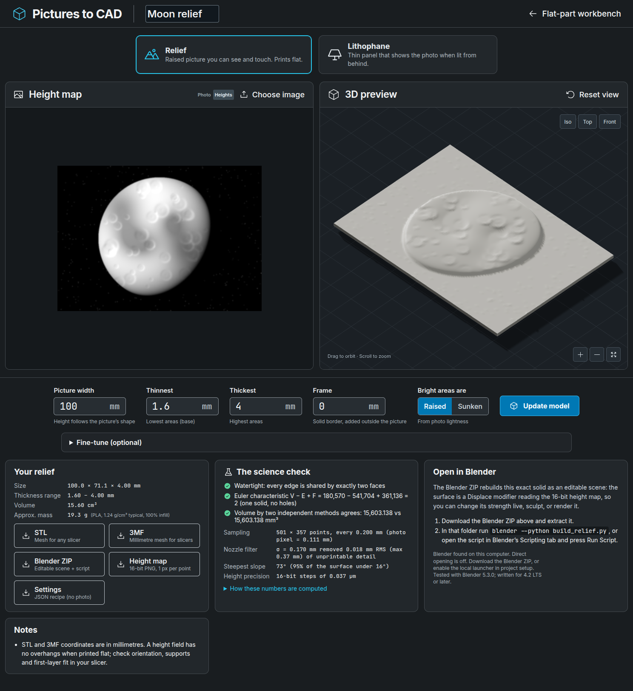

# Relief and lithophane studio

The studio turns any picture into a printable 3D surface without CAD work. Open **Relief & Lithophane** in the workbench header (or go to `/#relief`), choose a picture, and the model builds automatically.



The page shows the generated moon sample. The sample image is procedurally generated (a lit sphere with synthetic craters); it is not a photograph or third-party artwork.

| Mode | What you get | Typical use |
| --- | --- | --- |
| **Relief** | Raised picture on a flat base. Bright areas are high (or low, with **Sunken**). | Plaques, tactile pictures, embossed signs, textures |
| **Lithophane** | Thin panel whose thickness varies so that light shining through it reproduces the picture. | Lamp shades, window panels, night lights |

## Use it

1. Choose **Relief** or **Lithophane**.
2. Drop in a PNG, JPEG or WebP (up to 10 MiB), or press **Try the moon sample**. A 16-bit grayscale PNG is read at full depth, so depth maps from other tools keep all 65,536 levels.
3. Set **Picture width**, the **Thinnest** and **Thickest** walls, and an optional **Frame**. The picture's height follows its aspect ratio; a frame is added outside the picture at full thickness.
4. Lithophane only: set the filament's **Half-value thickness** (see [calibration](#calibrate-a-filament)). The line under **Update model** shows the light range those settings can produce.
5. Press **Update model** after changes. Downloads are disabled while the shown model is out of date.
6. Download **STL** or **3MF** for your slicer, or the **Blender ZIP** to keep editing.

**Fine-tune** holds the optional controls: picture type (photo or depth map), tone curve, auto levels, edge-preserving noise smoothing, nozzle width, the nozzle detail filter, sample spacing, material (for the mass estimate) and preview colour.

The 3D preview uses a low raking light so shallow relief is visible. It is a lighting choice only; the geometry is never exaggerated. The left panel switches between your picture and either the **height map** (relief: lighter is taller) or the **backlit prediction** (lithophane: the Beer–Lambert model of what the lit panel should look like).

## The science

Each step below is implemented in [`backend/relief.py`](../backend/relief.py) and checked by [`tests/test_relief.py`](../tests/test_relief.py).

### Colour to light

8-bit photo samples are sRGB-encoded. They are decoded to linear light with the IEC 61966-2-1 transfer function (linear below 0.04045, otherwise ((v + 0.055) / 1.055)^2.4) and combined into relative luminance

Y = 0.2126 R + 0.7152 G + 0.0722 B

using the Rec. 709 / sRGB primaries. A 16-bit grayscale image, or a picture marked **Depth map**, is treated as data and used without colour decoding.

### Relief: perceived lightness to height

Human lightness perception is roughly a cube root of luminance. A relief therefore maps CIE 1976 lightness L* = 116 f(Y) − 16 (with the standard linear segment near black) to height, so equal height steps look like equal tone steps. **Auto levels** (on by default) stretches the 0.5th–99.5th percentile tones to the full range, so the thinnest and thickest settings are actually reached. An optional tone curve raises the normalized value to the power γ before scaling to the thickness range.

### Lithophane: Beer–Lambert transmission

Light crossing an absorbing layer of thickness t is attenuated exponentially: T(t) = exp(−μ t). Relative to the thinnest wall, the viewer sees Y = exp(−μ (t − t_min)), so each point needs

t = t_min − ln(Y) / μ.

The material is described by its **half-value thickness** h, the extra thickness that halves the light, with μ = ln 2 / h. The panel's light range is (t_max − t_min) / h stops, or a contrast ratio of exp(μ (t_max − t_min)). Tones darker than that print at full thickness and are reported as **clipped shadows**. **Tone accuracy** compares the CIE L* of the target with the predicted transmission where the panel can show the tone, after filtering and quantization. A ΔL* of about 1 is barely visible.

Real filament also scatters light, so Beer–Lambert is a first-order model. The default half-value thickness, 0.5 mm, is a placeholder, not a measurement. Calibrate the filament you use.

### Printable detail

A nozzle cannot form lateral detail much narrower than its line width. When the nozzle filter is on, the thickness map is low-pass filtered with a Gaussian whose full width at half maximum equals the nozzle width (σ = w / (2 √(2 ln 2)) ≈ 0.4247 w). The RMS and maximum height removed are reported. Noise smoothing uses a bilateral filter, which averages only neighbouring samples of similar tone and so preserves edges.

Points are sampled every half nozzle width by default. When the grid is coarser than the photo's pixels, a Gaussian pre-filter (σ = half the sample step) removes detail the grid cannot represent, to avoid aliasing. The surface is capped at 250,000 points; wider parts get a wider spacing, and the notes say so. If the samples are finer than the photo's pixels, the notes say that too: interpolation adds no detail.

### Geometry and its checks

The thickness map is quantized to 16 bits (steps of span / 65,535, under 0.04 µm for typical settings). The STL, 3MF, height-map PNG and Blender scene all describe exactly that quantized surface.

Each grid cell is split into two triangles along the diagonal with the smaller height change, which follows ridges instead of cutting across them. Vertical walls drop to a flat base at z = 0, triangulated as a fan around an interior centre vertex so no triangle is degenerate. Every build is then checked independently:

- **Watertight and oriented:** every directed edge occurs once and its reverse occurs once.
- **One solid without holes:** the Euler characteristic V − E + F equals 2, i.e. genus 0.
- **Volume, two ways:** the divergence-theorem sum of signed tetrahedra must agree, to 10⁻⁹ relative, with the sum over top triangles of projected area × mean height. That is the same theorem applied with the field (0, 0, z), for which the walls and base contribute nothing.

The mass estimate is volume × a typical datasheet density at 100% infill (PLA 1.24, PETG 1.27, ABS 1.04, ASA 1.07, TPU 1.21, nylon 1.14 g/cm³). Slicer infill settings change the real mass.

A height field printed flat has no overhangs. Slope figures describe how steep the surface gets, not a support requirement.

## Calibrate a filament

Lithophane mode adds a **Calibration wedge** download: eight steps, each 10 × 25 mm, from the thinnest to the thickest wall. The wedge's risers are 0.02 mm ramps, far below printing resolution, and its volume equals that of ideal vertical steps.

1. Print the wedge in the filament you will use, with the same layer height and orientation you plan for the lithophane.
2. Hold it in front of the light you will use and photograph it with exposure and white balance locked, or measure each step with a light meter.
3. Enter each step's brightness under **Calibrate your filament**: pixel values (0–255) from a photo, or light-meter readings in any unit.
4. Press **Fit half-value thickness**. The app linearizes pixel values from sRGB, fits ln Y = a − μ t by least squares and reports the half-value thickness with its standard error and R². Readings at or near 0 or 255 carry no slope information and are skipped.
5. Press **Use this value**, then **Update model**.

A high R² supports the exponential model for that filament and light; a low one means the readings are noisy, saturated or not in step order.

## Blender

The **Blender ZIP** rebuilds the exact exported solid as an editable Blender scene:

- `build_relief.py` is a static script from this repository. It contains no project values.
- `relief.json` holds the dimensions, sample spacing and thickness range.
- `heightmap.png` is the 16-bit height map, one pixel per surface point.
- `model.stl` is the same geometry as the STL download.
- `README.md` explains the files, and `manifest.json` lists their SHA-256 hashes.

Extract the ZIP and run `blender --python build_relief.py` in that folder. Alternatively, open the script in Blender's **Scripting** workspace and press **Run Script**. The scene contains:

- **Relief**: the same flat base, walls and triangulation as the STL. Its top vertices (vertex group `surface`) are lifted by a **Displace** modifier that reads the height map at pixel centres without interpolation. The modifier's *Strength* is the thickness span; change it to rescale the relief live.
- **Lithophanes:** a Cycles scene with a backlight panel and a *Volume Absorption* material whose density equals μ per millimetre. A render is a physical simulation of the Beer–Lambert prediction.
- **Reliefs:** a sun 25° above the horizon (raking light) and the chosen colour.

Scene units are millimetres. To print an edited version, export STL with *Apply Modifiers* on and re-check it in your slicer; Blender edits do not update the studio.

The script also runs headless for checks:

```bash
blender -b --python build_relief.py -- --report report.json --export-stl out.stl
```

Add `--render out.png` to render the scene or `--save scene.blend` to keep it.

### Open Blender directly

On your own computer, the studio can open the scene for you. Start the server with the launcher enabled:

```bash
PICAD_ENABLE_BLENDER_LAUNCH=1 make start
```

The launcher looks for `blender` on `PATH`, then the Snap, macOS and Windows install locations. Set `PICAD_BLENDER=/absolute/path/to/blender` to choose one; it must be a single executable path, not a command line. **Open in Blender** then extracts the generated ZIP to `.local/blender-handoffs/<id>/` (or `PICAD_BLENDER_HANDOFF_DIR`) and starts `blender --python build_relief.py` there, without a shell. These copies remain until you remove them. Like the slicer launcher, it accepts only a same-origin JSON request from a loopback client, and `GET /api/blender` reports availability without starting anything. The installed version is not checked. The script was written for Blender 4.2 LTS or later and tested with Blender 5.3.0.

## Limits

- One picture carries no true depth. A relief is a tone map, not a reconstruction of the photographed object's shape; a depth map from another tool can supply estimated depth.
- Beer–Lambert ignores scattering, layer lines and colour. Thin walls under about 0.6 mm may print poorly; the defaults stay above that.
- Tone accuracy, light range and mass are model predictions. They are not measurements of a printed part.
- The source picture is uploaded to this app's backend, used once to compute the thickness map and deleted. Recipes and Blender ZIPs never contain it.
