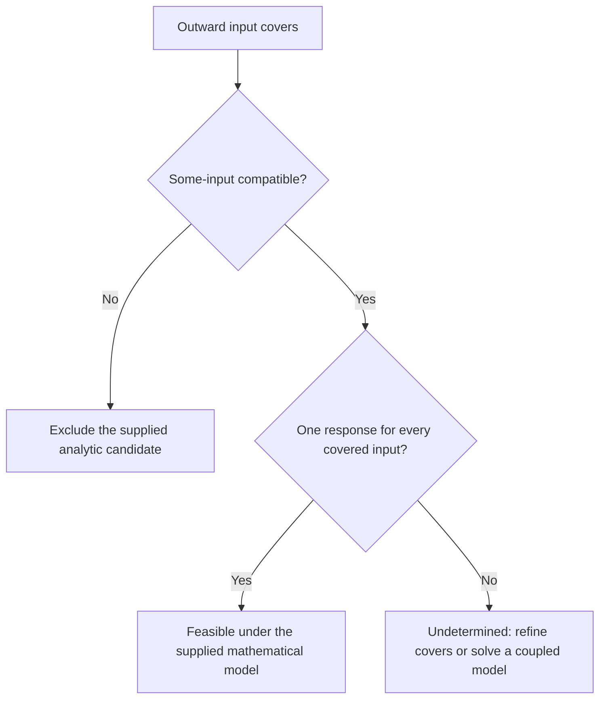

# One response with bounded input and output observations

This developer tool checks one continuous nondecreasing scalar response against
closed rectangles `input=[a,b]`, `output=[L,U]` and supplied slope bounds.
Choose whether **some input in each interval** or **every input in each
interval** must fit. Both modes require one shared response, rather than a
different curve for each observation. Neither estimates camera calibration,
corrects an image, computes an inverse, or changes production tracing or the UI.

Use the [exact-input response guide](response-calibration.md) for fixed knots,
the [developer catalog](developer-tools.md) for related commands, and
[raw-source fitting](raw-source-fit.md) for a separate supplied optical model.

For a supplied straight Gaussian edge, the separate
[continuous-domain solver](gaussian-response-domains.md) now couples offset and
blur width across every observation. It uses these rectangle tests within a
complete shared-parameter box tree; some-box compatibility alone still does not
prove analytic feasibility. See its [full controls](validation/gaussian-response-domains.md).

## Choose the input quantifier

Let `f` be one continuous nondecreasing function on the closed span of all
rectangle endpoints. For `x1 < x2`, its common slope bounds require

```text
m * (x2-x1) <= f(x2)-f(x1)
f(x2)-f(x1) <= M * (x2-x1)  # when M is finite
```

The supplied bounds obey `0 <= m <= M`; `M=null` omits the finite upper bound.
Slopes use output units per input unit. These are assumptions about the model,
not limits learned from the data.

| `input_mode` | Question | Endpoint constraints for each rectangle |
| --- | --- | --- |
| `"some"` (default) | Does one response pass through at least one selected point in every rectangle? | `f(a) <= U` and `f(b) >= L` |
| `"all"` | Does one response stay inside each output band for every input in its interval? | `f(a) >= L` and `f(b) <= U` |

In `some` mode, monotonicity gives the image interval `[f(a),f(b)]`.
Continuity and the [intermediate value theorem](https://live.ocw.mit.edu/courses/18-100b-real-analysis-spring-2025/mit18_100b_s25_lec11.pdf)
make its intersection with `[L,U]` sufficient for a selected graph point.
No interval midpoint is substituted. In `all` mode, the whole image interval
must lie inside `[L,U]`.

`all` means **one fixed response works for every allowed input**, not that a new
response may be fitted separately for each realization. It also does not mean
that the graph must pass through every point of a two-dimensional rectangle.
Set `input_mode` explicitly when recording or comparing results.

## Run a small exact example

After [workbench setup](development.md), save this as `rectangle-input.json`:

```json
{
  "version": 1,
  "units": {"input": "declared input unit", "output": "declared output unit"},
  "rectangles": [
    {"input": ["0", "1"], "output": ["0", "0"]}
  ],
  "input_mode": "some",
  "slope_bounds": ["0", null],
  "queries": ["0", "0.5", "1"]
}
```

```bash
.venv/bin/python scripts/response_rectangles.py rectangle-input.json --output .local/rectangle-result-new.json
```

Run from the repository root and choose a fresh output file. `--output` is
required; the complete JSON report is saved and printed to standard output.
No CAD server, photograph, native application or language model is needed.
The input is a declared mathematical problem, not a photo-calibration dataset.

The request is compatible. One possible witness is `f(x)=0`, but many other
responses can cross zero somewhere in `[0,1]`. The tight marginal query bands are

| Query | `some` mode | `all` mode with the same rectangle |
| --- | --- | --- |
| `0` | `[-infinity, 0]` | `[0,0]` |
| `0.5` | `[-infinity, +infinity]` | `[0,0]` |
| `1` | `[0, +infinity]` | `[0,0]` |

Changing only `input_mode` to `"all"` forces `f(x)=0` throughout the domain.
With `some` mode and finite slopes `["0","2"]`, the middle query is instead
bounded by `[-1,1]`. A declared output band at an uncertain input does not
automatically bound the response at the input midpoint.

If the slopes are `["1","1"]`, the same rectangle is compatible in `some`
mode—for example, `f(x)=x` meets it at zero—but incompatible in `all` mode.
A function increasing by one across the interval cannot remain zero everywhere.
The modes answer different questions, rather than different confidence levels.

## Read witnesses, incompatibility and unbounded queries

A compatible result supplies a finite piecewise-linear response witness and
per-observation assignments. In `some` mode, each selected `(input,output)`
lies in its original rectangle and on that same witness. These assignments
make the existential choices visible. In `all` mode, selected points alone are
not its guarantee: the shared witness must also satisfy the endpoint constraints
that cover every input in each rectangle.

These fields sit under the CLI report's `calibration` object:

| Field | Meaning |
| --- | --- |
| `rectangles` | Original observations in their supplied order, normalized to exact rational strings |
| `source_groups` | Endpoint constraints before slope propagation; each constraint records its original zero-based `source_index`, left/right endpoint and lower/upper bound |
| `nodes` | Tight output bands at the distinct input endpoints after propagation |
| `witness` | Finite endpoint values; linear interpolation defines one common response |
| `assignments` | One point per original observation, with its `source_index` and the witness outputs at both input endpoints |
| `contradiction` | For an incompatible result, the original lower/upper sources and endpoints that imply a strict `implied_lower > implied_upper` at `at_input` |

The response witness is one feasible curve, not a unique reconstruction. Query
envelopes describe all feasible responses for the selected mode. Their bounds
are pointwise: arbitrary choices from different query bands may not belong to
one common response. Add the desired joint observations and check them together.
Queries are defined only inside the declared endpoint domain; no extrapolation
or uncertain query-input solver is implied.

Finite results use exact rational strings, including fractions such as `"1/2"`;
submitted model values must still be decimal strings. A lower `null` means **unbounded
below** (`-infinity`), and an upper `null` means **unbounded above** (`+infinity`).
These are mathematical directions, not values of the finite witness, unknown
answers, unavailable queries, or JSON `Infinity` constants. A band with both
endpoints `null` can be a valid exact result under the declared assumptions.
An incompatible response has no query envelope; that is a separate outcome.
For example, the middle query above is serialized as
`{"input":"1/2","output":[null,null]}`. The report also declares
`unbounded_semantics={"lower_null":"negative_infinity","upper_null":"positive_infinity"}`.
An incompatible calibration instead yields a query entry such as
`{"input":"1/2","unavailable":"incompatible_calibration"}`, without an
`output` band.

| Outcome | Interpretation |
| --- | --- |
| `compatible` | At least one shared response satisfies the chosen quantifier and supplied constraints; retain its witness and assignments |
| `incompatible` | No response satisfies that declared model; retain the contradiction and original observation provenance |
| Invalid or resource-limited request | The implemented contract could not evaluate the request; this is not proof of mathematical incompatibility |

The CLI exits **0** for both compatible and incompatible mathematical reports.
Use `calibration.status`, rather than the exit code, to distinguish them.
Invalid inputs, resource limits and file errors exit **2** with a brief message
on standard error. An existing output file or symlink is refused; use a new path
to preserve the earlier result. Missing parent directories are created after
the analysis succeeds. No `--demo` mode is provided.

Computational compatibility does not validate the physical bounds or identify
why an incompatible model failed. Do not report either as camera acceptance.

## Preserve interval and dependency meaning

When `a=b`, the rectangle is an exact input knot. `some` and `all` then coincide
with the [fixed-input model](response-calibration.md). Equal output endpoints
are also valid closed bands. Endpoint contact is included, without an added
physical tolerance.

Overlapping input intervals need not select inputs in the order of their
midpoints or their rows. Identical nondegenerate intervals are not duplicate
exact knots: `[0,1]x[0,0]` and `[0,1]x[1,1]` are compatible in `some` mode via
`f(x)=x`, selecting zero and one respectively. Intersecting those two output
bands as if both rows had the same exact input would incorrectly reject them.

`some` mode treats the input intervals as separately selectable—a Cartesian
product of possibilities. This is a set assumption, not statistical independence.
It cannot enforce a shared calibration offset or another coupling between rows.
For example, take

```text
rectangle 1: input [0,1], output [1,1]
rectangle 2: input [1,2], output [1,1]
slopes: m=M=1
```

The Cartesian problem is compatible through `f(x)=x`, choosing both inputs
equal to one. If the actual inputs must instead be `delta` and `1+delta` for
one shared `delta in [0,1]`, they remain one unit apart. The slope constraint
then forces unequal outputs, contradicting the two observations. A compatible
Cartesian relaxation therefore does not establish compatible correlated choices.
Neither mode estimates that common offset; an existential question with shared
parameters requires a separate coupled model.

## Input, provenance and API

Version 1 requires `version`, `units` and `rectangles`. Optional `input_mode`
defaults to `"some"`, `slope_bounds` to `["0",null]`, and `queries` to `[]`.
All numeric model/query values are exact decimal strings; only `version` is the JSON
integer `1`, and only the optional upper slope may be `null`. Unknown fields,
duplicate JSON keys, non-finite constants and numeric/boolean model values are
refused.

There must be 1–512 rectangles and at most 256 queries. Each rectangle has exactly
an ordered closed `input` pair and an ordered closed `output` pair. Input files
are at most 512 KiB. `units` has exactly `input` and `output`, each a nonempty
printable label of at most 80 characters. Labels do not convert units or supply
physical evidence. Existing output paths are refused. Exact-number and arithmetic
limits can also refuse requests; they are computational bounds, not uncertainty
or whole-photo latency guarantees.

The shared exact-number parser allows at most 160 characters and 40 coefficient
digits after removing leading zeros; trailing zeros still count. The decimal
exponent and adjusted exponent must each
have absolute value at most 64. Parsed inputs have at most 512 bits in the
absolute numerator and denominator. Exact arithmetic results are limited to
8,192 bits in each, and calibration has a 250,000,000-unit arithmetic work budget.
That budget charges operand bit sizes; it is not a count of observations or a
runtime in seconds. Endpoint sorting, propagation and assignment recovery share
the calibration budget. Each interior query has its own arithmetic budget;
the calibration's reported `work` excludes query evaluation.

The report has format `pictures-to-cad-response-rectangles-result`, version `1`.
`input` retains the parsed submitted request, including its decimal strings;
`calibration` contains normalized rational values, and `queries` contains the
answers or unavailable-query entries. For a compatible result, a query outside
the endpoint span refuses the request. For an incompatible result, query syntax
is validated but the CLI reports unavailable queries without evaluating a domain
envelope.

`provenance.input_sha256` binds the raw UTF-8 input bytes, so even a whitespace
change can change that hash. `provenance.source_sha256` records exactly the
shared parser [backend/response_calibration.py](../backend/response_calibration.py),
rectangle core [backend/response_rectangles.py](../backend/response_rectangles.py)
and [CLI](../scripts/response_rectangles.py). Sources are checked for changes
during analysis. `provenance.git` records the revision and dirty-file entries;
when Git metadata cannot be read, its null fields include a reason.
`provenance.python` records the interpreter version. These local reports also
retain unit labels and repository filenames; review them before sharing.

Keep the report with external measurement and input-generation records. The
three source hashes do not bind an upstream optical calculation, including the
separate CDF helper below. A source or input revision is a different analysis;
Git revision alone is insufficient when the recorded source was uncommitted.

The Python entry point is
`calibrate_rectangles(rectangles, *, slope_bounds=("0",None), input_mode="some")`
in [backend/response_rectangles.py](../backend/response_rectangles.py). Queries
use the returned object's `.query(x)` method and return tight extended bounds
using exact `Fraction` values or `None` for the corresponding unbounded direction.
The shared [exact parser](../backend/response_calibration.py) `parse_exact` accepts
decimal strings, Python integers and `Fraction` values for the Python API;
binary floats and booleans are refused. The CLI requires decimal strings.
A finite witness does not require finite envelopes. Inspect the selected mode,
all observations and the full witness
rather than treating one assignment as a measurement recovered by the tool.

## Bound a supplied Gaussian input

The separate public helper
`normal_cdf_bounds(z, *, places=30, max_terms=256)` in
[backend/normal_cdf_bounds.py](../backend/normal_cdf_bounds.py) encloses the
mathematical standard-normal CDF `Phi(z)` at an exact supplied dimensionless
coordinate. It does not infer `z`, a blur width, an optical PSF or a camera
response from an image.

```python
from fractions import Fraction

from backend.normal_cdf_bounds import normal_cdf_bounds

bounds = normal_cdf_bounds("1", places=20)
assert isinstance(bounds.lower, Fraction)
assert isinstance(bounds.upper, Fraction)
assert bounds.upper - bounds.lower <= Fraction(2, 10**20)
report = bounds.to_dict()
```

`z` uses the same exact Python input parser and must lie in `[-6,6]`.
`places` is an integer from 1 to 30; `max_terms` is an integer from 1 to 256.
Booleans and binary floats are refused. A successful result has closed outward
`lower` and `upper` bounds with width at most `2 * 10**(-places)`. Invalid inputs
or an insufficient term budget raise an error rather than returning a partial
enclosure or a model-incompatibility conclusion.

The result records the exact `z`, requested `places`, actual `terms` used,
`reflected` flag and `certificate`. `.to_dict()` serializes the rational bounds
under `output` and retains these fields. At zero the answer is exactly `1/2`,
with zero terms and no certificate; elsewhere the certificate records the
partial-sum enclosure, first omitted term, tail-ratio bound, integral bounds
and normalization bounds. For a negative `z`, that certificate describes the
calculation at `abs(z)` before the recorded reflection. These are numerical
evidence, not confidence levels.

The implementation rescales the alternating error-function series in
[NIST DLMF 7.6.1](https://dlmf.nist.gov/7.6.E1) to the standard-normal integral.
It bounds the alternating tail after verifying decreasing tail magnitudes and
uses directed integer rounding on a `10**(-60)` internal grid. The normalization
`1/sqrt(2*pi)` is enclosed using Machin's identity
`pi = 16*atan(1/5) - 4*atan(1/239)`, the
[DLMF arctangent series](https://dlmf.nist.gov/4.24.E3), and integer square-root
bounds. Final outward rounding uses the requested decimal grid; negative inputs
use `Phi(-z)=1-Phi(z)`. No floating-point CDF evaluation is promoted to an exact
Gaussian probability.

If these bounds become rectangle inputs, preserve their outward direction and
decimal precision; do not substitute a midpoint or serialize a rounded decimal
as if it were an exact optical value. The helper's `output` uses rational strings,
which are not the CLI's decimal-string input syntax. Conversion must preserve the
enclosure; it is not an automatic step in the rectangle CLI.

Several CDF-derived input intervals form a Cartesian outer relaxation. Their
members are not freely realizable values of one analytic optical model:
they may share an offset, blur parameter or exact CDF relationship. In `some`
mode, compatibility of those boxes alone therefore does **not** establish
realizability by the correlated model. `all` instead asks its stronger
every-input question and is not a confidence level. Neither mode justifies a
physical Gaussian PSF or replaces a coupled optical-model calculation.

For a supplied analytic input vector known to lie inside the covers, the two
quantifiers give a useful decision process:



Invalid inputs or exhausted computation are separate refusals; they do not enter
the exclusion branch. The positive branch requires a common every-input witness,
rather than independent choices from marginal bands. This decision process
still depends on justified optical and measurement assumptions.

The [complete finite experiment](validation/response-rectangles.md) records
both modes at each precision, including cases where refinement resolves an
undetermined covering box. Run it to a fresh destination with
`make response-rectangles-study OUTPUT=.local/rectangle-study-new.json`;
its plan, all candidates, witnesses, contradictions and CDF certificates are
retained. The record also links independent graph, CDF and study-audit commands.

## Evidence and remaining scope

The endpoint reductions above follow monotonicity and continuity. They do not
model input/output correlation, uncertain slopes, a camera pipeline, or spatially
varying responses. External measurements must justify their stage, units, bounds
and shared-response assumption. A computational enclosure from a supplied optical
model would still need separate evidence that its PSF and geometry describe the
capture; decoding sRGB does not calibrate them.

[Milanese and Novara (2004)](https://www.ladispe.polito.it/corsi/Seminar/c3l04/material/MiNo04.pdf)
provide broader set-membership identification context: conclusions depend on
declared regularity and error assumptions, and consistency does not establish
those assumptions as physical truth. This tool implements the narrower scalar
rectangle problem, not their general nonlinear-system identification procedure.
No response inversion, image correction, probabilistic coverage or manufacturing
qualification follows from a compatible result.
