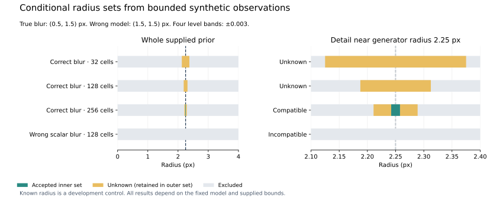

# Conditional corner-radius enclosures — November 12, 2026

Follow-up: [joint blur domains](corner-blur-domains.md) extend the developer
analysis with supplied sigma intervals and a padded Decimal exponential for
density bounds. This record retains the original fixed-sigma source and runs.

This candidate adds a developer CLI and numerical modules on the documentation
review head `77b7f6f74ea411e336ff3cf613b33e406ee98d72`. It implements one
restricted application of the feasible-set research proposed in the
[earlier corner review](sharp-corner-resolution.md). The production tracer,
fit thresholds, geometry, API and UI are unchanged. See the
[method and input contract](../corner-feasibility.md).

## Proof and independent checks

The positive-quadrant Gaussian probability minus a circular cutout is enclosed
using inner and outer rectangles. Cutout height decreases with X and grows with
radius. Outward CDF differences and products enclose rectangle masses; nested
cutouts enclose every radius in a box by its endpoints. Strict disjointness
preserves closed-boundary contact. Acceptance requires the entire image box to
fit within all declared observation intervals. Every unresolved and queued box
survives numerical or work exhaustion in the outer set.

The 60-digit Decimal layer encloses arithmetic and series truncation. Its
square-root padding is checked by exact rational squaring. CDF checks use a
separate nonalternating expansion at 140 digits, known digits, 129 rational-grid
points, symmetry, branch boundaries, coarse tails, subnormal underflow and
overflow refusal. Current and default Decimal contexts are perturbed in tests.
No floating-point `erf`, `exp` or π constant is trusted by the production layer.

Independent corner observations use stdlib `erfc`, NumPy Gauss–Legendre nodes
and the angular substitution `x=r(1-cos(theta))`, `h=r(1-sin(theta))`. They call
no production CDF, probability-cover, geometry, rendering or fitting function.
Quadrature-order agreement is numerical development evidence; it is not a
certified observation-error or model-discrepancy bound. Both generators retain
the Gaussian physical assumption.

Exact controls separately check the apex probability `U_0(0,0)=1/4`, feasible
radius-zero boundary contact, singleton priors, full `[0,1]` level acceptance,
contradictory observations, unknown coarse tails and coverage of every prior
region on budget exhaustion. Swap/scaling, independent accepted-midpoint
checks, 40-digit subdivision, input limits and injected numerical failures are
covered. CLI tests also preserve distinctions smaller than binary64 resolution,
duplicate-key refusal, 128 KiB boundaries, hashes and exclusive output writes.

## Retained development outcomes

Before the first seven-case run, a local plan fixed the points
`(0.5,0.5), (0.5,1.5), (1.5,0.5), (2,2) px`, radius prior `[0,4] px`,
stopping width `0.0625 px`, 127 box classifications and synthetic level bands
of ±0.003 around independent continuum values. Orders 64 and 128 agreed within
the predeclared `1e-11` numerical check. These are development cases, not unseen
qualification captures. Every original outcome is retained:

| True radius (px) | True blur `(sx,sy)` (px) | Model blur | Cells | Status | Outer set (px) |
| --- | --- | --- | ---: | --- | --- |
| 0.75 | (1,1) | (1,1) | 32 | Unknown | [0.625, 0.875] |
| 1.5 | (1,1) | (1,1) | 32 | Unknown | [1.375, 1.625] |
| 2.25 | (0.5,1.5) | (0.5,1.5) | 32 | Unknown | [2.125, 2.375] |
| 2.25 | (0.5,1.5) | (0.5,1.5) | 128 | Unknown | [2.1875, 2.3125] |
| 2.25 | (0.5,1.5) | (1.5,1.5) | 32 | Conditionally incompatible | Empty |
| 2.25 | (0.5,1.5) | (1.5,1.5) | 128 | Conditionally incompatible | Empty |
| 3 | (1,1) | (1,1) | 32 | Unknown | [2.875, 3.125] |

All five matching-model runs retained the known radius; their inner sets were
empty at these numerical settings. Both wrong-blur runs excluded the whole
supplied domain rather than interpreting model mismatch as proof of sharpness.
This is a fixed-point level experiment, separate from the earlier full-ring
fitting counterexample and from actual photo/API measurement.

A separately recorded, explicitly adaptive numerical follow-up retained those
seven results. With 128 cells, reducing the stopping width to `0.03125 px`
still left outer `[2.1875,2.3125] px`; `0.0078125 px` narrowed it to
`[2.203125,2.296875] px`. Both remained unknown with no accepted box.

Increasing the spatial cover to 256 cells with a 63-classification budget and the same
`0.0078125 px` stopping width produced **conditional compatibility**:
inner `[2.2421875,2.2578125] px`, outer `[2.2109375,2.2890625] px`.
The known `2.25 px` radius lies in both. It attempted 41 classifications and did
not exhaust the budget. The observed
local runtime was 19.84 s, not a performance guarantee. This illustrates the
spatial-cover limitation: more radius subdivision alone had not resolved it.

The 32/128-cell rows use stopping width `0.0625 px`; the 256-cell row uses
`0.0078125 px`. Teal is the accepted inner set, amber is retained unknown and
gray is excluded. All observations, blur widths and error bands are synthetic
and fixed. The figure does not supply a measured-camera accuracy interval.

## Completed checks

- Complete Python invocation: **760 passed in 137.61 s**, with no skips.
  The 130 new tests comprise 52 Decimal, 52 corner-set and 26 CLI checks.
- Full-repository Ruff check passed. The actual CLI demo ran with JSON stdout,
  separate explanation, retained input and source hashes; its compatible result
  has inner `[0,0.5] px` and outer `[0,0.625] px`.
- All guide examples, local links and documentation checks are recorded in the
  final source receipt. The existing library documentation invocation passed
  **19 tests**; library source/generated outputs and release records are unchanged.
- All **61 Markdown documents** parse; **588 local links**, including **43
  fragments**, resolve; **94 tables** have consistent columns. Whitespace
  checks pass. The figure was inspected as a rendered PNG and has SHA-256
  `a3cc4274dd2b0a9e9612628994eed2d9ce210ccbf376d4ed2ecbf57b06713a47`.

Frontend sources, API and production geometry paths did not change, so the
browser suite and frontend build were not rerun for this developer-only tool.
Earlier 74-scenario results retain their original source/run binding. Hosted CI,
review, merge, installation and deployment are separate from these local checks.

## Reproducible local evidence

Ignored local artifacts under `.local/verification/` retain the plans, all
outcomes, source freeze, demo, plot and full test logs. These paths are evidence
identifiers, not published download links.

| Artifact | SHA-256 |
| --- | --- |
| `corner-feasibility-plan.json` | `c69f9ce45db78d1edf8ee172a28554e50c3a2b87bb7fc460a4fb184021454599` |
| `corner-feasibility-development.json` | `562871f99f8280a14d0c09c3c2ef78530ef4673098166d7007dbe5384790077f` |
| `corner-feasibility-refinement.json` | `4747c974473913282c73111e8df6db31b3ffeac85e2c82bc3cbc1e6f91e343d1` |
| `corner-feasibility-spatial-refinement.json` | `f42fe5793e35415bb1e7c64884e064d70b55e68114e3b653e6d2f5b4d04369ac` |

The remaining engineering objective is broader: justify observation and model
discrepancy bounds, accommodate uncertain blur/pose/coordinates and non-right
corners, then evaluate reserved real captures and dimensions. This fixed-model
developer tool does not establish physical accuracy, hidden geometry, printer
fit or real-camera qualification. The broader science goal remains open.
