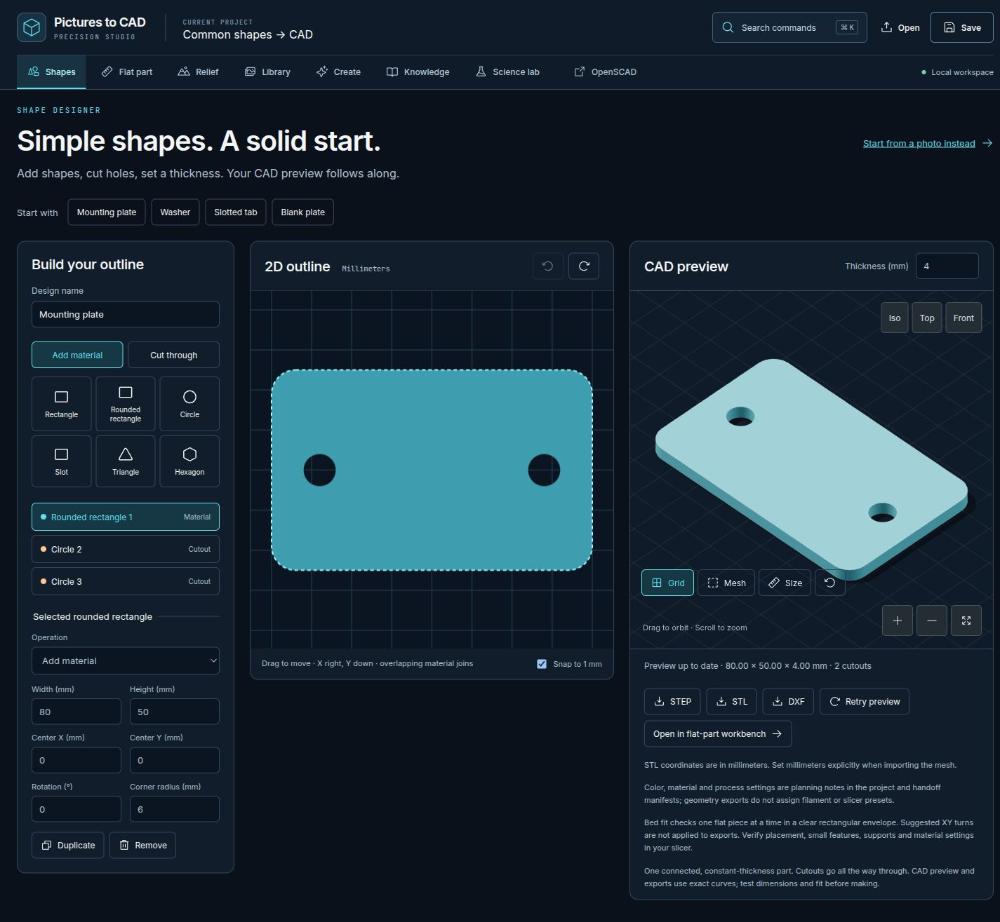
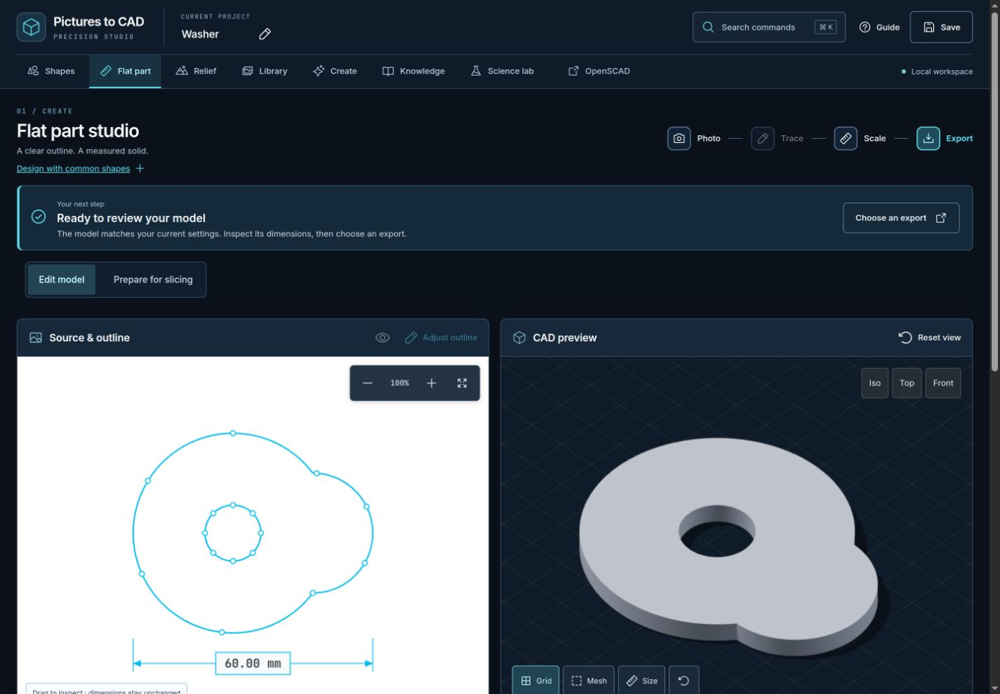
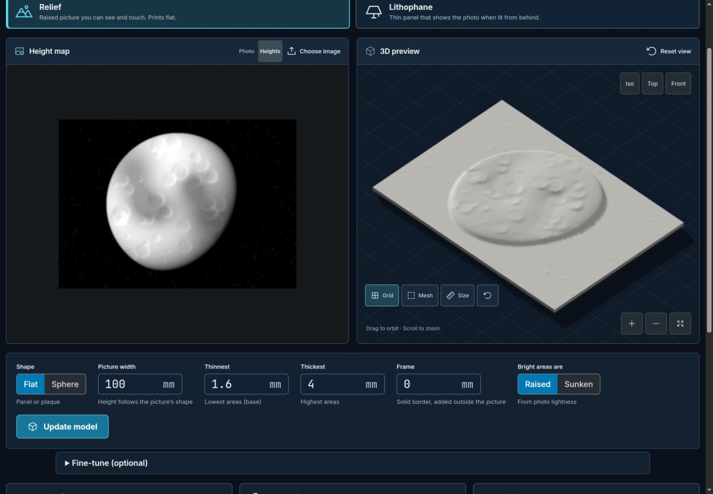
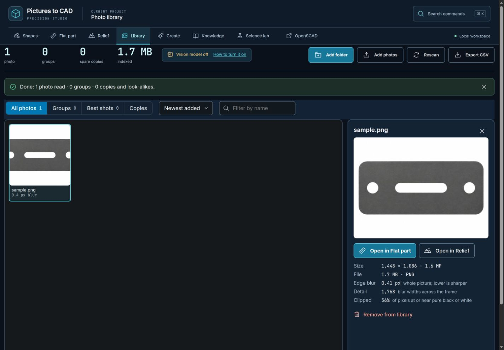
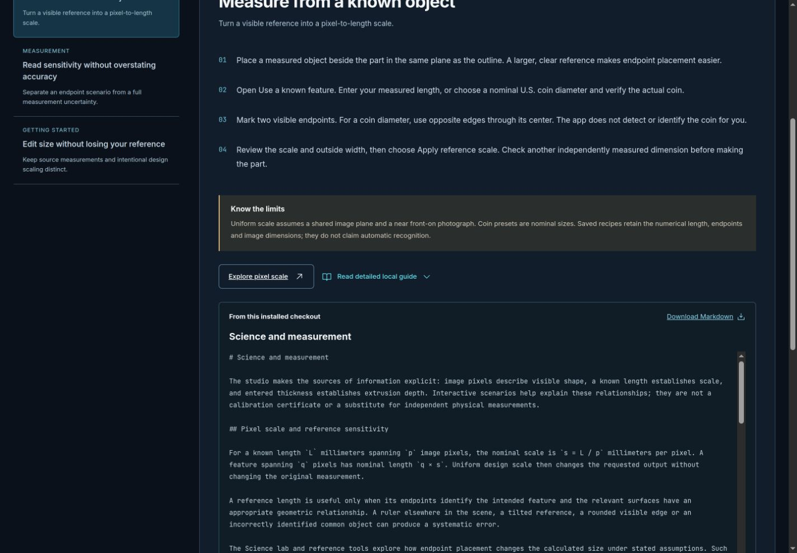
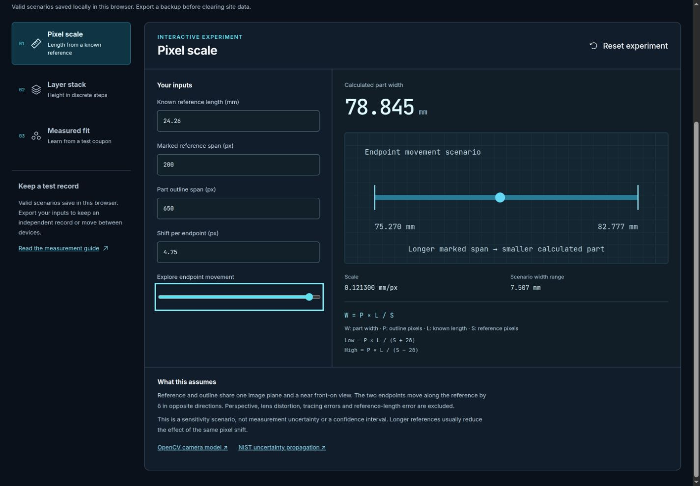
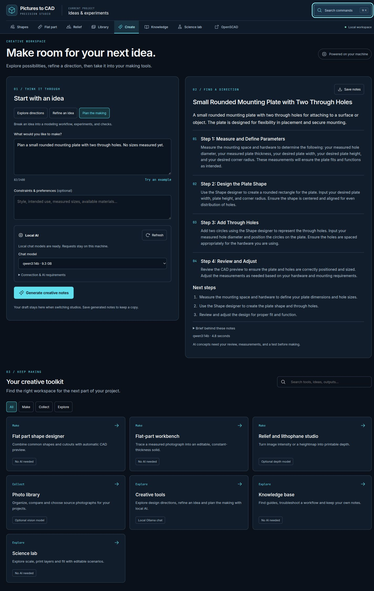
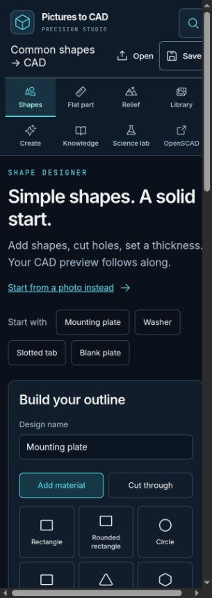
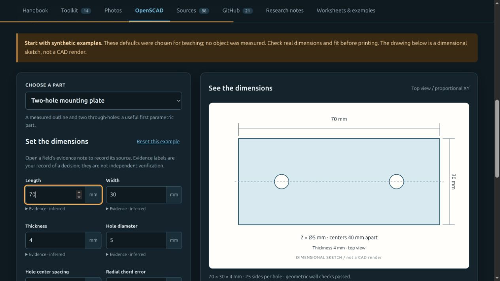

# Local AI, shape designer and workspace UI verification

Date: November 17, 2026. Base revision: `ebe6725`. Implementation branch: `codex/local-ai-creative-tools`.

The local preview was exercised through the Codex in-app browser, using isolated CAD jobs and an isolated photo library. Desktop checks used 1440 px layout width, the companion library used 1280 px, and all seven application studios were checked at 320 px. Inputs and pictures were synthetic/project samples. This report records the paths checked; it is not a claim that every possible UI state is bug-free.

## Walkthrough

| Step | Workspace and action | Observed result / health |
| --- | --- | --- |
| 1 | Shape designer: templates, size/thickness edits, drag positioning and one-step drag undo, material/cutout composition, invalid separated shapes, Retry, design download, CAD handoff | Working. A 90 × 50 × 5 mm plate updated automatically; the final starter shows 80 × 50 × 4 mm. Disconnected material produces a useful error and disables exports. A washer plus overlapping circular material transferred as exact profile geometry. |
| 2 | Flat-part workbench: open generated recipe, edit target width, switch studios | Working. The transferred part rebuilt successfully. Changing target width to 72 mm marked the preview stale, and navigation retained the unfinished edit. |
| 3 | Relief: load the moon photo sample and inspect the generated surface | Working. The sample built a 100 × 71.1 × 4 mm relief, with the image/height map and CAD mesh visible. |
| 4 | Photo library: first open, add sample.png, inspect photo details | Fixed a first-load SQLite initialization race. A fresh isolated store then opened without the 500, read the sample, and exposed metadata and both studio handoffs. |
| 5 | Knowledge: search scale, open a detailed local guide, search common shapes | Working. Search and local Markdown retrieval work. Added Shape designer and Creative tools guides, with their correct studio links and allowlisted documentation endpoints. |
| 6 | Science: use End, ArrowLeft and ArrowRight on endpoint movement | Working. Movement from 5 to 4.75 and back to 5 retained the stable range and updated the sensitivity scenario. |
| 7 | Creative tools: choose an installed chat model, generate notes, export notes, edit brief, search toolkit while waiting | Working. Notes preserve the submitted brief; edits mark previous notes as earlier input. Completion did not steal focus from toolkit search. The final local model checks passed for the assistant and all three text tools. |
| 8 | OpenSCAD companion: inspect the workspace and change plate length | Working as a web parameter/drawing tool. Changing length from 60 to 70 mm updated the dimensional schematic and retained the explicit distinction from a native CAD render. |

Header command search was exercised by keyboard through selection and Enter. Escape/closed-dialog state and the native keyboard skip-link path were checked. Each studio exposed one visible main region during the phone-width sweep. The shape designer initially overflowed to 398 px; shortening its header action labels at narrow widths brought it back to 320 px. Other studios measured 320 px at that viewport.

## Corrected findings

- **Photo library startup:** summary and photo-list requests could simultaneously transition a new SQLite store to WAL mode, producing `database is locked`. A short initialization lock now protects opening/migration; normal transactions remain concurrent. Three rounds of twelve concurrent first reads cover the failure path.
- **Narrow designer header:** long Open design / Save design labels pushed the page beyond a 320 px viewport. Responsive visible labels retain both actions without horizontal page overflow.
- **Preview accessibility text:** the browser exposed the canvas fallback's “unavailable” text in its accessibility tree while WebGL was rendering correctly. The native canvas fallback is now hidden from that tree; real renderer failures retain the existing error boundary. Screenshots confirmed the actual 3D solids throughout.
- **AI workflow grounding:** an early response incorrectly suggested Relief for through-holes. The production prompt now names the Shape designer's material/cutout operations and distinguishes the photo and relief workflows. A later unknown-size response still invented example dimensions; a backend guard now rejects numerical dimensions in supported mm/cm/inch forms when the brief contains none. This is a bounded check, not a general truth validator. Final Qwen3 14B checks produced valid notes, including a reviewed plan using measured inputs and Shape designer cutouts.
- **Tool discovery:** routing, tabs, titles, command navigation and the searchable toolkit now share a typed studio catalog. Knowledge includes the two new workflows and their local guides.

## Validation lanes

| Check | Result and scope |
| --- | --- |
| Broad Python run before the late shape/library/UI additions | 1,626 passed, 3 skipped, 523.45 s. This is the earlier broad baseline, not a final full-suite claim. |
| Final assistant + shape checks | 129 passed, 28.29 s, including cancellation/concurrency, capability checks, malformed responses, unknown-size rejection, real constructive geometry, exact DXF circles/arcs, STEP round trip, and failed-job cleanup. |
| Final library + documentation checks | 45 passed, 10.85 s, including concurrent empty-store initialization and all allowlisted guides. |
| Existing CAD API + AI + shape integration run | 237 passed, 32.18 s before the final additional creative guard test. |
| TypeScript unit tests | 36 passed. |
| Frontend build/typecheck, Ruff, source formatting, shell syntax and diff whitespace | Passed. |
| Real Ollama production paths | Ollama 0.35.1, installed `qwen3:14b`, assistant plus concepts/critique/plan all passed. The receipt records the model digest and synthetic outputs. No runtime or weights were downloaded. |
| Browser | Manual in-app interaction and screenshot checks above; no claim of a complete final Playwright-suite run or WCAG certification. |

The preview launcher selects `PICTURES_CAD_OLLAMA_MODEL=qwen3:14b` for this machine. The repository's portable default remains its small baseline, and another installed chat model can be selected. AI schema/guard success does not establish semantic correctness for other prompts. Specialized AI depth and DINOv3 features still require their separately installed weights; Ollama text generation does not supply those models.

One browser-automation file chooser call took 860 seconds. The application ultimately completed the sample upload without a console error. That tool duration is not a measured HTTP upload or image-processing benchmark.

The work is local source and browser verification. Native slicer/OpenSCAD GUI acceptance, physical prints, hosted CI, merging and deployment were not performed.

## Captured evidence

### 1. Shape designer and automatic CAD preview

### 2. Exact profile transferred to the workbench

### 3. Relief from the moon photo sample

### 4. Photo library after the initialization fix

### 5. Knowledge search and a detailed local guide

### 6. Science keyboard scenario

### 7. Grounded creative planning with local Ollama

### 8. Narrow designer header after the overflow fix

### 9. OpenSCAD companion dimensional schematic

