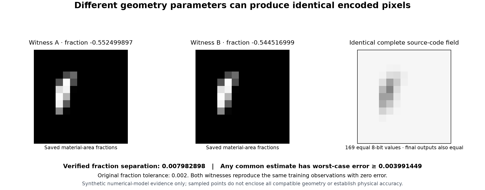

# First same-image geometry diagnostic result

## Outcome and source

The first actual diagnostic completes at research
`44ad56cf7026bb642a4ed0a8d71e93b7b3103903`, tree
`68d172bf1b637cf7b9e3152d874f3ce933189aea`, with **144 frozen governing
inputs and 236 saved bindings**. It retains all **24 cases and 17 saved fits**;
four fits are eligible, attempted and qualified. It retains 172 literal forward captures (four baselines plus
**168 new compatible tuples**).
All 168 alternatives match their own baseline's complete source codes,
complete final output bytes and training predictions, with zero cost and
zero raw and weighted residuals. [Method and API](../finite-acquisition-codecell-probe.md).

Diagnostic exit **0** means that a qualified alternative was found. The original
restoration result remains **11/12 matched passes, exit 1**, with middle PNG's
fraction error **0.00320694906346225 > 0.002**. There is no new best selection,
truth-based proposal, original-protocol rescore or workbench feature.

## First controls, additive repair and actual execution

The initial 139-input source at `849e183` first returns **1,394 passes,
two failures, one deselected node and 33 passing subtests**, exit 1.
Two new tests addressed internal ledger names on the public result dataclass;
their suffix assertions were not reached. The failed source and first
records remain unchanged. No actual probe ran under that failed selection.

Five separately admitted files add equivalent public-field accounting tests,
protocol controls and a wrapper over the hash-pinned original runner. All 139
predecessor files remain frozen. The repaired first suite passes **1,417 tests,
three deselected predecessor nodes and 33 subtests**, exit 0. The third
deselection is the earlier malformed restoration fixture, whose equivalent
replacement remains selected. No diagnostic algorithm, threshold or target
changed in this repair.

Only then does the first actual probe run, using the recorded controls receipt
and 144-input freeze. Native controls handle `40461` terminates at exit 0;
probe handle `96234` terminates at exit 0. The report has
`protocol_completed=true`, `interpretation_withheld=false`, unchanged source
and saved bindings, and no protocol errors. Individual raw files retain
`interpretation_withheld=true`; the final report alone qualifies them.

See the verbatim [freeze](evidence/acquisition-codecell-result-20261114/freeze.json),
[first failed controls](evidence/acquisition-codecell-result-20261114/controls-first-failure-receipt.json),
[repaired controls](evidence/acquisition-codecell-result-20261114/controls-repaired-receipt.json),
[probe terminal receipt](evidence/acquisition-codecell-result-20261114/probe-terminal-receipt.json)
and [complete 24-row report](evidence/acquisition-codecell-result-20261114/report.json).
These are recorded research executions, not commands available in this
main-based documentation checkout. No scientific calculation was rerun to
write this page.

## Sampled fraction separations

The table includes each baseline when computing extrema. It reports actual
sampled witnesses, not all compatible geometry or a feasible interval.

| Case | New compatible tuples | Sampled minimum fraction | Sampled maximum fraction | Half separation |
| --- | --- | --- | --- | --- |
| minor-png | 49 | -0.5524998970242435 | -0.544516998598625 | 0.00399144921281 |
| middle-png | 49 | 0.16676279128473026 | 0.16733677942146846 | 0.000286994068369 |
| major-png | 21 | 0.6093432763117355 | 0.6095960322110473 | 0.000126377949656 |
| wrapped-major-png | 49 | 0.8290267711908844 | 0.8295395016050038 | 0.00025636520706 |

All seven axes retain their seven declared slots: **196 slots** total.
Of these, 168 yield new actual alternatives, 21 return the unchanged tuple,
and seven duplicate an already retained tuple. The last 28 are all in major
PNG and receive no new literal call. Baseline historical complete codes are
available and equal for middle PNG; the other three explicitly record
`not_retained`. Their fresh baseline codes define the actual comparison.



The figure uses saved material-area fractions and source codes from actual
minor-case trials 45 and 17. No model or new candidate was generated for it.

## Conditional two-witness lower bound

Minor PNG's exact sampled fraction separation is
`4493972296869/562949953421312`. For a common estimate `fhat` from their
identical observation, the triangle inequality gives

```text
max(abs(fhat-f1), abs(fhat-f2)) >= abs(f1-f2)/2
                               = 4493972296869/1125899906842624
                               ≈ 0.0039914492128092505 > 0.002
```

This establishes that no single image-only estimate can be within 0.002 for
both admitted alternatives under the fixed numerical operator, domain and
unknown-level contract. Minor PNG passed in the original benchmark; this pair
does not make that 12-record benchmark impossible. It does not identify the
true alternative, enclose all compatible geometry, establish a probability or
physical-camera bound, or prove the middle miss unavoidable. Middle's sampled
half separation is below 0.002; a nonexhaustive sample proves neither accuracy
nor impossibility there. Represented angle differences can also alias a
physical shape; fraction separation is recorded separately.

## Work accounting and independent saved checks

All new work shares each fit's original remaining caps. The 172 literal
forwards plus eight sensitivity/linear operations total 180 newly charged
evaluations; capture counts and evaluation-budget units are distinct. Aggregate
`[evaluations, cell units, stage units]` is minor `[588,80951,21050489]`,
middle `[1044,143988,43042635]`, major `[716,107991,21836325]`, and wrapped
major `[321,44954,19309886]`, each within `[2048,1000000,100000000]`.

Saved-only checks independently inspect existing records; none calls the model,
computes new proposals or reruns recovery:

- [Root array audit](evidence/acquisition-codecell-result-20261114/root-array-audit.json):
  9,681 checks, 1,376 arrays, 232,544 array values and all 172 captures.
- [Mathematical audit](evidence/acquisition-codecell-result-20261114/math-audit.json)
  and [linkage supplement](evidence/acquisition-codecell-result-20261114/math-linkage-audit.json):
  3,815,680 plus 1,726 checks, zero discrepancies; recorded affine restrictions,
  196 slots, nearest representation gates and actual ledger/capture links.
- [Accounting and provenance audit](evidence/acquisition-codecell-result-20261114/accounting-audit.json):
  70,416 checks, no inconsistencies. Its
  [first checker failure](evidence/acquisition-codecell-result-20261114/accounting-audit-first-failure.json)
  is preserved: it assumed every unprobed row used `eligibility_reasons`;
  seven legitimate absent-fit rows instead use `reason`. An additive checker
  accepts both explicit schemas. Scientific inputs were unchanged.

- [Population and authority audit](evidence/acquisition-codecell-result-20261114/population-audit.json):
  2,158 checks, zero failures; all 24 identities, 17 fits, eligibility,
  terminal histories and final-report qualification links.

These checks have no independently admitted fault-control qualification;
their implemented consistency scope is not an independent forward-model,
global inverse or physical validation.

## Complete population

| Case | Family | Mode | Recorded disposition | New compatible tuples |
| --- | --- | --- | --- | --- |
| minor-smooth | matched | smooth | ineligible | — |
| minor-staged | matched | staged | ineligible | — |
| minor-png | matched | png | completed_witness_diagnostic | 49 |
| middle-smooth | matched | smooth | ineligible | — |
| middle-staged | matched | staged | ineligible | — |
| middle-png | matched | png | completed_witness_diagnostic | 49 |
| major-smooth | matched | smooth | ineligible | — |
| major-staged | matched | staged | ineligible | — |
| major-png | matched | png | completed_witness_diagnostic | 21 |
| wrapped-major-smooth | matched | smooth | ineligible | — |
| wrapped-major-staged | matched | staged | ineligible | — |
| wrapped-major-png | matched | png | completed_witness_diagnostic | 49 |
| zero-smooth | adverse | smooth | no_saved_fit | — |
| zero-png | adverse | png | no_saved_fit | — |
| low-staged | adverse | staged | no_saved_fit | — |
| cropped-smooth | adverse | smooth | no_saved_fit | — |
| thin-png | adverse | png | no_saved_fit | — |
| almost-circle-smooth | adverse | smooth | no_saved_fit | — |
| wrong-optics-smooth | adverse | smooth | ineligible | — |
| gradient-staged | adverse | staged | ineligible | — |
| singular-map-png | adverse | png | no_saved_fit | — |
| five-queries-smooth | adverse | smooth | ineligible | — |
| coincident-smooth | adverse | smooth | ineligible | — |
| budget-png | adverse | png | ineligible | — |

## Evidence coverage and remaining work

The [evidence manifest](evidence/acquisition-codecell-result-20261114/manifest.json)
binds the copied bytes. Published extracts include the full population report,
freeze, selected receipts/logs, audit receipts and saved-data figure. Full raw
case arrays, scientific runtime/tests and the complete result ZIP remain local.
The local portable archive has 58 members, including a verified 145-member
source ZIP (144 inputs plus freeze); 8 of the 236 prior payload records are
included and 228 are hash references. Its [manifest](evidence/acquisition-codecell-result-20261114/local-package-manifest.json)
and [readback](evidence/acquisition-codecell-result-20261114/local-package-readback.json)
retain that coverage. The archive itself is local, not a published download.
The 236 prior bindings are not all republished payloads. This documentation is
not a self-contained scientific reproduction or an installed feature.

The original six failed recovery protocols, frozen 131-input restoration
evidence, original targets and best remain authoritative for recovery. Further
work must use observed-data-only decision rules, valid nonlinear inclusion
methods or genuinely independent measured features under declared error bounds.
No known truth or reserved evaluation dimension becomes a new measurement.
Main integration, measured-camera accuracy, native slicing, CAD fit, strength
and physical acceptance remain unqualified by this diagnostic.
