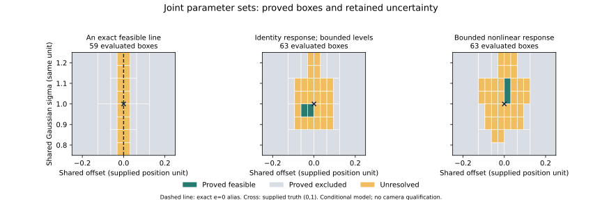

# Continuous shared Gaussian response domains

This candidate is based on published draft PR #68 at
`0b359ecb38a4cbe8df5fd6e0a2cd9fd88fb42e4d`. It encloses a continuous set of
shared edge-offset and positive Gaussian-blur hypotheses under externally
supplied observation, calibration and response-slope bounds. Read the
[input guide and mathematical contract](../gaussian-response-domains.md) before
using its results. The production trace/API/UI, earlier source files,
dependencies and reference-library artifacts retain their baseline bytes.
The Makefile adds one separate developer-study target.

## The coupled question

For exact supplied positions `p_i`, the model uses
`u_i(e,sigma)=Phi((p_i-e)/sigma)`, with `sigma > 0`. A feasible pair has
**one response shared by every observation and calibration constraint**.
Different feasible parameter pairs can have different response witnesses.
The target set therefore has the quantifiers `for each pair, there exists f`;
it does not demand one curve for all competing hypotheses.

At positive sigma, Gaussian input order is exactly position order. Reversed
output bands or contradictory equal-position observations can exclude the
whole domain analytically. With zero lower slope, no finite upper slope and
only endpoint calibration, consistent ordered levels instead construct a
response family over the whole prior. These certificates need no numerical
CDF evaluation and preserve the response/geometry ambiguity.

The numerical fallback bounds standardized coordinates at all four corners of
each offset/sigma box, then uses outward CDF covers. An incompatible existential
rectangle relaxation excludes the whole parameter box. One response for every
covered input certifies every parameter pair in the box. The remaining cases
are bisected or retained as unknown. Existential compatibility alone never
certifies the coupled analytic model; failure of the stronger universal test
alone never excludes it.

The complete exact-rational binary tree covers the closed prior. Children share
their split face; coverage is checked by exact parent/child equality, including
zero-width parameter domains, rather than by area totals. Budget, depth,
tolerance and local numerical/arithmetic exhaustion retain unknown leaves.
Accepted union is an inner set; accepted plus unknown union is an outer set.
Coordinate projections lose correlation. An empty inner set does not establish
that the feasible set is empty; the report's existence field is three-valued.

This follows the inner/outer box approach to bounded-error set inversion in
[Jaulin and Walter (1993)](https://webperso.ensta.fr/jaulin/paper_automatica93.pdf).
The paper's assumptions and convergence theorem do not establish convergence
for this implementation's response families, finite CDF precision and resource
limits. Fixed rounding bounds or thin feasible sets can leave unknowns after
refinement. No uniqueness, probability or physical confidence is inferred.

## Complete fixed development experiment

The [plan](../../studies/gaussian-response-domains-v1.json) declares nine models,
each evaluated at box budgets **1, 7 and 63**, giving **27 analyses**. All rows,
models, full node trees, source-indexed proofs, CDF certificates and summaries
are retained in [the canonical result](../../studies/results/gaussian-response-domains-v1.json).
There are **zero execution failures**. These are reused development models and
truth data, not independent camera captures or statistical trials.

Numerical analysis uses 24-place CDF covers, offset/sigma tolerances
`1/32, 1/16` and maximum depth 24. The three-position joint cases use positions
`-1,0,1` and supplied truth `(e,sigma)=(0,1)`. Generation retains 30-place
outward CDF certificates and adds output halfwidth `1/32`. The nonlinear source
is `h(u)=u+(3/20)*u*(1-u)`, with derivative in `[17/20,23/20]` on `[0,1]`;
its model includes five exact calibration patches and those slope bounds.
Numerical generation width is retained instead of promoting rounded truth
values to exact mathematical observations.

| Fixed case | Complete outcome at budget 63 | Interpretation |
| --- | --- | --- |
| Endpoint order family | One accepted root; entire supplied prior retained | Endpoint normalization and monotonicity alone do not identify offset or sigma |
| Reversed order | One excluded root | Position/output ordering contradicts every allowed response |
| Finite upper-slope overlap | Four accepted leaves after seven evaluations | Refinement proves the whole prior feasible; response witnesses may differ between boxes |
| Identity-response incompatible overlap | Three excluded leaves after five evaluations | Refinement excludes the complete continuous prior, rather than a finite grid |
| Exact zero-offset sigma alias | One accepted root, offset zero and sigma `[3/4,5/4]` | One half-level observation leaves all supplied blur widths feasible |
| Thin feasible offset line | 14 excluded and 16 unknown leaves; 59 evaluations; outer offset `[-1/32,1/32]` | The exact feasible line `e=0` remains covered without claiming an accepted box |
| Identity joint band | Two accepted, 14 excluded, 26 unknown leaves; outer offset `[-3/32,3/32]`, sigma `[7/8,5/4]` | Certified feasibility and unresolved boundary regions coexist |
| Nonlinear-response joint band | One accepted, 12 excluded, 34 unknown leaves; outer offset `[-1/8,1/8]`, sigma `[13/16,5/4]` | Externally supplied calibration restricts the conditional joint set |
| Rounded binary level at a singleton | One excluded root | Treating a rounded CDF evaluation as exact can reject the mathematical Gaussian truth |

At budget one, both overlap controls and all three nontrivial joint cases remain
unknown. The overlap controls resolve at budget seven; the thin-line and joint
band cases retain their unresolved leaves at the larger budget. All budget
results remain visible. The rounded-level control deliberately supplies the
exact rational value of a binary floating-point approximation; it does not
assert that this number is the exact Gaussian value.



The plot reads the retained maximum-budget trees. Teal is certified feasible,
gray excluded and amber unresolved. The cross marks supplied truth `(0,1)`;
the dashed line is the exact zero-offset alias in the first panel. The
[plot receipt](../../studies/results/gaussian-response-domains-plot-v1.json)
binds input, plotter and output hashes. This is a data view, not an additional
solver or camera validation. The SVG and local preview were visually inspected
for labels, units, legend and clipping.

## Independent proof replay

The [independent oracle](../../studies/verification/gaussian-response-domains-oracle-v1.py)
checks original endpoint cone constraints by exact difference-constraint closure,
replays CDF certificates using a separate rational series implementation,
verifies analytic order proofs and checks exact closed-tree coverage.
Its [generated census](../../studies/results/gaussian-response-domains-oracle-v1.json)
passes **31 cases and 19 controls**, comprising **255 individual checks**,
**94 CDF certificates** and **79 node certificates**, with zero failures.

The separate [saved-study audit](../../studies/results/gaussian-response-domains-study-audit-v1.json)
reconstructs all nine models, three budgets, generated output bands and summaries
without calling production analysis/CDF/response functions. All **27 analyses**,
**319 nodes** and **396 CDF certificates**, including three truth covers, pass
**122 outer checks and 766 internal analysis checks**. Every saved row is retained.
The reusable `verify_analysis(analysis)` helper has the same production-free
saved-record contract. It refuses analyses beyond its audit caps of 16 response
rectangles, 511 nodes or 1,024 CDF records; this is narrower than solver capacity.

Fifteen additional CLI, tamper and independence contracts pass. They include
duplicate-key refusal, a missing child, corrupt CDF evidence, fabricated pending
acceptance, complete replay with production imports blocked and first-case
failure retention. Corrupted-study checks retain all 27 analyses and inspect
later rows. Generated-census failure injection retains all 31 cases and checks
the following 30. Five separately executed study-runner contracts also pass:
help/missing-output/existing-file/dangling-symlink paths execute no population,
and an injected first-analyzer failure retains all 27 rows, with the following
26 executed, saves the full report and exits 1.

## Reproduce

After [setup](../development.md), use fresh destinations:

```bash
make gaussian-response-domain-study OUTPUT=.local/gaussian-study-new.json
.venv/bin/python studies/verification/gaussian-response-domains-oracle-v1.py --output .local/gaussian-oracle-new.json
.venv/bin/python studies/verification/gaussian-response-domains-oracle-v1.py --run studies/results/gaussian-response-domains-v1.json --output .local/gaussian-study-audit-new.json
.venv/bin/python -m pytest -q tests/test_gaussian_response_domains.py tests/test_gaussian_response_domains_cli.py
```

The strict CLI's complete decimal-string input is in the
[guide](../gaussian-response-domains.md#run-a-declared-example). Valid incompatible
and unresolved reports exit 0; inspect status and certificates. Invalid requests
and unsupported numerical roots exit 2. Local numerical limits retained as
unknown leaves still belong to valid reports. No server, photo, native program
or language model is needed. Reports preserve supplied measurements and names;
review [report handling](../privacy-security.md#numerical-reports) before sharing.

The [plotter](../../studies/verification/plot-gaussian-response-domains.py) requires
optional Matplotlib, which is not installed by workbench setup. The recorded
figure used Matplotlib 3.11.2. In a separate suitable plotting environment:

```bash
python studies/verification/plot-gaussian-response-domains.py --run studies/results/gaussian-response-domains-v1.json --output .local/gaussian-domains-new.svg --preview .local/gaussian-domains-new.png
```

Preserve dependency lockfiles and earlier outputs. Save the printed JSON receipt
alongside the figure. Plotting does not repeat the mathematical analysis.

## Source binding and regression

The [regression receipt](../../studies/results/gaussian-response-domains-regression-v1.json)
binds **167 frozen source/plan files**, verified unchanged after the run.
The full Python suite passes **1,536 tests**, with zero failures, errors or skips
in **232.67 seconds**, on Python **3.12.3**. The focused new coverage is 55 core
and 35 CLI tests. Frontend typecheck/build, Ruff and formatting checks pass.
The full suite started after successful build completion; an earlier run was
interrupted because that ordering had not been verified, with its log preserved
locally. It is not counted as a passed run or a product failure.

The parent revision identifies the baseline; dirty-file context and per-file
hashes identify the newly evaluated code. Study sources and independent-auditor
sources are checked before and after execution. The independent oracle and
plotter have their own source-bound receipts outside the 167-file suite freeze.
No pre-existing backend/frontend/script/test file changes in this candidate.
No new browser run, installed native-tool acceptance, measured-phone result,
physical-fit qualification or deployment is established.

## Documentation coverage

The complete repository Markdown inventory is reviewed, including current
workbench guides, numerical contracts, dated validation records and all 16
companion-library guides/templates. It extends the earlier
[91-document coverage](response-rectangles.md#documentation-coverage) with the
[domain guide](../gaussian-response-domains.md) and this record, for **93 documents**.
Current README/index, developer setup/catalog, architecture, engineering model,
research, roadmap, recovery, privacy, changelog and source/CI status now describe
the coupled tool and its limits. Historical dates, counts and source bindings
remain intact. Generated library/catalog/PDF/archive inputs and outputs remain
unchanged; this does not create a library release.

Repository-wide Markdown parsing passes for all **93 documents**, with
**1,437 local links**, **95 heading/HTML fragments** and **154 tables** checked.
The [documentation receipt](../../studies/results/gaussian-response-domains-documentation-v1.json)
retains the complete inventory and source hashes. Four new command-help paths,
root `make help`, the runnable guide example and the library's existing
**19 documentation tests** also pass. The current checks validate
documentation and supplied mathematical behavior, not physical reconstruction.
