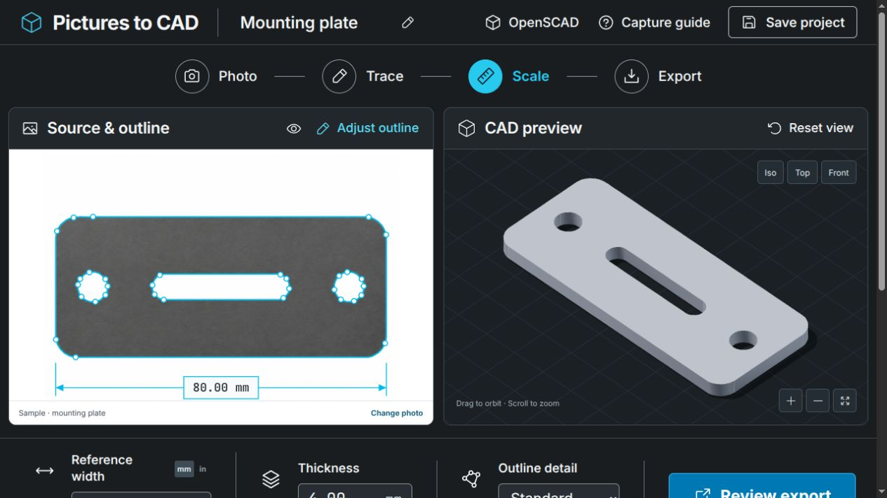
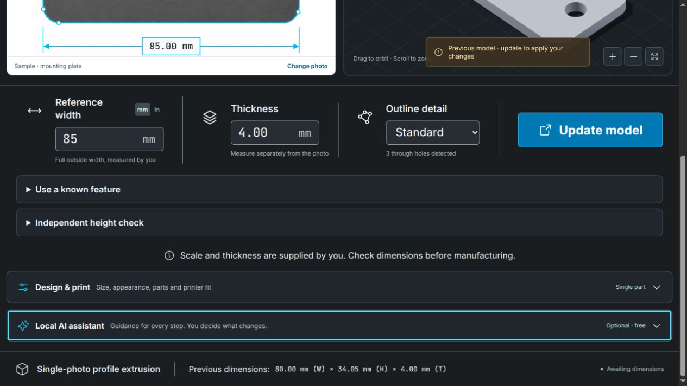
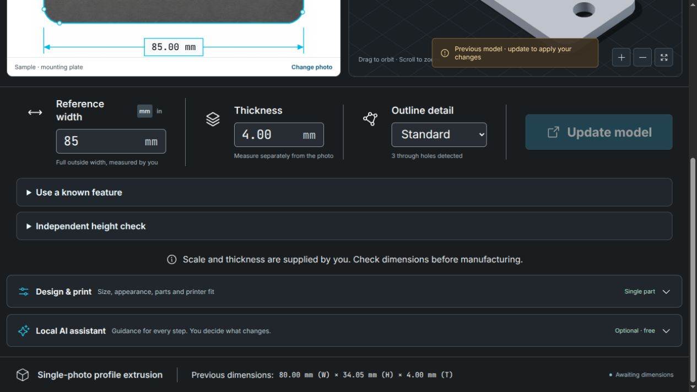
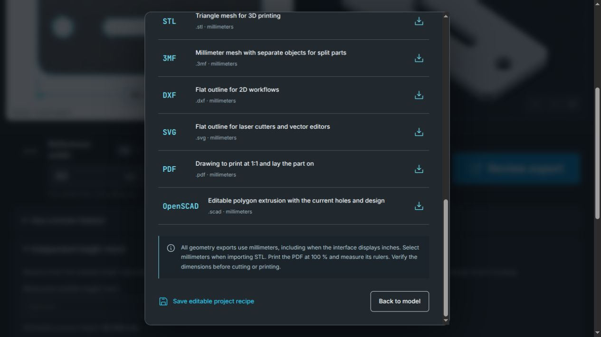
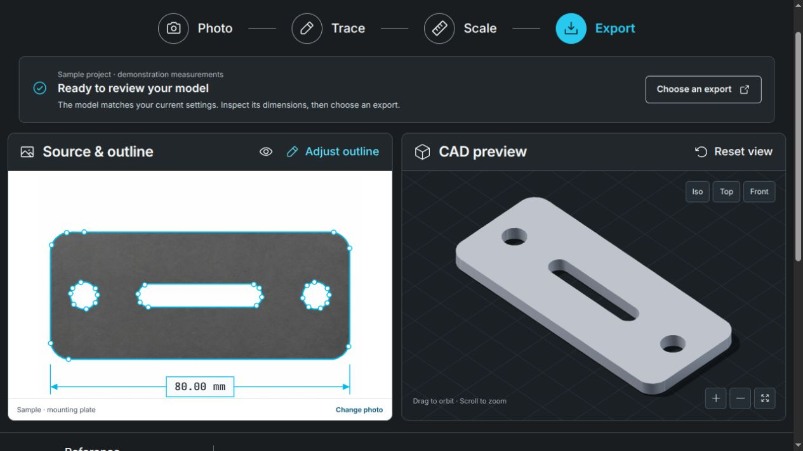
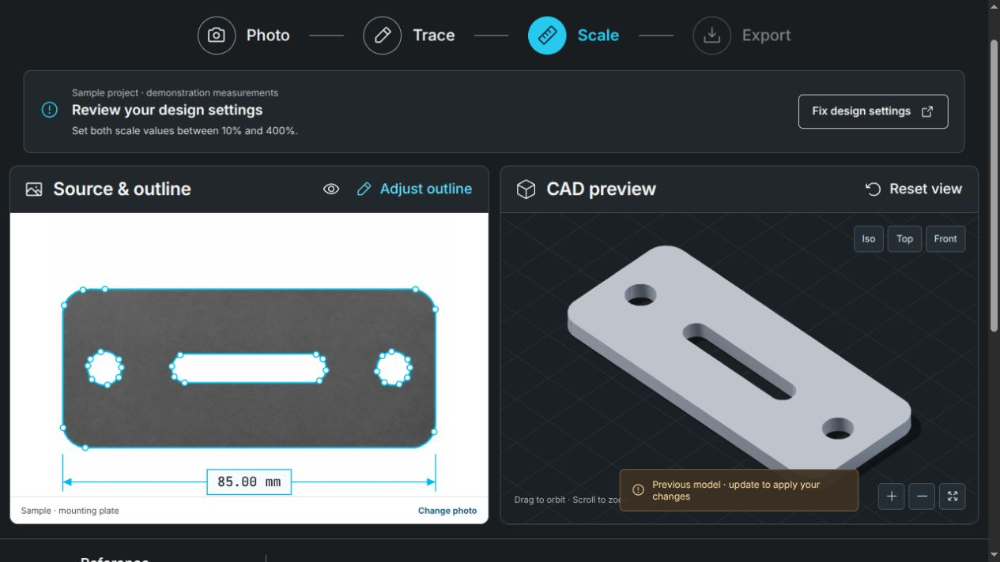
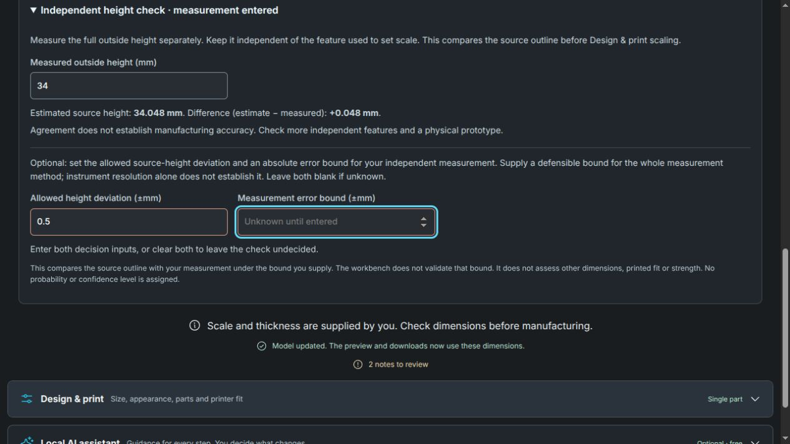
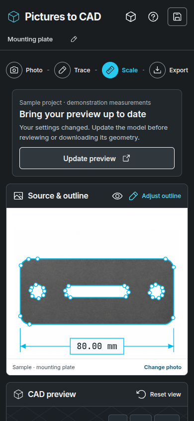

# Guided workbench review

Scope: opening the sample, editing a measured dimension, recovering from invalid
settings, and saving a recipe from export. Review performed November 11, 2026
on isolated integration revision `203ca3508126e438b63c76120dd00d53dc32d030`.
Only bundled synthetic imagery and measurements were used.

| Step | Baseline finding | Health before changes |
| --- | --- | --- |
| 1. Open current sample | A real source and CAD model render side by side, but Scale remains highlighted when the model already matches the settings. | Clear preview; misleading stage |
| 2. Change measured width | The old model is marked as old, and Update model is available. Footer incorrectly says Awaiting dimensions with valid measurements. | Working action; conflicting status |
| 3. Enter invalid design scale, then collapse settings | Build is disabled. The reason disappears inside the collapsed design panel. | Recovery needs work |
| 4. Save recipe with partial measurement notes from Export | Validation error is behind the open modal. The visible save action gives no useful feedback. | Recovery needs work |

## Captured baseline

### 1. Current sample

### 2. Edited dimensions

### 3. Collapsed invalid settings

### 4. Recipe validation behind Export

These are current-run browser captures. The paired source/CAD panels, visible
focus rings, explicit measurements and expandable specialist tools are useful
patterns to preserve. The improvement should provide one derived next step,
make blocked actions explain their cause, and keep specialist controls and
formats available through progressive disclosure.

A code review by mathematics, UX and AI roles also found reference-unit rounding
at supported input limits and unlabeled stale advice-only AI answers. Those
findings require regression evidence; screenshots alone cannot validate their
arithmetic or asynchronous behavior. Baseline keyboard entry and labels were
observed. Native screen-reader behavior and complete WCAG compliance were not
established by this review.

## Implemented and reviewed

The deterministic guide, workflow navigation and footer now share the same
readiness state. Specialist controls remain in their existing expandable panels;
the guide takes users directly to missing measurements or opens the invalid design
settings. Its preview action rebuilds without opening Export. Its action button
stays mounted during processing so completion can restore keyboard focus.

| Step | Result after changes | General health |
| --- | --- | --- |
| 1. Open current sample | Sample measurements are labeled as demonstrations. Export is the current stage, and the guide asks for dimension review before choosing a file. | Good in the reviewed desktop and phone views |
| 2. Change measured width | The guide and footer both request a rebuild. Update preview keeps the user beside the source and model; focus returns to the next action. | Good; current and outdated geometry remain distinct |
| 3. Enter invalid design scale, then collapse settings | The cause stays visible in the guide. Fix design settings opens and focuses the existing panel. Missing width/thickness actions focus their fields. | Recovery fixed in the reviewed cases |
| 4. Save recipe with partial measurement notes from Export | The dialog closes, the height check opens and the missing bound receives focus. An invalid height instead focuses height, even with blank optional decision fields. Current CAD remains available. | Recovery fixed; common downloads and specialist formats stay available |

### 1. Current sample

### 2. Edited dimensions

### 3. Collapsed invalid settings

### 4. Recipe correction

### Phone layout

The desktop images are actual in-app browser captures of the local workbench.
The phone capture comes from the new Playwright regression at 390 × 844 CSS
pixels. The existing full-page [desktop](../images/workbench.png) and
[phone](../images/workbench-mobile.png) documentation images were also refreshed
and visually inspected. No generated mockup substitutes for the working interface.

## Arithmetic and AI reliability

- Removed twelve-significant-figure rounding from the feature-length draft on
  restore and unit changes. The 1379 px outline / 7 px reference fixture at
  2000 mm now stays applicable in inches and after recipe restore. A real
  2002 mm request remains rejected.
- Full precision still leaves IEEE-754 boundary roundoff: the 0.1 mm fixture
  can become 0.09999999999999998 mm, and the 2000 mm fixture can become
  2000.0000000000002 mm. A 64-epsilon relative guard normalizes only numerical
  contact with those two computational limits. The regression sweeps 672 unit
  conversions over varied spans, diagonal endpoints and repeated switches;
  values beyond the guard remain outside. Nonfinite results are preserved for
  validation, and endpoint sensitivity remains an unclipped scenario.
- Advice-only AI answers now show the same stale-project notice as proposals
  after edits during a pending answer. A gated fixture verifies the old answer
  cannot silently describe the new 95 mm project as its earlier 80 mm state.
- Valid settings that request oversized geometry can ask for a repair suggestion.
  Raw invalid settings show a deterministic explanation before sending. Applying
  a repair remains explicit and size-validated, and no answer starts a build.
  Undo depends on actual work in progress rather than geometry-limit errors.

## Evidence limits

The guide describes editable inputs and current digital geometry. It does not
approve source measurements, conditional height decisions, strength, physical
fit or manufacturing. The existing source-height interval rule and separate
printer-placement evidence remain in place. AI tests use explicit response
fixtures, not a live-model quality evaluation. Browser reflow, keyboard focus and
automated accessibility checks do not establish native screen-reader behavior,
complete WCAG compliance or physical-device qualification.

## Validation completed

Local Linux workstation, November 11, 2026. The feature baseline
`203ca3508126e438b63c76120dd00d53dc32d030` has the same tracked tree as main at
`f336287b02a7a6d38416333870c0a6dcf8dc924a`; validation includes that integrated
geometry code. This change adds no backend or dependency changes.

- `npm run build`: passed, including TypeScript compilation and the production
  frontend bundle.
- `make lint`: Ruff and Prettier passed; `git diff --check` passed.
- `.venv/bin/python -m pytest -q`: **498 passed** in 178.55 s. These exercise geometry, backend
  validation, export re-import and existing arithmetic checks.
- `npx playwright test`: **74 passed** in 6.0 minutes, with a real local CAD
  backend. This includes six new guided-workflow cases, the reference-unit
  save/import case, four roundoff cases and three new AI fixture cases, alongside
  the existing upload, download, split, slicer, failure-recovery and accessibility
  regressions.
- All **97** local links in the six changed documentation files resolve.
- Manual in-app browser review: the current sample, edited model, hidden invalid
  settings, save correction and grouped export chooser were checked against the
  rendered application. No warning/error console entries were observed in the
  final clean sample preview.

The primary `codex/slicer-integration` checkout was preserved. Source changes,
local test results, the local preview and any remote CI status are separate
evidence; a draft review does not establish merge, deployment or physical fit.
