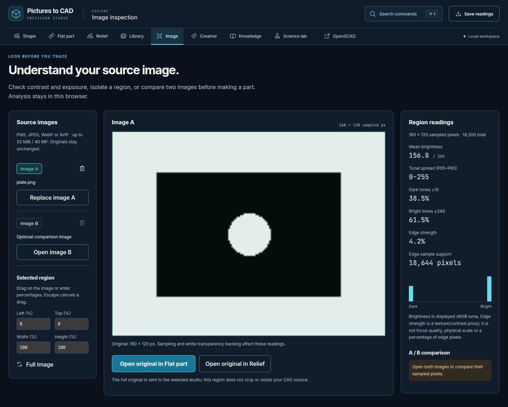

# DVR-inspired image inspection verification

November 17, 2026. Implementation branch `codex/image-inspection-studio`, based on
Pictures-to-CAD main `9e704c7`. Reviewed DVR main:
`9dfba23cf954f60531a7b541e5b482ee01d96c5c`. [Methods/provenance](../image-inspection.md).

## Checks and results

| Lane | Result |
| --- | --- |
| TypeScript pure tests | **43 passed**, including independent enumeration of all 512 extreme Sobel patches, correct white transparency backing, missing edge support, ROI crop isolation, percentiles and comparison thresholds. |
| Image + navigation/keyboard/tab browser regressions | **16 passed** in 20.5 s. Six new image scenarios plus retained-work, command navigation, native upload keyboard and existing CAD/relief checks. |
| Knowledge/Science routing, recovery and accessibility browser regressions | **9 passed** in 7.6 s. Older exact-role selectors were refreshed to match the catalog's Knowledge base name. |
| Documentation API tests | **14 passed**. New guide included in the curated local API. |
| Build/typecheck, Ruff, Prettier and whitespace | Passed. |

Browser tests used installed Chrome via the project Playwright configuration,
an isolated localhost service on port 8136, synthetic fixtures, isolated CAD jobs
and an isolated photo library. The full project Python and Playwright suites were
not rerun for this change. Hosted CI is a separate lane.

## Exercised behavior

- Image A/B import; exact JSON-download readback, histogram total, source names,
  sample dimensions, white backing, selected region and nonzero A/B difference.
- No POST requests during image import, analysis, export or ordinary studio navigation.
- Region editing by numeric percentages, pointer drag commit and Escape cancellation.
- Unsupported edge support in a one-pixel-wide ROI is Unavailable, not zero.
- Mismatched sample dimensions refuse A/B comparison; a malformed replacement
  retains the previous image and reports the error.
- A delayed decode cleared by the user cannot restore the deleted frame.
- A 1440 × 1080 original is sampled to 720 × 540 for inspection. Handoff produces
  the same decoded tracing image as a direct original upload (the tracer applies
  its own 1400-pixel long-side limit), preserving the full source rather than the
  selected 20% region. The workbench still requests physical measurements.
- Viewports 320, 375, 650, 800, 1001, 1100, 1251, 1366, 1440 and 1920 pixels
  have no document-width overflow. The targeted image-workspace axe scan passes.

The sweep caught tablet tab overflow, light panel text on white backgrounds and
short tab labels that did not match their accessible names. The final studio uses
the application's dark palette, three-column wrapping tabs on narrow layouts,
matching visible/accessibility labels, and a focusable skip-link target.

These are generated-pixel and software-workflow checks. They do not establish
optical quality, physical measurements, model accuracy, fabrication, deployment
or an exhaustive accessibility audit. DVR camera, tracker, map and recording
workflows were not copied or activated.

## Final captures

Both show the generated plate fixture, not a photograph of a measured part.

[Phone-width full-page capture](image-inspection/mobile.jpg)
