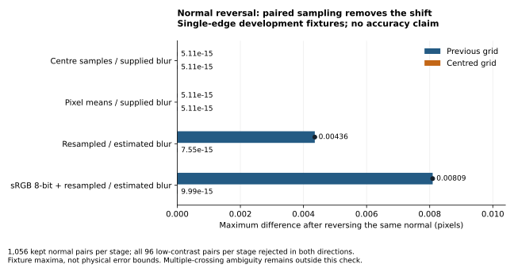

# Material-gradient census and symmetric edge sampling

The later [crossing-selection record](edge-crossings.md) repairs the separate
multi-contact selector. This page retains the source-bound PR #55 study below.

## Source and decision

This candidate is based on published `620d5c717e21fd7d7a797b114972fd2b09e9ece9`
([PR #54](https://github.com/bartytime4life/Pictures-to-3D-CAD-Models/pull/54)).
It adds a repeatable local-profile study and repairs an actual sampling-coordinate
defect in `sheet.half_level_search`. The paper-only slope guard is retained.
The two-affine treatment remains a research ablation; no new image-accuracy
decision, camera calibration, wall correction or physical acceptance is supplied.

The preliminary 36-case material-gradient probe is development evidence. The
crossed [plan](../../studies/material-gradients-v1.json) was fixed before its full
execution, then reused unchanged before and after the grid repair. This is a
development census, not an unseen statistical population. The [method guide](../material-gradients.md)
gives equations, exact stages, units, usage and limitations.

## Complete census

| Quantity | Baseline | Centred grid |
| --- | --- | --- |
| World scenes | 576 | 576 |
| Processing/treatment/normal rows | 9,216 | 9,216 |
| Kept crossings | 8,448 | 8,448 |
| Low-contrast rejections | 768 | 768 |
| Measurement failures | 0 | 0 |
| Acceptance changes | — | 0 |
| Largest normal-reversal crossing difference, px | 0.00809432299348 | 9.99200722163e-15 |
| Paired normal cases with different `ceil` reach counts | 0 | 0 |

Each stage/condition/treatment group contains 96 rows. Normal reversal produces
4,608 pairs per run; 4,224 have a kept crossing in both directions. No rows are
dropped from the comparison. Independent CSV checks verify the full Cartesian
keys, uniqueness, missing offsets for rejections, finite kept offsets, all 96
summary groups, totals and exact CSV hashes. Measured sigma values are unchanged.

The plotted ranges are fixture maxima, not confidence intervals or physical error
bounds. The two known-sigma stages were already symmetric for their selected
integer reaches and remain unchanged. Only the two estimated-sigma stages
change. The largest individual offset change is 0.0168996 px in a wall/ablation
case; this repair does not uniformly reduce geometric error.

## Why the grid was wrong

The old array began at `-reach` with a fixed step. A noninteger `reach/step`
made the positions asymmetric, although the crossing search treated the centre
index as the supplied point. Opposite normals therefore sampled different
physical locations. The new grid is `j × step`, `j=-ceil(reach/step),…,ceil(reach/step)`.
It includes zero and covers the requested window with mirror-paired positions.
No roundoff snap or physical tolerance is introduced.

Two independent diagonal, contrast-inverted, noninteger-window regressions use
segmented real-source Gaussian quadrature, not the runner’s closed form. They
fail before the fix: paper-only reversal differs by 0.00103631 px and the
two-affine treatment by 0.00123178 px. They pass after the grid repair. The
comparison concerns single-crossing profiles. Existing nearest-crossing
selection can still behave ambiguously on profiles with several competing roots.

## Lighting and wall limitations remain

The following signed ranges are all kept crossing offsets in the final encoded
stage, in pixels, positive toward paper. Each entry covers 96 fixture rows.
Condition names refer to the plan’s base polarity, paired with its intensity
inversion. They are observed extrema, not uncertainty intervals.

| Condition | Paper-only guard, px | Two-affine ablation, px |
| --- | --- | --- |
| `flat` | [-0.04329, +0.06291] | [-0.02659, +0.05288] |
| `paper_up` | [-0.04637, +0.08922] | [-0.05368, +0.07331] |
| `paper_down` | [-0.05993, +0.06098] | [-0.03613, +0.05424] |
| `material_up` | [-0.33162, -0.06046] | [-0.04717, +0.04294] |
| `material_down` | [+0.06370, +0.33946] | [-0.04696, +0.04517] |
| `parallel_up` | [-0.34789, -0.05104] | [-0.08265, +0.07192] |
| `parallel_down` | [+0.04929, +0.30317] | [-0.04355, +0.06864] |
| `opposed` | [-0.32752, -0.05657] | [-0.05758, +0.06551] |
| `opposed_reverse` | [+0.07268, +0.37987] | [-0.04239, +0.05864] |
| `narrow_wall_light` | [-1.83186, -0.85547] | [-1.74879, -0.83891] |
| `narrow_wall_dark` | [+0.40733, +0.83140] | [+0.25850, +0.51826] |
| `low_contrast` | 96 rejected; no offset | 96 rejected; no offset |

Material-up and material-down conditions still produce paper-only shifts of
about 0.06–0.34 px. The two-affine ablation has smaller errors on those gradient
fixtures, but both methods retain substantial wall offsets. Wall values are
pre-refinement crossings relative to the supplied outer silhouette; the later
wall model and final CAD are not tested. Thin-wall tone/width and edge motion
are first-order confounded, as derived in the method guide. These results do
not justify automatically fitting material slopes or labeling real parts accurate.

## Independent checks and reproducibility

- The bounded Gaussian oracle agrees with separately assembled affine-segment
  moments within 2.85e-14 over 264 values, including both distant tails.
- Every source segment endpoint is in `[0,255]`; slopes saturate outside `±12σ`.
- Unit-square means at 6×6 versus 12×12 Legendre orders change by at most
  2.67164068646e-12 across the complete plan, below its predeclared 1e-10 check.
  This floating-point agreement is not an interval proof.
- An independent affine intensity ramp verifies the rectification translation
  sign and half-pixel convention exactly in the interior.
- Tests cover independent real-line convolution, source joins, wall degeneracy,
  scalar inputs, aperture means, fixed-profile affine invariance, normal reversal,
  retained gradient bias, failure/rejection accounting and existing-output refusal.

The [baseline summary](../../studies/results/material-gradients-baseline.json),
[centred-grid summary](../../studies/results/material-gradients-centred-grid.json)
and [independent reconciliation](../../studies/results/material-gradients-audit.json)
are committed. Each summary includes all 96 groups, versions, source hashes and
the hash of its complete CSV. The individual CSV rows remain local at
`.local/verification/material-gradients-final/cases.csv` and
`.local/verification/material-gradients-centred-grid/cases.csv`; they are not
bundled in Git. Running the command regenerates all rows. For a baseline replay,
use an isolated checkout at `620d5c7` with the unchanged new runner and plan
copied into it and the same configured dependencies; do not replace the primary
checkout’s production source. Git metadata honestly records the dirty source
candidate during these studies; the file hashes bind the executed code.

| Input or artifact | SHA-256 |
| --- | --- |
| `studies/material-gradients-v1.json` | `7e9c4b8a0c9083938ec848744936cc803920dae2ec541ad0f479f4451b5859bb` |
| `scripts/material_gradient_study.py` | `e2d5c8fbd651f734de43ea933b70fc599eb2589718a1a79047971899a85e06d6` |
| `backend/sheet.py` | `c5a2b6404ff4be18519b37e7eef1aa33baabc19c2204fe3fafadfb3c3e6df5f8` |
| `tests/test_material_gradient_study.py` | `915b75b042f876f1a322855cf28ede95d35e48fc001b8eaca09af0e56aebb01b` |
| `studies/results/material-gradients-baseline.json` | `16d2cbf989728cba17a2c4a39138960e3a87e9afccf51da6a2fa4d2ae7a15379` |
| `studies/results/material-gradients-centred-grid.json` | `b5fb4b2031b9b5fda672642c2f17e2cfa57b8012fb1c2dca5ee5a20809b702c5` |
| `studies/results/material-gradients-audit.json` | `2f082b7889777ca1437a01f480725bab924fc560a1cd97292ee6b3ded5b026d5` |
| `docs/images/material-gradient-normal-reversal.svg` | `99a381b71e87b775e32872f81dd0b1df291f51199a9ed7555676022445ee2c3d` |

The baseline sheet hash is
`799fac3ada1df475250769ecb1227a5939b44e804a1db6ac9c9098ae5669c0f9`.
Runner, plan, edge/tone source and runtime versions match between runs; only
the production sheet hash changes. The scalar helper repair preserves the
preliminary census CSV byte for byte.

## Verification scope

The focused profile and existing fidelity suite passed **120 tests in 34.83 s**.
The complete Python suite passed **1,075 tests in 195.04 s**, including 53 new
study/invariant tests. Ruff and whitespace checks passed. The production source,
runner and tests remained frozen through the census and full suite.
The repository-wide Markdown audit passed for 69 documents, 686 local links,
51 heading fragments and 111 tables. The Matplotlib figure was rendered and
visually inspected after fixing a clipped title and an overlapping legend.
No frontend, API contract, dependency, generated-library or export changes are
introduced. Existing full-photo Python tests are regression checks; this new
census itself covers local profiles, not complete photos. Browser/build and
physical-photo/print acceptance remain separate evidence.
