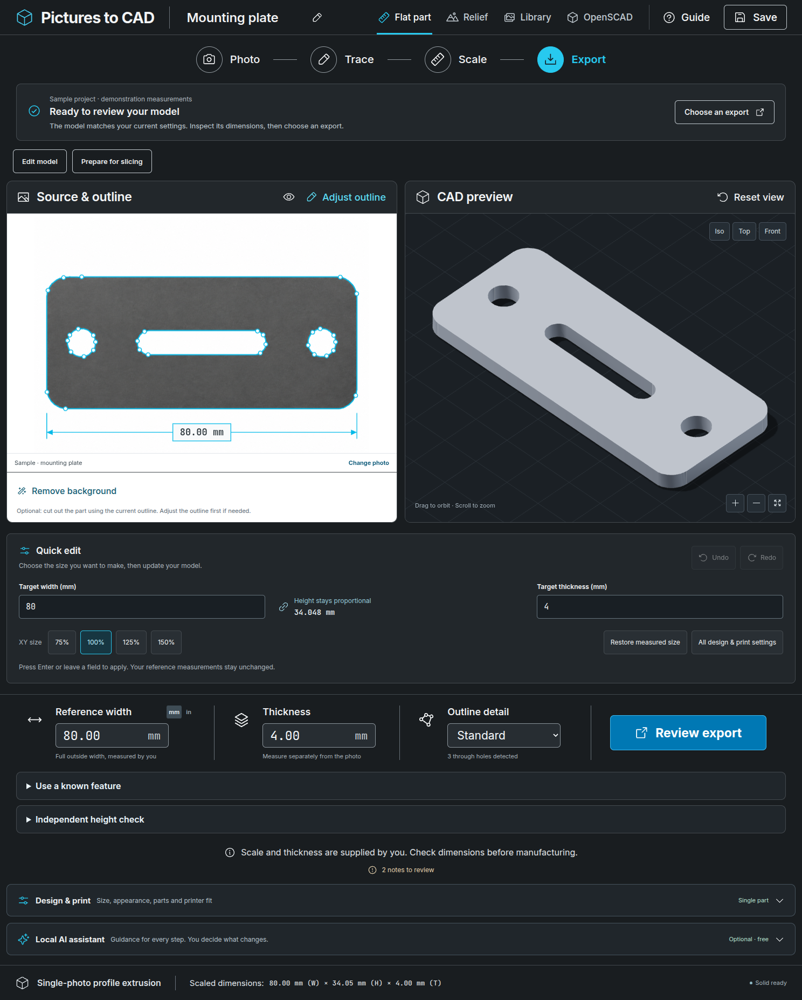
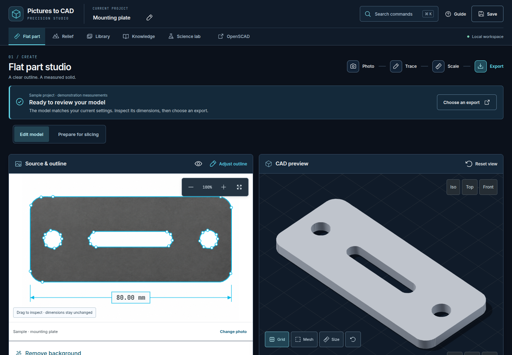
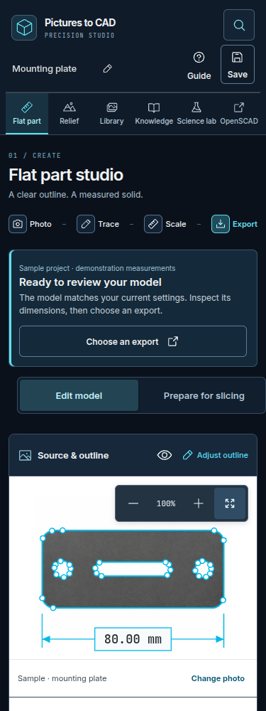
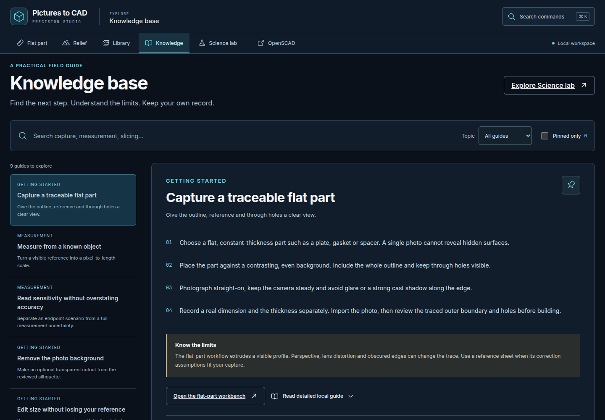
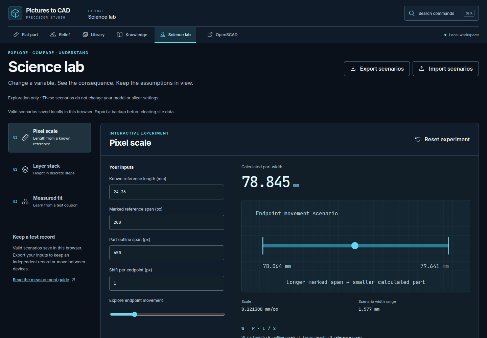
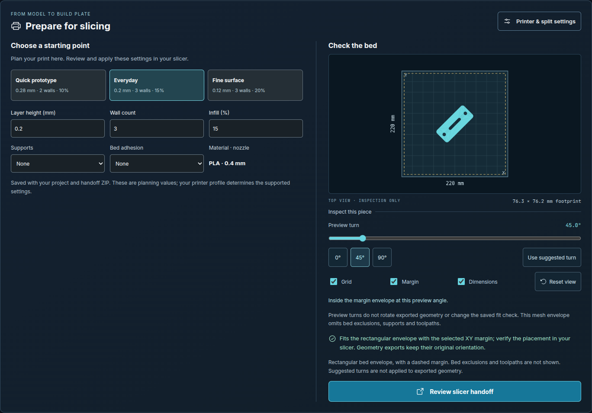
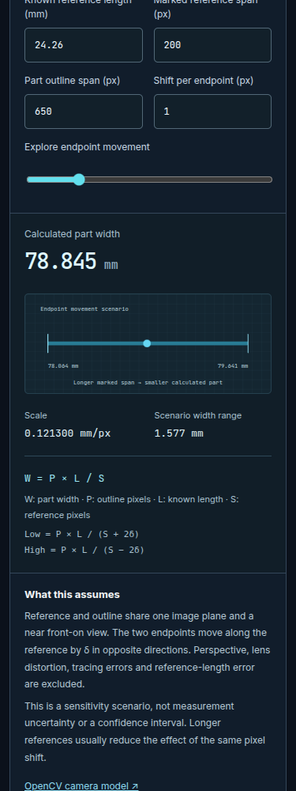
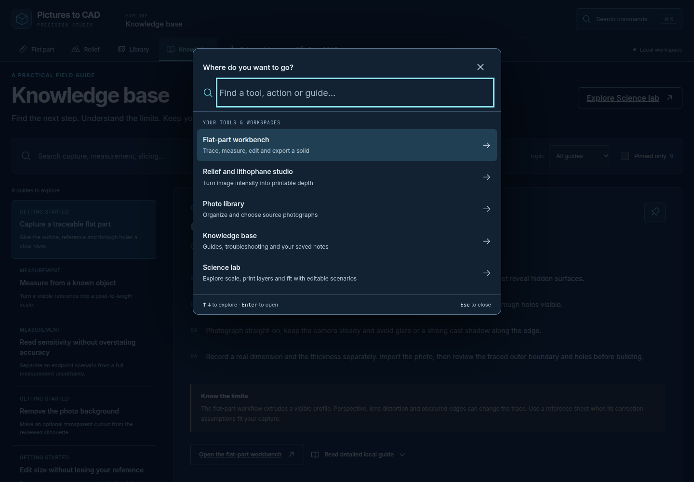

# Precision Studio: interface, knowledge and documentation

Local review on November 16–17, 2026, based on revision `502b2f5` plus this working tree. This follows the [slicer workspace review](slicer-workspace.md); that earlier record and its captures remain unchanged.

## What changed

The shared interface now uses a compact two-row navigation, a command search, clearer project context and responsive controls. Flat-part, Relief, Photo library, Knowledge and Science are separate workspaces. Visited studios retain editable state during navigation; inactive CAD canvases and background polling are suspended where applicable.

Source inspection supports zoom, drag-pan, keyboard movement and reset. CAD display supports grid, mesh and measurement toggles. Bed inspection supports editable preview turns, grid, margin and dimension controls. These display operations do not change saved geometry or the process plan.

Knowledge includes nine searchable guides, topic and pinned filters, personal notes, validated import/export, undo import, and recovery when browser storage fails. Ten curated project documents are available through a read-only local API, with matching Markdown downloads and SHA-256 content hashes. Raw document text is displayed as text rather than executable HTML.

Science includes three editable experiments: measured pixel scale with endpoint-shift sensitivity, an idealized layer stack, and additive hole-bias compensation from a measured coupon. Valid scenarios persist in browser storage and export as JSON. Invalid imports are atomic; invalid drafts do not overwrite the last valid saved scenarios. Every experiment displays its assumptions and a reset action.

README and the documentation index now lead with user tasks. New getting-started, workflow and science guides sit beside rewritten architecture and troubleshooting guides. Detailed prior API material and research links were retained in separate indexes rather than discarded.

## Reproduced and corrected defects

- A target-width edit from 80 to 100 mm was lost when leaving and returning to Flat part. The old router unmounted the studio; the retained-state router now preserves the edit and still requires a current build before export.
- Knowledge search was reset by unrelated hash navigation; plain studio switches now preserve it while explicit search links replace it. Repeated command searches for the same URL also reapply correctly.
- Brand, command and guide/experiment labels could override or omit visible wording; these controls now derive their names from the displayed content, with a retained command name on phones.
- On narrow screens the source ruler overlapped the filename strip and the Guide action lost its text label. Source fitting now reserves space for its overlays and the Guide label remains visible.
- Maximum-size notebooks containing non-ASCII or escaped text could export successfully but exceed the import byte limit. The bounded reader now accepts every supported notebook export, with Unicode and escaped-text round-trip tests.
- Experiment-specific guide links opened whichever Science experiment happened to be selected. Explicit links now select their named experiment while ordinary navigation retains the current choice.
- Undo could race a second notebook import. Competing mutations are disabled until that import completes.
- One- and two-layer diagrams extended below the bed and SVG bounds. The bands are now anchored above the bed.
- The existing library browser-test cleanup could act after a skipped or mocked test. Cleanup now requires that the test first verified an empty library.

## Rendered evidence

An independent design agent passed two review rounds. The final round inspected 24 primary states: workbench, preparation, Knowledge and all three Science experiments at 1440, 768, 375 and 320 px. It observed no page errors or horizontal page overflow. It also checked command dialogs, source fitting, bed rotation/reset, navigation and the one-/two-layer diagrams. Its final verdict was PASS. Captures 02–08 were refreshed after the final fixes; the original before capture was preserved.

Additional final captures show the [320 px source ruler](evidence/precision-studio/09-source-320px.png), [one-layer diagram](evidence/precision-studio/10-one-layer.png) and [two-layer diagram](evidence/precision-studio/11-two-layers.png). A different-provider evaluator was unavailable, so the evaluation used a fresh independent agent from the available provider. Screenshots establish appearance, not dimensional or manufacturing accuracy.

## Executed checks

- TypeScript typecheck and production build: passed.
- Pure TypeScript math, history, geometry projection and file round trips: 30 passed.
- Focused backend suites for documentation, process plans, slicer bundles/bridge, printing, assistant and 3MF: 187 passed.
- Installed-Chrome browser coverage: 120 distinct cases passed across the broad run and focused reruns; two optional installed-model checks were skipped because DINOv3 and AI depth were unavailable.
- Repository Ruff/Prettier checks and authored whitespace checks: passed. Relative-link checks across 15 changed/new guides found no missing local targets.

The broad 121-case run finished with 115 passes, four failures and two skips. Two failures exposed missing/mismatched visible labels; two were test assumptions about studio unmounting or navigation timing. Those were corrected, and a 38-case rerun passed 35, skipped two and exposed a further command-trigger naming problem through a newly added desktop axe check. After that correction, all ten final targeted Knowledge/Science/navigation/accessibility cases passed. There are no outstanding failures in the exercised application cases. The separate companion-library suite and hosted CI were not run.

The source and build files for this review are identified by [the local evidence manifest](evidence/precision-studio/manifest.json). It records the base revision and SHA-256 hashes of changed source/documentation/test files, current browser bundles and these screenshots; it is not a published release identifier.

The browser connector could not acquire a tab. The user explicitly authorized verification through the project's Playwright tests with installed Chrome. Browser checks run serially against this worktree's loopback server; optional installed-model checks retain their explicit availability conditions.

## Boundaries

This is local source and browser verification, not hosted CI, a deployment, native slicer import or a physical print. No native applications were launched or configured and no printer was contacted. The model is still a measured silhouette extrusion or a separately defined relief workflow, not arbitrary 3D reconstruction or a full feature-history CAD editor.

Common-object references require the user to identify the object, mark endpoints and verify its real dimension. Background removal is an optional outline-based transparent cutout. Science scenarios do not automatically modify a model or certify measurement uncertainty. Slicer settings are planning notes; toolpaths and native process profiles remain in the receiving slicer.

Current CAD projects remain in browser memory until saved as recipes. Knowledge and Science have separate browser-origin storage and backup files. Native file pickers, native slicer behavior and physical fit require their own checks. Local changes remain uncommitted and unpublished.
