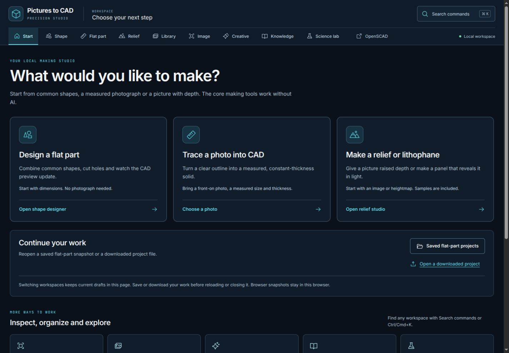
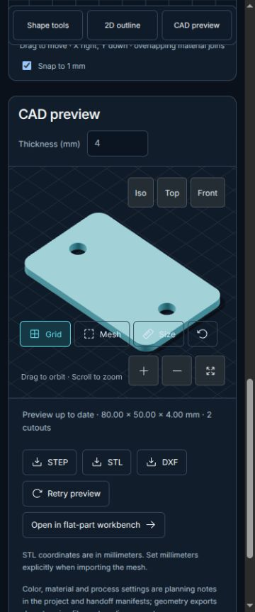

# Product experience review

Reviewed on 2026-11-18 against main `9ba132c`, with implementation on `codex/product-experience-review`. This is a bounded product review and regression record, not a claim that every possible workflow is defect-free.

## Scope and method

A design specialist, interaction engineer, setup engineer and lead integrator reviewed the task structure, setup path, persistence, optional AI, asynchronous work and responsive controls. Source review was followed by fresh Codex in-app browser checks on an isolated production build at `http://127.0.0.1:8138`, with separate photo-library and temporary-job directories. Screenshots below were captured in this run and inspected before acceptance. Only included repository sample images and synthetic review text were used.

The existing mounted `studio-route` / `hidden` / `inert` / `StudioActivity` design remains: visiting a different workspace preserves its draft and suspends inactive focus and automatic work. No native printer, slicer, Blender or OpenSCAD launch was requested.

## Findings and implemented changes

| Priority | Finding | Result |
| --- | --- | --- |
| High | The initial page immediately traced and built a demonstration, before the user chose their source or task. | A Start workspace offers shapes, a measured photo or relief, with required inputs visible. Photo/project entry opens its chooser without a demo job. The sample is an explicit learning action. |
| High | Unsaved saved-project details and print-form notes disappeared when selecting/filtering projects or closing the modal. | Tab-local drafts retain both forms per snapshot. Snapshot identity guards prevent reuse against a replaced entry. Successful saves clear only matching submitted fields, preserving newer edits and the other form. A 100-snapshot cap refuses extra drafts instead of silently evicting text. |
| High | A late original-image or designer handoff could redirect a user after they left its workspace; selected photo details could expose the previous photo's actions. | Handoffs bind to activity, selection/request identity and document revision. Library details have matching-photo loading and retry states. Inactive details cannot take focus. |
| Medium | Nine phone navigation entries consumed three rows, while shape controls placed the CAD preview far below the first screen. | A labeled Workspace picker appears through 1100 px. Phone Shape tools / 2D outline / CAD preview buttons focus and scroll their sections while keeping the designer route. |
| Medium | Setup guidance mixed app use with the companion handbook development environment and did not offer a read-only diagnosis. | App-only setup is the first-use recommendation. `make doctor`, clearer startup addresses, recovery commands and validated Start setup details distinguish required packages/assets from optional AI. |
| Medium | Creative discovery used one combined success path for the catalog and Ollama status. | Tool discovery and AI readiness settle independently; status failure preserves available tool descriptions and examples. Generation still requires AI readiness. |
| Medium | Shape dragging could accept a secondary pointer or leave an undo gesture open after capture loss; older import errors could replace newer feedback. | Primary-pointer ownership and capture/activity cleanup end gestures; import errors use the current ticket. |

Baseline: [automatic demonstration](evidence/experience/before-workbench.png), [phone navigation and long controls](evidence/experience/before-designer-phone.png).

## Numbered flow health

These statuses describe the observed paths, not a comprehensive certification of each feature.

| Step | Flow | Health after changes | Current-run evidence |
| --- | --- | --- | --- |
| 1 | Install, start and inspect setup | Improved. Doctor found required environment, package metadata and built assets. Optional loopback chat metadata was verified without inference by the doctor. API route tests confirm no-store and responsive health during slow metadata work. | [Setup details](evidence/experience/02-setup.png); runtime regressions |
| 2 | Choose a task and resume work | Improved. Start exposes source requirements, saved projects and portable recipes. Photo and saved-project entry visibly opened their dialogs with an empty workbench, without a preceding sample build. | [Start](evidence/experience/01-start.png), [photo entry](evidence/experience/03-photo-entry.png) |
| 3 | Design shapes and inspect CAD | Improved. Editing the mounting plate from 80 to 90 mm updated its CAD preview to 90 × 50 × 4 mm. Its name and dimensions survived a Knowledge round trip; its workbench handoff rebuilt the same dimensions. Phone jumps focused the exact section and preserved `#designer`. | [Phone controls](evidence/experience/05-designer-phone.png), [phone preview](evidence/experience/08-designer-preview-phone.png), [tablet](evidence/experience/06-designer-tablet.png) |
| 4 | Save and edit project records | Improved. Saved a synthetic 90 mm review snapshot, filtered it out/back, saved details, and closed/reopened the dialog. Both project notes and unsaved print notes remained; saving details did not clear the print form. No physical print was recorded in this browser audit. | [Retained forms](evidence/experience/07-project-drafts.png); seven pure draft regressions |
| 5 | Collect and select source photos | Improved asynchronous behavior. Indexed the repository sample, selected its matching details and opened it in Image inspection. Normal handoff worked; source review covers cancellation and stale-result guards. | [Selected photo](evidence/experience/14-library.png) |
| 6 | Inspect an image | Healthy observed path. The full 1448 × 1086 sample arrived from Photo library, with explicit 720 × 540 analysis sampling and region readings. | [Image inspection](evidence/experience/09-image-inspection.png) |
| 7 | Make a relief | Healthy observed path. The moon sample produced a 100 × 71.1 × 4 mm relief, current preview and available exports. | [Moon relief](evidence/experience/13-relief.png) |
| 8 | Use local creative AI | Improved discovery resilience. A fresh `qwen3:1.7b` browser request generated three desk-organizer concepts in 3.1 seconds. Notes remained reviewable concepts and did not change CAD dimensions. Independent catalog/status failures have controlled regression tests. | [Local creative response and toolkit](evidence/experience/10-creative-notes.png) |
| 9 | Find guidance and explore math | Healthy observed paths. Knowledge search for `shape` selected the matching guide. Science numeric endpoint shift accepted 20 px and ArrowLeft changed it to 19.75, with a matching sensitivity range. | [Knowledge](evidence/experience/11-knowledge.png), [Science](evidence/experience/12-science.png) |

## Responsive and keyboard evidence

All nine workspace routes were selected through the visible picker at 320 px. Each had one active main and no horizontal page overflow. Start/header measurements at 375, 768, 1024, 1100, 1280 and 1440 px also had no page overflow and zero header overflow. Scrollbar width accounts for the smaller client width in some captures.

At 375 px the picker preserved visible workspace names and the external OpenSCAD label. Shape section jumps focused `shape-preview-section` and `shape-tools-section`, preserved `#designer`, and left the document unchanged. Command search from Photo library opened saved flat-part projects with Enter. The browser's captured error log was empty at the end of the route review. This is a targeted keyboard/responsive review, not a full screen-reader or WCAG audit.

[Phone Start](evidence/experience/04-start-phone.png). Screenshot bytes are pinned by [SHA-256 manifest](evidence/experience/sha256.json). A transient library-loading capture and an early malformed viewport capture were rejected and are not published as evidence.

## Validation and limits

- Full Python suite: **1719 passed, 3 skipped**, 517.44 seconds. Skips remain environment-dependent checks; no physical acceptance is inferred.
- Final runtime/documentation regression lane: **56 passed** after integration, including all 42 runtime checks and API-route regressions.
- Pure frontend unit suite: **60 passed**, including independent creative connection failures, setup-schema rejection, explicit navigation intents and project draft concurrency/isolation.
- Production frontend build, TypeScript, Ruff, Prettier, shell syntax and whitespace checks passed.
- New browser regressions cover Start entry without jobs, malformed setup recovery, responsive picker navigation, phone section focus, creative discovery during AI-status failure and independently retained project forms. Existing CAD scenarios now explicitly open `/#workbench` rather than relying on the old landing page. Browser automation remains in the repository's hosted CI; this local review used the in-app browser.

Artificial network-delay races were reviewed in source; they were not manually reproduced with interception in the in-app browser. Catalog/status and form-save concurrency have controlled pure tests. The full hosted browser suite, broad screen-reader coverage, native downstream app behavior, model quality across briefs and physical manufacture remain separate validation lanes.

## Organization choices

The Start page introduces goals before workspace names, separates required inputs from optional AI and makes saved work discoverable. Every workspace still comes from the shared typed catalog, so titles, routes, desktop tabs, compact options, command search and creative-tool discovery stay consistent when tools are added. Setup commands remain in expandable setup details. Photo sources, browser snapshots, downloaded recipes and temporary exports keep their existing distinct lifetimes, now explained at entry and in the workflow docs.
