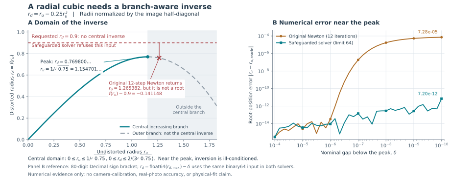

# Radial inverse: physical domain and independent simulation

Recorded November 12, 2026. Baseline: PR #44 head
`2d76aeaa41580494794cbaec0dd9ef659a068ee9`, merged into `main` at
`03f71e0e4095ee873051b71264b45fde83f84891`. The repair changes
`backend/sheet.py`; the independent renderer and its checks are in
`tests/synthetic.py`, `tests/test_synthetic_lens.py` and
`tests/test_radial_inverse.py`. These are numerical and synthetic-image checks,
not calibration of a real lens or a physical accuracy qualification.

The final candidate also integrates PRs #45 and #46 from `main` at `5c07d0f`.
Their [weak-edge recovery](contrast-recovery.md) and
[fillet-sector repair](fillet-sweep.md) retain separate reproduction records.
The six-case lens probe below was completed before that integration and retains
its original source binding and measured results.

## Defect and domain

The workbench models distorted radius as `rd = f(ru) = ru + k1 ru³`.
Both radii use the image half-diagonal as their unit, with the image center as
the principal point. These coefficients are not numerically interchangeable
with focal-normalized OpenCV coefficients.

For negative `k1`, the derivative `1 + 3 k1 ru²` first vanishes at
`ru_turn = 1 / sqrt(-3 k1)`. The increasing branch containing the optical center
therefore ends at `rd_max = 2 / (3 sqrt(-3 k1))`.
Monotonicity for a specified range of **undistorted** radii does not establish an
inverse for every **observed sensor** radius.

At `k1 = -0.25`, `rd_max` is approximately 0.769800359. The old 12-step Newton
function returned a value for `rd = 0.9` despite there being no nonnegative
central-branch root: `ru = 1.265381609`, with forward residual -0.141147681.
Near the peak it could also stop far from the central root while the forward
residual looked small.



The figure uses 37 nominal absolute gaps from `1e-4` to `1e-10` below the
binary64 peak at `k1 = -0.25`. Both solvers receive identical binary64 inputs;
the reference root is found by an 80-digit Decimal sign bracket. At the smallest
gap the observed root-position errors are approximately `7.28e-5` and
`7.20e-12` in normalized radius. These sampled numerical results are not a
universal inverse-error bound. As the derivative approaches zero, rounding and
image error are amplified; the repair does not remove that ill-conditioning.

## Repair

- Reject nonfinite inputs, negative observed radii and observed radii beyond
  the negative-coefficient central domain with `SheetError`.
- Keep a sign bracket on the increasing branch. Accept a Newton step only
  within that bracket, otherwise bisect. Return after numerical convergence or
  report failure after the 64-iteration limit.
- Restrict plumb-line trial coefficients using every observed sheet corner and
  edge sample. If their largest normalized radius is `R`, feasibility requires
  `k1 >= -4 / (27 R²)`. The implemented lower bound takes the next representable
  value toward positive infinity, intersected with the existing `[-0.25, 0.25]`
  search range. This is a domain restriction, not a camera-quality threshold.

The existing 20% straightness-improvement gate remains. The repair does not fit
additional lens terms or change the API, recipe schema or interface controls.

## Independent renderer and oracles

The synthetic renderer no longer imports the production inverse. For its cubic
model, let `s = sqrt(3 abs(k1))` and `q = 1.5 s rd`. Its separate closed forms
are `ru = 2 sin(asin(q)/3)/s` for negative `k1`, and
`ru = 2 sinh(asinh(q)/3)/s` for positive `k1`; zero is the identity.

An optional test-only `k2` adds `k2 ru⁵` to the forward polynomial. A bounded
sign-bracket inverse stops at the first positive derivative zero when one
exists and refuses a sensor field extending beyond that branch. This provides
model-mismatch inputs; production correction still fits only `k1`.

Independent 70-digit Decimal brackets check twelve coefficient combinations,
including very small radii, while known forward rays check the 4000 × 3000
pixel-coordinate mapping. A sentinel makes production inversion raise while
the renderer still produces an image. Four default-model JPEG comparisons at
1200 × 900, seed 17 and `k1 = -0.12, -0.035, 0, 0.08` are byte-identical to the
pinned original renderer using its pinned original inverse.

Separate implementation removes this shared-code dependency. Most camera,
sheet, tone and part assumptions remain shared. [Wirgin's inverse-crime
discussion](https://arxiv.org/abs/math-ph/0401050) concerns that broader
shared-model problem; the change does not make the renderer an independent
physical camera. [OpenCV's camera-model documentation](https://docs.opencv.org/4.x/d9/d0c/group__calib3d.html)
provides general radial/tangential model context, with a different coordinate
normalization.

## Higher-order lens mismatch

Six separately rendered 1600 × 1200 cases use the default plate, `ppm=6`,
zero added noise, JPEG quality 100, no shadow or illumination gradient,
zero thickness and seed 29. Default pose is retained. All six trace and retain
five circle primitives. Outer spans are measured with an independent minimum
area rectangle; circle diameters use returned radius fields; ten sorted center
distances are compared with literal reserved design coordinates. This probe
does not use production arc reconstruction for those measurements.
The pinned production base is PR #44 plus this radial repair, before the later
contrast and fillet-sector integration; these examined cases are development
evidence, not a fresh evaluation of the integrated candidate.

| Injected k1 | Injected k2 | Fitted k1 | Sheet RMS after (px) | Largest outer error (mm) | Largest circle error (mm) | Largest reserved spacing error (mm) |
| ---: | ---: | ---: | ---: | ---: | ---: | ---: |
| -0.035 | 0 | -0.03519 | 0.08283 | 0.00655 | 0.00267 | 0.00377 |
| -0.035 | 0.04 | -0.01892 | 0.09563 | 0.11572 | 0.02694 | 0.12035 |
| -0.035 | 0.08 | 0 | 0.13142 | 0.25541 | 0.06539 | 0.26950 |
| -0.035 | 0.12 | 0.01423 | 0.16792 | 0.33434 | 0.08640 | 0.35491 |
| -0.080 | 0.10 | -0.03950 | 0.15178 | 0.28320 | 0.07191 | 0.29762 |
| -0.035 | -0.04 | -0.05136 | 0.09873 | 0.10168 | 0.03227 | 0.11279 |

At `k2 = 0.08` no `k1` correction passes the 20% improvement gate. A small
sheet-edge residual does not bound independent part dimensions. These are
deliberate mismatch counterexamples, not newly passing accuracy criteria or
predictions of phone performance. No extra lens parameter is justified solely
by making these already-examined examples fit.

## Completed checks

- Against the original inverse, the 11 new domain/near-fold/search tests give
  **9 failures and 2 passing controls**. The repaired implementation passes all
  11; together with the 19 independent-renderer checks, **30 tests pass**.
- Existing tracing, fidelity and benchmark checks: **241 passed** in 121.87 s.
- Complete workbench Python suite: **609 passed** in 141.30 s, without skips.
  Ruff and the production frontend build passed. These results use this
  candidate on the integrated PR #44 baseline, excluding the separate contrast
  and fillet-sector candidates.
- After normal integration of their merged `main` at `5c07d0f`, the complete
  Python invocation passed **623 tests in 142.24 s**, without skips, and a fresh
  complete browser invocation passed **74 scenarios in 5.4 minutes**. The earlier
  runs and lens probe retain their original source binding.

Browser and documentation checks are recorded separately in the
[documentation follow-up](documentation-review-2026-11-12.md#model-checks-follow-up).
They do not measure a real camera, native slicer behavior, physical fit or
manufacturing accuracy.

Local logs, probe scripts, image hashes and source-bound receipts remain under
`.local/verification/`, outside the published repository. In particular,
`lens-independent-final.py/.json` records the pinned comparison and six-case
probe, and `radial-inverse-domain-final-figure.py/.json/.png` records the figure.
The committed tests are reproducible with:

```bash
.venv/bin/python -m pytest -q tests/test_radial_inverse.py tests/test_synthetic_lens.py
```

Next work needs independent measured captures, reserved part dimensions and
predeclared model-adequacy checks. More lens parameters alone do not establish
identifiability or physical accuracy.
