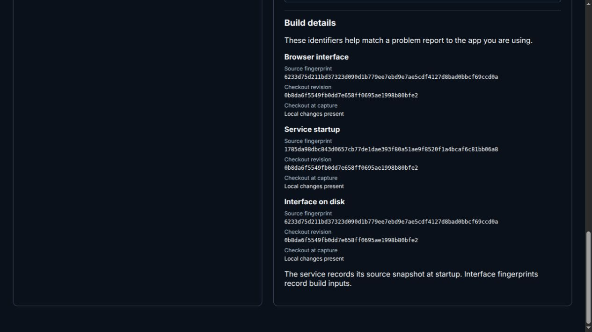

# Runtime build identity and reload isolation

Reviewed on 2026-11-18 from merged main `0b8da6f5549fb0dd7e658ff0695ae1998b80bfe2` (#175), on `codex/runtime-build-identity`.

## Next-step findings

The post-merge setup review found a healthy local environment and optional Ollama chat metadata. The current source tree matched merged #175 and the served interface matched its built index. However, health and package surfaces only reported `0.1.0`, leaving no app-level way to identify an existing Python process's startup source snapshot or distinguish a loaded browser interface from a later build on disk.

The main-branch [workbench run 44415341447](https://github.com/bartytime4life/Pictures-to-3D-CAD-Models/actions/runs/44415341447) then finished with **1711 Python tests passed, 11 skipped; 144 browser scenarios passed, one failed, two skipped**. Both new #175 regressions passed: delayed/reopened saves and native two-finger shape dragging. The remaining quick-edit failure's trace recorded an initial `/api/build` response of **429**, and its screenshot showed “Another model is being built.” The preceding project-library regression ended by reloading `#workbench`, starting an unrelated sample build before closing its page. This provides a source-backed explanation for the observed inter-test contention; it is not an application parallel-build failure.

## Changes

- Health, runtime and doctor expose a path-free `identity` with a backend startup source snapshot and the current built-interface identity. Git is optional; revision/checkout state and unavailable fingerprints remain explicit. Requests do not run Git or rescan backend source.
- Vite captures one frontend input identity, embeds it in the bundle and emits the same bounded `build-info.json`. Setup details show the loaded browser, service startup and interface on disk separately. A known source-input mismatch prompts saving/downloading drafts before reload. Missing or malformed diagnostics never change core readiness.
- Live development displays “Development interface” and suppresses production build comparison. Independent review caught the otherwise misleading fixed identity after hot reload; the corrected live preview was checked in the browser.
- The project-library regression now reloads Start and reopens the explicit saved-project entry. It still checks persisted notes/tags, then requires an empty workbench and **zero CAD build requests during the reload phase**. Independent source review confirmed the route, selectors and request listener. Native CAD concurrency limits are unchanged.

## Current-run validation

- **82 frontend unit tests passed, zero skipped**, including actual Git integration outside the restricted subprocess sandbox.
- **Full local Python suite: 1748 passed, 3 skipped**, 551.07 seconds. The remaining skips are environment-dependent checks, separate from physical acceptance.
- **72 focused Python checks passed**: 71 identity/readiness cases plus the existing health/API compatibility case. They cover frozen startup identity, source changes, framed hashes, optional Git, malformed/oversized/nonregular manifests, missing diagnostics, cache policy, doctor output and health responsiveness during slow setup work.
- Production build/TypeScript, Ruff, Prettier and whitespace checks passed. Browser discovery loaded all 11 project-library and quick-edit scenarios without launching a browser.
- The emitted frontend manifest's source fingerprint was present in the generated browser bundle. The isolated `8139` preview's health and runtime returned matching interface identities and `Cache-Control: no-store`; the doctor reported the core app and optional Ollama metadata ready.
- Fresh in-app browser verification held the old interface open while a new production build was written. Refreshing setup showed the save-before-reload message. Reloading made browser/disk fingerprints match and removed the message. At **375 px** the hashes wrapped with **zero horizontal page overflow**. A separate live-development preview showed the development label and no reload prompt; that temporary preview was closed and stopped. The normal development port was occupied and was left untouched.

The working-tree captures report checkout `0b8da6f` with local changes, as expected during implementation. The service startup source fingerprint was `1785da98dbc843d0657cb77de1dae393f80a51ae9f8520f1a4bcaf6c81bb06a8`. The old browser input fingerprint was `ffcd2c67cc31f33dd3b7b3e9f972a7238907173bb585c38ac1a03f9d14f06afe`; after the reviewed correction, browser and disk matched `6233d75d211bd37323d090d1b779ee7ebd9e7ae5cdf4127d8bad0bbcf69ccd0a`.

[Save-before-reload guidance](evidence/runtime-identity/01-update-available.png), [phone wrapping](evidence/runtime-identity/03-phone-build.png). All three captures were inspected; bytes are pinned by the [SHA-256 manifest](evidence/runtime-identity/sha256.json).

## Proof boundaries

Source fingerprints identify the documented input sets, not loaded-byte attestation, installed dependency contents, generated-file integrity, CAD accuracy or physical manufacture. Backend and frontend fingerprints intentionally cover different inputs. Full metadata semantics and hash scopes are in [development](../development.md#identify-the-running-build) and the [API reference](../api-reference.md#get-apiruntime).

The revised browser regression is authored for hosted CI and has not been executed through a local browser CLI. Local browser work used only the selected in-app browser. The new PR's full hosted result remains a separate merge gate. The initial restricted Python run could not bind its HTTP fixtures and was stopped; the loopback-enabled focused run passed. An initial Node Git fixture skip was resolved by the real-Git run above.
