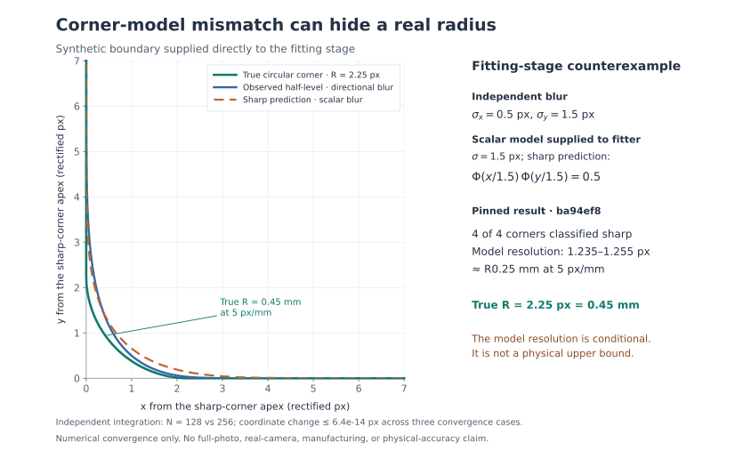

# Sharp-corner radius resolution: search guard and remaining model limits

Recorded November 12, 2026 against baseline
`ba94ef8e55bbc39b8074840052244f92c72be661`. The original `backend/fitting.py`
SHA-256 is `b019cecdd2b5d60ba20b97382eda7ee9c027bfa3449fd27c23edb826c22f3ca7`.
The candidate makes an exhausted radius-resolution search unresolved and changes
sharp-corner notes to describe a conditional model estimate. **Model adequacy
remains unresolved; this is not a physical upper-radius guarantee.**

## A search limit was reported as a crossing

For fixed initial gradient magnitudes `g_i`, `_exact_fillet` uses the
first-order distance surrogate `e_i(r) = (U_r(x_i) - 0.5) / g_i`. Its sharp-versus-
rounded comparison is `D(r) = max_i |e_i(r) - e_i(0)|`, with threshold
`F = 2 max(RMS(e(r_hat)), neighbouring-edge RMS, 0.03 px)`. This compares model
predictions, not absolute compatibility with the observations. Candidate mismatch
can enlarge `F`; RMS and the systematic heuristic are not maximum-error bounds.

An independently integrated sharp wedge has opening parameter `beta=0.09 rad`
(interior angle 174.84338°), isotropic Gaussian `sigma=0.7 px` and deterministic
vertical localization error `0.3 sin(2πx/(2.5 sigma)) px`. Its actual error RMS,
0.2108185107 px, is supplied as a diagnostic input, without an independence or
absolute-bound interpretation. On 160-node quadrature, the original helper gives:

| Quantity | Original result |
| --- | ---: |
| Fitted radius | 0.0143799313 px |
| Residual RMS | 0.2208416667 px |
| Comparison threshold `F` | 0.4416833334 px |
| Reported `sharp_bound` | 311.8116536621 px |
| `D(sharp_bound)` | 0.3047381545 px |
| `D(2 × sharp_bound)` | 0.6395045387 px |
| Extended numerical crossing | approximately 436.4527102731 px |

The reported endpoint is still below the required separation. Three expansion
iterations exhausted their budget, then bisection advanced its lower endpoint
toward a search cap that had never established a crossing. Observations from
80/160-node quadrature agree within `9.96e-15 px` and reproduce the defect. The
`beta=0.09` construction passes the caller's 5° nonparallel gate; this is still
a direct-helper reproduction, not proof of full-photo reachability. A separate
`beta=0.0201` helper example fails that caller gate and supplies no such claim.

## Repair and fallback semantics

Before bisection, the candidate explicitly evaluates the final expanded endpoint
and requires finite `D(hi) >= F`. Otherwise the whole `_exact_fillet` call returns
its existing failure sentinel, **`None`**. The final doubling must be evaluated:
the 0.2 px error-amplitude control has a valid crossing around 302.6360576 px
inside that final interval. Rejecting every exhausted loop would lose this
passing control. No expansion budget, threshold or uncertainty constant changed.

The two meanings of `None` remain distinct:

- Whole-call `None`: the exact fit or resolution search is unresolved. No finite
  `sharp_bound` is attached and this failure cannot itself delete the arc as sharp.
- A returned fit tuple whose fifth element is `None`: the fitted corner is
  distinguishable from sharp under the assumed model; no sharp-resolution
  estimate is supplied.

`fit_fillets` marks failed exact fits with `r_sd = Inf` in both caller paths.
An accepted approximate fit retains a positive approximate fillet, which may
move from the original arc. If the approximation also fails, the original
observed arc is retained geometrically **at the `fit_fillets` stage**, with an
unresolved-radius note. Later scalar blur correction and radius equalization
remain active and can change that geometry. This is not a promise that the full
pipeline freezes the original outline after a failed exact fit.

The sharp note now says the corner was traced as sharp **under the assumed blur**
and gives an **estimated radius resolution**. The legacy `sharp_bound` field name
remains internal. A finite model crossing is not a verified enclosure of every
data-compatible radius, and model-to-model agreement does not establish that
either prediction agrees adequately with the observations.

## Focused regression evidence

`tests/test_sharp_resolution.py` reports **7 passed**. Substituting the original
baseline fitting module in process memory gives **4 intended failures and 3
passing controls**; original files were preserved. Cases cover the exhausted
search at two quadrature orders, the valid final-endpoint crossing, independent
wedge convergence, both caller fallback paths and conditional note wording.
Caller fallback tests deliberately substitute an unresolved exact fit to isolate
that contract. These focused results do not establish a full Python or browser
run; those results belong to their separately recorded invocation.

### Completed candidate checks

- Complete workbench Python invocation: **630 passed in 147.19 s**, with no skips.
- Complete browser invocation: **74 passed in 5.5 minutes**, with no failures or
  skips, against this checkout's built frontend and CAD service on loopback
  port 18019. The owned service was stopped after verification.
- Production frontend build, full `make lint` and whitespace checks passed.
- `scripts/corner_sweep.py --quick` passed all **four matched isotropic-model
  cases**, with zero lost corners and zero model resolution estimates below
  the known radius. This is a regression check, not a physical qualification.

The candidate is based on PR #47 head `ba94ef8`; hosted CI, merge and installed
state remain separate from these local results. The original checkout and all
earlier experiment logs are preserved.

```bash
.venv/bin/python -m pytest -q tests/test_sharp_resolution.py
```

## Independent rounded-corner counterexample

A separate continuum oracle integrates a rounded rectangle under a separable
Gaussian using its own quadrature and CDF, without the production renderer or
corner-level formula. Its valid v2 development sweep uses true radii
`0.75, 1.5, 2.25, 3 px`, `sigma_x = 0.5, 1, 1.5 px`, and fixed
`sigma_y = 1.5 px`. The fitting stages receive scalar `sigma=1.5 px`. The
observed outlines enter real initial fitting, axis snapping, line refitting,
fillet fitting and scalar blur correction; this is not an image upload or CAD
acceptance experiment. The convergence receipt binds the original fitting,
reference and model sources to the baseline above.

All **12 valid cases** remain in the result: **7 initial fits and 5 initial
polyline fallbacks**. Exactly **one case** has a legacy resolution estimate
below the literal true radius. Fallbacks are not omitted or counted as successful
radius determinations.

| True radius (px) | `sigma_x` (px) | Recorded outcome |
| ---: | ---: | --- |
| 0.75 | 0.5 | Four corners traced sharp; legacy estimates exceed truth |
| 0.75 | 1.0 | Four corners traced sharp; legacy estimates exceed truth |
| 0.75 | 1.5 | Initial polyline fallback |
| 1.5 | 0.5 | Four corners traced sharp; legacy estimates exceed truth |
| 1.5 | 1.0 | Initial polyline fallback |
| 1.5 | 1.5 | Positive fitted arcs retained |
| 2.25 | 0.5 | Four corners traced sharp; legacy estimates below truth |
| 2.25 | 1.0 | Initial polyline fallback |
| 2.25 | 1.5 | Positive fitted arcs retained |
| 3.0 | 0.5 | Initial polyline fallback |
| 3.0 | 1.0 | Initial polyline fallback |
| 3.0 | 1.5 | Positive fitted arcs retained |

For the violating case, the four legacy estimates span **1.235097–1.255274 px**
despite true **R2.25 px**. At the illustrative scale of 5 px/mm, the old note said
“any fillet there is under R0.25 mm” for a literal **R0.45 mm** corner. The new
wording removes that physical interpretation; the bracket guard does not repair
the isotropic model's mismatch to this directional blur.



The figure uses the frozen baseline result and independent oracle. Its SVG is
bundled; its reproducer and source-bound receipt remain local as
`corner-radius-model-mismatch-figure.py/.json`.

For three selected cases, increasing quadrature order from 128 to 256 changes
coordinates by at most `6.40e-14 px`. Increasing the corner-arm samples from
260 to 520 gives the following sampled-ring Hausdorff differences:

| True radius / `sigma_x` / `sigma_y` (px) | Ring difference (px) |
| --- | ---: |
| 2.25 / 0.5 / 1.5 — violating case | 0.000367351 |
| 1.5 / 1.5 / 1.5 — control | 0.000294272 |
| 3.0 / 1.5 / 1.5 — control | 0.001296966 |

The violating interpretation persists at both resolutions. These are observed
convergence results, not certified quadrature enclosures or physical error bounds.

The earlier v1 sweep is explicitly **invalid geometry**: sorting arms by X
reordered tied coordinates where Gaussian tails rounded to zero and could
self-intersect the ring. Its script, plan, results and assessment were preserved.
Those outcomes are excluded from the valid 12-case census and all acceptance
claims; v2 constructs nonoverlapping bisector arms and checks polygon validity.

## Conditional feasible sets are future work

Follow-up: the [fixed-corner developer tool](../corner-feasibility.md) now
implements conservative inner/outer radius sets for supplied Gaussian blur and
level bounds. Its [independent checks](corner-feasibility.md) retain numerical
unknowns and wrong-model rejection. The broader nuisance/discrepancy inference
outlined below remains future work; this historical record describes the
earlier search-guard change.

A successor could predeclare a finite radius/nuisance domain `P`, observation-
error set `E` and model-discrepancy set `D`, then study
`F = {(r, eta) in P : y - m(r, eta) in E (+) D}` and its radius projection.
Here `(+)` denotes Minkowski addition. This is a proposed application of
[Jaulin and Walter's bounded-error set inversion](https://webperso.ensta.fr/jaulin/paper_automatica93.pdf)
and the distinction between model discrepancy and observation error discussed
by [Brynjarsdóttir and O'Hagan](https://www.tonyohagan.co.uk/academic/abs/simmach.html).
Neither source validates this corner implementation.

Such a result would remain conditional on independently justified domains,
error/discrepancy sets and numerical evaluation. Empty inner enclosures, failed
local candidates or empty sampled grids do not prove global incompatibility.
Budget exhaustion must remain unknown, and an endpoint at the prior-domain cap
is not an image-derived maximum. Certified exclusion between samples needs
validated enclosures or justified derivative/error bounds; none is implemented
here. Unrestricted discrepancy can make every radius compatible and supplies no
identification. The current change introduces no covariance correction, iid
p-values, new thresholds, physical error bounds or promised qualification.

## Local evidence artifacts

These files remain local, outside the published repository. Paths below are
plain-text provenance identifiers, not download links. The sibling research
workspace is `picad-model-adequacy`; the candidate workspace is
`picad-fillet-adequacy`. Both tables use their respective `.local/verification/`
directory. The original receipts retain their baseline and old wording.

| Research-workspace artifact | SHA-256 |
| --- | --- |
| `math-sharp-bound-bracket-ba94ef8.json` | `3700d763bb38b3d95954feac61a9f35bf0b7c87b026e0b67b34b0dcf409277fa` |
| `math-sharp-bound-semantics-ba94ef8.md` | `c7075296a2c49b51efe02de779017259f6a4a444ed0914e2662ef15440bbc1e0` |
| `corner-radius-feasibility-ba94-primary-notes.md` | `b92774621ff15e7c32a7fdb1d62f8826acc3ebff4b670b4f3e8128626481cf18` |

| Candidate-workspace artifact | SHA-256 |
| --- | --- |
| `independent-rounded-corners.py` — valid v2 oracle | `b67269a83e3fd223320fa8d5244e54745f45f7922977aaa99c71b1b2070e6bc5` |
| `independent-rounded-corners-v2-plan.json` | `f58760cec85372c9d40963bb19e59b3211a1d41c945c6a1023f67429cd8898f1` |
| `independent-rounded-corners-v2.json` | `f7b7b6c3d2c81ca54f6026c5c0b8cbf9e96439fe249466bee1a673deef3ba0a2` |
| `rounded-corner-convergence.py` | `9fea0c0026bd3cd36578a3fd7e48d67eb5e25d82de8f60a54a96f450338445ef` |
| `rounded-corner-convergence-plan.json` | `594f2952b4724f1e33694c36ac5366f4725751aed25a5e0ab12272b36e132fd6` |
| `rounded-corner-convergence.json` | `8280dbc9532963e5a1ed6a9662e0508816f139cdf04363f71cfc06e6e1c76e05` |
| `independent-rounded-corners-v1.py` — excluded invalid geometry | `269b63d70992ad5d5bf6e3655de11c32ac35116cbe832ce9eed3caa5e17bbe97` |
| `independent-rounded-corners-first.json` — excluded invalid geometry | `46fa5691b3f57a1d60e955cf72a11acbc031b36a9513af4dc698bd6f1f8f3255` |
| `independent-rounded-corners-first-assessment.json` | `0a236ad2c268c5c5bd9011850d518bb48687a167f0cff581f56c7d574c333231` |
| `sharp-resolution-pinned-control.log` | `a27bf0e6be06ff5cb031da54590f7410ca57122f1ec29814ce2ae4629abfa2c0` |
| `sharp-resolution-after-final.log` | `0a8c6210daa31422da0076732627c858058a9f4313c4dde8bae0ce9b5efd9cd9` |
