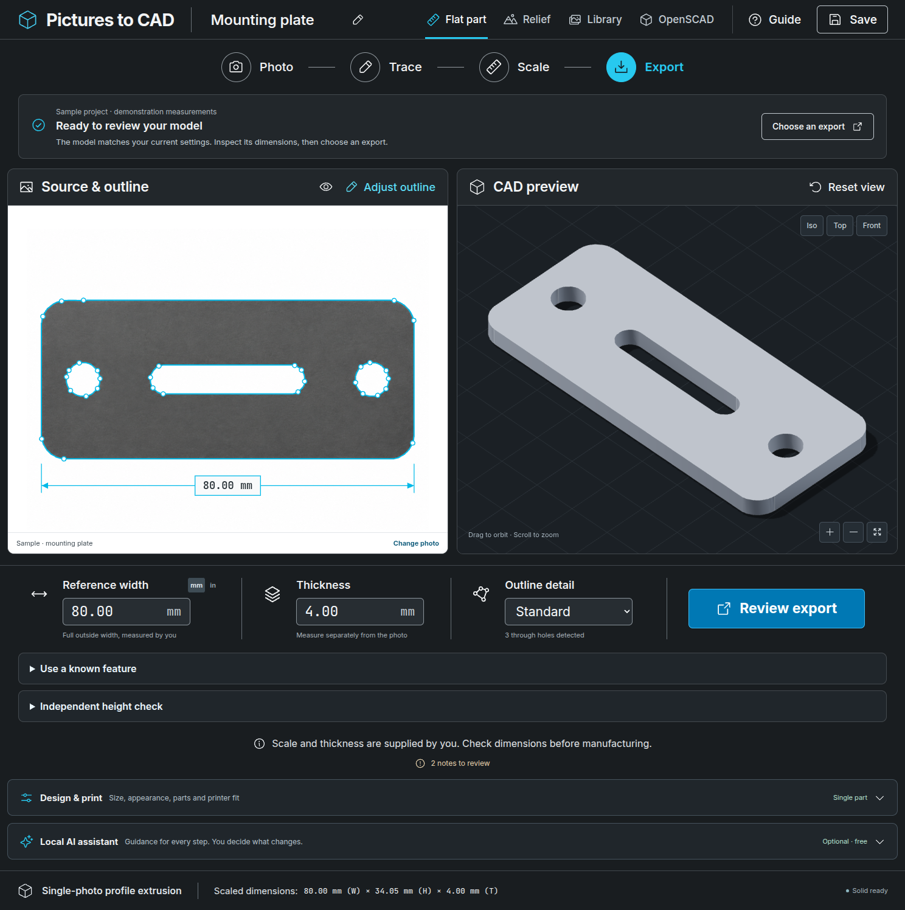
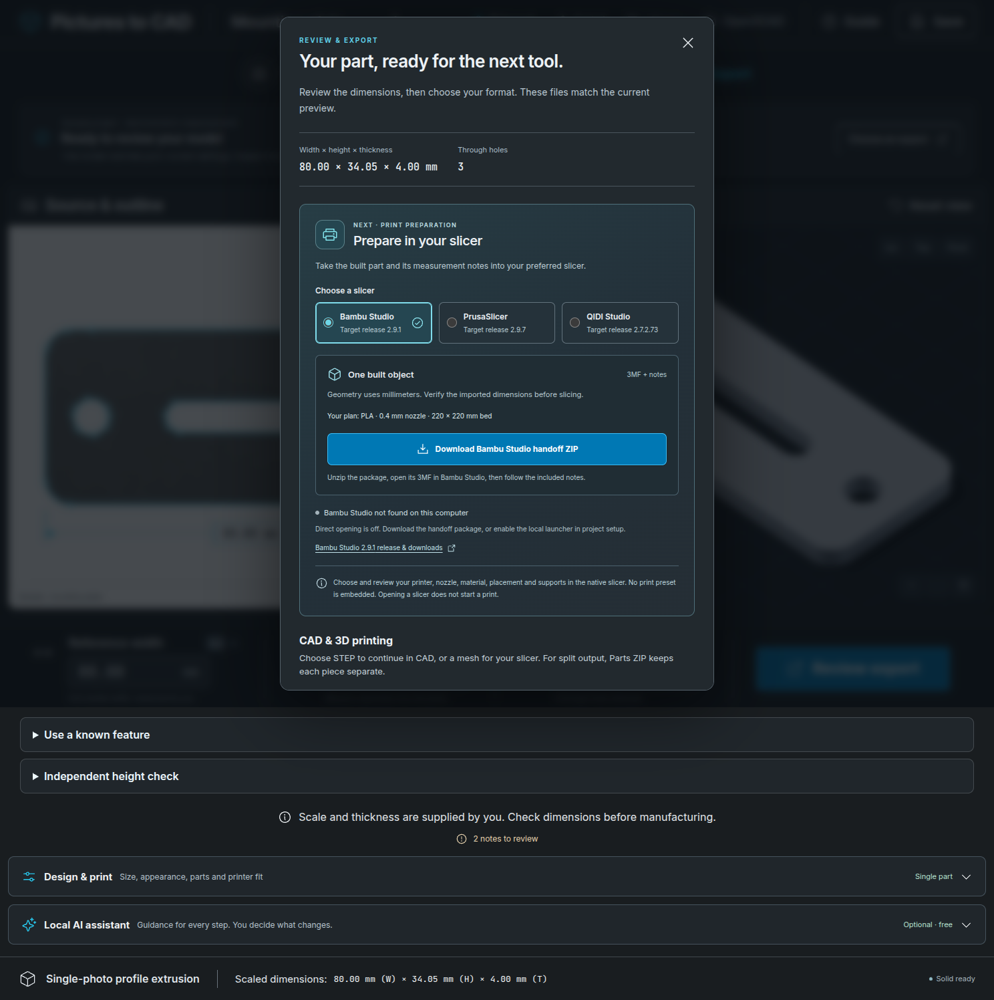
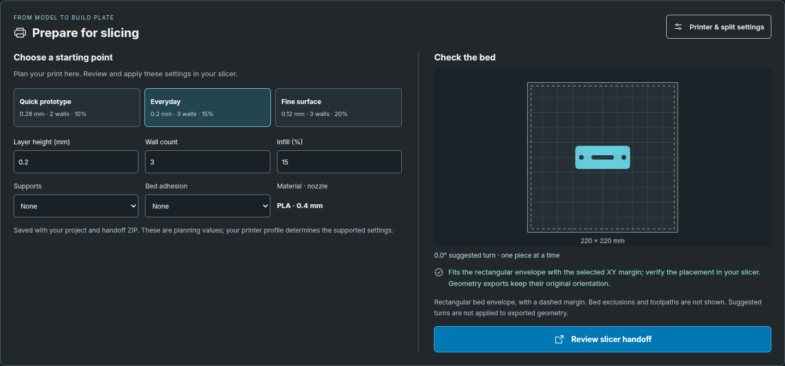
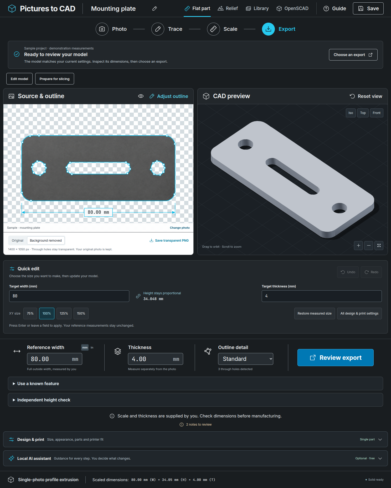
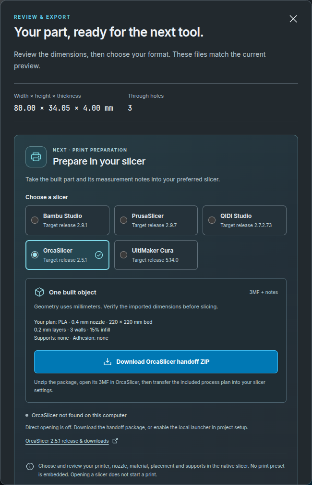
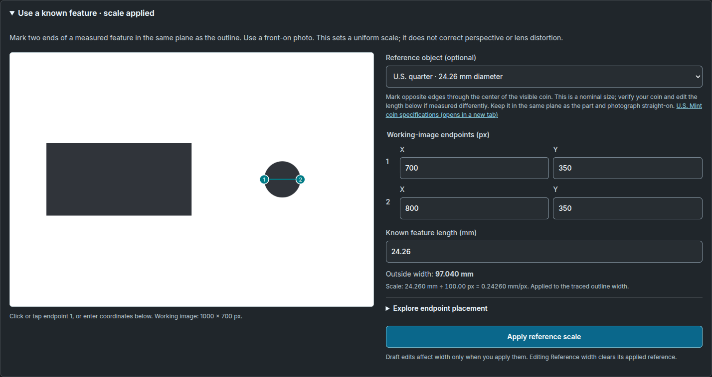

# Slicer workspace, model edits and photo preparation

Local review on November 16, 2026, based on repository revision `502b2f5` plus the working-tree changes described here. The review uses the bundled synthetic mounting plate and explicit demonstration dimensions. It does not establish real-photo measurement accuracy or native slicer/physical-print acceptance.

## Flow review

| Step | Baseline finding | Result |
| --- | --- | --- |
| 1. Inspect source and model | The paired previews work; design resizing is hidden under a collapsed section. | Visible Quick edit provides target width/thickness, proportional XY scaling, presets and bounded undo/redo. |
| 2. Prepare the photograph | No optional transparent cutout is exposed. | Remove background creates a browser-local silhouette PNG, preserves source colors and through holes, and provides original/cutout views. |
| 3. Plan a print | Printer/material/split controls exist; no process-plan controls or scaled bed projection. | Prepare for slicing exposes process starting points, layer/wall/infill/support/adhesion controls, and a per-piece bed envelope. |
| 4. Take the model to a slicer | Handoffs are reached through export review and support three targets. | Five targets include OrcaSlicer and Cura; each bundle contains a hash-verified process plan for manual transfer. |
| 5. Change or recover a design | Normal editing has no undo/redo; only an AI suggestion can be undone. | A 30-step settings history coalesces advanced numeric typing, excludes invalid drafts, resets on source changes, and requires fresh exports after undo. |
| 6. Set scale from an object in the photo | A generic known-feature measurement is available, but no common-object guide. | Optional coin presets fill a nominal diameter; the user marks endpoints, reviews the pixel-to-length calculation, and explicitly applies scale. A measured custom length remains available. |

## Captured baseline

## Final captures

The live 3D view, existing dark theme, measurements, separate reference evidence, and expandable specialist controls are retained. Screenshots establish visible layout only. Browser interaction tests check the actual editing, download, pixel-mask and accessibility behavior.

## Executed checks

| Check | Result |
| --- | --- |
| TypeScript and production frontend build (`npm run build`) | Passed after the final reference-frame fix. |
| Focused backend suites: process planning, slicer handoff, slicer bridge, printing, assistant and 3MF | 173 passed. |
| Design arithmetic and history (`npm run test:unit`) | 10 passed. |
| Installed-Chrome Playwright suites | 50 distinct cases passed across serial runs and focused retests. |
| Ruff, frontend/test Prettier and authored whitespace checks | Passed. |

The Playwright coverage comprises background removal (1), guided workbench (6), print planning (4), print preparation (3), project import (2), quick editing (8), slicers (5), common-object reference (2), calibration lifecycle (4), calibration (4), reference units (1), reference roundoff arithmetic (4), and reference sheets (6). The final reference-frame fix was followed by all six common-object/lifecycle cases passing, including saved-project restoration. The final history fixes were followed by all eight quick-edit cases passing. The full repository test suite and hosted CI were not run.

## Validation boundaries

- Backend checks exercise valid/invalid process plans, legacy defaults, unchanged solid geometry for process-only changes, all five handoff archives, hashes, and mocked fixed-argument launch behavior.
- Browser checks use installed Google Chrome against this worktree's local server. The Chrome connector could not acquire a tab; the user explicitly authorized the Playwright fallback.
- Background-removal checks decode the original and PNG in Chrome and compare retained material pixels, outside alpha and hole alpha. The cutout uses the traced working image; sheet traces use the corrected image. It is not general AI segmentation.
- Common-object calibration uses user-marked endpoints and nominal U.S. coin diameters from the [U.S. Mint specifications](https://www.usmint.gov/learn/coins-and-medals/circulating-coins/coin-specifications), checked November 16, 2026. The synthetic test checks a 100-pixel span against the resulting CAD width, saved/restored numeric evidence, measured overrides and unit conversion. A second case checks that an unapplied draft survives identical-image retracing but resets when the working-image frame changes. This does not establish automatic object recognition or real-photo dimensional accuracy. The reference must be in the part's plane; a two-point reference does not correct perspective.
- Unit checks exercise linked dimension arithmetic, invalid drafts, settings snapshots, bounded history and redo branching. The unit command is included in `scripts/test.sh`.
- Mobile accessibility checks use axe on the exercised states. They are not a complete accessibility certification.
- Native applications were not launched, installed or configured. Process values are planning notes, not native presets. No toolpaths or G-code were generated, and no printer was contacted.
- The bed view uses a rectangular envelope and each built piece separately. It does not show printer exclusions, supports, adhesion geometry, or a multi-object arrangement. Suggested turns remain metadata, and exports keep their original orientation.

Changes are local and uncommitted; no GitHub publication or deployment was performed in this review.
