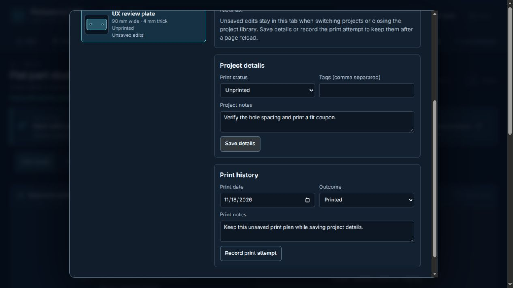

# Workspace reliability follow-up

Reviewed on 2026-11-18 against merged main `316f1f8149651b4131caa3b49a7055ee8dd5a8d8` (PR #174), on `codex/workspace-reliability-regressions`. This follows the [product experience review](product-experience.md) with a focused interaction and persistence pass.

## Findings and changes

- **A second finger could end the first finger's shape drag.** Rejected secondary touches still receive browser pointer lifecycle events. Pointer-up, cancellation and capture-loss handlers now end only the owning pointer's gesture. Activity/unmount cleanup still ends the current gesture. A Chromium native-touch regression adds and lifts a second contact, continues the first drag, then checks one-step undo and redo.
- **An earlier save could overwrite a newer revert.** While a save was pending, returning notes or print fields to their old loaded defaults removed the draft. Matching pending writes now protect explicit baseline values until a storage read begun after the writes settle confirms the defaults. A reopened Save includes explicitly reverted metadata in its payload. Failed writes preserve edits; confirmed no-op drafts clear after the fresh read.
- **A-B-A edits could be mistaken for the original submission.** Save completion previously cleared fields by value alone. Each explicit field edit now carries an identity, so a late save only clears the edit it submitted. Identities remain within the bounded tab-local draft entries; no draft text or tokens are persisted.
- **Save submission order is now explicit across modal instances.** A shared per-project queue covers storage acquisition and transaction completion. Errors release the next save, other projects remain independent, and completed queue entries are removed. The delayed-save browser regression submits the newer baseline revert before releasing the older save, checks storage before release and confirms the latest value after reload.
- **Two hosted browser checks used stale selectors.** PR #174's workbench run [44404712976](https://github.com/bartytime4life/Pictures-to-3D-CAD-Models/actions/runs/44404712976) passed 141 scenarios and failed two. Its captured project-library state retained the correct notes, but exact label matching also included React's restored textarea text. Accessible textbox names select the fields reliably. The phone check now uses the visible Workspace picker introduced in #174.

The interaction engineer implemented and tested draft/pointer changes and confirmed the A-B-A loss with production helpers. The lead integrator reviewed the asynchronous lifecycle, authored browser regressions and checked the production UI. A separate engineer reviewed the final patch for correctness.

## Validation

- Frontend unit suite: **72 passed**, including 15 project-draft cases and four queue cases. The eight new draft cases exercise baseline reverts, independent form clearing, failed-write recovery, refresh gaps, overlapping writes, replacement snapshots, explicit write payloads and A-B-A edit identity. Queue cases cover ordering, failure continuation, independent project IDs and cleanup. Restoring the prior baseline-pruning behavior in a temporary helper copy failed five of the new regressions.
- Production build, TypeScript, Ruff, Prettier and whitespace checks passed. Browser test discovery loaded all eight scenarios in the three affected browser files without launching a browser.
- Fresh Codex in-app browser checks used the final production build at `http://127.0.0.1:8138`, with the isolated library/job directories from the earlier review. Project and print notes survived filtering out/back and modal close/reopen. Saving project details retained the unsaved print plan; no physical print was recorded.
- An ordinary pointer drag changed a blank plate's center X from 0 to 9 mm; one Undo restored 0 and Redo restored 9. Its CAD preview settled at 80 × 50 × 4 mm.
- At 375 px, the visible Workspace picker opened Knowledge and the page had no horizontal overflow. The browser error log was empty. The temporary viewport override was reset, and the review tab was left on Start.

[Phone navigation capture](evidence/workspace-reliability/02-phone-navigation.png). Both captures were inspected; their bytes are pinned in the [SHA-256 manifest](evidence/workspace-reliability/sha256.json).

## Separate validation lanes

The current local browser interface does not support native multi-touch injection. The new native-touch regression and controlled delayed-save browser regression are authored for the repository's hosted Chromium suite; they are not claimed as locally executed. Their hosted result must be checked on the PR head before merge. Local save-race proof comes from the production-helper regressions, including reproductions of the prior loss.

The delayed-success harness deliberately broadens storage scheduling. Native IndexedDB opens use an ordered [connection queue](https://www.w3.org/TR/IndexedDB-3/#connection-queue); the new application queue is explicit protection under delayed completion testing, not evidence that ordinary native opens reorder themselves. The independent review identified this distinction and hardened the harness so an earlier list refresh cannot consume the save hold.

Python, geometry, AI-provider behavior and setup code are unchanged by this follow-up. The earlier 1719-pass local Python result belongs to #174; the new PR's hosted workflow performs its own Python and full browser runs. Native slicer/printer behavior and physical fit remain separate acceptance work.
