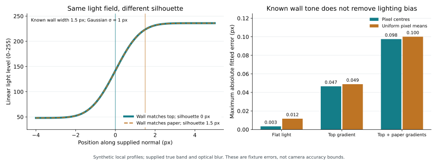

# Wall brightness, lighting and edge identity

The wall fitter's smallest residual does not establish the physical silhouette.
A new [repeatable development experiment](validation/wall-gradients.md) adds
bounded material and paper gradients to the local two-step model. It separates
source-level fitting at a supplied geometry from identifying that geometry.
The new solver is a study tool; production tracing retains its current fitter.



The left panel is an exact ambiguity in the stated scalar source model. The
right panel summarizes the 144 synthetic image scenes below; the wall tone, band and
optical blur are supplied from truth. These are fixture errors in pixels, not
camera accuracy or fabrication bounds.

## An exact ambiguity, even with known wall width

Let the top have constant level `C`, the paper level `A`, and the wall occupy
`[e-w,e]`, with `e` the silhouette and `w > 0` a known width.

| Interpretation | Top/wall boundary | Wall level | Silhouette |
| --- | --- | --- | --- |
| Wall matches top | `e-w` | `C` | `e` |
| Wall matches paper | `e` | `A` | `e+w` |

Both real source fields equal `C` to the left of `e` and `A` to its right.
They therefore produce identical Gaussian convolutions, pixel averages and
deterministic processing of that field. Photometry alone cannot choose between
these labels. This proves an ambiguity of this supplied local model, rather
than constructing two complete camera/part scenes with independently consistent
pose and geometry.

In the example, the silhouette labels differ by 1.5 pixels. Any algorithm forced
to return the same single position for the identical data has an error of at
least 0.75 pixels for one interpretation, by the triangle inequality. Abstaining,
retaining alternatives or adding independent information avoids that forced
choice. The value is a conditional example, not a general physical error bound.

For a narrow nonzero wall, changing its tone can also approximately mimic a
small edge shift. Bounding the tone limits that compensation; ambiguity does
not grow without limit as `w` approaches zero. At `w=0` the wall tone disappears
from the model, while a contrasted top/paper step can still locate an edge.

## A bounded joint lighting model

For one supplied `e`, width `w`, blur `σ > 0`, and tail distance `L > w`, the
source has five light levels, each constrained to `[0,255]`:

```text
q = source position - e

q <= -L       constant top level C_left
-L < q < -w   linear from C_left to C_edge
-w <= q < 0   constant wall level B
0 <= q < L    linear from A_edge to A_right
q >= L        constant paper level A_right
```

This bounds the source everywhere, including the unobserved tails. It imposes
implicit slope limits `255/(L-w)` and `255/L`; those are model restrictions,
not measured lighting priors. It does not include a sloping wall, arbitrary
illumination, camera tone errors or an unknown optical kernel.

Convolution remains linear in these five levels. With observation coordinate
`x=t-e`, standard normal density `φ` and CDF `Φ`, define

```text
U = Φ(-(x+w)/σ)
V = Φ((x+w)/σ) - Φ(x/σ)
P = Φ(x/σ)
F_minus(z) = z Φ(-z/σ) - σ φ(z/σ)
F_plus(z)  = z Φ( z/σ) + σ φ(z/σ)
T = F_minus(x+w) - F_minus(x+L)
R = F_plus(x) - F_plus(x-L)

node basis = [-T/(L-w), U+T/(L-w), V, P-R/L, R/L]
```

Each basis function is the convolution of a nonnegative source shape. In exact
arithmetic they are nonnegative and sum to one. Thus bounded node levels bound
the blurred field without clipping a fitted response.

For fixed geometry, the study solves box-constrained linear least squares.
It first tries an unconstrained SVD solution. If that leaves the box, it examines
all lower/free/upper coefficient faces, at most `3^5=243`, and computes direct
residuals. It avoids an enlarged normal-equation inverse and cancellation from
subtracting large squared norms. This is ordinary floating-point optimization,
not a certified interval solver. Rank and condition numbers describe only the
linear node fit at that fixed geometry; they do not prove edge identification.

Eliminating the linear coefficients follows the variable-projection principle
described by [O'Leary and Rust](https://www.cs.umd.edu/users/oleary/software/varpro.pdf).
Their paper distinguishes fitting the linear coefficients from nonlinear
geometry optimization and discusses SVD for nearly dependent columns. This
experiment evaluates a specified geometry grid; it does not implement their
full nonlinear optimizer or statistical diagnostics.

## What the experiment demonstrates

The [frozen plan](../studies/wall-gradients-v1.json) is a development population,
informed by the earlier [material-gradient study](material-gradients.md):

- **Direct lane:** 60 worlds, seven supplied edge positions and two light models,
  producing 840 bounded fits. A more flexible lighting model can fit a shifted
  geometry as well as describe the true lighting.
- **Image lane:** 144 worlds, two observation stages and two existing wall-fit
  treatments, producing 576 rows. It renders independently of the production
  Gaussian approximation, then calls actual `two_step_refine` through Keys
  sampling. Both optical blur and wall width are supplied; fixing the true wall
  tone is an oracle comparison, not an estimated production input.

For each direct pair, let `y` be truth-sampled data and `p` a shifted physical
model's prediction. Their midpoint `z=(y+p)/2` is a **constructed shared
observation**. Both models can generate `z` with an absolute level error of at
most `max(abs(y-p))/2`, allowing for the recorded numerical evaluation. This
does not say the alternative fits the original `y` at half that discrepancy:
its original-data discrepancy is `maximum_difference` in the CSV.
Each pair constructs its own midpoint; the census does not describe many
interpretations of one common measured image.

At the illustrative ±1 linear-light-level midpoint budget, the finite grid
finds 132 joint-gradient witnesses among 360 nonzero-offset fits, versus 24
flat-tone witnesses. The largest demonstrated separation is 0.825 pixels for
the joint model. These counts depend on this grid and these synthetic levels;
they are neither population rates nor uncertainty intervals. Missing a witness
does not prove infeasibility, and least squares does not minimize maximum error.

With the true wall tone fixed, the image lane's largest point-stage error is
0.00343 pixels under flat light and 0.0975 pixels with both gradients. Uniform
pixel means give 0.0117 and 0.1001 pixels respectively. Small flat-model residuals
or a known wall tone do not remove unmodelled lighting effects. Free-tone fits
also respond to sampling and finite apertures, including in flat controls;
the full [CSV and validation record](validation/wall-gradients.md) retain them.

## Repeat and interpret

```bash
make wall-gradient-study OUTPUT=.local/wall-gradients-new
```

The command refuses an existing output directory. It saves the plan, both full
CSVs, numerical summaries, source hashes, Git state and actual runtime versions.
A zero exit means execution and the aperture quadrature check completed; it
does not decide accuracy, model adequacy or release acceptance.

The direct renderer and fitted basis share code. Separate source-quadrature and
box-optimality checks test those primitives, rather than making the direct lane
an independent model-validation population. The image lane begins near the
true edge and bypasses segmentation, initial crossing selection, pose, pooled
tone estimation, ring smoothing, parallax, curve fitting and CAD export.
It does not establish behavior from a wrongly initialized trace.

For capture, distinguish the top face, visible wall and background where possible.
Use another lighting/view condition or an independent feature measurement when
the visible edge could belong to either surface. A further view helps only if
it adds information that distinguishes the interpretations. The current product
does not automatically detect this exact ambiguity or apply the joint-gradient
fit. Keep [reserved measurements](engineering-model.md) and
[physical qualification](capture-guide.md#cross-check-before-fabrication) separate.
