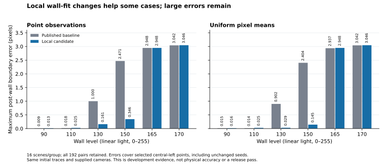

# Local wall fitting: geometry, observations and ambiguity

This candidate repairs a short search that could follow the top/wall boundary
instead of the silhouette. It expands geometry hypotheses, updates wall width
with each hypothesis, and retains unresolved numerical fits. It also exposes
remaining sampling and lighting failures. The [verification record](validation/wall-localization.md)
keeps every planned scene, the rejected development window and its camera-height
regressions. These changes do not establish physical accuracy.

## Keep geometry consistent

Let the supplied seed have a unit material-outward normal, camera height `H`,
entered thickness `h`, and predicted positive wall width `w0`, all converted to
the relevant image-pixel units. For a candidate outward displacement `e`,

```text
lambda = h / (H - h)
w(e) = max(w0 - lambda * e, 0)
```

This follows by projecting the shifted point onto the same fixed normal. It
does not update the normal or model a curved wall's complete two-dimensional
optical response. `band_rate=0` means a separately supplied fixed width.
A zero clamped seed width with positive rate loses the signed facing distance;
the public helper withholds that case instead of inventing it.

The candidate offset grid includes zero and covers at least
`[-0.6 sigma, max(0.8 sigma, (w0 + 0.8 sigma)/(1 + lambda))]` in `0.02 sigma`
steps, rounding the upper endpoint outward. The former search ended at
`+0.8 sigma`, which missed bright-wall silhouettes in the reproduced examples.

## Keep the observation model local

Every geometry hypothesis is compared against the same sampled observations.
The sample grid uses integer multiples of `0.125` pixels enclosing
`[-w0 - 4 sigma, 4 sigma]` around the seed. Nearby widths are grouped for bounded
batch allocation. It does not extend the observed tails merely because a wider
geometry search is available.

An earlier development version extended the observation window too. On a
rendered long-lens fixture, that changed the pooled wall tone from a dark basin
near 9 to a bright basin near 161 and prevented camera-height inference.
Centered near-window controls isolate the window extent from grid phase.
The extra observations did not obey the assumed flat-lighting model closely
enough to preserve the branch. More observations help only under an adequate
model. The original failures and full outputs remain in the validation record.

## Fit the linear levels and nonlinear position separately

For a supplied offset, the flat three-level Gaussian response is linear in the
top, wall and paper brightness. The coarse search uses the profiled quadratic
in wall brightness. Free wall brightness is constrained to `[0,255]`; the top
and paper levels remain unconstrained nuisance fits. This is not the separate
[bounded five-node source experiment](wall-gradients.md).

Represented local basins are refined with bounded golden searches and direct
SVD least-squares residuals. This uses the separable-fitting principle discussed
by [O'Leary and Rust](https://www.cs.umd.edu/users/oleary/software/varpro.pdf),
without implementing their complete nonlinear optimizer or statistical analysis.
[NumPy's least-squares contract](https://numpy.org/doc/stable/reference/generated/numpy.linalg.lstsq.html)
defines the numerical rank cutoff used here. Direct residual evaluation avoids
subtracting large squared norms at the final selected geometry.

Endpoints retain their actual coarse costs. Endpoint optima, flat or distinct
near-tied represented minima, non-finite inputs, unsupported ranks, excessive
basins and work-limit exhaustion withhold a correction. The returned point is
unchanged, its fitted tone is `NaN`, and its residual is infinite. These internal
statuses become trace notes; no non-finite numerical field is added to the API.
Independent valid profiles remain usable.

The arithmetic comparison uses `64 * eps * max(1, profile_energy)` and a separate
position guard. These are numerical heuristics, not image-noise bounds or
certified continuous optimization. A finite search cannot certify every basin.
The guard also tests a locally refined, physically bounded single-step witness:
two wall labels can describe the same visible step. Fixing a genuinely independent
wall tone is a different conditional problem from estimating one from these data.

At most 2,048 geometry candidates, 4,096 profile samples and 20 million
profile/candidate/sample combinations are allowed per batch, checked before
allocation. Pooled estimation uses at most 160 profiles and requires at least
30 numerically supported fits. These caps bound individual allocations, not
whole-photo latency or physical information. The existing correction taper remains;
accurate local offsets need not equal accurate final tapered boundaries.

## What the crossed comparison shows



Each bar is the largest final central-left boundary error among 16 synthetic
scenes. Both lanes receive the same initial trace and supplied camera. All 192
observation scenes are retained, including unchanged seeds, warnings and light-matching
walls. Wall levels 130 and 150 improve substantially in these cases. Controls
can worsen slightly, and high-wall-level groups retain errors around three
pixels. This is a development population informed by the original failures,
not an independent camera qualification or a universal improvement claim. Point
and pixel-mean treatments share 96 underlying continuous light fields.

## The next observation-model correction

The current wall fit predicts a continuous Gaussian profile, while its observed
profiles come from signed Keys interpolation of an already processed image.
Even an exact one-step source can therefore fit better as a spurious three-level
profile. The local numerical alias guard does not detect every such image case.
Increasing its arithmetic tolerance would mix model discrepancy with roundoff.

The separate developer prototype instead constructs the fixed signed sampling
matrix `S`. At each unique input-array pixel centre it predicts the three basis
columns `D(e)`, then fits `S D(e)` to the actual profile. Clipped indices preserve
the sampler's edge replication. Since `S` is linear and independent of `e`,
identical source fields remain identical after this observation operator.
Known uniform pixel means require their aperture integral before interpolation.

The retained prototype controls recover both aliases in a one-step example and
retain both off-grid ambiguous cases. Ten nonambiguous off-grid matched-model
controls have errors below `1.25e-9` pixels. Those tiny errors describe generated
matched data, not a phone or a printed part. The prototype shares the actual Keys
weight function intentionally; its Gaussian source uses independent `erfc`, and
the mean renderer and predicted mean use different numerical formulations.

Only the final sampling operator is matched. The input array has already passed
through rectification, float32 storage, smoothing and the camera's response.
Calibrating that chain, estimating its effective PSF, handling curved boundaries
and validating joint wall/camera inference remain necessary before promoting
this prototype into tracing. It is not currently used by the workbench.

The follow-up [fixed-observation module](profile-observations.md) now composes a
declared finite smoothing filter with Keys and accounts for correlated samples
under supplied input-pixel noise. Its controls expose missing aliases when only
an effective scalar Gaussian is used. Earlier rectification, rounding, real optics
and joint wall/camera identification still prevent a physical accuracy claim.

## Repeat

```bash
make wall-localization-study OUTPUT=.local/wall-localization-new
.venv/bin/python studies/verification/wall-localization-audit.py --run .local/wall-localization-new --output .local/wall-localization-audit-new.json
.venv/bin/python studies/verification/wall-keys-forward-prototype-v1.py --output .local/wall-keys-new.json
.venv/bin/python studies/verification/wall-keys-forward-offgrid-v2.py --output .local/wall-keys-offgrid-new.json
```

Use new paths. The comparison pins its baseline Git revision in the plan and
loads that trusted local repository source in an isolated package; the baseline
must be present in the local Git object database. It retains all CSV rows, source
hashes and execution failures. Its input images are independently rendered
synthetic fields; no personal media are uploaded or packaged.

The two prototype scripts are fixed development populations and refuse existing
output files. The off-grid runner pins its sibling prototype's exact source hash.
Changing that prototype requires an explicit pin update and a new result; an
old report cannot qualify a modified implementation. Plotting remains optional
and requires a separately selected environment containing Matplotlib.
