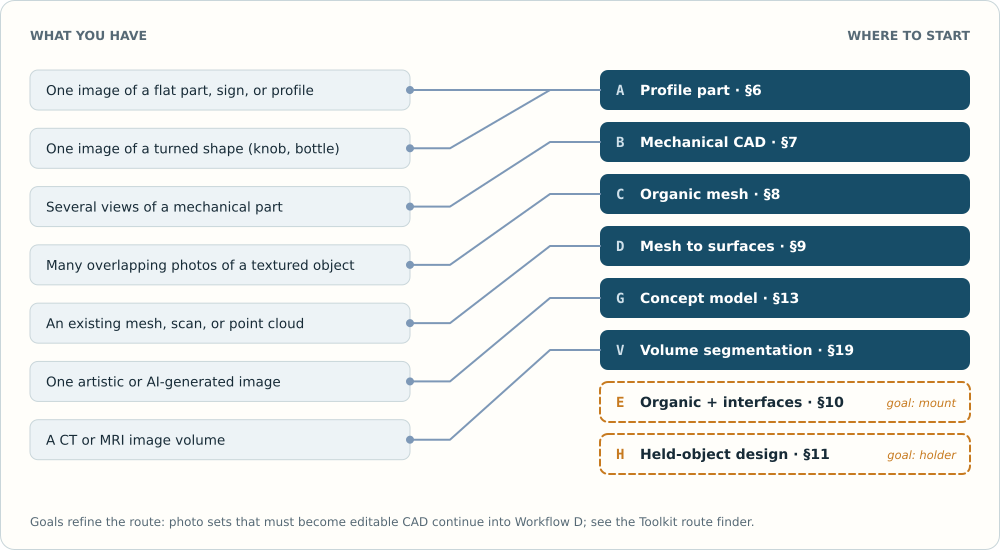
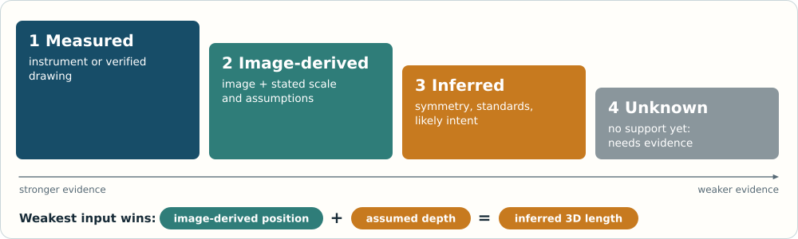
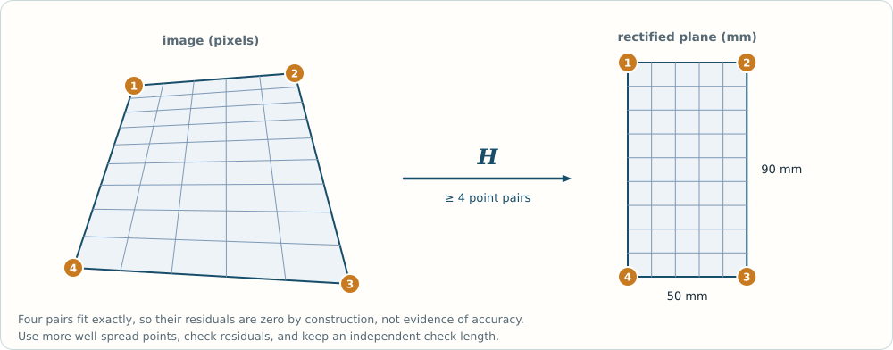
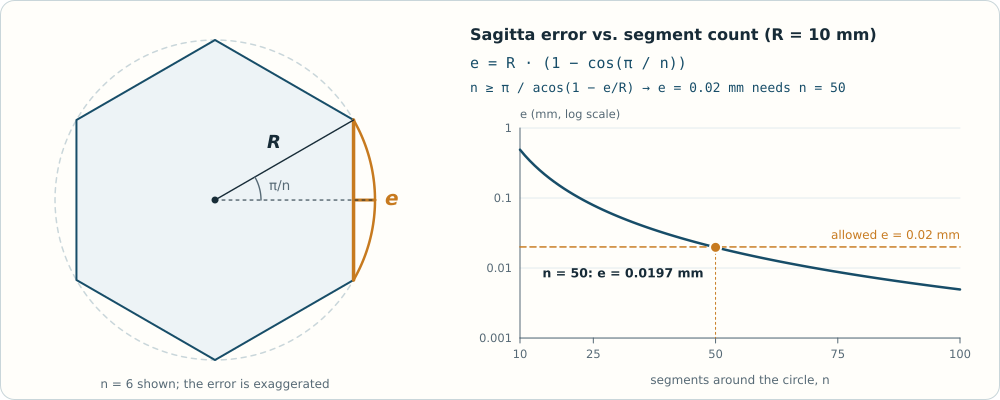
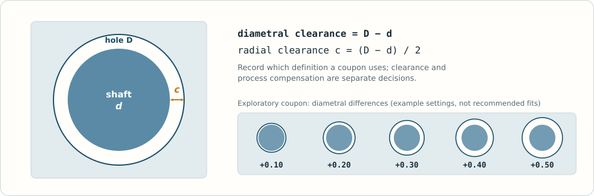
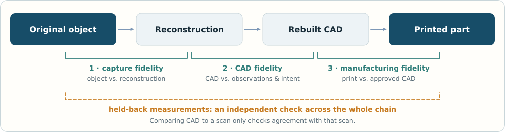
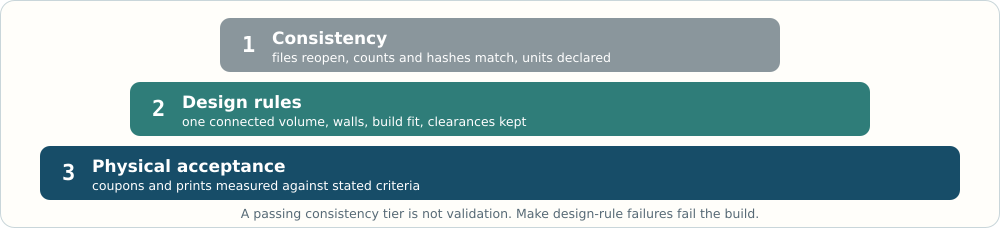

# From pictures to printable CAD

## 1. Start with the result you need

This handbook is a practical reference for reconstructing objects from photographs, drawings, silhouettes, and scanned geometry. Prepared **November 9, 2026**. It combines established documentation, research leads, and original engineering examples. It is not a test report for a particular printer or reconstruction package.

For a replacement part, start with its interfaces: the holes, shafts, mating faces, clearances, and overall envelope. For a sculpture, start with silhouette, surface coverage, wall thickness, and a stable base. For a moving assembly, identify the separate bodies, joints, constraints, and collision envelope before sculpting the visible exterior.

An attractive reconstruction can be dimensionally wrong. A watertight mesh can be difficult to edit. A CAD solid can contain thousands of tiny planar faces instead of meaningful cylinders and holes. A technically correct model can still fail when printed in an unsuitable orientation. Treat these as separate milestones.

**The practical default:** photograph for shape, measure for size, reconstruct important features in parametric CAD, and print a small fit test before the full part. This workflow is an engineering synthesis, not a promise of automatic accuracy.

### Choose a route

| Available input and desired result | Start here | Deliverable | Main missing information |
| --- | --- | --- | --- |
| One image of a flat plate, sign, or profile | Correct perspective; trace a constrained outline; extrude | Editable sketch and solid | Thickness, back face, and true scale |
| One image of a bottle, knob, or turned shape | Establish the axis; fit a profile; revolve | Parametric revolved solid | Hidden bore, wall thickness, non-axisymmetric details |
| Several views of a mechanical part | Measure key interfaces; fit sketches and analytic features | Feature-based CAD and drawings | Occluded features and design intent |
| Many overlapping images of a textured sculpture | Photogrammetry; inspect and repair the mesh | Scaled mesh, optional CAD mounting features | Underside, deep recesses, fine texture-poor areas |
| Only one artistic or AI-generated image | Interpret proportions; use image-to-3D as a candidate | Approximate concept model | Unseen geometry, actual scale, physical feasibility |
| CT or MRI image volume | Segment calibrated voxels; extract a surface | Anatomical surface mesh | Segmentation uncertainty and application-specific validation |

The [COLMAP tutorial](https://colmap.github.io/tutorial) describes the multi-view reconstruction path. [FreeCAD's scaled-image tutorial](https://freecad.github.io/Website/pl/news/tutorial-importing-and-using-scaled-reference-images/) demonstrates an image used as a modeling reference. [3D Slicer segmentation documentation](https://slicer.readthedocs.io/en/latest/user_guide/image_segmentation.html) addresses the distinct volume-imaging path.

### Make the governing decisions first

A few choices control every later number. Make them explicitly, record each with a date and a reason, and change them deliberately. Otherwise each script, export, or drawing quietly implies its own answer, and the answers drift apart.

- **Use environment:** where the object will live, how it is handled, the main viewing directions, and the space around it, such as shelf height, enclosure walls, and room for hands or tools.
- **Scale:** real size, or a stated ratio such as 1:10 relative to a named reference dimension. When a scene contains several subjects, one scale factor applies to all of them unless a deliberate exception is recorded.
- **One current design and one coordinate frame:** name the origin, axes, up direction, and units. If another frame is needed, such as a scan frame, camera frame, or alternative layout, store the transform between the frames as data rather than a note not to mix them.
- **Process and machine:** filament, resin, or another process; printer; material; usable build volume; likely orientation. Minimum feature sizes have no meaning until this is chosen.
- **Part strategy:** one fused body or separate printed parts, and how parts locate, attach, and are replaced.
- **Acceptance criteria:** for each critical interface, what will be measured and what result passes.
- **Provenance and rights:** where each input came from, what its terms allow, and what may be redistributed with the project.

When alternative designs are explored, mark one as current and archive the others with their status. Parallel designs with different datums, clearances, and envelopes cause confusion that later measurement cannot resolve. The project brief and the design-parameter register in the worksheets record these decisions.

## 2. Understand the representations

**Raster image:** pixels carrying color or intensity. An edge may be geometry, paint, texture, reflection, or shadow. Ordinary photographs do not encode reliable metric depth.

**Vector drawing:** lines, arcs, and curves in a plane. SVG and DXF can carry useful profiles, but imported paths need checks for scale, duplicate entities, gaps, and self-intersections. A bitmap trace is usually an outline, not an engineering sketch with constraints.

**Point cloud:** samples of a surface. Points may include normals or colors. An empty area means no usable observation; it does not prove that the object has a hole there.

**Triangle mesh:** vertices, edges, and faces approximating a surface. Meshes work well for sculptures and slicing. Triangle count alone says little about measurement accuracy.

**B-rep solid:** a boundary representation built from surfaces, trimmed faces, edges, and vertices that delimit a volume. A sphere may be represented analytically rather than as thousands of triangles. A valid B-rep does not necessarily contain the original modeling history.

**Parametric feature model:** dimensions and constraints drive sketches, extrusions, revolutions, holes, fillets, patterns, and assemblies. This is often the most useful replacement-part deliverable because a measured hole position or thickness can be changed intentionally.

**Drawing:** selected views of the model with dimensions, datums, sections, notes, and revision information. It communicates what must be manufactured and inspected. It is a companion to the model, not a substitute for volumetric geometry when slicing.

**Implicit field:** a function defines the surface, often as a zero level set. Signed distance fields are useful for offsets and Boolean operations, but converting them into a printable mesh introduces sampling and meshing choices.

Useful references: [CadQuery](https://cadquery.readthedocs.io/en/latest/), [build123d](https://build123d.readthedocs.io/en/latest/), [FreeCAD TechDraw](https://github.com/FreeCAD/FreeCAD-documentation/blob/main/wiki/TechDraw_Workbench.md), and [sxyu/sdf](https://github.com/sxyu/sdf).

### File handoff

| File | Appropriate role | Check before handing it over |
| --- | --- | --- |
| Native CAD file or modeling script | Editable design master | Parameters, dependencies, regeneration, and units |
| STEP | Exchange of engineering geometry | Solid validity, units, names, and whether history is lost |
| STL | Widely supported triangulated print geometry | Unit convention, scale, normals, and closed volume |
| 3MF | Manufacturing-oriented model/package | Units and supported extensions; distinguish geometry from slicer settings |
| OBJ / PLY | Scan, mesh, point, or appearance exchange | Which attributes survived export and whether faces are present |
| SVG / DXF | Planar profile or drawing exchange | Units, closed loops, curve interpretation, line duplication |
| PDF | Human-readable drawing or reference | Readable dimensions, revision, page size, and projection convention |
| G-code | Machine-specific manufacturing instructions | Exact printer/profile/material compatibility and preview |

Prefer the editable master plus an exchange model, a print mesh, and an inspection drawing. Consult the [3MF specification directory](https://3mf.io/spec/) for the format's actual capabilities. Do not assume that renaming a file converts its contents or that a mesh export preserves editable feature history.

### Units, axes, and frames do not travel reliably

STL and OBJ files carry no unit. Most slicers assume millimetres, so a model authored in metres or inches can arrive 1000 or 25.4 times the wrong size. The [glTF 2.0 specification](https://registry.khronos.org/glTF/specs/2.0/glTF-2.0.html) defines a right-handed frame with +Y up and linear distances in metres, while many CAD and slicing tools present +Z as up in millimetres. A 3MF model declares its unit, with millimetre as the default in the [3MF core specification](https://github.com/3MFConsortium/spec_core/blob/master/3MF%20Core%20Specification.md). Sculpting, game, and scanning tools vary.

On every import, state the expected unit and up axis, convert explicitly, and compare the resulting bounding box with a known dimension before doing anything else. A model lying on its back, or scaled by its depth instead of its height, usually traces back to this step. Record the conversion next to the file.

## 3. What photographs can and cannot determine

A single projected point is compatible with many positions along a viewing ray. Without extra evidence, a silhouette does not uniquely determine depth, wall thickness, back-side shape, or material. Symmetry, repeated features, known parts, and manufacturing conventions can narrow the possibilities, but those are assumptions until verified.

Separate every recovered dimension into one of four classes:

1. **Measured:** obtained directly with a suitable instrument or a verified drawing.
2. **Image-derived:** calculated from an image with a stated scale and geometric assumptions.
3. **Inferred:** chosen from symmetry, nominal standards, or likely manufacturing intent.
4. **Unknown:** unavailable and still requiring evidence.

Do not conceal an inferred depth by giving it many decimal places. Use an assumption register and identify how each important uncertainty will be resolved. A purchased bearing's manufacturer drawing is better evidence of its bore and shoulder requirements than an oblique photograph.

**Evidence class propagates.** A calculated value inherits the weakest class among its inputs. A 3D length computed from an image-derived position and an assumed depth is inferred, however many decimals it carries. Carry the class into derived tables, guide curves, and reports so that a proposal does not later read as a measurement.

Perspective foreshortens lengths and changes apparent angles. A circle can appear elliptical. Lens distortion can bend lines. Cropping, resizing, stabilization, computational camera processing, and screenshots can change the relation between pixels and a camera model. Keep original files and record preprocessing.

[OpenCV camera calibration](https://docs.opencv.org/4.x/dc/dbb/tutorial_py_calibration.html) explains intrinsics and distortion; the [homography tutorial](https://docs.opencv.org/4.x/d9/dab/tutorial_homography.html) explains planar projective correction. For deeper theory, use [Hartley and Zisserman's author resources](https://www.robots.ox.ac.uk/~vgg/hzbook/).

### Know what kind of image you have

Not every picture is a photograph of the object. Record the provenance of each image, because it decides what the image can support.

| Image type | What it can support | Main risks |
| --- | --- | --- |
| Calibrated photograph: known camera, distortion corrected, scale reference in the measured plane | Image-derived dimensions on the referenced plane | Off-plane features and residual lens error |
| Ordinary photograph, original file | Shape, proportions, and approximate dimensions with a reference | Unknown camera, perspective, and distortion |
| Screenshot, crop, marketplace or messaging image | Shape and appearance | Resampling, cropping, compression; camera data usually lost |
| Rendering of a 3D model | Shape, if the model represents the real object | Unrecorded camera; the model may differ from the manufactured part |
| Illustration, concept art, or AI-generated image | Composition, silhouette, and intended appearance | Perspective and proportions need not be physically consistent |

Images of different physical objects, such as a product, a similar object, and an illustration, form separate groups. Do not combine them as if they were views of one rigid object; multi-view methods will produce confident but invalid geometry. Identify duplicates and crops of the same frame. Repeated copies are one view, and feature matches between them are not independent observations.

### Nominal labels and published dimensions

Dimensions printed on packaging, listings, or datasheets are a different kind of evidence from a measurement. Record what each label refers to: outside envelope, inside cavity, visible window, or the item it holds. Check labels against what the object must physically contain. A pocket labelled smaller than the standard item it holds is probably describing an opening or window, not the cavity.

Account for rounding. A value printed to two decimal places of an inch is consistent with any true value within ±0.005 in, which is ±0.127 mm. The [GUM](https://www.bipm.org/documents/20126/2071204/JCGM_100_2008_E.pdf) treats a quantity known only to lie within ±a as a rectangular distribution with standard uncertainty a/√3, here about 0.073 mm. That covers rounding alone. The manufacturing tolerance is separate, often larger, and usually unpublished. Converting 3.25 in to 82.550 mm adds digits, not knowledge.

## 4. Capture a useful evidence set

### For a measured mechanical reconstruction

Photograph the front, back, top, bottom, and both sides when accessible. Add oblique views for interpretation and close-ups for holes, seams, shoulders, and ribs. Put a scale reference in the same plane as the feature being measured. Include a wider photograph that makes the reference placement understandable.

Measure a small number of reliable dimensions before collecting dozens of ambiguous ones. Start with overall length, width, and height; then interface diameters, center distances, thicknesses, and depth steps. Establish a datum face and two perpendicular directions. Record which instrument, setup, and repeated readings support each value.

Use calipers for accessible dimensions only when the contact arrangement is suitable. A caliper's displayed resolution is not its measurement uncertainty. Irregular surfaces, contact force, alignment, dirt, and worn reference features can dominate. For blind holes or complex recesses, consider depth measurement, gauges, disassembly, or a sectional drawing rather than guessing from darkness in a photo.

### For photogrammetry

Use diffuse, steady light and a sharp, rigid subject. Capture a sequence around the object with substantial overlap and more than one height ring. Add views into recesses and under protrusions. Choose viewpoints with translation so that depth can be triangulated. Repeated images taken from exactly one camera center provide little new depth information.

The [Meshroom capture guide](https://meshroom-manual.readthedocs.io/en/latest/capturing/capturing.html) recommends at least 60% side and 80% frontal overlap, stable focal length, and a featureless background for rotating-object setups. These figures are starting guidance, not acceptance thresholds for every object.

For a turntable, the reconstruction should follow the rotating object. A richly textured stationary background can create a conflicting motion explanation. Use suitable masking or a plain background and follow the selected package's workflow. If the object is flipped to capture the underside, plan a separate pass with sufficient common geometry and document registration between passes.

Glossy, transparent, translucent, repetitive, very dark, and textureless surfaces are difficult. Improve lighting and camera geometry first. A removable matte treatment or removable texture markers may help when appropriate for the object; any coating can add thickness and obscure detail. Record that intervention. Do not treat a polished reconstructed surface as proof that difficult regions were observed accurately.

### Minimum project folder

Keep originals, preprocessing, calibration, measurements, reconstruction, CAD, drawings, print exports, and validation in separate folders. Preserve the raw images and raw reconstructed mesh. Save tool versions and settings with the run. Give each object and revision a stable identifier so a print can be linked back to its source geometry.

The supplied capture checklist and measurement CSV template turn this into a repeatable routine.

### Provenance and rights

Photographs taken by others, purchased or downloaded models, marketplace listings, and generated images each come with terms. Licenses can restrict commercial use, derivatives, redistribution, or particular uses such as automated or machine-learning processing. [Creative Commons](https://creativecommons.org/share-your-work/cclicenses/) summarizes common license elements, but marketplace and custom licenses differ, and character or trademark rights can apply whatever the file license says.

Record the origin, date, terms, and a file hash for each input in a source manifest. Keep third-party inputs in an inputs area that is excluded from any archive you share unless the terms allow redistribution. Read a model's terms before running automated or AI-assisted tools on it.

## 5. Scale, perspective, and uncertainty

### Planar scale calculation

For an undistorted, front-facing plane, or a plane correctly rectified into metric coordinates:

`scale_mm_per_pixel = known_length_mm / reference_length_pixels`

`feature_length_mm = feature_length_pixels * scale_mm_per_pixel`

**Synthetic example:** a 50.00 mm reference spans 1,000 pixels, so scale is 0.05000 mm/pixel. A feature spanning 640 pixels is 32.00 mm under the stated planar assumptions. This does not measure a raised feature at a different depth.

If the same plane has perspective distortion, rectify it with known coplanar correspondences before using a uniform scale. Four suitable point pairs can define a planar homography; near-collinear points or a very narrow reference region make the estimate fragile. More well-distributed control points permit residual checks. Avoid extrapolating far beyond the controlled area.

### Check a calibration against itself

With exactly four point pairs, a homography reproduces the four reference points exactly. A near-zero residual at those points is an arithmetic check, not evidence of accuracy. Use more than four well-distributed control points so that residuals mean something, and reserve an independent check length.

Before rectifying, compare the reference shape's proportions in the image with its known proportions. A tilted plane changes apparent proportions in a way that converging lines will confirm. If tilt does not explain the difference, the image may be cropped or resampled unevenly, or it may not be a physical projection at all. A homography still forces the reference into its nominal shape, and it passes the same stretch to everything else mapped through it.

**Synthetic example:** a rectangle known to be 50 × 90 mm (aspect 1.800) spans 400 × 675 pixels (aspect 1.6875), so it appears 6.25% too squat. The implied scales are 0.1250 mm/pixel horizontally and 0.1333 mm/pixel vertically, so content mapped through that correction is stretched vertically by about 6.7% relative to horizontally. If plane tilt is not the cause, use one uniform scale for content that is not on the reference plane, record both results, and carry the difference as uncertainty.

The local scale can also be inspected directly. The Jacobian of the homography at a point gives the millimetres-per-pixel factor in each direction there; report it alongside any mapped dimension.

### Features off the reference plane

A rectified plane gives a scale for that plane only. Under a pinhole model, a feature parallel to the image plane at distance `Z + Δ` from the camera, where `Z` is the reference plane's distance, has an actual size of approximately:

`actual_size ≈ size_at_reference_scale × (Z + Δ) / Z`

Features behind the reference plane (Δ > 0) are larger than the reference scale suggests; features in front of it are smaller. Features that are not parallel to the image plane are foreshortened as well.

**Synthetic example:** with `Z = 500 mm` and `Δ = 60 mm` the factor is 1.12, so a feature measuring 40.0 mm at the reference scale is about 44.8 mm. If `Z` were only known to lie between 350 and 800 mm and `Δ` between 30 and 80 mm, the factor could range from about 1.04 to 1.23.

 / Z.")

Assigning depths to image points does not recover 3D geometry. If guides are built from projected points and proposed depths, either apply the depth correction with a stated camera distance or label the outputs as reference-plane guides.

### Estimating camera distance

When the original file and camera are known, estimate the focal length in pixels. With a 35 mm-equivalent focal length, which is usually defined on the 43.27 mm full-frame diagonal, `f_px ≈ f_35mm × image_diagonal_px / 43.27`. A reference of known length `L` spanning `l` pixels at roughly constant depth is then at distance `Z ≈ f_px × L / l`.

**Synthetic example:** a 26 mm equivalent focal length on an uncropped 4000 × 3000 pixel image (5000-pixel diagonal) gives `f_px ≈ 3005`. A 100 mm reference spanning 500 pixels is then about 601 mm from the camera. This assumes the original uncropped frame, a centred principal point, and negligible distortion; screenshots and crops break those assumptions.

For a single still without camera data, [fSpy](https://fspy.io/) estimates a camera from converging lines, and a homography of a known rectangle can be decomposed if the principal point and pixel shape are assumed. If these estimates are implausible or disagree, treat that as evidence that the image cannot set physical scale, and set scale by declaration instead.

### A first uncertainty calculation

For `L = p * Lref / pref`, a small-error, independent-input approximation is:

`(uL / L)^2 = (up / p)^2 + (uLref / Lref)^2 + (upref / pref)^2`

Here `u` denotes standard uncertainty under the selected error model. Suppose `p = 640 ± 2 px`, `pref = 1000 ± 2 px`, and `Lref = 50.00 ± 0.05 mm`, with all ± values interpreted as standard uncertainties. Then `L = 32.00 mm` and `uL ≈ 0.123 mm`. This is an illustrative propagation calculation, not a measured result or a 95% coverage interval.

The calculation omits perspective error, distortion residuals, endpoint bias, and correlations. Shared image endpoints or a common scale can introduce correlation. Systematic bias is not cured by averaging many measurements. State which errors were considered, and use an independent check length at a different location.

### Scaling a 3D reconstruction

If a known separation is 100 mm and the corresponding reconstructed separation is 2 model units, the uniform scale factor is 50 mm/model unit. Verify several independent lengths and directions afterward. A model can match the chosen scale bar while remaining distorted elsewhere.

Keep scale adjustment distinct from rigid registration. A rigid transform rotates and translates a model; it does not resize it. A similarity transform can include uniform scale. Allowing scale to float during final inspection can conceal a size error that matters to manufacturing.

## 6. Workflow A: one picture to a profile-based part

Use this route for flat brackets, covers, signs, simple gaskets, and decorative silhouettes. The photo supplies a plan view; thickness and out-of-plane details come from measurements or explicit assumptions.

1. Decide what the part must attach to and record those interface dimensions.
2. Correct lens distortion if it is material at the intended precision.
3. Rectify a planar face if needed, using known reference geometry.
4. Import the image into CAD, place it on a named plane, and set its scale.
5. Sketch straight lines, arcs, circles, and symmetry constraints. Use as few entities as the intended shape allows.
6. Dimension the interfaces from measurement. Let noncritical cosmetic edges follow the image more loosely.
7. Close the profile, remove duplicate segments, and check self-intersections.
8. Extrude using measured thickness. Add holes, recesses, ribs, and fillets as separate features.
9. Regenerate the model after changing a major parameter to check that constraints express the intended behavior.
10. Export a drawing, exchange model, and print mesh. Make a small interface coupon before committing to the whole part.

For a flat graphic, [Inkscape tracing](https://inkscape-manuals.readthedocs.io/en/1.1/tracing-an-image.html) can provide a starting vector outline. Redraw important circles and straight edges instead of preserving noisy bitmap contours. For a CAD image setup, use [FreeCAD's official tutorial](https://freecad.github.io/Website/pl/news/tutorial-importing-and-using-scaled-reference-images/).

### Worked example: two-hole plate

The included example is **synthetic teaching geometry**, not a reconstruction of a real supplied photograph. Assume a 60 × 30 × 4 mm rectangular plate with two 5 mm through-holes at x = −20 and +20 mm, y = 0. The hole center distance is 40 mm. The example demonstrates how named dimensions become a script and a drawing.

The dimensions say nothing about the load that plate can carry. The chosen hole diameter is not a universal fit for any particular fastener. In a real job, replace these values with measured or manufacturer-specified interfaces, establish fit requirements, and add any print compensation as a documented decision.

## 7. Workflow B: several views to editable mechanical CAD

Start by choosing a coordinate system that reflects function: a mounting plane, shaft axis, or symmetry plane. Align reference views to this system. Prefer a small set of measured features over forcing inconsistent photographs to agree perfectly.

Break the part into manufacturing-like features. A housing may be a main extrusion with pockets, ribs, and bosses. A knob may be a revolve with a bore and grip pattern. A bracket may be a base plate plus a perpendicular web. This is a reconstruction strategy; it does not prove the original manufacturing process.

Use lines and circles before splines. Fit a cylinder to a sufficient region of a bore or boss; do not fit it only to a noisy silhouette. Treat draft angles, tapers, edge breaks, and fillets explicitly when they affect function. Add small decorative details after the main envelope and interfaces are settled.

For repetitive features, dimension the pattern count, pitch, axis, and starting angle. For symmetry, constrain the geometry about a datum and keep any observed asymmetry in the evidence register. Wear and damage may be real observations but undesirable design targets. Decide whether the objective is an as-is replica or a replacement approximating unworn intent.

Make separate components for things that move or assemble. Specify the actual joint type: revolute, sliding, fixed, or another intended motion. A single merged watertight mesh does not describe those relationships.

[CadQuery](https://cadquery.readthedocs.io/en/latest/) and [build123d](https://build123d.readthedocs.io/en/latest/) are useful when repeatable dimensions and scripting matter. FreeCAD supplies a GUI-centered route. Choose one modeling system for a first project; a long tool list is not a requirement to install everything.

## 8. Workflow C: photographs to a printable organic mesh

This route suits statues, rocks, shells, carvings, and other shapes whose surface is more useful than a compact feature tree.

**Reconstruct:** estimate camera poses and sparse structure, then recover dense geometry using the package's chosen method. Inspect which images registered and whether the camera positions are plausible. Separate reconstructions or inverted camera clusters can signal a capture or matching problem.

**Scale and orient:** use a measured distance, establish axes, and record the transform. Reserve other measurements for validation.

**Clean conservatively:** remove the background and clearly disconnected artifacts. Keep a raw copy. Fix boundaries and normals with attention to whether a gap is a missing observation or a real opening. Mark any reconstructed underside or filled cavity as inferred.

**Simplify deliberately:** reduce triangle count while monitoring critical contours, interfaces, and thin details. Uniform heavy smoothing can shrink an object, round edges, and erase inscriptions. A low geometric deviation on a broad face can coexist with the loss of an important small feature.

**Prepare for fabrication:** add a base, thicken fragile parts, split large components, or hollow where appropriate. These are design changes to the scanned shape and should be documented. Preserve a faithful reference mesh separately from the modified print model.

The [MeshLab project](https://www.meshlab.net/) covers mesh processing. [Open3D's reconstruction tutorial](https://www.open3d.org/docs/release/tutorial/geometry/surface_reconstruction.html) introduces several ways to form a mesh from points. Those operations create a candidate surface; they cannot prove unobserved geometry.

## 9. Workflow D: mesh or point cloud to engineering surfaces

A direct mesh-to-solid operation is most useful when its output structure matches the next task. A faceted solid may be sufficient for a Boolean cut or archival exchange. For dimensions that must change predictably, rebuild major planes, cylinders, cones, and profiles using constraints.

Begin by segmenting the observations into meaningful regions. Fit analytic primitives to appropriate regions and inspect residuals. Use section curves to understand transitions. Reconstruct freeform patches only where a simpler surface cannot describe the intended shape adequately.

For a curved shell, choose a manageable surface network. Avoid excessive control points that absorb noise and produce waviness. Trim and join patches carefully, then check continuity and whether the shell encloses a valid volume. Surface reconstruction and topology repair are related but different tasks.

The [Fusion mesh conversion guide](https://help.autodesk.com/cloudhelp/ENU/Fusion-Mesh/files/MESH-CONVERT-TO-SOLID.htm) distinguishes faceted and prismatic conversion. [McNeel's reverse engineering guide](https://wiki.mcneel.com/rhino/reverseengineering) describes editable surface reconstruction. [CGAL shape detection](https://doc.cgal.org/latest/Shape_detection/index.html) is relevant when developing custom primitive-fitting tools.

### When to stop rebuilding

If the goal is a decorative statue with a precisely sized mounting socket, a hybrid result may be best: retain the organic mesh and design the socket or adapter parametrically. Turning every surface bump into CAD patches can add effort without improving the printed result. Decide based on the modifications and inspection the object actually needs. Workflow E extends this hybrid approach to whole assemblies.

## 10. Workflow E: organic subjects with mechanical interfaces

Statues, figures, creatures, and other sculpted subjects often have to meet something exact: a base, socket, stand, held object, or another part. Treat the organic surface and the interfaces as two kinds of geometry with different evidence and different tools. Keep the interfaces parametric and let the sculpted surface follow them.

### Declare scale from a reference dimension

Choose a real-world reference, such as standing height, a limb length, or a known accessory, and a ratio. Derive model size from it. Do not scale by bounding-box height. A bounding box includes raised limbs, hair, held props, and any base supplied with a mesh, so two meshes "scaled to 150 mm" can have very different body sizes. Measure between named landmarks, ideally in a neutral rest pose, and apply one scale factor to every subject in the scene. Relative sizes then follow from the subjects' declared real sizes; any deliberate exaggeration is a recorded decision.

### Pose is not a rigid transform

Translation, rotation, and uniform scale place a mesh; they cannot bend an elbow. Changing a pose means binding the mesh to an armature and transforming bones, as described in [Blender's posing documentation](https://docs.blender.org/manual/en/latest/animation/armatures/posing/introduction.html), or editing the surface with [sculpting tools](https://docs.blender.org/manual/en/latest/sculpt_paint/sculpting/index.html). Expect volume loss and creasing at joints, and budget time for cleanup. If no sculpt in a near-final pose is available, sculpting over a posed blockout can cost less than re-posing a dense sculpt. A blockout is a simple mannequin fixed at the final pose, scale, and contact points.

### Handle heavy and multi-part source meshes

Purchased or downloaded sculpts are often multi-part kits with millions of triangles. Assemble kit parts in their intended relationship first. Then make a simplified proxy for layout, collision, and clearance checks, and keep the full-resolution mesh for export. Record the simplification and either confirm the proxy's deviation is below the check tolerance or enlarge the proxy by that deviation.

### Image brightness is not depth

Converting brightness to height, as relief and lithophane generators do, turns paint, highlights, and shadows into geometry. Dark areas become dents and specular highlights become bumps. This is a decorative effect, not shape recovery, and it supplies no back side or thickness.

### Mount subjects deliberately

Choose pins, pegs, dowels, magnets, or a keyed socket, and record diameter, engagement depth, socket allowance, and keying in the parameter register. One round pin allows rotation; two pins or a non-circular key fixes orientation. Place pins in thick sections, with material around the hole on both parts. Prefer real support points such as feet or a hand resting on terrain, and confirm that every part is supported by the build plate or the assembly rather than floating.

### Plan splits along natural seams

Cut along clothing edges, armour plates, joints, hairlines, or behind other parts where a seam is hidden. Add locating features to each cut, and confirm each part fits the chosen printer with its supports. The [PrusaSlicer cut tool](https://help.prusa3d.com/article/cut-tool_1779) is one way to cut a model and add plug, dowel, or snap connectors; test connector fit with a coupon first.

### Protect fragile features

Long thin cantilevers such as blades, spikes, antennae, tails, cables, and fingers concentrate stress at the root and break during handling. Thicken the root. Connect long features to the body or base at more than one point. Orient filament prints so that layers run along the feature rather than across it. Consider an embedded metal rod for slender parts, or make the feature a separate, replaceable piece. Keep fragile features out of the zones that hands enter during normal use.

### Check the composition from real viewpoints

View the assembly from the intended viewing positions with any held object or contents in place. Detail hidden behind opaque contents or other parts may not be worth printing; detail that reads only in a concept image may not read at physical scale.

## 11. Design around a held or purchased object

Holders, mounts, enclosures, adapters, and display stands are defined by an object you do not design: a device, container, tool, or case. That object is the controlling interface, and its real geometry outranks any picture of it.

### Measure the real object

Record maximum width, thickness, and length, including bulges at seams, latches, hinges, magnets, buttons, and labels. Record corner radii, edge chamfers, and the minimum dimensions that retention depends on. Measure more than one unit if possible, because manufacturing variation is real. Model the object as an envelope with those radii and local bulges, not as a sharp box at nominal size.

### Define the insertion and removal path

Sweep the measured envelope along the actual path, whether a straight lift, a slide, a tilt, or a combination. Check clearance to everything else as a minimum distance that must exceed the chosen gap. Zero intersection volume only proves that the shapes do not overlap; contact also passes that test.

The removal travel equals the engaged length. A deep guide therefore needs headroom above the object equal to that length plus room to grip it, and that space must exist where the object will actually stand. Shorter engagement, a tilt-out path, a front opening, or detent or magnetic retention can reduce it.

### Reserve access and visibility volumes

Fingers or tools need room to grasp the object; a few millimetres exposed above a guide may be too little. Model a keep-out volume for the grasp and check it like any other clearance. If something must remain visible, such as a label, screen, or the contents, reserve the region between the expected viewpoints and that feature. Opaque contents hide everything behind them, so review renders with representative contents in place rather than an empty, transparent proxy.

### Hold without damage

Printed layer lines and support scars can scratch clear plastics and finished surfaces. Limit contact to edges or small pads, orient contact faces for the best finish, add lead-in chamfers at entry edges, and consider felt or flocking. Decide how the object resists tipping and vibration: friction, gravity with a lean angle, detents, or magnets. Avoid an interference fit unless it has been tested.

### Test the fit in its final state

Primer, paint, and other coatings add thickness to every surface. A slot coated on both faces loses about twice the coating thickness. **Synthetic example:** a 0.08 mm coat on each face removes 0.16 mm of slot width. Test the coupon in the finished state, or reserve the allowance in the parameter register.

A short slice of a long guide checks the cross-section, not straightness, lean, or warp over the full length. When engagement is long, print a reduced-width guide at full length as well.

## 12. Advanced geometry that pays off

### Coordinate frames and projection

A pinhole camera model can be written `λ [u,v,1]^T = K [R|t] [X,Y,Z,1]^T`. `K` describes intrinsics; `R` and `t` describe camera pose. The unknown projective scale `λ` explains why a pixel does not specify one 3D location. Keep world, camera, CAD, and printer axes explicit, especially when software mixes conventions.

For two calibrated views, a point in one image constrains the corresponding point to an epipolar line in the other. Useful triangulation needs a suitable baseline and reliable correspondence. More images help only if they add geometric information and usable observations. [Multiple View Geometry](https://www.robots.ox.ac.uk/~vgg/hzbook/) is the deeper reference.

### Least squares and robust fitting

Least squares chooses parameters to minimize a sum of squared residuals. It can be appropriate for approximately Gaussian measurement errors, but large outliers can dominate. Robust losses or RANSAC-style hypothesis testing can reduce outlier influence. Neither can compensate for fitting the wrong shape to the wrong region.

Use residual maps, spatial coverage, and independent measurements. A small residual from fitting a plane to a tiny patch is weak evidence about the full face. [CGAL shape detection](https://doc.cgal.org/latest/Shape_detection/index.html) provides implementation references.

### Registration

Rigid registration estimates rotation and translation; similarity registration also estimates scale. ICP iteratively updates correspondences and alignment. It generally needs a reasonable starting pose and enough distinctive overlap. Repeated teeth, flat regions, and symmetry can produce ambiguous alignments. [Open3D's ICP tutorial](https://www.open3d.org/docs/release/tutorial/pipelines/icp_registration.html) explains the initial-alignment requirement.

### Curves, NURBS, and continuity

A rational B-spline curve combines control points, basis functions, and weights. NURBS can represent both freeform curves and exact conic shapes. More control points increase flexibility but can also fit noise. Prefer low-complexity curves that satisfy the measurements and intended smoothness.

`G0` means surfaces meet in position. `G1` means tangent directions agree at the join. `G2` adds curvature continuity. Parametric `C1` and `C2` conditions are stronger statements about derivatives under the chosen parameterization. A visually smooth join may still contain undesirable curvature behavior. The [MIT hyperbook](https://web.mit.edu/hyperbook/Patrikalakis-Maekawa-Cho/mathe.html) covers the mathematical foundations.

**Sweeping along a guide curve:** a profile swept along a centreline folds into itself wherever the curve's radius of curvature, `R = 1/κ`, is smaller than the profile's extent toward the centre of curvature, which is half its width for a profile centred on the curve. Sample curvature along a guide before sweeping. A curve interpolated through noisy or widely spaced points, such as estimated joint centres, can contain kinks with radii well under a millimetre even when it looks smooth at overview scale. Smooth or refit the guide rather than thinning the profile to suit it.

### Mesh topology and geometry

For an ordinary closed manifold surface, each edge belongs to two faces, and the faces around each vertex form a single fan. The edge condition alone misses two shells that touch at one corner, which share a vertex but no edge. Neither condition rules out self-intersections, inverted regions, duplicated internal shells, or zero-thickness contacts. Check connected components, orientation, intersections, and volume interpretation. Intentional separate bodies may legitimately produce several closed components.

Boolean unions of separately modelled parts need their own checks. Count connected components after the union and compare the count with intent: small extra components are floating islands that print as loose debris or fail. Overlapping regions can also leave slivers and walls thinner than any printable path. Measure local thickness after the Boolean, not only on the inputs.

Poisson-style reconstruction uses oriented samples to estimate a surface and can create geometry in poorly sampled regions. Ball pivoting and alpha-shape methods make different assumptions about connectivity and scale. Use the output's support in the observations, not just visual smoothness, to decide whether it is acceptable. [Open3D surface reconstruction](https://www.open3d.org/docs/release/tutorial/geometry/surface_reconstruction.html) and [CGAL mesh processing](https://doc.cgal.org/latest/Polygon_mesh_processing/) provide practical starting points.

### Tessellation error

For a circle of radius `R` represented by `n` equal chords, the maximum radial chord error is `e = R × (1 − cos(π/n))`. Thus `n ≥ π / acos(1 − e/R)` for the usual positive-error range; round up to an integer.

**Synthetic example:** for `R = 10 mm` and `e = 0.02 mm`, at least 50 segments are needed around the circle. This controls idealized polygon approximation only. It does not establish the accuracy of a printed hole or include slicer and machine errors. Prefer chordal and angular export settings when the CAD package exposes them.

### Signed distance fields and lattices

An exact signed distance field records distance to a surface with a chosen sign convention. A constant-distance level set can describe an offset. Arbitrary implicit functions and smooth Boolean combinations are not always exact distance fields; using their values as physical thickness can be wrong.

A common periodic implicit expression used to construct gyroid-like lattices is `sin(x)cos(y) + sin(y)cos(z) + sin(z)cos(x) = 0`. The coordinates are dimensionless phase variables, so spatial scaling must be explicit. A narrow field band is not automatically a constant-thickness shell. Validate minimum feature thickness after meshing. This is an advanced design construction, not a method for recovering hidden structure from a photograph.

For further study, use [Geometry Central](https://geometry-central.net/), [libigl's tutorial](https://libigl.github.io/tutorial/), and [Crane's Discrete Differential Geometry course](https://www.cs.cmu.edu/~kmcrane/Projects/DDG/).

## 13. AI-generated geometry and neural reconstruction

Image-conditioned 3D generators can help explore plausible silhouettes and unseen sides. Treat these surfaces as design candidates. A generated back face, cavity, fastener seat, or tooth profile is not an observation. Validate every functional interface from independent evidence.

[TRELLIS](https://github.com/microsoft/TRELLIS) and [Hunyuan3D-2](https://github.com/Tencent-Hunyuan/Hunyuan3D-2) are relevant image-to-3D research projects. Their code, weights, dependencies, and compute needs require separate review before installation. This library did not run them or compare their output quality.

Neural radiance fields and related rendering representations target appearance from new viewpoints. Surface extraction, scale recovery, thin-feature preservation, and closed-volume construction are additional problems. Rendering quality is not a dimensional acceptance test. [Nerfstudio](https://github.com/nerfstudio-project/nerfstudio) is a research entry point.

CAD-specific learning targets another representation: sketches, operations, or B-rep geometry. [DeepCAD](https://www.cs.columbia.edu/cg/deepcad/) and [BrepGen](https://github.com/samxuxiang/BrepGen) are useful foundational reading. The literature directory also includes recent image-to-CAD and mesh-to-CAD leads, explicitly marked as abstract-level discovery where deeper review was not completed.

### Evaluate an AI CAD claim

Ask whether the input is a real photograph, synthetic rendering, depth map, mesh, or point cloud. Identify the output representation and supported operations. Check how invalid outputs are counted, whether test objects overlap training data, and whether scale is normalized away. Inspect holes, thin walls, assemblies, and occluded surfaces. Require independent dimensions and an actual editable model before calling the result manufacturing-ready.

### Generated images used as targets

A generated or painted image is often used as the look a build should achieve. It shows appearance, not geometry. Its perspective, lighting, and proportions need not match any physical camera, and known objects in it may be drawn at the wrong proportions. Check it against known shapes before calibrating anything from it (section 5).

Use such an image for composition, silhouette, and proportions within a single subject, and set physical scale by decision. Expect a physical build seen from the same direction to differ. Subjects measured at a front reference plane's scale and then placed behind it will look smaller than in the image. A generated image may also show empty or transparent states that will not exist in use.

## 14. Turn the model into useful CAD drawings

Choose views that explain the object with little ambiguity. Include orthographic views for geometry, a section through hidden functional features, and an isometric view for orientation. Declare the projection convention. Avoid dimensioning the same requirement twice in inconsistent ways.

Give the drawing a part identifier, revision, units, material/process assumptions, and a scale statement. Show overall dimensions, datum references, hole sizes and locations, thicknesses, depths, and interface requirements. Distinguish reference dimensions from dimensions controlling acceptance. Use tolerances appropriate to function and verified capability rather than attaching an arbitrary tight tolerance to every number.

Use baseline or datum-based dimensions where an interface depends on a common reference. A long chain of small dimensions can accumulate error. For assemblies, provide component identifiers, an exploded view if helpful, a bill of materials, joint relationships, and assembly access notes.

Export the drawing to PDF and open it independently. Check that text, hidden lines, sections, and symbols survived. When a model changes, regenerate the drawing and review dimensions attached to geometry that may have changed identity. [FreeCAD TechDraw](https://github.com/FreeCAD/FreeCAD-documentation/blob/main/wiki/TechDraw_Workbench.md) documents model-derived drawing tools and export options.

A good handoff also includes a short inspection plan: which instrument or gauge checks each critical feature, what constitutes acceptance, and which assumptions remain unresolved.

## 15. Design for the actual printing process

### Choose the process before the details

Minimum wall thickness, smallest detail, hole accuracy, support strategy, and maximum part size all depend on the process. Choose it before setting feature sizes, and record the machine and material.

| Consideration | Filament extrusion (FDM/FFF) | Resin vat photopolymerization (SLA/MSLA) |
| --- | --- | --- |
| Smallest reliable detail | Set by extrusion width and layer height | Set by XY resolution, exposure, and resin |
| Typical strengths | Large parts, tough materials, low cost per volume | Fine surface detail, small features, smooth faces |
| Supports | Overhangs and bridges; marks on supported faces | Most overhangs and every island; many small contact points |
| Large solid volumes | Infill controls mass and time | Hollow shell with drain holes, or a solid print at higher cost |
| Characteristic failures | Warping, first-layer flare, layers splitting along thin features | Suction or cupping, trapped resin, brittle thin features, post-cure distortion |
| Post-processing | Support removal and sanding | Washing, post-curing, and support removal |

These are general tendencies to test, not specifications. Mixed-process assemblies are common: a large base printed in filament and small detailed parts in resin. Their interfaces must tolerate both processes' errors.

Hollow resin parts need drain and vent holes so that uncured resin can escape and suction does not form inside them. Formlabs' [hollowing guide](https://formlabs.com/blog/how-to-hollow-out-3d-models/) advises adding at least one more drain hole after the first. Wall thickness trades strength against material and time.

Check build-volume fit in the chosen orientation, including supports, raft or brim, and the printer's exclusion zones. A part that fits only diagonally, or only without its supports, does not fit.

### Walls, details, and orientation

Choose wall thickness with the slicer's actual path planning in mind. Nozzle diameter, extrusion width, layer height, wall algorithm, and material affect which thin features survive. Inspect the toolpath at the thinnest ribs and smallest holes. A CAD wall that exists mathematically can disappear or become one fragile extrusion in the slice.

Orientation affects support placement, surface finish, hole shape, and the way layers carry load. Keep important mating faces away from difficult support interfaces when possible. Evaluate long thin features and overhangs locally. A fixed overhang-angle rule does not cover every material, cooling condition, and geometry.

The [Prusa design guide](https://help.prusa3d.com/article/modeling-with-3d-printing-in-mind_164135) and [layers/perimeters reference](https://help.prusa3d.com/article/layers-and-perimeters_1748) connect design choices with slicing behavior. Their machine-specific examples should not be transferred as universal guarantees.

### Clearances and compensation

Define clearance precisely. For concentric circular parts, **diametral clearance** is hole diameter minus shaft diameter; **radial clearance** is half that value. For a rectangular tongue centered in a slot, distinguish total width difference from the gap on each side. Record which definition a test coupon uses.

A useful exploratory coupon might test total or diametral differences of 0.10, 0.20, 0.30, 0.40, and 0.50 mm. These are example test settings, not recommended fits or claims about your machine. Choose a wider or narrower range when the scale and process justify it. Use the same material, orientation, layer settings, and cooling as the intended part.

Separate design clearance from process compensation. A joint may need a deliberate running gap even if the printer reproduced nominal geometry perfectly. A measured manufacturing bias may need compensation in addition. Keep an uncompensated nominal model when useful, and record where compensation is applied so it is not accidentally doubled in CAD and the slicer.

Coatings count as well. Primer and paint reduce every clearance they touch, so reserve a finish allowance or test the coupon after finishing (section 11).

### Segmentation and assembly

Split a large object along accessible, low-visibility or structurally sensible interfaces. Include locating features, assembly order, fastener access, and adequate material around joints. Account for brim/support space and printer exclusion zones, not just nominal build volume. Print a joint coupon before splitting a large assembly into many parts.

For moving parts, consider bearing seats, shaft alignment, axial retention, backlash, and friction. Test the simplest joint first. An animation demonstrates a selected motion model; it does not establish load capacity, friction, wear, or start-up behavior.

## 16. Mechanisms: reconstruct function before decoration

For a gear-driven or wind-driven sculpture, create a mechanism diagram before tracing its exterior. Identify fixed frames, rotating bodies, axes, gear ratios, and the range of motion. Check whether apparently separate features in the image intersect in 3D or need impossible support.

For standard external spur gears at nominal center distance, pitch diameter is `d = m × z`, where `m` is module and `z` is tooth count. For two compatible, unshifted gears, nominal center distance is `a = m × (z1 + z2) / 2`. Their angular speed ratio is `ω2 / ω1 = −z1 / z2`. These relations do not define the complete tooth profile, backlash, strength, or suitability of profile-shifted gears.

**Synthetic example:** module 2 mm and tooth counts 20 and 40 give pitch diameters 40 and 80 mm, nominal center distance 60 mm, and an output speed of −0.5 times the input speed. Do not trace tooth tips from a perspective photo and assume those tips define pitch circles. Use a validated gear generator or manufacturer geometry and verify the chosen system. [KHK's gear-dimension reference](https://khkgears.net/new/gear_knowledge/gear_technical_reference/calculation_gear_dimensions.html) covers the distinctions between gear families and profile-shift cases.

A first wind-energy estimate is `P = 0.5 × ρ × A × v^3 × Cp`, where `Cp` describes extracted power in the operating condition. This is not a start-up torque formula. The running relation `torque = P / ω` cannot be evaluated at zero speed to prove starting performance. Starting torque must overcome friction, imbalance, and mechanism resistance at the actual initial configuration.

Build a small bearing-and-drive prototype and measure when it starts, stalls, reverses, and binds. Keep cosmetic panels off during early tests. General formulas here are teaching relationships; they do not qualify a particular wind sculpture, printer, or installation.

## 17. Scripted pipelines and reproducible geometry

Scripted CAD and mesh processing, with tools such as CadQuery, build123d, OpenSCAD, or mesh libraries, make geometry repeatable. That only holds if the scripts are organized so that a change in one place reaches every output.

- **One parameter source.** Keep every governing value in one parameter file that geometry, drawings, renders, checks, and reports all read. That includes held-object dimensions, clearances, scale, datums, pin sizes, and process limits. A value retyped into a render or drawing script will eventually disagree with the model.
- **Named frames with stored transforms.** Name each coordinate frame and store the transforms between frames as data. Convert at the boundary where data enters.
- **Downstream steps read upstream outputs.** If a step produces landmarks, guide curves, or placements, later steps read those files instead of re-entering numbers by hand.
- **Relative paths and a hashed inputs folder.** Scripts find inputs relative to the project, never in temporary or machine-specific directories. Recorded input hashes let a rebuild confirm it used the same evidence.
- **Version control instead of filename versions.** Use a version-control system and tag the revision that produced each print. Files named v2, v3, and v4 drift apart and lose the reason for each change.
- **Pinned environments.** Record the interpreter version and pin dependencies with a lock file. Geometry kernels and mesh libraries change behaviour between releases.
- **Explicit import handling.** Every mesh import states units and up axis and checks the expected extents (section 2).
- **Proxies for heavy checks.** Run collision and clearance checks on simplified proxies with a known deviation, and export from full-resolution geometry.
- **Generated files are disposable.** Treat STL, STEP, renders, and drawings as build products that can be regenerated. The scripts and the parameter file are the source.

[trimesh](https://github.com/mikedh/trimesh) and [CadQuery](https://github.com/CadQuery/cadquery) provide the component counts, distance queries, and Boolean checks these steps need. Section 18 describes how to organize the checks themselves.

The library's own synthetic plate follows this structure on a small scale: `examples/plate-parameters.csv` is the single parameter source, `examples/build_plate.py` passes it to OpenSCAD as `-D` overrides, and the resulting STL is checked by `python3 -m cadkit meshcheck` rules before a validation CSV is written. Section 23 lists the commands.

## 18. Validate the whole chain

### Separate three comparisons

1. **Capture fidelity:** reconstructed geometry versus independently measured original geometry.
2. **CAD fidelity:** rebuilt CAD versus the observations and intended replacement dimensions.
3. **Manufacturing fidelity:** the printed part versus the approved CAD requirements.

Comparing CAD to a scan checks agreement with that scan. If the scan is distorted, the comparison can be excellent while the part remains wrong. Hold back some measurements from modeling and use them for independent evaluation.

### Three tiers of checks

Automated and manual checks answer different questions. Report each tier separately.

1. **Consistency checks:** files reopen, counts and hashes match, units are declared, and reports quote the model correctly. These prove that the package agrees with itself.
2. **Design-rule checks:** these say whether the design can work.
   - Each printable part is one connected volume, and every part is supported.
   - Minimum walls and features meet the chosen process's demonstrated limits.
   - Parts fit the build volume with their supports.
   - Keep-out volumes for insertion, access, and visibility are clear by at least the stated distance.
   - Parts that must not touch keep their gap.
   - The combined centre of mass lies inside the support footprint with margin.
3. **Physical acceptance:** coupons and prints measured against stated criteria (sections 11 and 15 and the acceptance worksheet).

A passing consistency tier is often presented as validation; it is not. When an audit finds a problem, such as an island, a sliver wall, or a clearance below target, make the check fail the build rather than only listing the value. Use minimum-distance queries rather than intersection volume for clearances, because zero intersection still allows contact.

### Distances and registration

Record units, reference identity, alignment method, sampling density, and any excluded regions. Use a datum-based alignment when functional interfaces define the coordinate system. If using best-fit alignment, state what degrees of freedom were allowed. Report signed deviation only when orientation and the tool's sign convention are understood.

A mean or RMS distance can hide a localized bad hole. Include a maximum or high-percentile absolute deviation, regional checks, and critical feature measurements. A percentile requires a stated sample set. Hausdorff distance is sensitive to extreme discrepancies; Chamfer-type averages depend on sampling and can hide missing features. Neither metric alone establishes functional equivalence.

[CloudCompare's distance documentation](https://www.cloudcompare.org/doc/wiki/index.php/Distances_Computation) distinguishes point-cloud and mesh comparisons. The [NIST additive manufacturing test artifact](https://www.nist.gov/publications/additive-manufacturing-test-artifact) illustrates the value of testing multiple feature types rather than relying on one overall dimension.

### Keep image diagnostics separate from physical accuracy

A small reprojection residual describes agreement in image coordinates. It is not a whole-mesh tolerance in millimetres. Covariance-based uncertainty also depends on the camera and measurement models. [Di Filippo and colleagues](https://isprs-archives.copernicus.org/articles/XLVIII-2-W2-2022/31/2022/isprs-archives-XLVIII-2-W2-2022-31-2022.pdf) examine tie-point covariance but explicitly leave dense image-matching uncertainty outside their analysis. The practical implication is to report these separately:

| Result | What it checks | What still needs evidence |
| --- | --- | --- |
| Image reprojection residual | Fit of projected points to image observations | Object-space dimensions and missing surfaces |
| Estimated coordinate uncertainty | Dispersion under the selected model | Unmodelled bias and later surface-processing changes |
| Held-back physical dimensions | Independent checks at measured locations | Unchecked regions and printed-part behavior |

Freeze scale, alignment, and modeling choices before checking held-back measurements. If those checks then guide a correction, record that use and obtain fresh independent checks where practical.

Use the [independent-check worksheet](templates/INDEPENDENT-CHECKS.md) and [CSV register](templates/independent-checks.csv) to reserve checks, preserve the evaluated revision, and record whether a check later influenced a correction.

### Decide what happens near a tolerance limit

[JCGM 106, section 8.3](https://www.bipm.org/documents/20126/2071204/JCGM_106_2012_E.pdf/fe9537d2-e7d7-e146-5abb-2649c3450b25) distinguishes allowable part values from measurement results that permit acceptance under a stated decision rule. Guard bands can narrow the acceptance interval. Record the rule and uncertainty basis before inspecting results.

**Synthetic example:** a 10.00 ± 0.10 mm requirement gives limits 9.90–10.10 mm. A chosen guard band equal to expanded uncertainty `U = 0.04 mm` narrows acceptance to 9.94–10.06 mm. A 10.08 mm reading is not accepted by that rule, even though the reading lies within the tolerance limits; it does not prove the true size is outside them. State the coverage factor and assumptions behind `U`. With unknown uncertainty, record acceptance as unresolved and improve the measurement. This teaching rule does not certify compliance with a manufacturing standard.

### An acceptance record

For each critical feature, record target, tolerance or fit criterion, measured value, instrument/setup, uncertainty or known limitation, decision rule, pass/fail/unresolved/not-tested status, and evidence file. Avoid a single global accuracy percentage. A 99% length match can still be unacceptable for a bearing seat.

Inspect the exported mesh in the actual slicer. Verify dimensions, component count, layers, support contact, holes, thin walls, and estimated assembly clearances. Then print a coupon or reduced-scope prototype. Measure after relevant cooling or post-processing. Keep a failed result as evidence and change one meaningful variable at a time.

## 19. Biology, anatomy, and specimen resources

Photogrammetry can capture an exposed specimen surface. It cannot reveal internal anatomy hidden inside an opaque object. CT or MRI volumes support a different workflow: respect voxel spacing, segment structures, extract surfaces, and track changes caused by smoothing and meshing.

[NIH 3D](https://3d.nih.gov/) provides scientific models and workflows. [MorphoSource's official project](https://github.com/MorphoSource/MorphoSource) describes a repository for specimen and other scholarly-object media. Its live catalog blocked automated access during this research, so individual dataset rights and downloads were not checked. The [Smithsonian 3D program](https://dpo.si.edu/3d-digitization-program) is useful for object-digitization context.

Use [3D Slicer's training compendium](https://training.slicer.org/) and [segmentation/export documentation](https://slicer.readthedocs.io/en/latest/user_guide/modules/segmentations.html) for image-volume exercises. Use the [Stanford scanning repository](https://graphics.stanford.edu/data/3Dscanrep/) for geometry-processing practice, recognizing that its classic scans are not phone-photogrammetry validation data.

For research datasets, record source identifier, units, acquisition modality, preprocessing, license, and model version. A scientific model suitable for education is not automatically suitable for clinical manufacture or patient-specific decisions. No clinical workflow is being qualified by this library.

## 20. Troubleshooting by symptom

| Symptom | Likely questions to investigate | Next useful action |
| --- | --- | --- |
| Wrong overall scale | Unit mismatch? Reference at a different depth? | Verify units and several independent dimensions |
| Separate reconstruction islands | Poor overlap? Repetitive texture? Camera changes? | Inspect registration and recapture bridging viewpoints |
| Holes filled by a smooth cap | Was the recess observed? Did reconstruction extrapolate? | Preserve raw data and capture the missing region |
| CAD becomes slow after mesh conversion | Thousands of tiny faces? | Rebuild major features or retain a hybrid mesh workflow |
| Thin details vanish in the slice | Mesh too coarse? Wall below printable path width? | Inspect export tolerance and per-layer toolpaths |
| Parts almost fit but bind | Clearance definition? Orientation? Local distortion? | Print an interface coupon and measure the actual contact |
| Scan comparison looks good but assembly fails | Best fit hiding interface errors? Wrong reference? | Align to functional datums and inspect each critical interface |
| Smooth freeform CAD looks wavy | Too many control points? Poor patch layout? | Simplify surfaces and inspect curvature behavior |
| AI result has a plausible but wrong back | Hidden geometry generated from learned priors? | Replace the assumption with measurements or additional views |
| Mechanism moves on screen but stalls | Friction, imbalance, collision, or poor alignment? | Test one joint or drive stage physically |
| Imported mesh lies on its side or is far too large or small | Up-axis or unit mismatch? Scaled by a bounding box? | Convert explicitly and check expected extents on import |
| Image-derived shapes look stretched in one direction | Reference drawn at the wrong proportions? Image not a physical projection? | Compare the reference's image proportions with its known proportions; use one uniform scale off the plane |
| Features behind the reference come out too small | Depth not corrected after planar calibration? | Apply `(Z + Δ) / Z` with a stated camera distance, or label as plane-scale guides |
| Subjects are the wrong size relative to each other | Scaled separately, or by bounding boxes? | Declare one scale from reference dimensions |
| Part fits the coupon but binds over full length or after painting | Guide lean or warp? Coating thickness? | Print a full-length guide and test in the finished state |
| Held object cannot be removed where the assembly stands | Removal travel and headroom never designed? | Model the path and headroom; shorten engagement or change the path |
| Automated validation passes but the print fails | Only consistency checks ran? | Add design-rule checks that fail the build |
| Boolean union leaves small floating pieces | Overlapping, separately modelled parts? | Count components after each Boolean; connect or remove islands |
| Detail disappears in the finished display | Reviewed with an empty or transparent proxy? | Render with representative contents from real viewpoints |

## 21. A staged learning plan

**Exercise 1 - Flat profile:** use a simple, noncritical object and one measured reference. Produce a constrained sketch, extrusion, and drawing. Compare at least three dimensions not all used to set scale.

**Exercise 2 - Revolved part:** choose a rotationally symmetric object. Measure several diameters and heights. Build a revolve and explicitly document any unknown cavity or wall thickness.

**Exercise 3 - Textured object:** capture a small rigid object with substantial texture. Reconstruct, scale, inspect coverage, and print a mesh. Keep reconstructed and fabrication-modified meshes separate.

**Exercise 4 - Hybrid interface:** add a measured mounting feature to an organic model. Print only the adapter or joint first, then the full assembly after the fit is established.

**Exercise 5 - Advanced inspection:** register two models, compute deviations, and explain what the statistics omit. Inspect local critical features in addition to global averages.

**Exercise 6 - Automation experiment:** try a research pipeline in an isolated environment on a nonprivate sample. Compare its geometry and editability with the manually measured baseline. Record unsupported features and failure cases, not just attractive successes.

**Exercise 7 - Single-image depth check:** photograph a rectangle of known size with a second object of known size placed 50–100 mm behind it. Rectify the plane, measure the rear object at the plane's scale, then apply the depth correction using an estimated camera distance. Compare both results with caliper measurements, and record which assumptions explain the remaining error.

**Exercise 8 - Held-object stand:** measure a small purchased object's real envelope, including bulges and corner radii. Design a holder with an explicit insertion path, a grasp volume, and a coating allowance, all read from one parameter file. Print a full-length guide coupon before the stand.

A useful first tool combination is FreeCAD for editable mechanical models and drawings, MeshLab for mesh cleanup, CloudCompare for comparison, and one familiar slicer. Add a reconstruction package when multi-view photographs are actually the chosen route, and Blender when organic subjects must be posed or sculpted. This is a task-based starting suggestion, not a benchmark ranking.

## 22. What this reference library establishes

The library provides current source links, workflow explanations, an annotated tool directory, research leads, templates, and synthetic calculation examples. Official project pages and GitHub metadata were checked on November 8, 2026; each catalog entry records the depth of review. Scholarly discovery is not a systematic review, and several recent papers remain abstract-level leads.

No private photo set was processed. No AI reconstruction package was installed or benchmarked, and no CAD package was compared with another; OpenSCAD was used only to render the synthetic examples (Revision 3). No real object, printer tolerance, mechanical assembly, or printed part was validated. The included example has no load or fit qualification. The useful next proof is a small measured object taken through one complete workflow, with independent checks before and after printing.

**Revision 2, November 8, 2026.** This revision adds:

- governing decisions to make first, unit and axis conventions in exchange files, and image provenance
- interpretation of published labels and rounding
- checks for a single-view calibration, off-plane depth correction, and camera-distance estimates
- an organic-subject workflow with mechanical interfaces, and design around held objects
- process selection, structure for scripted pipelines, and three tiers of checks
- new troubleshooting rows, two exercises, a design-parameter register, and seven catalog sources

The additions are engineering synthesis with synthetic arithmetic. They were not validated by a physical reconstruction or print.

**Revision 3, November 8, 2026.** This revision adds:

- ten explanatory figures generated from the handbook's own formulas and data, shared by the HTML library, the Markdown, and the PDF
- a Toolkit with a route finder and fourteen calculators in the HTML library, and the `cadkit` Python package that implements the same arithmetic and mesh checks from the command line (section 23)
- a parameter-driven example pipeline: the plate's register drives an OpenSCAD render whose STL is checked for extents, closure, orientation, connectivity, and minimum walls, plus a printable clearance coupon
- automated tests that compare every browser calculator and every route recommendation with the Python implementation, check the catalog and documentation for internal consistency, and exercise the HTML in a browser
- a refreshed GitHub metadata snapshot, a link check of every catalog URL, and removal of tracking parameters from eight research links

OpenSCAD 2021.01 rendered the two synthetic examples and their meshes passed the geometry checks. That establishes that the CAD sources produce the intended closed solids; it is not a slicing, printing, fit, or strength result.

**Revision 4, November 8, 2026.** This revision adds a local photo workspace: repeatable multi-photo intake, saved viewpoint labels and notes, coverage guidance, reference-length dimension estimates, and a metadata manifest. Synthetic browser checks exercise storage, editing, and image measurement. No real-object reconstruction or physical accuracy qualification is implied.

**Revision 6, November 9, 2026.** The catalog keeps search and filters near the top, preserves filter links between tabs, and provides a clear reset for empty results. Photo editors show unsaved changes and protect them on Close, Escape, and supported browser navigation. Outstanding saves and removals remain protected after the editor closes. Mesh checks now detect non-manifold vertices, including separate closed solids that meet at one point. Independent-check worksheets preserve reserved physical dimensions, model revisions, uncertainty limitations, and acceptance rules. These improvements are local and synthetic; no reconstruction or physical print has been qualified.

## 23. Companion toolkit

The calculators are conveniences for the arithmetic in this handbook. They state their assumptions and raise the warnings described in the text, but they cannot supply missing evidence: a result inherits the weakest evidence class of its inputs.

### In the HTML library

Open the **Toolkit** tab of `index.html`. The route finder takes what you have and what you need, and returns a starting workflow, any follow-on workflow, warnings for risky combinations, checks before printing, sources to read first, and the relevant calculators. The calculators cover planar scale, scale uncertainty, the calibration self-check, a homography fit with residuals and local scale, off-plane depth correction, camera distance, label rounding, circle tessellation, a clearance-coupon planner, coating allowance, spur-gear relations, import-unit diagnosis, evidence-class propagation, and a first wind-power estimate. Everything runs locally; links such as `index.html#calc-depth` open a calculator directly.

### Local photo workspace

Open the **Photos** tab to build a reference set for the current object. Select multiple JPEG, PNG, or WebP files or drop them into the page. Repeat as often as needed: there is no fixed photo-count limit. Processing is sequential, the gallery displays 24 thumbnails at a time, and browser storage is the practical total limit. Each image must be at most 50 MiB and 60 megapixels. Exact byte duplicates are skipped; similar views are retained.

The working originals, thumbnails, viewpoint labels, notes, and measurements are stored in this browser on this device. No images are uploaded. Explicit backups and downloads write copies to files you choose. Browser data may be cleared or evicted, and storage under a local file can vary by browser and path. Keep your originals. Exporting the photo manifest saves metadata and measurement points, not image backups. Moving the HTML file or changing browsers does not automatically transfer the collection. Use a complete folder backup to carry it over.

Save photo details to keep notes, viewpoints, and measurement points. Close and Escape offer to keep editing or discard unsaved changes; supported browsers warn before navigation. Closing a submitted save or removal does not cancel it.

Label the front, back, left, right, top, bottom, and detail views. The coverage display reports these labels and suggests missing views; it does not infer camera poses or score reconstruction accuracy. Capture overlapping views of the same unchanged object and retain physical measurements of critical interfaces.

For a front-on planar feature, mark two endpoints of a known reference, enter its length in millimeters, and mark two endpoints of the target feature. The workspace computes `target pixels × known mm / reference pixels` using full-resolution image coordinates. Numeric coordinate inputs offer the same operation without pointing. The original image, selected points, and known length remain associated in the manifest. Results are unverified estimates: both lengths must lie in the same plane, perspective and lens distortion are not corrected, and a short baseline increases endpoint-picking sensitivity. Use the Toolkit homography and depth workflows where their assumptions apply; independently measure critical dimensions before building or printing.

### Portable photo backups and measurement handoff

**Revision 5, November 8, 2026.** The photo workspace can copy originals and their metadata into a new folder selected by the user. **Back up photos to a folder** writes one original at a time under its SHA-256 fingerprint, preserves the original name in the manifest, and writes `cad-photo-manifest.json` last. Existing folders and photos are not replaced. Cancelled or failed backups leave an incomplete folder without a completion manifest; start a new backup when ready.

**Restore from a folder** accepts a complete backup, or a metadata manifest kept together with the original photos. It validates the manifest before writing, then verifies each original by content fingerprint, file size, decoded dimensions, and format. Files can be renamed without losing their association. Missing, changed, unsupported, or corrupted files are reported. Existing matching photos retain their current annotations; an interrupted restore can be repeated to add the remaining photos. There is no total photo-count cap; available storage and per-image limits still apply. Manifest input is limited to 64 MiB. Folder backup depends on browser support for choosing and writing a folder; the manifest-plus-originals workflow is the fallback.

**Export measurement CSV** produces the same columns as `templates/measurement-register.csv`. It records each saved target estimate as `image-derived`, including the photo fingerprint, known reference length, and full-image endpoints. Instrument readings, uncertainty, and acceptance criteria stay blank rather than becoming zero. These values are review inputs: independent measurements and an explicit design decision are needed before promoting a critical estimate to a CAD parameter. The export does not update a CAD model or prove improved physical accuracy.

### OpenSCAD mechanical parts

**Revision 7, November 9, 2026.** The **OpenSCAD** tab connects reviewed dimensions to a mounting plate or clearance coupon. Edit the parameters and their evidence, review a dimensioned sketch, then download an editable `.scad` file, its parameter CSV and an SVG drawing. The sketch is not a rendered solid. Open the source in native OpenSCAD, preview with F5, render with F6 and inspect the console before exporting STL.

The `openscad` command discovers the local renderer and builds either template into a new folder from the same CSV. It checks the actual mesh against analytic extents, hole layout and volume, records source/parameter/output hashes, and preserves previous builds on failure. The defaults are synthetic; a successful render is not a physical fit or print result. See [OpenSCAD setup, checked builds and starter files](OPENSCAD.md).

### From the command line

Run `python3 -m cadkit --help` in the `reference-library` folder. The package uses only the Python standard library.

| Command | Section | Purpose |
| --- | --- | --- |
| `route` | 1 | Recommend a workflow for an input and a goal |
| `scale`, `uncertainty`, `aspect`, `homography`, `depth`, `camera` | 5 | Image scale, propagation, calibration checks, rectification, depth, camera distance |
| `label`, `evidence` | 3 | Rounding of published values; weakest evidence class |
| `units`, `meshcheck` | 2, 12, 18 | Unit mismatch on import; STL extents, volume, closure, orientation, components |
| `chord`, `coupon`, `coating` | 11, 12, 15 | Tessellation, clearance series, finish allowance |
| `gear`, `wind` | 16 | Nominal gear relations with an undercut warning; first wind-power estimate |
| `params`, `new-project` | 4, 17 | Validate a design-parameter register; scaffold the minimum project folder |
| `openscad` | 17, 23 | Discover OpenSCAD; render and verify a plate or clearance coupon from its parameter register |

`cadkit/README.md` documents every option with real output.

### How the pieces are kept consistent

The browser calculators (`assets/js/cadcalc.js`) and `cadkit` implement the same formulas and thresholds, and the test suite compares them on the handbook's examples and on additional inputs. The worked numbers in this handbook are reproduced by `examples/calculate.py` and checked against `examples/calculation-results.json`; the figures are drawn from the same formulas. `BUILD.md` lists the build and test commands.
