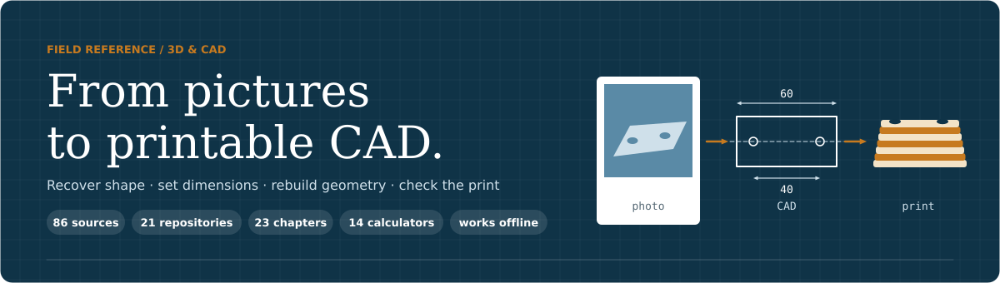
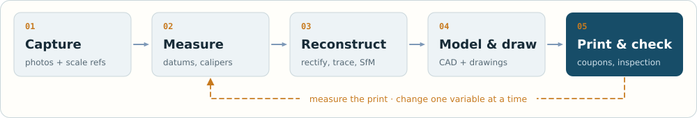
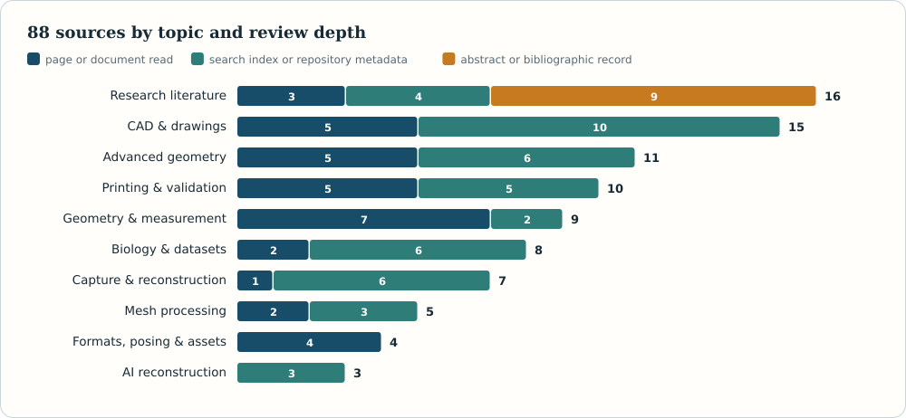
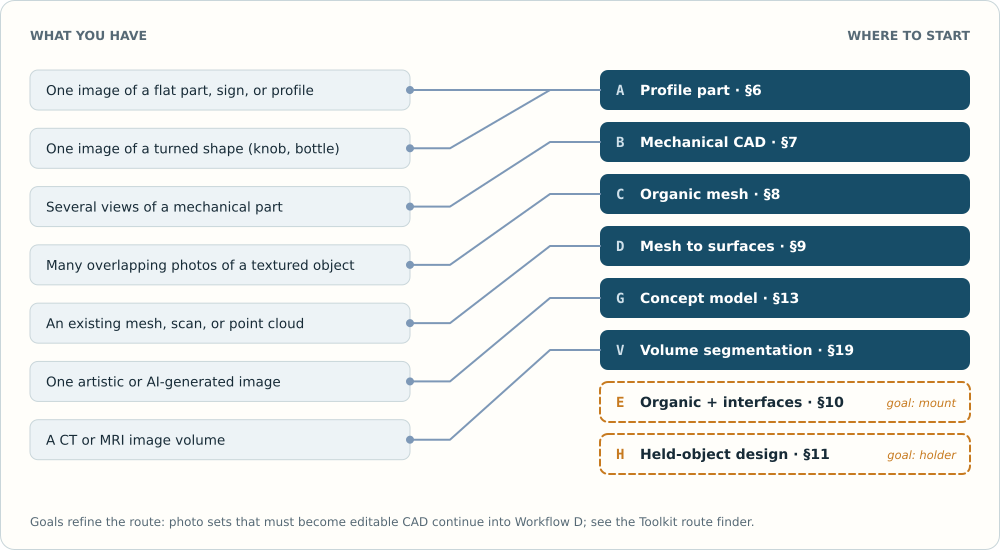
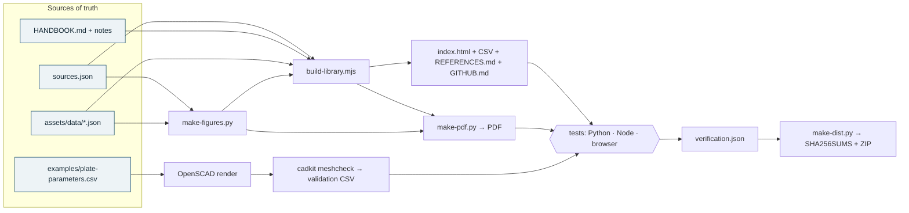

<p align="center">
  
</p>

<p align="center">
  
  
  
  
</p>

# Pictures to printable CAD: reference library

This folder is the reference companion to the [photo-to-CAD workbench](../README.md) in this repository. The workbench traces one flat part; the library covers the wider route from photographs to printable CAD.

When reading inside the repository, use the [documentation index](../docs/README.md)
for current workbench guides and [contribution guide](../docs/contributing.md) for
repository changes. This library's own revision, catalog snapshot, image limits,
browser storage and verification record remain separate. Its portable reader
works without a running workbench or those parent-repository guides.

For workbench developer research, see the
[source-cell acquisition model](../docs/finite-acquisition-mean.md) and its
[source-bound qualification](../docs/validation/finite-acquisition-mean.md).
The subsequent [unrounded area sensitivities](../docs/finite-cell-sensitivity.md)
and [saved-only archive](../studies/fixtures/finite-cell-sensitivity-v1/README.md)
are also workbench research APIs. Check the
[dated source snapshot](../docs/project-status.md) for branch inclusion.
Those APIs and synthetic results belong to the workbench, with no
change to this library's revision, calculators or generated handbook.

The [local acquisition-recovery snapshot](../docs/finite-acquisition-recovery.md)
records 4/12 matched target passes in the original experiment and 9/12 in a
separate continuation; both earlier full protocols failed. Its 459 focused tests bind
the research candidate, not main or this library. The
[original audit record](../docs/validation/finite-acquisition-recovery.md)
retains 14 unresolved comparisons where pre-cast area differences cannot be
reconstructed from rounded capture arrays. The
[current documentation review](../docs/validation/documentation-inward-margin.md)
connects the later results and both first projection-control outcomes. This
documentation does not add a fitter to main, the workbench or the Photos tab.

The later local [coupled search](../docs/finite-acquisition-coupled.md) and
[source-event strategy](../docs/finite-acquisition-events.md) each finish at
11/12 matched passes, with both full protocols failed. Their
[results](../docs/validation/finite-acquisition-continuations.md) and
[saved-only audits](../docs/finite-acquisition-saved-audit.md) retain first
failures and 28 historical precision unknowns. They do not refresh this
library's release verification or add a Photos tool.

The [protected-source-bin design](../docs/finite-acquisition-protected.md)
retains its eight failed first controls. The
[active-face follow-up](../docs/finite-acquisition-protected-active.md) preserves
its first expectation failure, passes a separately frozen selected 821 tests
and 33 subtests, then completes the original 24-case study at 11/12 matched
passes, exit 1. The later [saved-only physical-rounding diagnostic](../docs/finite-acquisition-physical-rounding.md)
accepts none of 128 adjacent physical candidates. These
[source-bound results](../docs/validation/finite-acquisition-physical-rounding.md)
add no library feature, release verification or physical acceptance.

A separately frozen [inward-margin follow-up](../docs/finite-acquisition-inward-margin.md)
passes 103 selected controls and all five gates for 128 new adjacent
corners. Its independent saved-only audit passes 8,030 checks. The earlier
0/128 result is preserved; actual PNG cost and recovery improvement remain
untested. See [the new evidence](../docs/validation/finite-acquisition-inward-margin.md).

A practical, source-backed library for turning photographs into printable CAD: recover shape, establish dimensions, rebuild editable geometry, and check the part you print. **Revision 7, November 9, 2026.**

It contains a 23-chapter handbook, 88 annotated sources (including 21 GitHub repository records), research notes, reusable worksheets, 10 explanatory figures, 14 calculators with a route finder, a local photo workspace, a Python command-line toolkit, and synthetic worked examples that are rendered and checked automatically.

## Start here

| If you want to… | Open |
| --- | --- |
| Read and search everything in a browser, offline | [`index.html`](index.html) |
| Read a printable copy | [the PDF handbook](output/pdf/pictures-to-printable-cad.pdf) |
| Find the right workflow and check the arithmetic | the **Toolkit** tab of `index.html`, or `python3 -m cadkit` |
| Collect reference photos, check view coverage, and estimate a flat dimension | the **Photos** tab of `index.html` |
| Design a measured plate or fit coupon and export to OpenSCAD | the **OpenSCAD** tab, or [OpenSCAD guide](OPENSCAD.md) |
| Edit the text | [`HANDBOOK.md`](HANDBOOK.md) and the [worksheets](templates/) |
| Rebuild, test, or package the library | [`BUILD.md`](BUILD.md) |

The easiest first project is a measured flat part. Import and scale a reference image, draw a constrained sketch, extrude it to the measured thickness, document the critical dimensions, and print an interface coupon before the full part.



## What is inside

| Material | Files | Notes |
| --- | --- | --- |
| Handbook | [`HANDBOOK.md`](HANDBOOK.md) | Governing decisions, capture, provenance, scale and single-view calibration, workflows A–E, held-object design, geometry, drawings, process selection, scripted pipelines, validation, troubleshooting, and a learning plan |
| Source directory | [`REFERENCES.md`](REFERENCES.md), [`sources.csv`](sources.csv), [`sources.json`](sources.json) | 88 annotated sources, each with a use, a limitation, and its depth of review. `sources.json` is the authoritative record |
| GitHub directory | [`GITHUB.md`](GITHUB.md) | 21 GitHub repository records: purpose, caution, and a metadata snapshot |
| Research notes | [`RESEARCH-NOTES.md`](RESEARCH-NOTES.md) | Search scope, evidence depth, exclusions, and a paper-evaluation worksheet |
| Worksheets | [`templates/`](templates/) | Project brief, capture checklist, print acceptance, independent dimension checks, and measurement, assumption, validation, and design-parameter registers |
| Toolkit | [`cadkit/`](cadkit/README.md), [`assets/js/cadcalc.js`](assets/js/cadcalc.js) | 14 calculators, a route finder, an STL checker, a parameter-register loader, and a project scaffolder |
| Photo workspace | [`assets/photo-workspace.html`](assets/photo-workspace.html), [`assets/js/photos.js`](assets/js/photos.js), [`assets/js/photo-workspace.js`](assets/js/photo-workspace.js) | Add photos in batches, label viewpoints, record notes, and estimate a flat feature from a known reference length; stored in this browser |
| Examples | [`examples/`](examples/README.md) | Synthetic plate driven by one parameter register and checked after an OpenSCAD render; a printable clearance coupon; reproducible calculations |
| Records | [`VERIFICATION.md`](VERIFICATION.md), [`CHANGELOG.md`](CHANGELOG.md), [`CONTRIBUTING.md`](CONTRIBUTING.md) | What was checked, what was not, and what changed |



## OpenSCAD parts

The **OpenSCAD** tab connects this reference workflow to editable mechanical geometry. Choose a two-hole mounting plate or a clearance coupon, adjust dimensions and evidence, inspect the live dimensional sketch, and download its OpenSCAD source, parameter CSV and SVG. The page works offline; the native renderer runs locally.

From this folder, `python3 -m cadkit openscad doctor` checks the installed executable. `python3 -m cadkit openscad build --model plate --output-dir output/plate-01 --preview` renders the synthetic defaults and checks the actual STL. Supply `--params plate-parameters.csv` to use a reviewed register. Each new output folder contains the source, STL, checks, hashes and optional preview. Earlier builds are preserved. Personal build directories are excluded from the portable library archive. See [the guide and rendered starter files](OPENSCAD.md). Physical fit and printing remain untested.

## The toolkit

In the browser, the **Toolkit** tab answers "which route fits my project?" and runs 14 calculators: planar scale, scale uncertainty, calibration self-check, homography fit, off-plane depth correction, camera distance, label rounding, circle tessellation, clearance coupons, coating allowance, spur gears, import-unit diagnosis, evidence-class propagation, and wind power. Each calculator links to its handbook section and warns about the conditions the handbook flags.

The same arithmetic runs from a terminal. From this folder:

```bash
python3 -m cadkit route --input photo-set --goal editable
```

```bash
python3 -m cadkit depth --z 500 --delta 60 --size 40
```

```bash
python3 -m cadkit meshcheck examples/output/two-hole-plate.stl --expect-mm 60
```

The last command checks the STL that `make plate` renders with OpenSCAD: extents, volume, closure, vertex manifoldness, orientation, and genus, which for a plate equals the number of through-holes. It works on any ASCII or binary STL, including the workbench's exports, and the [workbench tests](../tests/test_mesh_interop.py) run it on combined and split-part exports. The library's test suite checks that the browser and Python calculators return the same results and the same route recommendations.



## Your reference photos

Open **Photos** to add JPEG, PNG, or WebP images, either with the file picker or by dropping them onto the page. There is no photo-count cap: add more in later batches as needed, subject to available browser and device storage. Each image is limited to 50 MiB and 60 megapixels so a single large file cannot consume excessive decoding memory. Imports run one photo at a time and can be stopped after the current file.

Label each image's viewpoint and record notes about its features or uncertainties. Unsaved edits are shown explicitly; Close and Escape let you keep editing or discard them, and supported browsers warn before leaving an edited photo. The coverage summary reflects those labels; it does not evaluate whether the pictures are sharp, overlapping, or suitable for reconstruction. Search and viewpoint filters help find the reference you need as the collection grows.

For a front-on view of a flat surface, mark two endpoints on a known reference and two on the feature of interest, then enter the reference length in millimeters. You can select points on the image or enter full-size pixel coordinates. The resulting dimension is a scale estimate that assumes both lengths lie in the same plane. It does not correct perspective, recover hidden geometry, generate CAD, or establish 3D accuracy. Confirm critical dimensions with physical measurements and use the Toolkit to choose a reconstruction workflow.

Photos and their details are saved only in this browser's local storage; they are never uploaded. Clearing browser data, using another browser or origin, or losing the device can make the collection unavailable. Keep your original image files. **Export photo manifest** saves the notes and measurements, not the image files, and is not a backup of the photo library. **Download original** retrieves an individual stored photo. The feature needs a browser with IndexedDB and image decoding support; storage restrictions and private browsing can prevent saving.

The Photos tab is separate from the [workbench](../README.md)'s photo upload, which traces one flat part on its own backend. Photos saved here stay in this page's browser storage and are not shared with the workbench.

### Back up, restore, and hand off measurements

1. In **Photos**, choose **Back up photos to a folder**. The app creates a new subfolder with unchanged originals and a manifest of notes, views, and measurement points. It writes one image at a time and marks the backup complete only after every original is copied. Folder writing requires a supporting browser and your folder selection.
2. To recover the set on another browser or device, choose **Restore from a folder** and select the backup folder. The app checks image fingerprints and dimensions before saving. Existing matching photos keep their current notes and measurements; missing photos are added. An interrupted restore can be retried safely.
3. Choose **Export measurement CSV** for a register matching the project worksheet. Values stay labelled **image-derived**; unknown instrument readings, uncertainty, and acceptance criteria remain blank. The export does not modify CAD parameters.

If folder writing is unavailable, download the photo manifest and keep it in a folder with your originals. **Restore from a folder** accepts that set too, even if the originals have been renamed. A metadata manifest alone cannot recover images. Choose one backup at a time; manifest files are limited to 64 MiB, separately from the per-image limits. Incomplete backup folders are retained for inspection and are never presented as complete backups.

## How the pieces fit together

Every count, chart, and worked number is derived from one source of truth, and the tests fail when a generated file or a document drifts from it.



## Folder layout

```text
reference-library/
├── index.html                 offline library (generated)
├── README.md, CHANGELOG.md, CONTRIBUTING.md, BUILD.md, VERIFICATION.md
├── HANDBOOK.md, RESEARCH-NOTES.md
├── sources.json               authoritative catalog → sources.csv, REFERENCES.md, GITHUB.md
├── library.json               revision, date, archive name
├── assets/                    photo/cad workspaces, css, js, shared model data, figures (SVG)
├── cadkit/                    Python toolkit: python3 -m cadkit
├── examples/                  synthetic plate, clearance coupon, rendered OpenSCAD starters, calculations
├── templates/                 worksheets and registers
├── scripts/                   build, figures, PDF, checks, link check, GitHub refresh, dist
├── tests/                     python/ (unittest) and node/ (node --test)
└── output/pdf/                the PDF handbook (generated)
```

## Build and test

Reading needs nothing but a browser. Before rebuilding or testing, follow the
[dependency and environment setup](BUILD.md#requirements), including the Python
and Node packages and the browser/font prerequisites for the steps you need.
The parent repository's `make setup-library` prepares this library's separate
environment; a standalone copy has its own setup instructions in that guide.
With that environment active, run from this folder:

```bash
make test
```

```bash
make release
```

`make release` rebuilds the calculations, figures, HTML, and PDF, renders the OpenSCAD plate, and runs the Python, Node, and browser tests. It then records [`verification.json`](verification.json) and writes a checksum manifest and ZIP archive to `dist/`. [`BUILD.md`](BUILD.md) lists the dependencies, every target, and the environment variables. The GitHub Actions workflow `reference-library.yml` runs the tests and the browser check on every change to this folder. It also fails when a generated file is out of date.

## What this library does and does not establish

The handbook combines official documentation, research leads, and original engineering synthesis. Every catalog entry records how deeply it was reviewed, and recent research is labeled by review depth. The worked examples are synthetic and are reproduced by code. OpenSCAD renders of the two example parts are checked for extents, closure, orientation, connectivity, and minimum walls.

No real photographs were reconstructed. No part was sliced or printed, and no printer, material, or reconstruction package was qualified or benchmarked. Repository metadata is a snapshot, not a quality score. Read [`VERIFICATION.md`](VERIFICATION.md) before relying on any result.

## Revision history

See [`CHANGELOG.md`](CHANGELOG.md). Revision 7 adds the OpenSCAD workspace, shared mechanical parameters, traceable local builds and safe render replacement. Revision 6 improves search, protects photo drafts, extends mesh checks, and adds independent validation worksheets and sources. Revision 5 adds portable folder backup and restore plus an image-derived measurement CSV. Revision 4 adds a local photo workspace with repeatable multi-photo intake, viewpoint coverage, and traceable image measurements. Revision 3, the first revision kept in this repository, added the figures, toolkit, Python package, example pipeline, automated tests, a reproducible PDF and archive, and a refreshed metadata snapshot. Revision 2 added governing decisions, single-view calibration checks, Workflow E, held-object design, and seven sources. Revision 1 was the initial library with 79 resources.
